<a id="index"></a>

# JAVA from Basics to Advanced — Study Notes (YouTube links only)

Notes for Concept && Coding (Shrayansh)'s Java playlist, in teaching order.

**External links:** YouTube only. **In this file:** index / part / lecture jump links below.

Playlist: https://www.youtube.com/playlist?list=PL6W8uoQQ2c63f469AyV78np0rbxRFppkx

Lectures covered: **52**

<a id="parts"></a>

## Parts (quick jump)

| Part | Lectures | Jump |
|------|----------|------|
| **A** | 01–07 | [Part A — Roadmap, OOPs & Java Fundamentals](#part-a) |
| **B** | 08–14 | [Part B — Methods, Constructors, Memory & Classes](#part-b) |
| **C** | 15–19 | [Part C — Interfaces, Lambdas, Reflection & Annotations](#part-c) |
| **D** | 20–22 | [Part D — Exceptions, Operators & Control Flow](#part-d) |
| **E** | 23–29 | [Part E — Collections Framework & Streams](#part-e) |
| **F** | 30–39 | [Part F — Multithreading & Concurrency](#part-f) |
| **G** | 40–47 | [Part G — Lombok & Modern Java (14–21)](#part-g) |
| **H** | 48–52 | [Part H — Optionals, File I/O & NIO](#part-h) |

## Full index

### [Part A — Roadmap, OOPs & Java Fundamentals](#part-a)

1. [Ultimate Java Basics to Advanced Roadmap | Java Course Roadmap for Beginners | Java learning Roadmap](#lec-01) · [▶ Watch](https://www.youtube.com/watch?v=GeG895R5EtU)
2. [1. OOPs Concept in Java with Examples | 4 Pillars of Object Oriented Programming (OOPs)](#lec-02) · [▶ Watch](https://www.youtube.com/watch?v=MIYbPZCk34k)
3. [2. How Java Program Works and its 3 Important Components (JVM, JRE and JDK) with Example](#lec-03) · [▶ Watch](https://www.youtube.com/watch?v=IoireaKRRFo)
4. [3. Quiz Question: Why only 1 Public Class in JAVA file](#lec-04) · [▶ Watch](https://www.youtube.com/watch?v=ijEJJuIQdzY)
5. [4. Java Variables - Part1 | Primitive Data Types in Depth](#lec-05) · [▶ Watch](https://www.youtube.com/watch?v=Q6_jrvz-R7w)
6. [5. How FLOAT and DOUBLE Number Stored in Memory? | IEEE 754 Representation](#lec-06) · [▶ Watch](https://www.youtube.com/watch?v=NZ3qAfM8Ztw)
7. [6. Java Variables - Part2 | Reference/Non-Primitive Data Types in Depth](#lec-07) · [▶ Watch](https://www.youtube.com/watch?v=1Ox0fyJuUVY)

### [Part B — Methods, Constructors, Memory & Classes](#part-b)

8. [7. Java Methods in Depth | Different Types of Methods with Examples](#lec-08) · [▶ Watch](https://www.youtube.com/watch?v=Lqan4AF9wzA)
9. [8. Java Constructor in Depth | Different Types of Constructor with Examples](#lec-09) · [▶ Watch](https://www.youtube.com/watch?v=_hHtmSt5dSg)
10. [9. Java Memory Management and Garbage Collection in Depth](#lec-10) · [▶ Watch](https://www.youtube.com/watch?v=vz6vSZRuS2M)
11. [10. Java Classes in Depth - Part1 | Nested Class, Concrete, Abstract, Object, Super and Sub Class](#lec-11) · [▶ Watch](https://www.youtube.com/watch?v=aecJeZgl__4)
12. [11. Java Generic Classes | Java Classes in Depth - Part2](#lec-12) · [▶ Watch](https://www.youtube.com/watch?v=NCx_ABybp2o)
13. [12. Java Enum, POJO and Final Classes Explained with Examples | Java Classes in Depth - Part3](#lec-13) · [▶ Watch](https://www.youtube.com/watch?v=zNCtAAqxjT0)
14. [13. Java Singleton and Immutable Class Explained with Examples | Java Classes in Depth - Part4](#lec-14) · [▶ Watch](https://www.youtube.com/watch?v=SqDbZOjW1uM)

### [Part C — Interfaces, Lambdas, Reflection & Annotations](#part-c)

15. [14. Java Interface in Depth - Part1](#lec-15) · [▶ Watch](https://www.youtube.com/watch?v=aj3SLuDkGWg)
16. [15. Default, Static & Private Method in Interface - Java8 and Java9 features | Java Interfaces Part2](#lec-16) · [▶ Watch](https://www.youtube.com/watch?v=ZFPajbsXIwM)
17. [16. Functional Interface and Lambda Expression - Java8 features | Java Interfaces Part3](#lec-17) · [▶ Watch](https://www.youtube.com/watch?v=YXRBBOjgrFU)
18. [17. Java Reflection in Depth (Using Examples)](#lec-18) · [▶ Watch](https://www.youtube.com/watch?v=P4UAoYiaHg4)
19. [18. Java Annotations with Examples](#lec-19) · [▶ Watch](https://www.youtube.com/watch?v=H5WYze-FL50)

### [Part D — Exceptions, Operators & Control Flow](#part-d)

20. [19. Exception Handling in Java with Examples](#lec-20) · [▶ Watch](https://www.youtube.com/watch?v=tw4wWCsGNe4)
21. [20. Operators in Java | Different Types of Operators in JAVA](#lec-21) · [▶ Watch](https://www.youtube.com/watch?v=ZsyUkt0v-ko)
22. [21. Control Flow Statements in Java | Decision Making, Looping and Branching Statements](#lec-22) · [▶ Watch](https://www.youtube.com/watch?v=Z2B5CYMEWfc)

### [Part E — Collections Framework & Streams](#part-e)

23. [22. Collections in Java - Part1 | Java Collections Framework in depth](#lec-23) · [▶ Watch](https://www.youtube.com/watch?v=TT1-qsuHMXs)
24. [23. Collections in Java - Part2 | Comparator Vs Comparable | PriorityQueue](#lec-24) · [▶ Watch](https://www.youtube.com/watch?v=vVfZIWMEzMM)
25. [24. Collections in Java - Part3 | Deque and List in Depth](#lec-25) · [▶ Watch](https://www.youtube.com/watch?v=0P6ToH8mi14)
26. [25. Collections in Java - Part4 | HashMap Internal Working in Java](#lec-26) · [▶ Watch](https://www.youtube.com/watch?v=VjYRxcbmEso)
27. [Collections in Java - Part5 | LinkedHashMap and TreeMap in depth](#lec-27) · [▶ Watch](https://www.youtube.com/watch?v=SDsUL7VFyvg)
28. [Collections in Java - Part6 | SET](#lec-28) · [▶ Watch](https://www.youtube.com/watch?v=gikFgvzFuwo)
29. [Streams in Java8 | Collections in Java - Part7](#lec-29) · [▶ Watch](https://www.youtube.com/watch?v=nEno48RpDR4)

### [Part F — Multithreading & Concurrency](#part-f)

30. [Multithreading and Concurrency in Java: Part1 | Threads, Process and their Memory Model in depth](#lec-30) · [▶ Watch](https://www.youtube.com/watch?v=TpYIcJN9EV8)
31. [Thread Creation, Thread Lifecycle and Inter-Thread Communication | Multithreading in Java: Part2](#lec-31) · [▶ Watch](https://www.youtube.com/watch?v=AYiE7_loIsE)
32. [Thread Joining, Daemon Thread, Thread Priority | Multithreading in Java: Part3](#lec-32) · [▶ Watch](https://www.youtube.com/watch?v=cdsFwGDVzpg)
33. [Locks and Condition | Java Multithreading Part4 | Reentrant, ReadWrite, Stamped & Semaphore Lock](#lec-33) · [▶ Watch](https://www.youtube.com/watch?v=DPob5NLzKFI)
34. [33. Lock-Free Concurrency | Compare-and-Swap | Atomic & Volatile Variables | Multithreading Part5](#lec-34) · [▶ Watch](https://www.youtube.com/watch?v=JGb4qNEBW6Q)
35. [34. Thread Pools in Java | ThreadPoolExecutor Framework | Multithreading Part6](#lec-35) · [▶ Watch](https://www.youtube.com/watch?v=ZUWs2U71vvk)
36. [35. Java8 CompletableFuture | Future and Callable in Java | Multithreading in Java - Part7](#lec-36) · [▶ Watch](https://www.youtube.com/watch?v=SFwCiYwr3yQ)
37. [36. Java ForkJoinPool || WorkStealingPool || FixedThreadPool || CachedThreadPool || SingleThreadPool](#lec-37) · [▶ Watch](https://www.youtube.com/watch?v=VlfVyz-QG60)
38. [37. Java ScheduledThreadPoolExecutor || Shutdown Vs AwaitTermination || Multithreading in Java](#lec-38) · [▶ Watch](https://www.youtube.com/watch?v=PR1YkZWAH1E)
39. [38. Java VirtualThreads vs Normal Threads || ThreadLocal in Java](#lec-39) · [▶ Watch](https://www.youtube.com/watch?v=pXVEEfYMwws)

### [Part G — Lombok & Modern Java (14–21)](#part-g)

40. [39. Project Lombok in Java in depth | Lombok top 10 features](#lec-40) · [▶ Watch](https://www.youtube.com/watch?v=fGqb6cmA22A)
41. [Java 21 : SequencedCollection, SequencedSet and SequencedMap](#lec-41) · [▶ Watch](https://www.youtube.com/watch?v=xYky-RDlnpY)
42. [Java 17 : Sealed Classes and Interfaces](#lec-42) · [▶ Watch](https://www.youtube.com/watch?v=BgBDbc8F4A8)
43. [Java 14: Switch Expressions Deep Dive](#lec-43) · [▶ Watch](https://www.youtube.com/watch?v=blb1guXuVxA)
44. [Java 16: Pattern Matching for instanceof](#lec-44) · [▶ Watch](https://www.youtube.com/watch?v=KmX4uHi-KY0)
45. [Java 21: Pattern Matching for switch](#lec-45) · [▶ Watch](https://www.youtube.com/watch?v=IwoidRDGEb8)
46. [Java 16: Record class](#lec-46) · [▶ Watch](https://www.youtube.com/watch?v=w7ZyscLnaM4)
47. [Java 15: Text Blocks](#lec-47) · [▶ Watch](https://www.youtube.com/watch?v=z04mr_i2SO8)

### [Part H — Optionals, File I/O & NIO](#part-h)

48. [Master Java Optional from Java 8 to 11 | All Methods with Real Examples](#lec-48) · [▶ Watch](https://www.youtube.com/watch?v=4ZxIOwi4r_g)
49. [Java File Handling Explained | Streams, Buffers, Readers & Writers](#lec-49) · [▶ Watch](https://www.youtube.com/watch?v=e_S2yJKpTaw)
50. [Java NIO Deep Dive (Part-1): Advantages of NIO over Traditional File I/O](#lec-50) · [▶ Watch](https://www.youtube.com/watch?v=pqEqj58bnxc)
51. [Java NIO Deep Dive (Part2): ByteBuffer, HeapByteBuffer, DirectByteBuffer, MappedByteBuffer](#lec-51) · [▶ Watch](https://www.youtube.com/watch?v=wZ3b--utf1s)
52. [Java NIO Deep Dive (Part3): FileChannel and Complete Code Examples](#lec-52) · [▶ Watch](https://www.youtube.com/watch?v=vocQoMkHJ78)

---
<a id="part-a"></a>

# Part A — Roadmap, OOPs & Java Fundamentals

[↑ Index](#index) · [Parts](#parts)

---

<a id="lec-01"></a>

## 01. Ultimate Java Basics to Advanced Roadmap | Java Course Roadmap for Beginners | Java learning Roadmap


[↑ Index](#index) · [Parts](#parts)


> **Video:** [Ultimate Java Basics to Advanced Roadmap | Java Course Roadmap for Beginners | Java learning Roadmap](https://www.youtube.com/watch?v=GeG895R5EtU)

### What this lecture covers
- Why this Java playlist exists (path to Spring Boot + microservices)
- How to access the member-only playlist (channel Join / membership)
- Full topic roadmap from OOPs → unit testing (Mockito)
- Expected upload cadence (1–2 Java videos per week)
- What comes after Java (Spring Boot with microservices)

### Goal of the series `[0:00](https://www.youtube.com/watch?v=GeG895R5EtU&t=0s)`
- End goal of Concept && Coding’s learning path: **Spring Boot with microservices**.
- Java is the prerequisite — if you want Spring Boot but don’t know Java, start here.
- Plan: finish **Java Basics → Advanced**, then move to Spring Boot.

### How to open / avail the playlist `[0:32](https://www.youtube.com/watch?v=GeG895R5EtU&t=32s)`
- On the YouTube channel, use the **Join** button.
- Membership tier mentioned: **Java Basics to Advanced** (~₹159/month at the time of recording).
- Membership keeps a dedicated learner group so he can answer doubts quickly.

### Roadmap topics he plans to cover `[1:03](https://www.youtube.com/watch?v=GeG895R5EtU&t=63s)`

He walks a slide of topics with estimated video counts. In order:

| Area | What he says he’ll cover | Rough estimate he gave |
|------|--------------------------|------------------------|
| **OOPs fundamentals (Java perspective)** | Classes, objects, four pillars, examples | ~1 topic / ~2 hours |
| **Java overview** | JDK, JRE, JVM; what makes Java platform-independent; installation | Try to fit in ~1 video |
| **One level deeper (core language)** | Abstract classes / related class types, variable kinds, access specifiers, typecasting, many Java terminologies | Multiple videos |
| **Also in “deeper” bucket** | Garbage collection, constructors, file reading, etc. | — |
| **Memory management** | How memory works in Java (stack and related concepts) | Called out as very important |
| **Operators** | Different operators | — |
| **Control flow** | Decision / looping / branching style statements | — |
| **Multithreading & concurrency** | Different ways to achieve multithreading | — |
| **Exception handling** | — | — |
| **Generic programming** | Generics in Java | Important |
| **Collections** | All commonly used collections | Important |
| **Java 8 features** | Lambdas, Stream API, predicates, functional interfaces | Very important for interviews; less critical *only* for Spring Boot, but still included |
| **Unit testing** | With **Mockito** — how to unit-test the Java code you write | Last major block |

### Unit testing (preview) `[3:04](https://www.youtube.com/watch?v=GeG895R5EtU&t=184s)`
- Unit testing = testing a **single method** against **predefined inputs/expected outputs**.
- Example framing: if you pass values `1, 2, 3`, you should get a known expected result.
- Full depth comes later in the playlist (Mockito).

### Cadence & what’s next `[3:35](https://www.youtube.com/watch?v=GeG895R5EtU&t=215s)`
- Expectation: **at least 1, at most 2** Java videos per week.
- After this Java series: **Spring Boot with microservices** playlist.
- Membership reminder again (Join → member level) so doubts can be answered promptly `[4:05](https://www.youtube.com/watch?v=GeG895R5EtU&t=245s)`.

### Interview questions / gotchas he highlights
- This video is a **roadmap**, not concept teaching — no interview Qs yet.
- Implicit tip: treat **Java 8 (lambda / streams / functional interfaces)** and **collections / multithreading / memory** as interview-heavy areas he deliberately included.

### Quick revision
- Series goal: Java first → Spring Boot + microservices.
- Access: channel **Join** (member playlist; price mentioned as ₹159/month then).
- Start: OOPs → JDK/JRE/JVM overview → deeper language topics.
- Core pillars ahead: memory, operators, control flow, multithreading, exceptions, generics, collections.
- Java 8 features included mainly because interviews ask them.
- Finish Java block with unit testing via Mockito.
- Upload pace: ~1–2 Java videos/week.
- No PDF/slides for this lecture.


---

<a id="lec-02"></a>

## 02. 1. OOPs Concept in Java with Examples | 4 Pillars of Object Oriented Programming (OOPs)


[↑ Index](#index) · [Parts](#parts)


> **Video:** [1. OOPs Concept in Java with Examples | 4 Pillars of Object Oriented Programming (OOPs)](https://www.youtube.com/watch?v=MIYbPZCk34k)

### What this lecture covers
- OOPs overview (Java perspective) vs procedural programming
- Objects & classes (properties/state + behavior/methods)
- Four pillars: **abstraction**, **encapsulation**, **inheritance**, **polymorphism**
- Access modifiers glimpse (`private` / `public`) in encapsulation demos
- Inheritance types + **diamond problem**
- Method overloading vs overriding
- **IS-A** vs **HAS-A**; aggregation vs composition

---

### Agenda & why this matters `[0:00](https://www.youtube.com/watch?v=MIYbPZCk34k&t=0s)`
- Fundamentals from a **Java** perspective (syntax differs from Python etc., even if ideas overlap).
- Agenda: OOPs overview → objects & classes → four pillars → relationships (IS-A / HAS-A).
- Pillars + relationships are both learning basics and **interview favorites**.
- Also the foundation for **low-level design** thinking `[0:31](https://www.youtube.com/watch?v=MIYbPZCk34k&t=31s)`.

### OOPs overview `[1:02](https://www.youtube.com/watch?v=MIYbPZCk34k&t=62s)`
- **OOPs** = Object Oriented Programming — everything revolves around **objects**.
- Industry framing: given a project, identify the **objects** in the domain `[1:32](https://www.youtube.com/watch?v=MIYbPZCk34k&t=92s)`.
- An **object** = a **real-world entity** (car, bike, ATM, …) `[2:02](https://www.youtube.com/watch?v=MIYbPZCk34k&t=122s)`.
- Every such entity has two aspects `[2:32](https://www.youtube.com/watch?v=MIYbPZCk34k&t=152s)`:
  1. **Properties / state**
  2. **Behavior / functionality** (methods)

---

### Procedural vs OOPs `[3:03](https://www.youtube.com/watch?v=MIYbPZCk34k&t=183s)`

He contrasts C-style **procedural** programming with OOPs:

| | **Procedural** | **OOPs** |
|--|----------------|----------|
| Structure | Program split into **functions** | Program split into **objects** |
| Focus | Importance to **functions** | Importance to **data** |
| Data | Moves freely function → function; hard to hide | **Data hiding**; data + methods bound together |
| Coupling | **Tightly coupled** (anyone can mutate shared data) | Control via the owning class / object |
| Overloading | Not really in classic procedural model | Possible |
| Inheritance | Not in the same way | Possible |
| Reusability | Weak | Present |
| Examples | Pascal, C, FORTRAN | Java, C#, Python, C++ |

Procedural picture `[3:35](https://www.youtube.com/watch?v=MIYbPZCk34k&t=215s)`: Task → Function1 → Function2 → pass data around. No clean ownership of data `[4:05](https://www.youtube.com/watch?v=MIYbPZCk34k&t=245s)`.

OOPs picture `[5:35](https://www.youtube.com/watch?v=MIYbPZCk34k&t=335s)`: bind functions **with** the data they operate on; expose accessors so the class controls mutation `[6:06](https://www.youtube.com/watch?v=MIYbPZCk34k&t=366s)`.

---

### Objects & classes `[6:37](https://www.youtube.com/watch?v=MIYbPZCk34k&t=397s)`

#### Object = real-world entity with state + behavior `[7:08](https://www.youtube.com/watch?v=MIYbPZCk34k&t=428s)`

**Dog as object**
- Properties / state (observable): age, colour, breed, …
- Behavior: bark, sleep, eat, …

**Car as object** `[8:39](https://www.youtube.com/watch?v=MIYbPZCk34k&t=519s)`
- Properties: colour, type, brand, weight, …
- Behavior: apply brake, drive, increase speed, …

Rule of thumb: if you can describe **state by observing** and **actions it performs**, you can model it as an object `[9:10](https://www.youtube.com/watch?v=MIYbPZCk34k&t=550s)`.

#### Class = blueprint / skeleton / template `[9:40](https://www.youtube.com/watch?v=MIYbPZCk34k&t=580s)`
- You write properties + behavior **in the class**.
- Objects are **created from** the class (`new`).
- One class → **many** objects `[10:10](https://www.youtube.com/watch?v=MIYbPZCk34k&t=610s)`.
- Keyword: `class`.

#### Demo: `Student` class `[11:12](https://www.youtube.com/watch?v=MIYbPZCk34k&t=672s)`

```java
class Student {
    // data variables (properties / state)
    int age;
    String name;
    String address;

    // data methods (behavior)
    void updateAddress(/* ... */) { /* modify address */ }

    int getAge() {
        return age;
    }
}
```

- Properties → **data variables** / fields `[12:13](https://www.youtube.com/watch?v=MIYbPZCk34k&t=733s)`
- Functions → **data methods** that work on those fields (getters/setters, `updateAddress`, …) `[12:44](https://www.youtube.com/watch?v=MIYbPZCk34k&t=764s)`

#### Creating objects `[14:17](https://www.youtube.com/watch?v=MIYbPZCk34k&t=857s)`

```java
Student engStu = new Student();
Student mbaStu = new Student();
Student caStu  = new Student();
```

- `new` creates a new instance `[14:47](https://www.youtube.com/watch?v=MIYbPZCk34k&t=887s)`.
- Each object has **its own copy** of fields (engStu age 23 / XYZ address; mbaStu age 25 / ABC address) but the **same method shapes** `[15:50](https://www.youtube.com/watch?v=MIYbPZCk34k&t=950s)`.

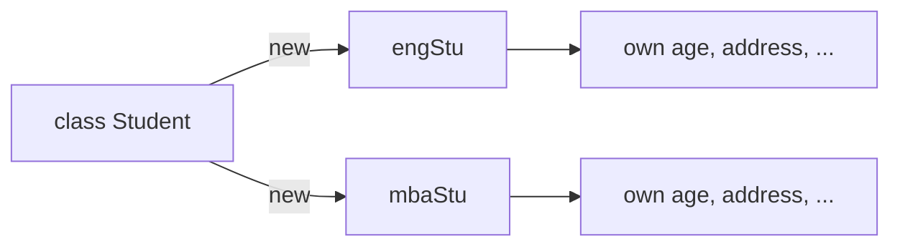

---

### Interview framing for the four pillars `[18:28](https://www.youtube.com/watch?v=MIYbPZCk34k&t=1108s)`
Common ask: *“Explain OOPs fundamentals as if to a 14-year-old.”*
- Prefer **real-world examples**, avoid jargon-only answers.

---

### Pillar 1 — Abstraction `[19:29](https://www.youtube.com/watch?v=MIYbPZCk34k&t=1169s)`

**Definition:** hide internal implementation; show only **essential** functionality to the user `[19:59](https://www.youtube.com/watch?v=MIYbPZCk34k&t=1199s)`.

**Car brake:** press pedal → speed reduces. How hydraulics/ABS work is abstracted `[19:29](https://www.youtube.com/watch?v=MIYbPZCk34k&t=1169s)`.

**Cell phone call:** dial + green button → call connects. Network/routing details abstracted `[20:30](https://www.youtube.com/watch?v=MIYbPZCk34k&t=1230s)`.

**How in Java (preview):** interfaces and abstract classes `[21:01](https://www.youtube.com/watch?v=MIYbPZCk34k&t=1261s)` (depth later).

**Advantages he stresses:** **security / confidentiality** (and simpler client code) `[21:31](https://www.youtube.com/watch?v=MIYbPZCk34k&t=1291s)`.

#### Demo sketch `[22:02](https://www.youtube.com/watch?v=MIYbPZCk34k&t=1322s)`

```java
interface Car {
    void applyBrake();
    void incSpeed();
    void handBrake();
}

class CarImpl implements Car {
    public void applyBrake() {
        // Step 1
        // Step 2
        // Step 3 ...
        // ultimately speed reduces — hidden from caller
    }
}
```

User only calls `applyBrake()` / accelerator / horn / headlights; steps 1…N stay hidden `[24:04](https://www.youtube.com/watch?v=MIYbPZCk34k&t=1444s)`.

#### Live Q&A on “why hide?” `[25:35](https://www.youtube.com/watch?v=MIYbPZCk34k&t=1535s)`
Reasons he and the student land on:
1. **Confidentiality** — only expose the 3 features the user should have `[26:06](https://www.youtube.com/watch?v=MIYbPZCk34k&t=1566s)`.
2. Avoid **bombarding** clients with 10 internal steps `[29:41](https://www.youtube.com/watch?v=MIYbPZCk34k&t=1781s)`.
3. Clients can’t **mess with** internal steps `[30:44](https://www.youtube.com/watch?v=MIYbPZCk34k&t=1844s)`.
4. Client code stays: **input → expected output**; “how” is not their job `[31:14](https://www.youtube.com/watch?v=MIYbPZCk34k&t=1874s)`.

---

### Pillar 2 — Encapsulation (data hiding) `[31:44](https://www.youtube.com/watch?v=MIYbPZCk34k&t=1904s)`

**Definition:** bundle **data** and the **code that works on that data** into a **single unit** (the class) `[32:14](https://www.youtube.com/watch?v=MIYbPZCk34k&t=1934s)`. Also called **data hiding**.

**Steps (from slides / talk):**
1. Declare fields `private`
2. Provide public getters/setters to view/modify

**Advantages:** loosely coupled code; better access control & security.

#### Demo: `Dog` `[33:45](https://www.youtube.com/watch?v=MIYbPZCk34k&t=2025s)`

```java
class Dog {
    private String colour;           // data member

    String getColour() {             // often public getter
        return this.colour;
    }

    void setColour(String colour) {  // setter
        this.colour = colour;
    }
}

Dog lab = new Dog();
lab.setColour("black");
lab.getColour(); // "black"
```

Class owns `colour`; outsiders go through methods `[36:49](https://www.youtube.com/watch?v=MIYbPZCk34k&t=2209s)`. Contrast with procedural free-floating data `[38:20](https://www.youtube.com/watch?v=MIYbPZCk34k&t=2300s)`.

**Loose coupling:** Class1 and Class2 should not both mutate the same shared blob; each class owns its related fields `[39:22](https://www.youtube.com/watch?v=MIYbPZCk34k&t=2362s)`.

#### Student doubt: “Is reading via getter against encapsulation?” `[40:56](https://www.youtube.com/watch?v=MIYbPZCk34k&t=2456s)`
- **Getting information is OK** — programs share data.
- Encapsulation is about **who owns** the field and **how** others access it.
- `Cat` may need dog colour to do work, but **must not take ownership** of dog fields `[44:05](https://www.youtube.com/watch?v=MIYbPZCk34k&t=2645s)`.
- Only `Dog` maintains dog state; others call `getColour` / setters.

#### Access specifiers glimpse `[45:38](https://www.youtube.com/watch?v=MIYbPZCk34k&t=2738s)`
Four: `private`, `public`, `protected`, default (package). Depth later.

Control examples `[48:16](https://www.youtube.com/watch?v=MIYbPZCk34k&t=2896s)`:
- Field `private`, getter `public` → other classes cannot use `rottweiler.colour`, only `rottweiler.getColour()`.
- Both `public` → direct field access allowed (weaker control).
- Both `private` → outside classes cannot access either; some same-class method must expose what’s needed `[50:49](https://www.youtube.com/watch?v=MIYbPZCk34k&t=3049s)`.

**14-year-old analogy:** medicine **capsule** — data inside, outer shell protects; access modifiers = how the shell opens `[52:21](https://www.youtube.com/watch?v=MIYbPZCk34k&t=3141s)`.

---

### Pillar 3 — Inheritance `[53:21](https://www.youtube.com/watch?v=MIYbPZCk34k&t=3201s)`

**Definition:** capability of a class to inherit properties (fields + methods) from a **parent** class `[53:52](https://www.youtube.com/watch?v=MIYbPZCk34k&t=3232s)`.

- Child gets parent members **without rewriting** them.
- Child can add its own members.
- **Child → parent members: yes.** **Parent → child-only members: no** `[54:53](https://www.youtube.com/watch?v=MIYbPZCk34k&t=3293s)`.
- Achieved with `extends` (classes) or via interfaces (`implements`) `[56:55](https://www.youtube.com/watch?v=MIYbPZCk34k&t=3415s)`.

#### Demo: `Vehicle` → `Car` `[55:24](https://www.youtube.com/watch?v=MIYbPZCk34k&t=3324s)`

```java
class Vehicle {
    boolean engine;
    boolean getEngine() {
        return this.engine;
    }
}

class Car extends Vehicle {
    String type; // hatchback / SUV / sedan, etc.
    String getCarType() {
        return this.type;
    }
}

Car swift = new Car();
swift.getEngine();   // OK — inherited from Vehicle

Vehicle v = new Vehicle();
v.getCarType();      // NOT OK — parent doesn't get child members
```

#### Types of inheritance `[60:31](https://www.youtube.com/watch?v=MIYbPZCk34k&t=3631s)`

```text
Single:        A
               │
               B

Multilevel:    A
               │
               B
               │
               C

Hierarchical:      A
                 /   \
                B     C

Multiple:      A     B
                \   /
                  C     ← NOT supported for classes in Java (diamond)
```

#### Diamond problem `[63:14](https://www.youtube.com/watch?v=MIYbPZCk34k&t=3794s)`

If `C extends A, B` were allowed and both `A` and `B` define `getEngine()`:

```java
C obj = new C();
obj.getEngine(); // call A's or B's? Ambiguous
```

Java **disallows** multiple class inheritance for this reason `[65:45](https://www.youtube.com/watch?v=MIYbPZCk34k&t=3945s)`.

**Workaround via interfaces** `[66:15](https://www.youtube.com/watch?v=MIYbPZCk34k&t=3975s)`:
- Interfaces historically declare methods without (full) implementation.
- Implementing class **must** provide one implementation → ambiguity resolved `[68:49](https://www.youtube.com/watch?v=MIYbPZCk34k&t=4129s)`.
- Deep dive deferred to interface videos + method overriding.

> **Note:** Since Java 8, interfaces can have `default`/`static` methods; diamond rules for defaults exist (`Class` wins, else must override). His teaching point (class multiple inheritance banned; interfaces help) remains the interview core.

#### Advantages of inheritance `[70:23](https://www.youtube.com/watch?v=MIYbPZCk34k&t=4223s)`
1. **Code reusability**
2. Enables **polymorphism** (overriding) via inheritance

---

### Pillar 4 — Polymorphism `[71:26](https://www.youtube.com/watch?v=MIYbPZCk34k&t=4286s)`

- **Poly** = many, **morphism** = forms.
- Same method / concept behaves differently in different situations `[71:56](https://www.youtube.com/watch?v=MIYbPZCk34k&t=4316s)`.
- Everyday analogies: a person as father / husband / employee; water as liquid / solid / gas.

#### Two types (highly interview-asked) `[72:27](https://www.youtube.com/watch?v=MIYbPZCk34k&t=4347s)`

| Name variants | Mechanism |
|---------------|-----------|
| Compile-time / Static polymorphism / **Method overloading** | Same class, same name, **different parameters** |
| Runtime / Dynamic polymorphism / **Method overriding** | Parent–child, same signature, **different implementation** |

#### Overloading demo `[72:57](https://www.youtube.com/watch?v=MIYbPZCk34k&t=4377s)`

```java
class Sum {
    int doSum(int a, int b) {
        return a + b;
    }
    int doSum(int a, int b, int c) {
        return a + b + c;
    }
    // also OK: different parameter types, e.g. doSum(String, String)
}

Sum calc = new Sum();
calc.doSum(5, 2);        // binds to 2-arg version
calc.doSum(3, 4, 2);     // binds to 3-arg version
```

Binding decided at **compile time** from the argument list `[75:33](https://www.youtube.com/watch?v=MIYbPZCk34k&t=4533s)`.

**Not overloading:** only renaming parameters (`x,y` vs `a,b`) with same types `[76:34](https://www.youtube.com/watch?v=MIYbPZCk34k&t=4594s)`.

**Not overloading:** same parameters, only **return type** differs `[77:06](https://www.youtube.com/watch?v=MIYbPZCk34k&t=4626s)`:

```java
int doSum(int x, int y) { ... }
String doSum(int x, int y) { ... } // ILLEGAL — not valid overloading
```

Why: call `calc.doSum(5,2)` may ignore the return; compiler can’t choose by return type alone `[78:38](https://www.youtube.com/watch?v=MIYbPZCk34k&t=4718s)`.

#### Overriding demo `[80:09](https://www.youtube.com/watch?v=MIYbPZCk34k&t=4809s)`

```java
class A {
    int getEngine() { return 1; }
}
class B extends A {
    int getEngine() { return 2; } // override — same signature
}

B obj = new B();
obj.getEngine(); // 2 — decided at runtime by actual object type
```

Rules he stresses `[81:12](https://www.youtube.com/watch?v=MIYbPZCk34k&t=4872s)`:
- Method name, arguments, return type — **same**
- Only **implementation** differs
- Which body runs depends on the **runtime object** `[81:42](https://www.youtube.com/watch?v=MIYbPZCk34k&t=4902s)`

Lookup intuition from Q&A `[84:15](https://www.youtube.com/watch?v=MIYbPZCk34k&t=5055s)`: for a `B` object, look in `B` first; if missing, walk up parents.

| | Overloading | Overriding |
|--|-------------|------------|
| Where | Same class | Parent + child |
| Signature | Name same; **params differ** | **Everything same** |
| When chosen | Compile time | Runtime |
| Inheritance needed? | No | Yes |

---

### Relationships: IS-A and HAS-A `[85:50](https://www.youtube.com/watch?v=MIYbPZCk34k&t=5150s)`

#### IS-A = inheritance `[86:20](https://www.youtube.com/watch?v=MIYbPZCk34k&t=5180s)`
- `Car extends Vehicle` → **Car is-a Vehicle**
- `Dog extends Animal` → **Dog is-a Animal**
- Interview: “What is IS-A?” ≈ asking about inheritance.

#### HAS-A = object as a field in another class `[87:22](https://www.youtube.com/watch?v=MIYbPZCk34k&t=5242s)`
- Class A holds a field of type B → **A has-a B**.
- About **classes/objects**, not methods `[91:01](https://www.youtube.com/watch?v=MIYbPZCk34k&t=5461s)`.

Cardinalities `[88:26](https://www.youtube.com/watch?v=MIYbPZCk34k&t=5306s)`:
- **One-to-one:** student has one `Course`
- **One-to-many:** student has `List<Course>`
- **Many-to-many:** student has many courses; a course has many students

Examples: bike has engine; school has classes/students `[90:31](https://www.youtube.com/watch?v=MIYbPZCk34k&t=5431s)`.

#### Aggregation vs composition (both HAS-A) `[91:32](https://www.youtube.com/watch?v=MIYbPZCk34k&t=5492s)`

| | **Aggregation** (weak) | **Composition** (strong) |
|--|------------------------|---------------------------|
| Independence | Both objects can survive alone | Ending one ends the other |
| Example | School ↔ students — destroy school object ≠ destroy student people/objects; students can join another school `[92:33](https://www.youtube.com/watch?v=MIYbPZCk34k&t=5553s)` | School ↔ rooms — destroy school object → rooms go with it `[93:04](https://www.youtube.com/watch?v=MIYbPZCk34k&t=5584s)` |

Clarifications from Q&A `[93:35](https://www.youtube.com/watch?v=MIYbPZCk34k&t=5615s)`:
- Removing students from a school’s list leaves school intact (maybe empty list).
- Deleting **objects** of students ≠ deleting the Student **class**.
- Deleting the Student **class** itself → compilation errors wherever referenced.
- Composition talk is about **object lifetimes**, e.g. school A’s 4 room objects die when school A object is destroyed `[95:12](https://www.youtube.com/watch?v=MIYbPZCk34k&t=5712s)`.

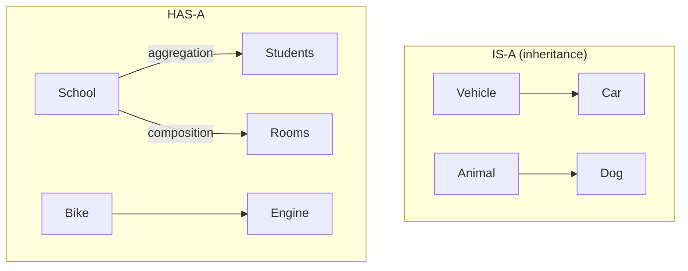

#### Association umbrella (from slides) `[87:22](https://www.youtube.com/watch?v=MIYbPZCk34k&t=5242s)`

Slides place **association** as “relationship between different objects,” then split:

```text
Association (HAS-A between objects)
├── Aggregation  — weak; both can survive alone
└── Composition  — strong; ending one ends the other
```

Closing one-liner from the video `[96:14](https://www.youtube.com/watch?v=MIYbPZCk34k&t=5774s)`:
- Remove one **object**, other unaffected → **weak HAS-A = aggregation**
- Remove one **object**, other destroyed → **strong HAS-A = composition**
- Always reason at **object lifetime**, not “delete the `.java` class file.”

#### Worked mental model: school A vs school B rooms `[95:12](https://www.youtube.com/watch?v=MIYbPZCk34k&t=5712s)`

```text
School A object ──owns──► Room1, Room2, Room3, Room4
School B object ──owns──► Room1'..Room10'

Destroy School A object  →  A's four room objects go away (composition)
Destroy School B object  →  B's ten room objects go away
Destroy all Student objects enrolled in A → School A object can still exist (aggregation)
```

---

### End-to-end map of what this lecture built

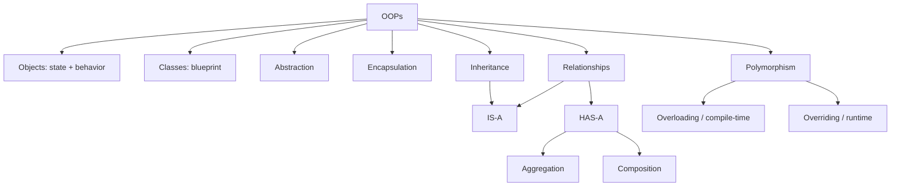

**Keywords he deliberately deferred** (keep in “back of mind” until later videos): `this`, full access-modifier matrix, deep interface syntax, `default` methods, constructors, LLD patterns — but the **ideas** above are the foundation.

---

### Interview questions / gotchas he highlights
- Explain OOPs to a 14-year-old with real examples (no jargon dump) `[18:28](https://www.youtube.com/watch?v=MIYbPZCk34k&t=1108s)`.
- Procedural vs OOPs comparison table (data hiding, coupling, inheritance, reusability).
- Object = state + behavior; class = blueprint; many objects from one class.
- Abstraction vs encapsulation — don’t conflate (hide *how* vs bundle/control *data*).
- Capsule analogy for encapsulation `[52:21](https://www.youtube.com/watch?v=MIYbPZCk34k&t=3141s)`.
- Why hide internals? Confidentiality, simpler clients, prevent misuse.
- “If Cat reads Dog.colour via getter, is that breaking encapsulation?” → No — **ownership** stays with Dog; Cat only consumes info `[41:57](https://www.youtube.com/watch?v=MIYbPZCk34k&t=2517s)`.
- Inheritance: child gets parent members; not vice versa (`swift.getEngine()` OK; `vehicle.getCarType()` not).
- Types of inheritance; **why Java forbids multiple class inheritance** (diamond / ambiguous method).
- “What if child also defines `getEngine`?” → then child’s method wins; ambiguity is when child **doesn’t** define it and two parents do `[68:18](https://www.youtube.com/watch?v=MIYbPZCk34k&t=4098s)`.
- Interface workaround: interfaces declare, implementing class **must** implement once.
- Overloading vs overriding names (compile/static vs runtime/dynamic).
- Overloading **cannot** be by return type alone `[77:06](https://www.youtube.com/watch?v=MIYbPZCk34k&t=4626s)`.
- Overriding: name + params + return type same; body may differ; dispatch by runtime object.
- IS-A vs HAS-A; aggregation (weak) vs composition (strong); object-lifetime test `[96:14](https://www.youtube.com/watch?v=MIYbPZCk34k&t=5774s)`.

### Quick revision
- OOPs orients design around objects (real-world entities).
- Object: properties + behavior; class: template; `new` creates instances.
- Procedural = functions + free data; OOPs = data + methods packaged with control.
- Abstraction: expose essentials, hide implementation (interfaces/abstract classes).
- Encapsulation: private fields + public accessors; ownership + loose coupling.
- Inheritance (`extends`): reuse parent fields/methods; four shapes; no multi-class extend.
- Diamond: two parents, same method → ambiguity; interfaces force one implement.
- Polymorphism: overloading (same class, different params) vs overriding (same signature, runtime object).
- IS-A = inheritance; HAS-A = nested object field; aggregation weak, composition strong.
- Association umbrella: aggregation vs composition judged by whether destroying one object kills the other.


---

<a id="lec-03"></a>

## 03. 2. How Java Program Works and its 3 Important Components (JVM, JRE and JDK) with Example


[↑ Index](#index) · [Parts](#parts)


> **Video:** [2. How Java Program Works and its 3 Important Components (JVM, JRE and JDK) with Example](https://www.youtube.com/watch?v=IoireaKRRFo)

### What this lecture covers
- What Java is (platform-independent OOP language) and **WORA**
- Three components: **JVM**, **JRE**, **JDK** — roles and nesting
- Compile / run flow: `.java` → bytecode (`.class`) → JVM → machine code
- Why Java code is portable but JVM/JRE/JDK are platform-dependent
- Demo: compile with `javac`, run with `java`
- JSE / JEE / JME (heads-up)
- First program: `Employee`, `public static void main`, comments, compile-then-run trap

### What is Java? `[0:00](https://www.youtube.com/watch?v=IoireaKRRFo&t=0s)`
If asked “What is Java?”, his answer:

- A **platform-independent** language
- A highly popular **object-oriented** language (inheritance, polymorphism, encapsulation, abstraction — covered in lecture 02)
- Biggest practical advantage: **portability** → **WORA** = **Write Once, Run Anywhere** `[1:03](https://www.youtube.com/watch?v=IoireaKRRFo&t=63s)`

**WORA intuition:** write a program on a phone; the same program (as bytecode) can run on laptop/desktop/notebook wherever a compatible JVM/JRE exists `[1:37](https://www.youtube.com/watch?v=IoireaKRRFo&t=97s)`.

### Three main components `[2:09](https://www.youtube.com/watch?v=IoireaKRRFo&t=129s)`

| Component | Full form |
|-----------|-----------|
| JVM | Java Virtual Machine |
| JRE | Java Runtime Environment |
| JDK | Java Development Kit |

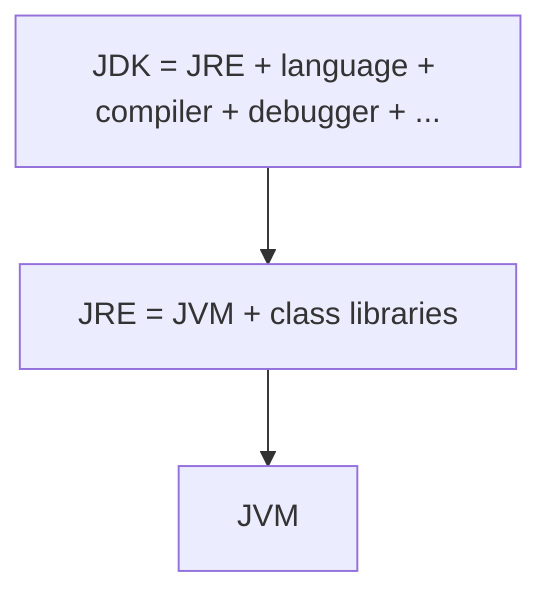

---

### JVM — Java Virtual Machine `[2:42](https://www.youtube.com/watch?v=IoireaKRRFo&t=162s)`

#### Abstract machine `[3:12](https://www.youtube.com/watch?v=IoireaKRRFo&t=192s)`
- JVM is an **abstract** machine — it does **not** exist as physical hardware.
- Think of it as software that behaves like a machine.

#### Execution flow `[3:42](https://www.youtube.com/watch?v=IoireaKRRFo&t=222s)`

```text
Java program (.java)
        │
        ▼
    Compiler (javac)
        │
        ▼
    Bytecode (.class)
        │
        ▼
       JVM  ──(JIT)──►  Machine code
        │
        ▼
       CPU → Output
```

- Portability / “platform independent” behavior of **Java programs** comes from this bytecode + JVM model `[4:12](https://www.youtube.com/watch?v=IoireaKRRFo&t=252s)`.
- Compiling Java does **not** produce native machine code directly — it produces **bytecode**, which the JVM consumes `[4:42](https://www.youtube.com/watch?v=IoireaKRRFo&t=282s)`.

#### JVM is platform-dependent `[5:12](https://www.youtube.com/watch?v=IoireaKRRFo&t=312s)`
- Critical distinction:
  - **Java program / bytecode** → platform-**independent**
  - **JVM** → platform-**dependent** (Mac JVM ≠ Windows JVM ≠ Linux JVM)
- You install a JVM (via JRE/JDK) that matches the OS.

#### JIT compiler `[6:12](https://www.youtube.com/watch?v=IoireaKRRFo&t=372s)`
- JVM includes a **JIT (Just-In-Time)** compiler.
- Input: bytecode → Output: machine code for that platform.
- JVM tasks summarized `[6:45](https://www.youtube.com/watch?v=IoireaKRRFo&t=405s)`:
  1. Tied to the platform it runs on
  2. Takes bytecode in, machine code out

#### How this yields portability `[7:16](https://www.youtube.com/watch?v=IoireaKRRFo&t=436s)`
- Any JVM that understands Java bytecode can run the same `.class` file.
- Write on mobile → get bytecode → run that bytecode on Linux/Mac/Windows JVM.
- Slogan: **Java program is platform-independent; JVM is platform-dependent** `[7:48](https://www.youtube.com/watch?v=IoireaKRRFo&t=468s)`.

#### Live compile demo `[8:18](https://www.youtube.com/watch?v=IoireaKRRFo&t=498s)`
- Source: `Student.java`
- Compile: `javac Student.java`
- Before compile: only the `.java` source visible; after compile: **`Student.class`** appears `[8:48](https://www.youtube.com/watch?v=IoireaKRRFo&t=528s)`
- `.class` = bytecode; take it to any machine with a JVM and run `[9:49](https://www.youtube.com/watch?v=IoireaKRRFo&t=589s)`

---

### JRE — Java Runtime Environment `[10:19](https://www.youtube.com/watch?v=IoireaKRRFo&t=619s)`

**JRE = JVM + class libraries** `[10:50](https://www.youtube.com/watch?v=IoireaKRRFo&t=650s)`

#### Class libraries example `[11:21](https://www.youtube.com/watch?v=IoireaKRRFo&t=681s)`
In his demo `Student` code he uses:

- `Math.abs(...)` → `java.lang`
- `Arrays.sort(...)` → `java.util.Arrays`

Many packages exist (`java.math`, `java.util`, …).

#### Why libraries sit with the JVM `[12:23](https://www.youtube.com/watch?v=IoireaKRRFo&t=743s)`
- Bytecode may call library methods.
- At runtime the JVM must **resolve/link** those calls against the libraries shipped with the JRE.
- So bytecode alone isn’t enough if library implementations aren’t available — JRE supplies them `[12:55](https://www.youtube.com/watch?v=IoireaKRRFo&t=775s)`.

#### What JRE alone can / cannot do `[13:25](https://www.youtube.com/watch?v=IoireaKRRFo&t=805s)`
- With **only JRE**: you can **run** Java programs (bytecode), but you **cannot develop/compile** new code.
- You don’t install “JVM alone” as the usual product — JVM comes **as part of JRE** `[13:56](https://www.youtube.com/watch?v=IoireaKRRFo&t=836s)`.
- Bytecode + JRE → runnable, because JVM + libraries are both present `[14:28](https://www.youtube.com/watch?v=IoireaKRRFo&t=868s)`.

---

### JDK — Java Development Kit `[15:00](https://www.youtube.com/watch?v=IoireaKRRFo&t=900s)`

JDK adds the **developer tooling**:

- Programming language / APIs you write against (`System.out.println`, etc.)
- **Compiler** (`javac`) — `.java` → `.class`
- **Debugger** (and related tools)

**JDK = JRE + (language + compiler + debugger + other tools)** `[16:03](https://www.youtube.com/watch?v=IoireaKRRFo&t=963s)`

Download JDK → you get JRE (and thus JVM + libraries) as well `[16:35](https://www.youtube.com/watch?v=IoireaKRRFo&t=995s)`.

| Layer | Platform dependent? |
|-------|---------------------|
| JDK | Yes |
| JRE | Yes |
| JVM | Yes |
| Compiled **bytecode** | **No** — portable across JVMs |

---

### Downloading JDK `[17:36](https://www.youtube.com/watch?v=IoireaKRRFo&t=1056s)`
- Search/download from **Oracle** archive / official downloads (he demos Oracle).
- Pick OS installer (Windows x64, macOS, etc.) `[18:36](https://www.youtube.com/watch?v=IoireaKRRFo&t=1116s)`.
- After install, verify: `java -version` (shows 8 / 15 / 17 / whatever you installed) `[19:07](https://www.youtube.com/watch?v=IoireaKRRFo&t=1147s)`.
- Prefer authentic Oracle (or other trusted distributors) over random mirrors.

> **Note:** Today many teams use **Temurin / OpenJDK** builds; LTS lines are commonly **17** and **21** (and newer). His “Java 17” mention was current for the recording era; the install/verify idea is unchanged.

---

### JSE, JEE, JME (heads-up only) `[19:40](https://www.youtube.com/watch?v=IoireaKRRFo&t=1180s)`

| Acronym | Meaning | Role |
|---------|---------|------|
| **JSE** | Java Standard Edition | “Core Java” — classes, objects, multithreading, etc. What this playlist focuses on |
| **JEE** | Java Enterprise Edition | JSE + enterprise APIs (transactions/commit/rollback, Servlets, JSP, persistence for RDBMS). Used for large apps (e.g. e-commerce). Now often called **Jakarta EE** |
| **JME** | Java Micro / Mobile Edition | APIs for resource-constrained / mobile apps |

Don’t panic when download pages say JSE/JEE — for this course you’re on **JSE / JDK** `[23:18](https://www.youtube.com/watch?v=IoireaKRRFo&t=1398s)`.

---

### First Java program `[23:48](https://www.youtube.com/watch?v=IoireaKRRFo&t=1428s)`

#### File ↔ public class rules (preview of lecture 04) `[24:18](https://www.youtube.com/watch?v=IoireaKRRFo&t=1458s)`
- File: `Employee.java` → public class name: `Employee`
- **One file → only one public class**

#### What a class can contain `[25:20](https://www.youtube.com/watch?v=IoireaKRRFo&t=1520s)`
- Variables
- Methods
- Constructors
- Nested / inner classes
(Depth comes in later videos.)

#### `public static void main(String[] args)` `[25:51](https://www.youtube.com/watch?v=IoireaKRRFo&t=1551s)`

**Why `main`?** `[26:22](https://www.youtube.com/watch?v=IoireaKRRFo&t=1582s)`

```text
.java → javac → .class (bytecode) → JVM loads → JVM calls main → program starts
```

`main` = **starting / entry point**. From `main` you call other methods/classes.

| Piece | Meaning in this lecture |
|-------|-------------------------|
| `void` | No return value `[27:24](https://www.youtube.com/watch?v=IoireaKRRFo&t=1644s)` |
| `public` | Callable from outside package — JVM must invoke it `[27:54](https://www.youtube.com/watch?v=IoireaKRRFo&t=1674s)` |
| `static` | Belongs to the **class**, not an instance — JVM can call `Employee.main(...)` **without** `new Employee()` `[28:26](https://www.youtube.com/watch?v=IoireaKRRFo&t=1706s)` |
| `String[] args` | Command-line arguments the JVM can pass `[31:01](https://www.youtube.com/watch?v=IoireaKRRFo&t=1861s)` |

Contrast with instance methods `[28:58](https://www.youtube.com/watch?v=IoireaKRRFo&t=1738s)`:

```java
A obj = new A();
obj.methodOne();   // instance method needs an object

A.methodOne();     // if static, callable via class name
```

#### Comments `[31:33](https://www.youtube.com/watch?v=IoireaKRRFo&t=1893s)`
- `//` single-line (repeat per line)
- `/* ... */` multi-line block
Compiler ignores both.

#### Tiny program `[32:04](https://www.youtube.com/watch?v=IoireaKRRFo&t=1924s)`

```java
public class Employee {
    public static void main(String[] args) {
        // this is a comment
        int a = -10;
        System.out.println("This is my first program and output of a is " + a);
    }
}
```

- `System.out.println(...)` prints to the console.

#### Compile and run `[33:06](https://www.youtube.com/watch?v=IoireaKRRFo&t=1986s)`

```bash
javac Employee.java   # produces Employee.class
java Employee         # JVM runs bytecode → prints -10
```

#### Important trap: edit without recompile `[34:07](https://www.youtube.com/watch?v=IoireaKRRFo&t=2047s)`
1. Change source so `a = -11`, save.
2. Run `java Employee` **without** `javac` again → still prints **-10**.
3. Why? JVM reads **`.class`**, not `.java`. Stale bytecode until you recompile.
4. `javac Employee.java` then `java Employee` → **-11**.

---

### Interview questions / gotchas he highlights
- Java = platform-independent OOP + **WORA** portability.
- **JVM is platform-dependent**; bytecode is not.
- JIT turns bytecode into machine code.
- **JRE** = JVM + libraries → run but don’t develop.
- **JDK** = JRE + compiler/debugger → develop.
- Don’t confuse needing “only JVM” — you use JRE (which includes JVM).
- File name = public class name; one public class per file.
- Why `public static void main`? JVM entry + no object needed.
- Changing `.java` without recompiling doesn’t change what `java` runs.

### Quick revision
- WORA: write once, run anywhere via bytecode.
- Flow: `.java` → `javac` → `.class` → JVM/JIT → machine code → CPU.
- JVM abstract + OS-specific; JIT inside JVM.
- JRE = JVM + class libraries; can run, not write.
- JDK = JRE + language + `javac` + debugger.
- Install JDK from trusted source; check `java -version`.
- JSE = core Java; JEE/Jakarta EE = enterprise; JME = mobile/micro.
- `main` is the entry point JVM calls.
- Recompile after every source change or you’ll run old bytecode.


---

<a id="lec-04"></a>

## 04. 3. Quiz Question: Why only 1 Public Class in JAVA file


[↑ Index](#index) · [Parts](#parts)


> **Video:** [3. Quiz Question: Why only 1 Public Class in JAVA file](https://www.youtube.com/watch?v=ijEJJuIQdzY)

### What this lecture covers
- Recap: `main` is the program entry point
- Why `main` must live in a **public** class
- Why the **public class name must match the `.java` file name**
- How those two rules together force **at most one public class per file**
- Classic interview framing of this restriction

### Context from previous lecture `[0:00](https://www.youtube.com/watch?v=ijEJJuIQdzY&t=0s)`
- Previous video covered JDK / JRE / JVM, `.class` files, and a first Java class.
- There he stated: **in one `.java` file you can have only one public class**.
- This short video answers the interview question: **why?**

### Two facts that unlock the answer `[0:33](https://www.youtube.com/watch?v=ijEJJuIQdzY&t=33s)`

He says if you understand these two rules, the “only one public class” restriction becomes obvious:

1. **`main` must be inside a public class** `[1:34](https://www.youtube.com/watch?v=ijEJJuIQdzY&t=94s)`
2. **Public class name must equal the file name** `[2:06](https://www.youtube.com/watch?v=ijEJJuIQdzY&t=126s)`

### Why `main` must be in a public class `[2:06](https://www.youtube.com/watch?v=ijEJJuIQdzY&t=126s)`
- Who calls `main`? The **JVM**.
- JVM needs **access** to that method from outside the package.
- That’s why the containing class is **`public`** — so it is visible outside its package to the JVM.
- `main` is also **`static`** so the JVM can call it as `ClassName.main(...)` **without creating an object** (e.g. `A.main(...)`).

```java
// File: A.java
public class A {
    public static void main(String[] args) {
        // JVM entry: A.main(...)
    }
}
```

### Why public class name = file name `[3:09](https://www.youtube.com/watch?v=ijEJJuIQdzY&t=189s)`
- Example: file `Employee.java` → if you declare a **public** class, it must be named `Employee`.
- **Not allowed:** `Employee.java` containing `public class Manager`.
- Java enforces this naming so the public type can be found from the file name alone.

### Putting it together: why only one public class? `[4:11](https://www.youtube.com/watch?v=ijEJJuIQdzY&t=251s)`

Thought experiment:

- Suppose `Employee.java` contained **hundreds** of classes (`A`, `B`, … `XYZ`) and **more than one** of them were `public`.
- JVM will invoke `main`, and `main` must sit in a **public** class.
- If multiple public classes exist, **which class’s `main` should the JVM start?** Ambiguous.

Java’s restriction removes the ambiguity:

- **Only one public class** per `.java` file.
- That public class’s name **must match** the file name (e.g. `B.java` → `public class B`).
- JVM looks at the file / class you run (`java B`) and knows: public class is `B`, and `main` (if present) is there.
- JVM does **not** need to scan 100 other types in the file to find the entry class.

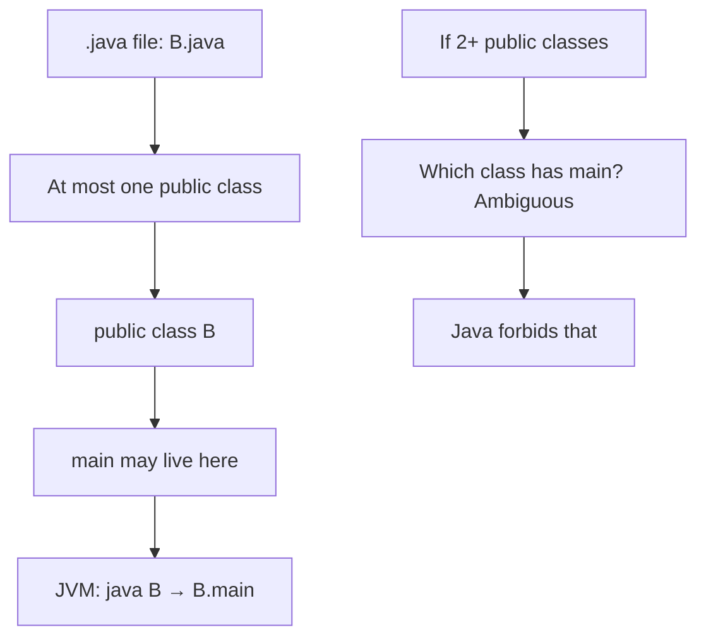

### Non-public classes in the same file `[5:13](https://www.youtube.com/watch?v=ijEJJuIQdzY&t=313s)`
- You **can** still have other classes in the same file — they just cannot be `public` (package-private / default access).
- Those helpers don’t confuse the JVM’s entry-point lookup, because the runnable public type is uniquely tied to the file name.

```java
// File: B.java  — allowed shape
public class B {
    public static void main(String[] args) { }
}

class Helper { }   // OK: not public
class Utils { }    // OK: not public
```

### Interview questions / gotchas he highlights
- **Q:** Why only one public class per Java source file?
- **A (his chain):** JVM invokes `main` → `main` needs a public class → public class name = file name → if multiple public classes, JVM couldn’t know which holds `main` → Java allows only one public class per file, named like the file.
- Related: why `public static void main`? Public for JVM access; static so no object is required.

> **Note:** Modern Java still has this rule for traditional `.java` sources. With **JEP 445 / Unnamed Classes and Instance Main Methods** (preview → finalized later as simpler launch), teaching demos can use a different `main` shape — but for standard named public classes in interviews, his explanation still holds.

### Quick revision
- `main` = entry point; JVM calls it.
- Class holding `main` should be **public** so JVM can see it outside the package.
- `static` lets JVM call `ClassName.main` without `new`.
- Public class name **must** match `.java` file name.
- Multiple public classes would make “which `main`?” ambiguous.
- Hence: **one public class per file**, named after the file.
- Other package-private classes in the same file are fine.
- Slides PDF is shared with lecture 03 (How Java Works); this video is mostly Q&A.


---

<a id="lec-05"></a>

## 05. 4. Java Variables - Part1 | Primitive Data Types in Depth


[↑ Index](#index) · [Parts](#parts)


> **Video:** [4. Java Variables - Part1 | Primitive Data Types in Depth](https://www.youtube.com/watch?v=Q6_jrvz-R7w)

### What this lecture covers
- What a variable is; declaration shape
- Java as **statically typed** and **strongly typed**
- Variable naming conventions
- Eight **primitive** types (focus of this video; reference types next)
- Signed two’s complement intuition for integral types
- Default values: instance fields vs locals
- Float/double precision surprise → prefer BigDecimal for money (deep dive next video)
- Type conversions: widening, narrowing, promotion in expressions
- Kinds of variables: member, local, static, method params, constructor params

---

### What is a variable? `[0:00](https://www.youtube.com/watch?v=Q6_jrvz-R7w&t=0s)`
- Variable = a **container that holds a value** (water-bottle analogy) `[0:30](https://www.youtube.com/watch?v=Q6_jrvz-R7w&t=30s)`.
- Declaration shape:

```java
datatype variableName = value;
// e.g.
int var = 32;
```

---

### Static typing & strong typing `[1:32](https://www.youtube.com/watch?v=Q6_jrvz-R7w&t=92s)`

Interview pair: *Is Java statically typed? Strongly typed?* → **Yes to both**.

| Term | Meaning (his framing) |
|------|------------------------|
| **Static typing** | Every variable’s **datatype must be declared**; the type says what kind of data it stores `[2:03](https://www.youtube.com/watch?v=Q6_jrvz-R7w&t=123s)` |
| **Strong typing** | Values must fit the type’s **allowed range / rules** — you can’t stuff an arbitrary huge number into a too-small type `[2:34](https://www.youtube.com/watch?v=Q6_jrvz-R7w&t=154s)` |

---

### Naming conventions `[3:35](https://www.youtube.com/watch?v=Q6_jrvz-R7w&t=215s)`

1. **Case-sensitive** — `var` ≠ `Var` `[4:06](https://www.youtube.com/watch?v=Q6_jrvz-R7w&t=246s)`
2. Legal identifier: **Unicode letters & digits** (not only English) `[4:37](https://www.youtube.com/watch?v=Q6_jrvz-R7w&t=277s)`
3. May **start with** letter, `$`, or `_` — **not** a digit `[5:08](https://www.youtube.com/watch?v=Q6_jrvz-R7w&t=308s)`

```java
int _a = 1;      // OK
int $var = 1;    // OK
int var = 1;     // OK
int 9var = 1;    // NOT OK
```

4. **Cannot** be Java reserved words (`new`, `class`, `for`, `while`, `int`, `float`, …) `[5:39](https://www.youtube.com/watch?v=Q6_jrvz-R7w&t=339s)`
5. Style: single word → all lowercase (`jaipur`); multi-word → **camelCase** (`jaipurCity`) `[6:10](https://www.youtube.com/watch?v=Q6_jrvz-R7w&t=370s)`
6. **Constants** → `UPPER_SNAKE` / all caps (preview of `static final`) `[7:12](https://www.youtube.com/watch?v=Q6_jrvz-R7w&t=432s)`

```java
static final int JAIPUR = 2; // constant naming; details later
```

---

### Types of variables (big picture) `[8:15](https://www.youtube.com/watch?v=Q6_jrvz-R7w&t=495s)`

```text
Variables
├── Primitive (8)          ← this video
└── Reference / non-primitive  ← later video (class, interface, array, String, …)
```

**Eight primitives** `[8:46](https://www.youtube.com/watch?v=Q6_jrvz-R7w&t=526s)`:

| Group | Types |
|-------|--------|
| Character | `char` |
| Integral | `byte`, `short`, `int`, `long` |
| Fractional | `float`, `double` |
| Boolean | `boolean` |

---

### `char` `[8:46](https://www.youtube.com/watch?v=Q6_jrvz-R7w&t=526s)`
- Size: **2 bytes = 16 bits**
- Character representation of a code unit (he says ASCII; see note)
- Range: **0 … 65535** (`'\u0000'` … `'\uffff'`)
- Default (for fields): `'\u0000'` (NUL) — he distinguishes this from reference `null` `[11:49](https://www.youtube.com/watch?v=Q6_jrvz-R7w&t=709s)`

```java
char c = 'A';
System.out.println(c); // A

char c2 = 65;
System.out.println(c2); // A (code 65)

char c3 = 97;
System.out.println(c3); // a
// 64 → '@', etc.
```

> **Note:** Java `char` is a UTF-16 code unit (historically tied to UCS-2). Calling it “ASCII” is a teaching simplification; ASCII is a subset.

---

### Integral types & signed two’s complement `[12:22](https://www.youtube.com/watch?v=Q6_jrvz-R7w&t=742s)`

Integral types store whole numbers (… -2, -1, 0, 1, 2 …). He groups `byte`/`short`/`int`/`long` as **signed two’s complement**.

#### `byte` `[12:22](https://www.youtube.com/watch?v=Q6_jrvz-R7w&t=742s)`
- **1 byte = 8 bits**
- Range: **-128 … 127**
- Default (fields): `0`
- Unsigned 8-bit would be 0…255; because of the sign bit, positive/negative share the space → -128…127 `[14:25](https://www.youtube.com/watch?v=Q6_jrvz-R7w&t=865s)`
- Sign bit: `0` → non-negative, `1` → negative `[14:58](https://www.youtube.com/watch?v=Q6_jrvz-R7w&t=898s)`

#### Two’s complement mini-demo (4 bits for simplicity) `[15:31](https://www.youtube.com/watch?v=Q6_jrvz-R7w&t=931s)`

Represent **+3** and **-3**:

```text
+3  →  0011

Ones' complement of +3 → 1100
Add 1 (two's complement) → 1101   (= -3)

+3 + (-3):
  0011
+ 1101
= 0000  (carry out discarded within bit width)
```

Same idea scales to 8/16/32/64 bits; overflow bits beyond the width are dropped `[17:02](https://www.youtube.com/watch?v=Q6_jrvz-R7w&t=1022s)`.

#### Default values: fields vs locals `[18:05](https://www.youtube.com/watch?v=Q6_jrvz-R7w&t=1085s)`

```java
class Employee {
    byte var; // instance field → defaults to 0

    void dummy() {
        System.out.println(var); // prints 0
        // byte local;
        // System.out.println(local); // compile error — must assign
        byte local = 7; // OK
    }
}
```

**Rule:** automatic defaults apply to **class member (instance) variables**, not to **local** variables — locals must be assigned before use `[19:37](https://www.youtube.com/watch?v=Q6_jrvz-R7w&t=1177s)`.

#### `short` `[20:09](https://www.youtube.com/watch?v=Q6_jrvz-R7w&t=1209s)`
- 2 bytes = 16 bits, signed two’s complement
- Range: **-32_768 … 32_767**
- Default (fields): `0`

#### `int` `[20:39](https://www.youtube.com/watch?v=Q6_jrvz-R7w&t=1239s)`
- 4 bytes = 32 bits, signed
- Range: **-2³¹ … 2³¹−1**
- Default: `0`

#### `long` `[21:09](https://www.youtube.com/watch?v=Q6_jrvz-R7w&t=1269s)`
- 8 bytes = 64 bits, signed
- Range: **-2⁶³ … 2⁶³−1**
- Default: `0`
- Literal suffix `L` / `l`:

```java
long var = 100L;
```

---

### `float` & `double` (preview) `[22:12](https://www.youtube.com/watch?v=Q6_jrvz-R7w&t=1332s)`
- Fractional / floating types
- `float`: 32-bit **IEEE 754**; suffix `f`
- `double`: 64-bit **IEEE 754**; suffix `d` (optional for double literals)

```java
float  f = 63.20f;
double d = 63.20d;
```

#### Precision gotcha (why money ≠ float) `[23:49](https://www.youtube.com/watch?v=Q6_jrvz-R7w&t=1429s)`

```java
float v1 = 0.3f;
float v2 = 0.1f;
float v3 = v1 - v2;
System.out.println(v3); // expected 0.2 → often 0.20000002 style noise
```

Same class of surprise with `double`.

Industry advice he gives `[24:49](https://www.youtube.com/watch?v=Q6_jrvz-R7w&t=1489s)`: when decimals must be exact (currency, fixed scale), **don’t use float/double** — use a precise decimal type.

> **Note:** He says “Big Integer”; for decimal money the usual choice is **`BigDecimal`** (`BigInteger` is for arbitrary-precision **integers**). Full IEEE-754 storage is lecture 06.

---

### `boolean` `[25:50](https://www.youtube.com/watch?v=Q6_jrvz-R7w&t=1550s)`
- Only values: **`true`** / **`false`**
- Conceptually ~1 bit of information
- Default (fields): **`false`**

```java
boolean flag = true;
```

> **Note:** Slide OCR may show default `True`; the spoken (correct) default for `boolean` fields is `false`.

---

### Type conversions `[27:25](https://www.youtube.com/watch?v=Q6_jrvz-R7w&t=1645s)`

Size ladder (integral → long → float → double conceptually for widening):

```text
byte (1) → short (2) → int (4) → long (8) → float → double
```

#### 1) Widening / automatic conversion `[27:57](https://www.youtube.com/watch?v=Q6_jrvz-R7w&t=1677s)`
Lower → higher: **automatic**.

```java
int var = 10;
long varLong = var; // OK — int widened to long

byte x = 10;
int intVariable = x; // OK — byte → int
System.out.println(intVariable); // 10
```

#### 2) Narrowing / downcasting / explicit `[30:29](https://www.youtube.com/watch?v=Q6_jrvz-R7w&t=1829s)`
Higher → lower: **must cast**; no silent auto-narrow.

```java
int integerVariable = 10;
byte byteVariable = (byte) integerVariable; // OK → 10
```

**Beyond range wraps (two’s complement modulo)** `[31:30](https://www.youtube.com/watch?v=Q6_jrvz-R7w&t=1890s)`:

```java
int integerVariable = 128;
byte b = (byte) integerVariable; // -128  (after 127 comes -128)

int v = 129;
byte b2 = (byte) v; // -127
```

#### 3) Promotion during expressions `[33:03](https://www.youtube.com/watch?v=Q6_jrvz-R7w&t=1983s)`

```java
byte a = 127;
byte b = 1;
// byte sum = a + b; // won't compile as byte — a+b promotes
int sum = a + b;     // 128 — byte/short promote to int in arithmetic
byte wrapped = (byte) (a + b); // -128 if you force byte
```

Rules he teaches:
- `byte` / `short` in arithmetic → promoted to **`int`** when the result needs a wider type / crosses range `[34:07](https://www.youtube.com/watch?v=Q6_jrvz-R7w&t=2047s)`
- If **any** operand is a wider type (e.g. `double`), the expression promotes to that wider type `[35:40](https://www.youtube.com/watch?v=Q6_jrvz-R7w&t=2140s)`:

```java
int a = 34;
double doubleVar = 20d;
// int sum = a + doubleVar; // error
double sum = a + doubleVar; // 54.0
int forced = (int) (a + doubleVar); // explicit cast of the expression
```

**Keywords to remember:** widening, narrowing (explicit), promotion (in expressions), explicit cast during expression `[37:13](https://www.youtube.com/watch?v=Q6_jrvz-R7w&t=2233s)`.

Wrapper classes → deferred to reference-types video `[37:43](https://www.youtube.com/watch?v=Q6_jrvz-R7w&t=2263s)`.

---

### Kinds of variables `[37:43](https://www.youtube.com/watch?v=Q6_jrvz-R7w&t=2263s)`

Sketch from the lecture:

```java
class Employee {
    int memberVariable;              // instance / member
    static int staticVariable = 100; // class / static

    Employee() { }                   // default constructor
    Employee(int a) { }              // parameterized — constructor params

    void dummy() {
        byte localVariable = 100;    // local
    }

    int dummyMethodTwo(int a, int b) { // method parameters
        return a + b;
    }
}
```

#### Member / instance variables `[40:20](https://www.youtube.com/watch?v=Q6_jrvz-R7w&t=2420s)`
- Declared in the class body (outside methods).
- Created with each **object**.
- **Each object has its own copy**.
- Get default values if not assigned (`int` → 0, etc.).

```java
Employee o1 = new Employee();
Employee o2 = new Employee();
// o1.memberVariable and o2.memberVariable are independent
```

#### Local variables `[41:55](https://www.youtube.com/watch?v=Q6_jrvz-R7w&t=2515s)`
- Declared **inside a method**.
- Live only for that method invocation; destroyed when the method ends.
- Scope = enclosing `{ ... }`.
- **No** automatic default — must initialize before use.

#### Static / class variables `[42:26](https://www.youtube.com/watch?v=Q6_jrvz-R7w&t=2546s)`
- `static` → **one copy per class**, shared by all instances.
- Access via **class name**: `Employee.staticVariable` (preferred).
- Not “owned” per object the way instance fields are `[43:31](https://www.youtube.com/watch?v=Q6_jrvz-R7w&t=2611s)`.

```java
Employee o1 = new Employee();
Employee o2 = new Employee();
// Employee.staticVariable — single shared value
```

#### Method parameters `[46:05](https://www.youtube.com/watch?v=Q6_jrvz-R7w&t=2765s)`
- Variables in the method signature; filled by the caller.

```java
o1.dummyMethodTwo(2, 5); // a=2, b=5 inside the method
```

#### Constructor parameters `[46:36](https://www.youtube.com/watch?v=Q6_jrvz-R7w&t=2796s)`
- Same idea for constructors: `new Employee(10)` binds the parameterized constructor’s params.
- Default vs parameterized constructors mentioned; full constructor deep-dive later.

---

### What’s deferred to later videos `[47:39](https://www.youtube.com/watch?v=Q6_jrvz-R7w&t=2859s)`
- Floating types in depth (IEEE 754) — **next video**
- Reference / non-primitive types
- Wrapper classes, `final`, etc.

---

### Interview questions / gotchas he highlights
- Java is **statically** and **strongly** typed.
- Naming rules: case-sensitive; `$`/`_`/letter start; no keywords; camelCase; constants UPPER.
- Eight primitives and their sizes/ranges/defaults.
- Why `byte` is -128…127 (signed), not 0…255.
- Two’s complement: negate by flip bits + 1; +x + (−x) = 0 in fixed width.
- Defaults only for **instance fields**, not locals.
- `0.3f - 0.1f` ≠ exact `0.2` — don’t use binary float for money.
- Widening auto; narrowing needs `(type)`; wrap-around if out of range.
- Expression promotion: `byte+byte` → `int`; mixed with `double` → `double`.
- Instance vs static: per-object copies vs one class copy.
- Overloading return-type-only is illegal (from OOPs lecture; conversions reinforce type strictness).

### Quick revision
- Variable = typed container; declare `type name = value`.
- Static typing = declare types; strong typing = values must fit rules/ranges.
- 8 primitives: char, byte, short, int, long, float, double, boolean.
- Integrals are signed two’s complement; know ranges & field defaults.
- Locals need explicit init; fields get defaults.
- Float/double ≈ IEEE 754; use BigDecimal for exact decimals/currency.
- Widening automatic; narrowing cast; watch wrap-around (128 → byte = -128).
- Arithmetic promotes `byte`/`short` to `int`; wider operand wins.
- Member = per object; static = one per class; local = method scope; params = caller-supplied.
- Float/double bit layout → lecture 06; references → lecture 07.


---

<a id="lec-06"></a>

## 06. 5. How FLOAT and DOUBLE Number Stored in Memory? | IEEE 754 Representation


[↑ Index](#index) · [Parts](#parts)


> **Video:** [5. How FLOAT and DOUBLE Number Stored in Memory? | IEEE 754 Representation](https://www.youtube.com/watch?v=NZ3qAfM8Ztw)

### What this lecture covers
- Why `0.7f` prints as `0.69999988…` instead of exact `0.7`
- **32-bit IEEE 754** layout for `float`: sign, exponent, mantissa
- Four-step encoding worked example: **4.125f**
- Decode formula: recover decimal from stored bits
- Harder example: **0.7f** (non-terminating binary → approximation)
- **64-bit IEEE 754** layout for `double` (sign, exponent, mantissa, bias)
- Interview angle + industry practice: **`BigDecimal`** for exact decimals

---

### Motivation: the `0.7f` surprise `[0:00](https://www.youtube.com/watch?v=NZ3qAfM8Ztw&t=0s)`

Continues from primitive types (lecture 05). `float` and `double` are interview-heavy because their behavior is non-obvious.

```java
float f = 0.7f;
System.out.println(f); // often 0.69999988... not exactly 0.7
```

- Not a random bug — it follows from **how the value is stored and read back** from memory `[0:30](https://www.youtube.com/watch?v=NZ3qAfM8Ztw&t=30s)`.
- In industry, binary floating point is avoided for money; **`BigDecimal`** gives exact decimal semantics (e.g. `4.7` prints as `4.7`) `[20:14](https://www.youtube.com/watch?v=NZ3qAfM8Ztw&t=1214s)`.

---

### `float` = 32-bit IEEE 754 `[1:03](https://www.youtube.com/watch?v=NZ3qAfM8Ztw&t=63s)`

Out of **32 bits**:

| Field | Size | Role |
|-------|------|------|
| **Sign** | 1 bit | `0` = positive, `1` = negative `[1:33](https://www.youtube.com/watch?v=NZ3qAfM8Ztw&t=93s)` |
| **Exponent** | 8 bits | Biased exponent (not two’s complement) `[1:33](https://www.youtube.com/watch?v=NZ3qAfM8Ztw&t=93s)` |
| **Mantissa** (significand) | 23 bits | Fractional part after the implicit leading `1.` `[2:05](https://www.youtube.com/watch?v=NZ3qAfM8Ztw&t=125s)` |

```text
float (32 bits)
┌───┬────────────────┬───────────────────────────────┐
│ S │   exponent (8) │      mantissa (23)            │
└───┴────────────────┴───────────────────────────────┘
```

Plan: encode **4.125** (easy), decode it, then tackle **0.7f** (hard) `[2:05](https://www.youtube.com/watch?v=NZ3qAfM8Ztw&t=125s)`.

---

### Encoding 4.125f — Step 1: decimal → binary `[2:35](https://www.youtube.com/watch?v=NZ3qAfM8Ztw&t=155s)`

**Integer part (4):**

```text
4 ÷ 2 → quotient 2, remainder 0
2 ÷ 2 → quotient 1, remainder 0
1 ÷ 2 → quotient 0, remainder 1
Read remainders bottom → top: 100₂
```

**Fractional part (0.125):** multiply by 2, take integer digit, top → bottom `[3:40](https://www.youtube.com/watch?v=NZ3qAfM8Ztw&t=220s)`

```text
0.125 × 2 = 0.25  → 0
0.25  × 2 = 0.50  → 0
0.50  × 2 = 1.00  → 1
Fractional bits top → bottom: .001₂
```

**Combined:** `4.125` → **`100.001₂`** `[4:11](https://www.youtube.com/watch?v=NZ3qAfM8Ztw&t=251s)`

---

### Step 2: normalized form `1.xxx × 2^e` `[4:41](https://www.youtube.com/watch?v=NZ3qAfM8Ztw&t=281s)`

Target shape (base **2**, not 10):

\[
\text{value} = 1.\text{mantissa bits} \times 2^{\text{exponent}}
\]

Move the binary point **two places left** on `100.001`:

```text
100.001₂  =  1.00001₂ × 2²
```

- Decimal point left → exponent **increases** (here `+2`).
- If you moved the point right, exponent would be **negative** (needed for values like `0.001`) `[5:12](https://www.youtube.com/watch?v=NZ3qAfM8Ztw&t=312s)`.
- After the dot in `1.00001`, the part **`00001`** is what goes into the **mantissa field** (the leading `1.` is implicit) `[6:14](https://www.youtube.com/watch?v=NZ3qAfM8Ztw&t=374s)`.

---

### Step 3: add bias to exponent `[5:43](https://www.youtube.com/watch?v=NZ3qAfM8Ztw&t=343s)`

For **`float`**, **bias = 127** (`2^(8-1) - 1` for an 8-bit exponent field) `[6:14](https://www.youtube.com/watch?v=NZ3qAfM8Ztw&t=374s)`.

**Stored exponent** = **actual exponent + bias**

For `4.125`: actual exponent = **+2** → stored = **127 + 2 = 129** `[6:46](https://www.youtube.com/watch?v=NZ3qAfM8Ztw&t=406s)`.

**Why bias?** IEEE 754 does **not** use two’s complement for the exponent. Bias lets you represent **negative exponents** without a separate sign scheme:

| Actual exponent | Stored (float) |
|-----------------|----------------|
| +2 | 129 |
| −3 | 127 + (−3) = **124** `[7:16](https://www.youtube.com/watch?v=NZ3qAfM8Ztw&t=436s)` |

---

### Step 4: pack into 32 bits `[7:48](https://www.youtube.com/watch?v=NZ3qAfM8Ztw&t=468s)`

**Sign:** `4.125` is positive → **`0`**

**Exponent 129 in 8 bits** (powers 128, 64, 32, 16, 8, 4, 2, 1):

```text
129 = 128 + 1  →  10000001₂
```

**Mantissa:** from `1.00001`, store **`00001`** then pad with zeros to **23 bits** `[8:48](https://www.youtube.com/watch?v=NZ3qAfM8Ztw&t=528s)`.

```text
S | exponent (8)     | mantissa (23)
0 | 1 0 0 0 0 0 0 1 | 0 0 0 0 1 0 0 0 ... (zeros to fill 23)
```

This bit pattern is what lives in memory for `4.125f` `[9:19](https://www.youtube.com/watch?v=NZ3qAfM8Ztw&t=559s)`.

---

### Decode (reward back): formula `[9:49](https://www.youtube.com/watch?v=NZ3qAfM8Ztw&t=589s)`

```text
value = (−1)^sign × (1 + mantissa_as_fraction) × 2^(stored_exponent − bias)
```

- **`1 + mantissa`**: the stored mantissa is only the **fraction after** the implicit `1.` `[9:49](https://www.youtube.com/watch?v=NZ3qAfM8Ztw&t=589s)`.
- **Subtract 127** when reading because encoding **added** bias `[9:49](https://www.youtube.com/watch?v=NZ3qAfM8Ztw&t=589s)`.
- **Sign bit**: `0` → factor `1`; `1` → factor `−1` `[10:20](https://www.youtube.com/watch?v=NZ3qAfM8Ztw&t=620s)`.

For our `4.125` bits:

- Sign = 0 → multiplier 1
- Stored exponent 129 → **129 − 127 = 2**
- Mantissa fraction: bit at position 5 after the point → **2^(−5) = 1/32 = 0.03125** `[10:52](https://www.youtube.com/watch?v=NZ3qAfM8Ztw&t=652s)`

```text
(1 + 0.03125) × 2² = 1.03125 × 4 = 4.125  ✓
```

Fetching from memory recovers **exactly 4.125** for this case `[11:25](https://www.youtube.com/watch?v=NZ3qAfM8Ztw&t=685s)`.

---

### Encoding 0.7f — why it goes wrong `[11:56](https://www.youtube.com/watch?v=NZ3qAfM8Ztw&t=716s)`

#### Step 1: binary expansion `[12:26](https://www.youtube.com/watch?v=NZ3qAfM8Ztw&t=746s)`

Repeated ×2 on the fractional part:

```text
0.7 × 2 = 1.4  → 1
0.4 × 2 = 0.8  → 0
0.8 × 2 = 1.6  → 1
0.6 × 2 = 1.2  → 1
0.2 × 2 = 0.4  → 0   ← back to 0.4, cycle repeats
```

So `0.7` in binary is **non-terminating / repeating**:

```text
0.7₁₀ ≈ 0.101100110011001100110011...₂
```

Only **23 mantissa bits** can be kept → **rounding/truncation** `[13:00](https://www.youtube.com/watch?v=NZ3qAfM8Ztw&t=780s)`.

#### Step 2: normalize `[13:30](https://www.youtube.com/watch?v=NZ3qAfM8Ztw&t=810s)`

Shift point once right:

```text
0.10110011...₂ = 1.0110011...₂ × 2^(−1)
```

Actual exponent = **−1**.

#### Step 3: bias `[14:02](https://www.youtube.com/watch?v=NZ3qAfM8Ztw&t=842s)`

Stored exponent = **127 + (−1) = 126**.

#### Step 4: store `[14:32](https://www.youtube.com/watch?v=NZ3qAfM8Ztw&t=872s)`

- Sign `0` (positive)
- Exponent **126** in 8 bits
- First **23** bits of the mantissa after `1.` packed into the field `[15:02](https://www.youtube.com/watch?v=NZ3qAfM8Ztw&t=902s)`

#### Decode sketch `[15:32](https://www.youtube.com/watch?v=NZ3qAfM8Ztw&t=932s)`

Same formula; exponent term **126 − 127 = −1**.

He sums mantissa contributions at positions where bits are `1` (powers **2^(−1), 2^(−2), …**) `[16:03](https://www.youtube.com/watch?v=NZ3qAfM8Ztw&t=963s)` — partial sum of the infinite series because the true binary expansion never ends.

- Mantissa fraction computed ≈ **0.399414062** (with the bits stored) `[18:09](https://www.youtube.com/watch?v=NZ3qAfM8Ztw&t=1089s)`
- **(1 + mantissa) × 2^(−1)** → about **0.699707…** in his partial calculation `[18:40](https://www.youtube.com/watch?v=NZ3qAfM8Ztw&t=1120s)`
- Full 23-bit mantissa + rounding → what you see in Java (~**0.69999988…**) `[19:11](https://www.youtube.com/watch?v=NZ3qAfM8Ztw&t=1151s)`

**Takeaway:** `0.7` has **no exact finite binary** representation in 32 bits; memory holds the **closest** representable value, and `println` shows that decimal.

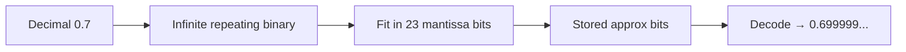

---

### `double`: same idea, wider format `[19:43](https://www.youtube.com/watch?v=NZ3qAfM8Ztw&t=1183s)`

| | `float` | `double` |
|---|---------|----------|
| Total bits | 32 | 64 |
| Sign | 1 | 1 |
| Exponent | 8 | **11** |
| Mantissa | 23 | **52** |
| Exponent bias | **127** | **1023** (`2^11 - 1` style: for 11-bit field, bias is **1023**) `[19:43](https://www.youtube.com/watch?v=NZ3qAfM8Ztw&t=1183s)` |

Same encode/decode steps; `double` fits more mantissa bits → often **closer** decimals but still not exact for many fractions (e.g. `0.1`).

> **Note:** Default floating literal `0.7` is **`double`**; use `0.7f` for `float`. `Double.toHexString(x)` / `Float.intBitsToFloat` are handy when interviewers ask about raw bits.

---

### Four-step cheat sheet (float)

```text
1. Convert decimal → binary (int part ÷2; frac part ×2)
2. Normalize to 1.xxx × 2^e  (base 2)
3. Stored exponent = e + 127
4. Sign | exponent (8) | mantissa (23, pad with 0)
```

Decode:

```text
(−1)^s × (1 + f) × 2^(stored_exp − 127)
```

---

### Interview questions / gotchas he highlights
- Why does `0.7f` not print exactly `0.7`? → **IEEE 754 finite precision**; repeating binary; only 23 mantissa bits `[0:30](https://www.youtube.com/watch?v=NZ3qAfM8Ztw&t=30s)`.
- Layout of **float**: 1 + 8 + 23; roles of sign, exponent, mantissa `[1:33](https://www.youtube.com/watch?v=NZ3qAfM8Ztw&t=93s)`.
- **Bias 127** for float — why not two’s complement on exponent? `[6:46](https://www.youtube.com/watch?v=NZ3qAfM8Ztw&t=406s)`.
- Walk through **4.125** encode and decode end-to-end (common whiteboard question) `[2:35](https://www.youtube.com/watch?v=NZ3qAfM8Ztw&t=155s)`.
- **Implicit leading 1** in normalized form → decode uses **`1 + mantissa`** `[9:49](https://www.youtube.com/watch?v=NZ3qAfM8Ztw&t=589s)`.
- **0.7f** = repeating binary → approximation when printed `[12:26](https://www.youtube.com/watch?v=NZ3qAfM8Ztw&t=746s)`.
- **Double**: 1 + 11 + 52, bias **1023** `[19:43](https://www.youtube.com/watch?v=NZ3qAfM8Ztw&t=1183s)`.
- Production: use **`BigDecimal`** for decimal/money, not `float`/`double` `[20:14](https://www.youtube.com/watch?v=NZ3qAfM8Ztw&t=1214s)`.
- Experienced candidates still get confused — **practice** the 4.125 example by hand `[20:14](https://www.youtube.com/watch?v=NZ3qAfM8Ztw&t=1214s)`.

### Quick revision
- `float` = **32-bit IEEE 754**: sign (1) + exponent (8) + mantissa (23).
- Encode: binary → **1.xxx × 2^e** → exponent store = **e + 127** → pack bits.
- Decode: **(−1)^s × (1 + mantissa) × 2^(exp − 127)**.
- **4.125** is exact in `float`; round-trip proves the format.
- **0.7** = repeating binary; 23-bit mantissa → **~0.699999…** when printed.
- Exponent uses **bias**, not two’s complement.
- **`double`**: 64 bits, 11-bit exponent, 52-bit mantissa, bias **1023**.
- Money/exact decimals → **`BigDecimal`**, not binary floats.


---

<a id="lec-07"></a>

## 07. 6. Java Variables - Part2 | Reference/Non-Primitive Data Types in Depth


[↑ Index](#index) · [Parts](#parts)


> **Video:** [6. Java Variables - Part2 | Reference/Non-Primitive Data Types in Depth](https://www.youtube.com/watch?v=1Ox0fyJuUVY)

### What this lecture covers
- **Reference** (non-primitive) types vs primitives — overview
- Four main reference kinds: **class**, **String**, **interface**, **array**
- **Heap**, references, and `new` (memory/GC deep dive later)
- Java is **pass-by-value** but references give **pointer-like** mutation
- **String** immutability, **string literals**, **string constant pool**
- `==` vs `.equals()` for strings
- **Interfaces**: polymorphic references; **cannot** `new` an interface
- **Arrays**: 1D, 2D, declaration styles, default values
- **Wrapper classes**, **autoboxing** / **unboxing** (why collections need wrappers)
- **Constant variables**: `static final` + naming convention
- Roadmap: methods → memory management & GC

---

### Two families of types (recap) `[0:00](https://www.youtube.com/watch?v=1Ox0fyJuUVY&t=0s)`

| Family | Also called | Examples |
|--------|-------------|----------|
| Primitive | — | `int`, `char`, `boolean`, … (8 total) |
| Non-primitive | **Reference** | `Employee`, `String`, `List`, arrays, … `[0:31](https://www.youtube.com/watch?v=1Ox0fyJuUVY&t=31s)` |

This lecture finishes the **variables** track: reference types, wrappers, constants. Next: **methods**, then **memory management & garbage collector** `[0:31](https://www.youtube.com/watch?v=1Ox0fyJuUVY&t=31s)`.

Main reference categories `[1:02](https://www.youtube.com/watch?v=1Ox0fyJuUVY&t=62s)`:

```text
Reference data types
├── Class
├── String
├── Interface
└── Array
```

---

### What is a “reference”? — class example `[1:32](https://www.youtube.com/watch?v=1Ox0fyJuUVY&t=92s)`

#### Simple `Employee` class `[2:02](https://www.youtube.com/watch?v=1Ox0fyJuUVY&t=122s)`

```java
class Employee {
    int employeeId;

    int getEmployeeId() {
        return employeeId;
    }

    void setEmployeeId(int employeeId) {
        this.employeeId = employeeId;
    }
}
```

- Class = **properties** + **methods** (getters/setters here).

#### Creating an object `[2:34](https://www.youtube.com/watch?v=1Ox0fyJuUVY&t=154s)`

```java
// inside another class, e.g. Student
Employee empObject = new Employee();
```

- **`new`** allocates the object (details of heap/stack in a later video) `[3:04](https://www.youtube.com/watch?v=1Ox0fyJuUVY&t=184s)`.

#### Heap + reference mental model `[3:34](https://www.youtube.com/watch?v=1Ox0fyJuUVY&t=214s)`

```text
Stack (variable)              Heap (object)
┌──────────────┐              ┌─────────────────┐
│ empObject    │ ──────────►  │ Employee        │
│ (reference)  │   address  │ employeeId = …  │
└──────────────┘              └─────────────────┘
```

- **`empObject`** is **not** the whole object in the variable — it holds a **reference** (like an address) to heap memory `[4:04](https://www.youtube.com/watch?v=1Ox0fyJuUVY&t=244s)`.
- Hence **reference data type**: variable → reference → actual object in heap `[4:34](https://www.youtube.com/watch?v=1Ox0fyJuUVY&t=274s)`.

> **Note:** Java has **no pointers** you can arithmetic on; references are typed and safe. C/C++ pointer analogy is for intuition only `[5:37](https://www.youtube.com/watch?v=1Ox0fyJuUVY&t=337s)`.

---

### Pass-by-value vs “changing through a method” `[6:07](https://www.youtube.com/watch?v=1Ox0fyJuUVY&t=367s)`

**Interview line:** In Java, **everything is pass-by-value**. There is **no** pass-by-reference `[6:07](https://www.youtube.com/watch?v=1Ox0fyJuUVY&t=367s)`.

| Language idea | Java |
|---------------|------|
| Pass int by value | Copy of `int` — callee changes don’t affect caller’s variable |
| Pass object “by reference” (C++) | **Not** in Java — you pass a **copy of the reference** |

**Why mutation still “works”:**

```java
void modify(Employee emp) {
    emp.setEmployeeId(20);  // same heap object as caller's
}

Employee empObject = new Employee();
empObject.setEmployeeId(10);
modify(empObject);
System.out.println(empObject.getEmployeeId()); // 20
```

- Caller passes **copy of reference**; copy still points to **same heap object** `[7:42](https://www.youtube.com/watch?v=1Ox0fyJuUVY&t=462s)`.
- `emp.setEmployeeId(20)` changes **heap state** → caller sees **20** `[8:44](https://www.youtube.com/watch?v=1Ox0fyJuUVY&t=524s)`.
- This mimics pointer benefits **without** exposing pointers `[9:17](https://www.youtube.com/watch?v=1Ox0fyJuUVY&t=557s)`.

**Reassigning the reference inside callee** does **not** rewire the caller’s variable (only the copy moves) — he focuses on **field mutation** on the shared object.

---

### Multiple references, one object `[9:48](https://www.youtube.com/watch?v=1Ox0fyJuUVY&t=588s)`

```java
Employee empObject = new Employee();
Employee obj2 = empObject;  // second reference, same heap object
obj2.setEmployeeId(30);
// empObject.getEmployeeId() → 30
```

- **`obj2`** and **`empObject`** both reference the **same** memory `[10:18](https://www.youtube.com/watch?v=1Ox0fyJuUVY&t=618s)`.
- Change through either name affects the **one** object.

---

### `String` as reference type `[10:48](https://www.youtube.com/watch?v=1Ox0fyJuUVY&t=648s)`

String is **built into Java** but is **not** primitive — it’s a **reference type** `[11:23](https://www.youtube.com/watch?v=1Ox0fyJuUVY&t=683s)`.

Why? The variable holds a **reference** to string data (pool or heap object), not a raw value inline like `int` `[19:01](https://www.youtube.com/watch?v=1Ox0fyJuUVY&t=1141s)`.

#### Immutability `[11:54](https://www.youtube.com/watch?v=1Ox0fyJuUVY&t=714s)`

- **Strings are immutable** — once a `String` object’s content exists, that content is not modified in place `[12:24](https://www.youtube.com/watch?v=1Ox0fyJuUVY&t=744s)`.
- “Changing” a variable means pointing it at a **different** `String` instance; old literal/object can remain for others `[18:00](https://www.youtube.com/watch?v=1Ox0fyJuUVY&t=1080s)`.

#### String literals & string constant pool `[12:55](https://www.youtube.com/watch?v=1Ox0fyJuUVY&t=775s)`

Inside **heap**, there is a special area: **string constant pool** (string literal pool) `[11:54](https://www.youtube.com/watch?v=1Ox0fyJuUVY&t=714s)`.

```java
String s1 = "hello";   // string literal
```

- `"hello"` is a **string literal** → stored in the **string constant pool** `[13:25](https://www.youtube.com/watch?v=1Ox0fyJuUVY&t=805s)`.
- `s1` holds a **reference** to that pooled `"hello"`.

```java
String s2 = "hello";
```

- JVM checks pool: **"hello" already exists** → `s2` gets a reference to the **same** pooled entry (no duplicate `"hello"` in pool) `[13:57](https://www.youtube.com/watch?v=1Ox0fyJuUVY&t=837s)`.

```java
String s3 = new String("hello");
```

- **`new`** → **new heap object** with content `"hello"` — **not** the same as pool-only literal semantics `[14:58](https://www.youtube.com/watch?v=1Ox0fyJuUVY&t=898s)`.
- `s3` references the **heap object**; `s1`/`s2` reference the **pool** entry `[15:29](https://www.youtube.com/watch?v=1Ox0fyJuUVY&t=929s)`.

```text
        Heap
┌─────────────────────────────┐
│  String Constant Pool       │
│    "hello" ◄── s1, s2       │
│                             │
│  separate String object     │
│    "hello" ◄── s3 (new)     │
└─────────────────────────────┘
```

#### `==` vs `.equals()` `[15:59](https://www.youtube.com/watch?v=1Ox0fyJuUVY&t=959s)`

| Operator / method | Compares |
|-------------------|----------|
| **`==`** | **Reference identity** — same memory / same pooled literal? `[16:29](https://www.youtube.com/watch?v=1Ox0fyJuUVY&t=989s)` |
| **`.equals()`** | **Character content** (value) `[16:29](https://www.youtube.com/watch?v=1Ox0fyJuUVY&t=989s)` |

```java
String s1 = "hello";
String s2 = "hello";
String s3 = new String("hello");

s1 == s2;           // true  — same pool reference
s1.equals(s2);      // true  — same content

s1.equals(s3);      // true  — same content
s1 == s3;           // false — different objects
```

Practice these four cases — very common in interviews `[20:32](https://www.youtube.com/watch?v=1Ox0fyJuUVY&t=1232s)`.

#### “Changing” `s1` `[18:00](https://www.youtube.com/watch?v=1Ox0fyJuUVY&t=1080s)`

```java
String s1 = "hello";
String s2 = "hello";
s1 = "sj";   // new literal (or new pool entry), s1 retargeted
```

- `"hello"` in pool **unchanged**; `s2` still points to `"hello"` `[19:31](https://www.youtube.com/watch?v=1Ox0fyJuUVY&t=1171s)`.
- Immutability = **no in-place edit** of `"hello"`; only **reference reassignment**.

> **Note:** From Java 7+, string pool can live in heap; behavior for literals/`intern()` is still interview-relevant. `new String("hello")` is discouraged in modern code (creates extra objects).

---

### Interface as reference type `[20:32](https://www.youtube.com/watch?v=1Ox0fyJuUVY&t=1232s)`

Similar to class for **reference** behavior `[21:02](https://www.youtube.com/watch?v=1Ox0fyJuUVY&t=1262s)`.

```java
interface Person {
    String profession();
}

class Teacher implements Person {
    @Override
    public String profession() {
        return "teaching";
    }
}

class Engineer implements Person {
    @Override
    public String profession() {
        return "software engineer";
    }
}
```

- Implementing class **must** provide method bodies (interface = contract / blueprint) `[21:34](https://www.youtube.com/watch?v=1Ox0fyJuUVY&t=1294s)`.

#### Valid reference declarations `[22:05](https://www.youtube.com/watch?v=1Ox0fyJuUVY&t=1325s)`

```java
Person softwareEngineer = new Engineer();
Person teacher = new Teacher();
Teacher teacherRef = new Teacher();
Engineer engineerRef = new Engineer();
```

- **Parent-typed reference** can hold **child object** — reference points to real child instance in heap `[22:36](https://www.youtube.com/watch?v=1Ox0fyJuUVY&t=1356s)`.
- You are **not** creating a `Person` object when you `new Engineer()` — you hold a reference to an **Engineer** `[24:41](https://www.youtube.com/watch?v=1Ox0fyJuUVY&t=1481s)`.

#### Invalid: `new` on interface `[23:39](https://www.youtube.com/watch?v=1Ox0fyJuUVY&t=1419s)`

```java
Person person = new Person();  // COMPILE ERROR — cannot instantiate interface
```

- Interface has **no implementation**; only concrete classes can be instantiated `[24:09](https://www.youtube.com/watch?v=1Ox0fyJuUVY&t=1449s)`.

---

### Array as reference type `[25:11](https://www.youtube.com/watch?v=1Ox0fyJuUVY&t=1511s)`

- **Array** = sequence of memory locations, **same element type** `[25:42](https://www.youtube.com/watch?v=1Ox0fyJuUVY&t=1542s)`.
- Array variable holds **reference** to that block in heap `[26:12](https://www.youtube.com/watch?v=1Ox0fyJuUVY&t=1572s)`.

#### 1D array — creation `[25:42](https://www.youtube.com/watch?v=1Ox0fyJuUVY&t=1542s)`

```java
int[] arr = new int[5];
// or
int arr2[] = new int[5];
```

- **5** `int` slots, indices **0 … 4** `[26:12](https://www.youtube.com/watch?v=1Ox0fyJuUVY&t=1572s)`.
- Default for `int` elements: **0** `[29:20](https://www.youtube.com/watch?v=1Ox0fyJuUVY&t=1760s)` (in new arrays).

```java
arr[0] = 10;
arr[3] = 40;
```

#### Array initializer `[27:46](https://www.youtube.com/watch?v=1Ox0fyJuUVY&t=1666s)`

```java
int[] a = { 30, 20, 10, 40, 50 };
```

- Compiler infers length **5** and fills indices 0–4 `[28:17](https://www.youtube.com/watch?v=1Ox0fyJuUVY&t=1697s)`.

#### 2D array `[28:48](https://www.youtube.com/watch?v=1Ox0fyJuUVY&t=1728s)`

```java
int[][] grid = new int[5][4];  // 5 rows, 4 columns
// brackets can be: int[][] grid, int grid[][], int[] grid[] — all valid style-wise
```

- Default: all `int` cells **0** `[29:20](https://www.youtube.com/watch?v=1Ox0fyJuUVY&t=1760s)`.

```java
grid[2][2] = 20;
grid[1][3] = 30;
```

#### 2D initializer `[30:24](https://www.youtube.com/watch?v=1Ox0fyJuUVY&t=1824s)`

```java
int[][] m = { {1, 5, 7}, {4, 2, 3} };  // 2 rows × 3 columns
// m[1][2] → 3
```

Arrays are reference types: mutating `arr[i]` changes heap contents visible through the reference `[31:25](https://www.youtube.com/watch?v=1Ox0fyJuUVY&t=1885s)`.

---

### Wrapper classes, autoboxing, unboxing `[32:27](https://www.youtube.com/watch?v=1Ox0fyJuUVY&t=1947s)`

For each primitive, Java provides a **wrapper** (reference type):

| Primitive | Wrapper |
|-----------|---------|
| `int` | `Integer` |
| `char` | `Character` |
| `short` | `Short` |
| `byte` | `Byte` |
| `long` | `Long` |
| `float` | `Float` |
| `double` | `Double` |
| `boolean` | `Boolean` `[33:29](https://www.youtube.com/watch?v=1Ox0fyJuUVY&t=2009s)` |

#### Why wrappers exist — two reasons `[34:01](https://www.youtube.com/watch?v=1Ox0fyJuUVY&t=2041s)`

**1) Reference semantics when calling methods**

```java
void modifyPrimitive(int x) {
    x = 20;
}
int a = 10;
modifyPrimitive(a);
System.out.println(a); // 10 — copy of value
```

```java
void modifyObject(Integer x) {
    x = 20;  // reassigns local reference; see note below for mutating wrapper
}
```

- Primitives live on **stack** (detail in memory lecture); pass copies → no caller update `[35:04](https://www.youtube.com/watch?v=1Ox0fyJuUVY&t=2104s)`.
- Wrappers are **objects** — useful when APIs need **object** pass-through and shared heap semantics (collections, custom APIs) `[36:06](https://www.youtube.com/watch?v=1Ox0fyJuUVY&t=2166s)`.

> **Note:** `Integer` is immutable; to “change” an `Integer` field through a method you mutate a **holder object** or reassign a field on a shared domain object — his point is **collections/APIs need reference types**.

**2) Collections only store objects**

- `ArrayList`, `HashMap`, etc. work on **reference types**, not primitives `[36:37](https://www.youtube.com/watch?v=1Ox0fyJuUVY&t=2197s)`.
- `List<int>` is illegal (pre-generics era); use `List<Integer>` or autoboxing with `List<Integer>`.

#### Autoboxing & unboxing `[38:09](https://www.youtube.com/watch?v=1Ox0fyJuUVY&t=2289s)`

```java
int a = 10;
Integer a1 = a;        // autoboxing: primitive → wrapper

Integer x = 20;
int x1 = x;            // unboxing: wrapper → primitive
```

- Compiler inserts conversion automatically `[38:40](https://www.youtube.com/watch?v=1Ox0fyJuUVY&t=2320s)`.

---

### Constant variables: `static final` `[39:10](https://www.youtube.com/watch?v=1Ox0fyJuUVY&t=2350s)`

```java
class Employee {
    static int employeeId = 10;  // static — one per class, shared by all instances
}
```

- **Static** field belongs to **class**; all objects share **one** `employeeId` `[40:10](https://www.youtube.com/watch?v=1Ox0fyJuUVY&t=2410s)`.
- Not constant yet — any instance can change it (`20`, `40`, …) `[40:42](https://www.youtube.com/watch?v=1Ox0fyJuUVY&t=2442s)`.

```java
class Employee {
    static final int EMPLOYEE_ID = 10;  // constant — UPPER_SNAKE naming
}
```

- **`final`** → cannot reassign → **compile error** on `EMPLOYEE_ID = 20` `[41:12](https://www.youtube.com/watch?v=1Ox0fyJuUVY&t=2472s)`.
- **`static`** → single copy for class; **`final`** → value fixed after init `[41:45](https://www.youtube.com/watch?v=1Ox0fyJuUVY&t=2505s)`.
- Ties back to lecture 05 naming: constants in **UPPER_SNAKE** `[41:45](https://www.youtube.com/watch?v=1Ox0fyJuUVY&t=2505s)`.

---

### Variables track complete (recap) `[42:16](https://www.youtube.com/watch?v=1Ox0fyJuUVY&t=2536s)`

- Naming, primitives, reference types, conversions, wrappers, `static`/`final` constants.
- Up next: **methods**, then **memory management & garbage collector** `[42:16](https://www.youtube.com/watch?v=1Ox0fyJuUVY&t=2536s)`.

---

### Interview questions / gotchas he highlights
- Main reference types: **class, String, interface, array** `[1:02](https://www.youtube.com/watch?v=1Ox0fyJuUVY&t=62s)`.
- Reference variable = **handle to heap object**; `new` allocates on heap `[4:04](https://www.youtube.com/watch?v=1Ox0fyJuUVY&t=244s)`.
- **No pointers** in Java; **pass-by-value always** — including copy of reference `[6:07](https://www.youtube.com/watch?v=1Ox0fyJuUVY&t=367s)`.
- Mutating object **through** shared reference vs reassigning reference.
- **String pool**, literals, **`new String(...)`** difference `[14:58](https://www.youtube.com/watch?v=1Ox0fyJuUVY&t=898s)`.
- **`==` vs `equals`** on strings `[16:29](https://www.youtube.com/watch?v=1Ox0fyJuUVY&t=989s)`.
- **String immutability** — reassignment vs changing characters in place `[12:24](https://www.youtube.com/watch?v=1Ox0fyJuUVY&t=744s)`.
- **Cannot `new` interface**; child instance in parent-typed reference OK `[23:39](https://www.youtube.com/watch?v=1Ox0fyJuUVY&t=1419s)`.
- Array syntax variants, 2D indexing, initializer lists `[28:48](https://www.youtube.com/watch?v=1Ox0fyJuUVY&t=1728s)`.
- **8 wrappers**; **autoboxing/unboxing**; collections need objects `[37:07](https://www.youtube.com/watch?v=1Ox0fyJuUVY&t=2227s)`.
- **`static final`** = constant variable; naming **UPPER_SNAKE** `[41:12](https://www.youtube.com/watch?v=1Ox0fyJuUVY&t=2472s)`.

### Quick revision
- Reference types: variable stores **reference** → **heap** object.
- Java: **pass-by-value**; object methods see **same heap** via copied reference.
- **String**: immutable; literals in **string constant pool**; `new` makes separate heap object.
- **`==`** identity; **`.equals()`** content.
- **Interface**: implement in class; **no** `new Person()` on interface.
- **Array**: reference to contiguous elements; `new int[n]` or `{...}`; 2D = rows/columns.
- **Wrappers** for primitives; **autoboxing** / **unboxing**.
- Collections → **wrapper** types, not primitives.
- Constants: **`static final`**, typically **UPPER_SNAKE**.


<a id="part-b"></a>

# Part B — Methods, Constructors, Memory & Classes

[↑ Index](#index) · [Parts](#parts)

---

<a id="lec-08"></a>

## 08. 7. Java Methods in Depth | Different Types of Methods with Examples


[↑ Index](#index) · [Parts](#parts)


> **Video:** [7. Java Methods in Depth | Different Types of Methods with Examples](https://www.youtube.com/watch?v=Lqan4AF9wzA)

### What this lecture covers
- What a **method** is: tasks, instructions, reusability, readability
- **Method declaration** anatomy: access, return type, name, parameters, body
- **Access specifiers**: `public`, `private`, `protected`, default (package-private)
- **Return type** and `void`; early `return;`
- Method **naming** conventions (verb, camelCase)
- **Throws** clause — deferred to exception-handling video
- Method **categories**: system-defined vs user-defined
- **Overloading** vs **overriding** (polymorphism preview)
- **Static** methods: class association, call syntax, restrictions, hiding vs override
- When to declare **`static`**
- **`final`** methods (no override)
- **`abstract`** methods (flavor; detail in class-types video)
- **Varargs** (`...`) — rules and usage
- Roadmap: **constructors** next, then memory management

---

### What is a method? `[0:00](https://www.youtube.com/watch?v=Lqan4AF9wzA&t=0s)`

- Method = unit that **performs a task**: input → work → optional output `[1:01](https://www.youtube.com/watch?v=Lqan4AF9wzA&t=61s)`.
- Formal definition: **collection of instructions** that together do one specific job `[1:31](https://www.youtube.com/watch?v=Lqan4AF9wzA&t=91s)`.
- Benefits:
  - **Reusability** — write once, call many times `[2:01](https://www.youtube.com/watch?v=Lqan4AF9wzA&t=121s)`.
  - **Readability** — method name conveys intent (`sum`, `getPriceOfPen`) `[5:03](https://www.youtube.com/watch?v=Lqan4AF9wzA&t=303s)`.

**Deferred (orange topics):** `throws` / exception handling — separate lecture `[0:31](https://www.youtube.com/watch?v=Lqan4AF9wzA&t=31s)`.

---

### Example: `sum` method `[2:01](https://www.youtube.com/watch?v=Lqan4AF9wzA&t=121s)`

```java
public class Calculation {
    public int sum(int variable1, int variable2) {
        int total = variable1 + variable2;
        System.out.println(total);  // "logging" instruction
        return total;
    }
}
```

- Instructions: add, log, **return** result `[3:01](https://www.youtube.com/watch?v=Lqan4AF9wzA&t=181s)`.

#### Reusability demo `[3:31](https://www.youtube.com/watch?v=Lqan4AF9wzA&t=211s)`

```java
public int getPriceOfPen() {
    int capPrice = 2;
    int bodyPrice = 5;
    int totalPenPrice = sum(capPrice, bodyPrice);  // 7
    return totalPenPrice;
}

public int getCombinedAge() {
    int younger = 2;
    int older = 5;
    return sum(younger, older);  // same sum(), different context
}
```

- Same `sum` used for **money** and **ages** — no duplicated addition logic `[4:33](https://www.youtube.com/watch?v=Lqan4AF9wzA&t=273s)`.

---

### How to declare a method — full anatomy `[5:33](https://www.youtube.com/watch?v=Lqan4AF9wzA&t=333s)`

```text
[access] [returnType] methodName(parameterList) [throws ...] {
    // method body
}
```

Example skeleton from slides:

```java
public int sum(int a, int b) throws Exception {  // throws → later video
    // body
}
```

Parts covered in order: **access specifier** → **return type** → **name** → **parameters** → (throws) → **body** `[5:33](https://www.youtube.com/watch?v=Lqan4AF9wzA&t=333s)`.

---

### Access specifiers (4 types) `[6:05](https://www.youtube.com/watch?v=Lqan4AF9wzA&t=365s)`

**Packages** = group of related classes (e.g. `salesdepartment`, `humanresource`) `[6:36](https://www.youtube.com/watch?v=Lqan4AF9wzA&t=396s)`.

| Modifier | Who can call the method |
|----------|-------------------------|
| **`public`** | Any class, **any package** (most open) `[8:13](https://www.youtube.com/watch?v=Lqan4AF9wzA&t=493s)` |
| **`private`** | **Only** methods in the **same class** `[10:18](https://www.youtube.com/watch?v=Lqan4AF9wzA&t=618s)` |
| **`protected`** | Classes in **same package** **or** **subclasses in other packages** `[11:49](https://www.youtube.com/watch?v=Lqan4AF9wzA&t=709s)` |
| **default** (no keyword) | Classes in **same package only** — not subclasses in other packages unless same package `[14:51](https://www.youtube.com/watch?v=Lqan4AF9wzA&t=891s)` |

#### `public` example `[8:13](https://www.youtube.com/watch?v=Lqan4AF9wzA&t=493s)`

- `Invoice.getInvoice()` in package **salesdepartment** can be called from **JobPortal** in **humanresource** after `new Invoice()` + call `[9:47](https://www.youtube.com/watch?v=Lqan4AF9wzA&t=587s)`.

#### `private` example `[10:18](https://www.youtube.com/watch?v=Lqan4AF9wzA&t=618s)`

- `private void getInvoice()` callable from **`printInvoice()` in same `Invoice` class** `[10:48](https://www.youtube.com/watch?v=Lqan4AF9wzA&t=648s)`.
- **Outside** class / other package → **compile error** (IDE suggests making public) `[11:18](https://www.youtube.com/watch?v=Lqan4AF9wzA&t=678s)`.

#### `protected` example `[11:49](https://www.youtube.com/watch?v=Lqan4AF9wzA&t=709s)`

- `Order` (same package as `Invoice`) can call `protected getInvoice()` `[12:19](https://www.youtube.com/watch?v=Lqan4AF9wzA&t=739s)`.
- Unrelated class in **different package** → **no** `[12:50](https://www.youtube.com/watch?v=Lqan4AF9wzA&t=770s)`.
- **Subclass in different package** (e.g. `JobPortal extends Invoice`) → **yes** `[13:20](https://www.youtube.com/watch?v=Lqan4AF9wzA&t=800s)`.

#### `default` example `[14:51](https://www.youtube.com/watch?v=Lqan4AF9wzA&t=891s)`

- Omit modifier → **package-private** `[15:21](https://www.youtube.com/watch?v=Lqan4AF9wzA&t=921s)`.
- `Order` in same package → OK; `JobPortal` child in other package → **error** (unlike `protected`) `[15:53](https://www.youtube.com/watch?v=Lqan4AF9wzA&t=953s)`.

```text
Visibility summary (method)
public     → everywhere
private    → same class only
protected  → same package + subclasses elsewhere
(default)  → same package only
```

---

### Return type `[16:24](https://www.youtube.com/watch?v=Lqan4AF9wzA&t=984s)`

- Tells **what the method gives back** after computation `[16:54](https://www.youtube.com/watch?v=Lqan4AF9wzA&t=1014s)`.
- Can be primitive or reference type (`int`, `boolean`, `String`, custom class, …).
- **`void`** = returns **nothing** `[17:24](https://www.youtube.com/watch?v=Lqan4AF9wzA&t=1044s)`.

```java
public void getInvoice() {
    System.out.println("inside invoice");
    return;   // optional early exit; no value
}
```

- For `void`, either omit `return` or use bare `return;` — **must not** `return 5;` `[17:54](https://www.youtube.com/watch?v=Lqan4AF9wzA&t=1074s)`.

---

### Method name conventions `[18:28](https://www.youtube.com/watch?v=Lqan4AF9wzA&t=1108s)`

1. Use a **verb** / action: `getData`, `printInvoice`, `getAge`, `getId` `[18:59](https://www.youtube.com/watch?v=Lqan4AF9wzA&t=1139s)`.
2. Start with **lowercase** letter — not `GetEmployeeDetails` `[19:29](https://www.youtube.com/watch?v=Lqan4AF9wzA&t=1169s)`.
3. Multiple words → **camelCase**: `getEmployeeDetails` `[19:29](https://www.youtube.com/watch?v=Lqan4AF9wzA&t=1169s)`.

---

### Parameters (argument list) `[20:00](https://www.youtube.com/watch?v=Lqan4AF9wzA&t=1200s)`

- **Parameter list** = variables the method uses to do its work `[20:30](https://www.youtube.com/watch?v=Lqan4AF9wzA&t=1230s)`.
- Can have **zero or many** parameters `[21:03](https://www.youtube.com/watch?v=Lqan4AF9wzA&t=1263s)`.
- Ties to lecture 07 variable kinds: method parameters are their own category.

---

### `throws` — quick pointer only `[21:33](https://www.youtube.com/watch?v=Lqan4AF9wzA&t=1293s)`

```java
void getInvoice() throws ArithmeticException { ... }
```

- Declares that callers may need to **handle** checked exceptions — full treatment in **exception handling** video `[22:04](https://www.youtube.com/watch?v=Lqan4AF9wzA&t=1324s)`.

---

### Types of methods — overview `[23:06](https://www.youtube.com/watch?v=Lqan4AF9wzA&t=1386s)`

```text
Methods
├── System-defined (JDK library)
├── User-defined (you write)
├── Overloaded
├── Overridden
├── Static
├── Final
├── Abstract
└── Varargs
```

---

### System-defined methods `[23:37](https://www.youtube.com/watch?v=Lqan4AF9wzA&t=1417s)`

- Already implemented in Java — ready to use `[24:07](https://www.youtube.com/watch?v=Lqan4AF9wzA&t=1447s)`.

```java
int value = 25;
double root = Math.sqrt(value);
```

- `Math.sqrt` lives in **`java.lang`** (auto-imported) `[24:37](https://www.youtube.com/watch?v=Lqan4AF9wzA&t=1477s)`.
- **Interview hook:** libraries come from **JDK** (he asks viewers to recall JDK vs JRE vs JVM from earlier video) `[23:37](https://www.youtube.com/watch?v=Lqan4AF9wzA&t=1417s)`.

---

### User-defined methods `[24:37](https://www.youtube.com/watch?v=Lqan4AF9wzA&t=1477s)`

- Methods you create for program needs — e.g. `sum`, `getInvoice` `[25:08](https://www.youtube.com/watch?v=Lqan4AF9wzA&t=1508s)`.

---

### Overloaded methods `[25:08](https://www.youtube.com/watch?v=Lqan4AF9wzA&t=1508s)`

- **Same class**, **same method name**, **different parameter lists** (compile-time / **static binding** — polymorphism lecture) `[25:39](https://www.youtube.com/watch?v=Lqan4AF9wzA&t=1539s)`.

```java
void getInvoice() { }
void getInvoice(String history) { }
void getInvoice(int a, int b) { }
```

- Compiler picks overload by **arguments at call site** `[30:16](https://www.youtube.com/watch?v=Lqan4AF9wzA&t=1816s)`:

```java
invoice.getInvoice();           // no-arg
invoice.getInvoice("hello");    // String
invoice.getInvoice(4, 8);       // two ints
```

#### Return type does NOT distinguish overloads `[27:11](https://www.youtube.com/watch?v=Lqan4AF9wzA&t=1631s)`

```java
void getInvoice() { }
int getInvoice() { }   // ERROR — same params, different return only
```

- **Invalid** — overload resolution uses **name + parameter types**, **not** return type `[27:42](https://www.youtube.com/watch?v=Lqan4AF9wzA&t=1662s)`.
- Fix: change parameter list (e.g. add `String` arg) `[28:12](https://www.youtube.com/watch?v=Lqan4AF9wzA&t=1692s)`.

---

### Overridden methods `[28:12](https://www.youtube.com/watch?v=Lqan4AF9wzA&t=1692s)`

- **Subclass** provides method with **same signature** as parent: name, params, return type, access (covariant return allowed in Java but he keeps “same”) `[28:42](https://www.youtube.com/watch?v=Lqan4AF9wzA&t=1722s)`.
- **Runtime / dynamic binding** — which implementation runs depends on **actual object type** `[31:18](https://www.youtube.com/watch?v=Lqan4AF9wzA&t=1878s)`.

```java
class Person {
    String profession() { return "person"; }
}

class Doctor extends Person {
    @Override
    String profession() { return "doctor"; }
}
```

```java
Person p = new Doctor();
p.profession();  // calls Doctor's version at runtime
```

- JVM: look in **Doctor** first; if missing, walk up to **Person** `[32:20](https://www.youtube.com/watch?v=Lqan4AF9wzA&t=1940s)`.
- `@Override` optional but recommended `[29:13](https://www.youtube.com/watch?v=Lqan4AF9wzA&t=1753s)`.

---

### Static methods `[32:50](https://www.youtube.com/watch?v=Lqan4AF9wzA&t=1970s)`

- Like **static variables**: static method belongs to **class**, not to each instance `[33:20](https://www.youtube.com/watch?v=Lqan4AF9wzA&t=2000s)`.

```java
class A {
    void method1() { }
    static void method2() { }
}

A obj1 = new A();
A obj2 = new A();
```

| Kind | Per object? | How to call |
|------|-------------|-------------|
| Instance `method1` | **Yes** — each object has its own | `obj1.method1()` `[35:28](https://www.youtube.com/watch?v=Lqan4AF9wzA&t=2128s)` |
| Static `method2` | **No** — **one** for class | `A.method2()` — **no object required** `[35:59](https://www.youtube.com/watch?v=Lqan4AF9wzA&t=2159s)` |

```java
public class Calculation {
    public static int getPriceOfPen(int cap, int body) {
        return cap + body;
    }
}

// in main:
int price = Calculation.getPriceOfPen(2, 5);
```

---

### Static method restrictions `[37:33](https://www.youtube.com/watch?v=Lqan4AF9wzA&t=2253s)`

**Rule:** static method **cannot** directly access **non-static** (instance) fields or **non-static** methods `[37:33](https://www.youtube.com/watch?v=Lqan4AF9wzA&t=2253s)`.

```java
class Calculation {
    int stockPrice = 20;           // instance
    static int carPrice = 40;      // static

    static void staticMethod() {
        carPrice = 50;      // OK — static field
        // stockPrice = 10;  // ERROR — which object's stockPrice?
        // print();          // ERROR — instance method needs target object
    }

    void print() { }
}
```

**Why:** static code has **no `this` object** — instance members exist **per object** (`obj1.stockPrice` vs `obj2.stockPrice`) `[39:04](https://www.youtube.com/watch?v=Lqan4AF9wzA&t=2344s)`.
- To call instance method from static context you need an **explicit instance**: `new Calculation().print()` `[41:08](https://www.youtube.com/watch?v=Lqan4AF9wzA&t=2468s)`.

---

### Static methods cannot be overridden (they hide) `[42:13](https://www.youtube.com/watch?v=Lqan4AF9wzA&t=2533s)`

- **Override** = dynamic dispatch on **instance** type `[42:45](https://www.youtube.com/watch?v=Lqan4AF9wzA&t=2565s)`.
- **Static** resolves at **compile time** by **reference type / class name** used in call `[43:15](https://www.youtube.com/watch?v=Lqan4AF9wzA&t=2595s)`.

```java
class Person {
    static void profession() { System.out.println("person"); }
}
class Doctor extends Person {
    static void profession() { System.out.println("doctor"); }  // hides, not override
}

Doctor.profession();  // doctor
Person.profession();  // person — no runtime polymorphism for static
```

- Terminology: **method hiding** for static, not overriding `[44:48](https://www.youtube.com/watch?v=Lqan4AF9wzA&t=2688s)`.

---

### When to declare a method `static` `[45:48](https://www.youtube.com/watch?v=Lqan4AF9wzA&t=2748s)`

Declare **`static`** when the method:

1. **Does not modify object state** (no instance field writes) `[45:48](https://www.youtube.com/watch?v=Lqan4AF9wzA&t=2748s)`.
2. **Utility** — works **only from arguments**, no instance variables `[46:20](https://www.youtube.com/watch?v=Lqan4AF9wzA&t=2780s)`.

**Good candidate:**

```java
static int sum(int a, int b) {
    return a + b;  // only uses parameters
}
```

**Bad candidate:**

```java
int carPrice = 40;
int sum2(int a, int b) {
    carPrice = carPrice + a + b;  // uses + mutates instance state
    return carPrice;
}
```

- Uses **instance variable** → **not static** `[48:26](https://www.youtube.com/watch?v=Lqan4AF9wzA&t=2906s)`.
- If wrongly `static` with shared static state, **threads** / multiple callers can see **unexpected shared `carPrice`** (race) `[49:29](https://www.youtube.com/watch?v=Lqan4AF9wzA&t=2969s)`.
- **Simple rule:** uses **any instance variable** → don’t make it `static`; argument-only computation → often `static` `[50:30](https://www.youtube.com/watch?v=Lqan4AF9wzA&t=3030s)`.
- Example pattern: **Factory** methods (LLD playlist) — creation from args only `[51:03](https://www.youtube.com/watch?v=Lqan4AF9wzA&t=3063s)`.

---

### Final methods `[51:03](https://www.youtube.com/watch?v=Lqan4AF9wzA&t=3063s)`

```java
class Person {
    final void profession() { }
}
class Doctor extends Person {
    // void profession() { }  // COMPILE ERROR — cannot override final
}
```

- **`final` method** → subclasses **cannot override** implementation `[52:03](https://www.youtube.com/watch?v=Lqan4AF9wzA&t=3123s)`.
- Logic: if parent forbids changing behavior, overriding is pointless → disallowed `[52:35](https://www.youtube.com/watch?v=Lqan4AF9wzA&t=3155s)`.

---

### Abstract methods (preview) `[53:06](https://www.youtube.com/watch?v=Lqan4AF9wzA&t=3186s)`

- Declared in **`abstract` class** — **signature only**, **no body** `[53:36](https://www.youtube.com/watch?v=Lqan4AF9wzA&t=3216s)`.

```java
abstract class Person {
    abstract void print();
}

class Doctor extends Person {
    @Override
    void print() {
        // concrete implementation — child responsibility
    }
}
```

- Child **must** implement; IDE enforces `[54:37](https://www.youtube.com/watch?v=Lqan4AF9wzA&t=3277s)`.
- Full taxonomy (abstract class, nested, etc.) → **classes** video later `[55:10](https://www.youtube.com/watch?v=Lqan4AF9wzA&t=3310s)`.

---

### Variable arguments (varargs) `[55:42](https://www.youtube.com/watch?v=Lqan4AF9wzA&t=3342s)`

Problem: sum unknown count of ints — overloading `sum(a)`, `sum(a,b)`, … doesn’t scale `[56:12](https://www.youtube.com/watch?v=Lqan4AF9wzA&t=3372s)`.

```java
int sum(int... numbers) {
    int output = 0;
    for (int n : numbers) {
        output += n;
    }
    return output;
}
```

- **`int...`** = **variable arity** — treated like an **array** inside `[57:13](https://www.youtube.com/watch?v=Lqan4AF9wzA&t=3433s)`.

```java
Calculation calc = new Calculation();
calc.sum(3);
calc.sum(3, 8, 9, 10);
```

#### Varargs rules `[58:47](https://www.youtube.com/watch?v=Lqan4AF9wzA&t=3527s)`

| Rule | Detail |
|------|--------|
| **Only one** varargs parameter per method | Cannot have `int... a, int... b` `[59:19](https://www.youtube.com/watch?v=Lqan4AF9wzA&t=3559s)` |
| **Must be last** in parameter list | `void m(int a, int... rest)` OK; `void m(int... rest, int a)` **wrong** `[59:50](https://www.youtube.com/watch?v=Lqan4AF9wzA&t=3590s)` |

**Why last?** Compiler must know where fixed params end and “rest” begins; if varargs were first, it couldn’t split arguments unambiguously `[60:21](https://www.youtube.com/watch?v=Lqan4AF9wzA&t=3621s)`.

---

### What’s next `[0:00](https://www.youtube.com/watch?v=Lqan4AF9wzA&t=0s)` / end

- **Constructors** (next video, same PDF) `[0:00](https://www.youtube.com/watch?v=Lqan4AF9wzA&t=0s)`.
- Then **memory management** & GC `[0:00](https://www.youtube.com/watch?v=Lqan4AF9wzA&t=0s)`.
- Only **throws** and deeper **abstract/class** topics deferred `[60:52](https://www.youtube.com/watch?v=Lqan4AF9wzA&t=3652s)`.

---

### Interview questions / gotchas he highlights
- Method = instructions + **reusability** + **readability** `[2:01](https://www.youtube.com/watch?v=Lqan4AF9wzA&t=121s)`.
- Four **access modifiers** and package vs subclass rules `[6:05](https://www.youtube.com/watch?v=Lqan4AF9wzA&t=365s)`.
- **`void`** and empty `return;` `[17:24](https://www.youtube.com/watch?v=Lqan4AF9wzA&t=1044s)`.
- Method names: **verb**, **camelCase**, lowercase start `[18:28](https://www.youtube.com/watch?v=Lqan4AF9wzA&t=1108s)`.
- **Overload**: same name, **different args**; return type **ignored** `[27:11](https://www.youtube.com/watch?v=Lqan4AF9wzA&t=1631s)`.
- **Override**: runtime dispatch; parent ref + child object → child method `[31:18](https://www.youtube.com/watch?v=Lqan4AF9wzA&t=1878s)`.
- **Static**: class-level; call `ClassName.method()`; **no** instance field/method access `[37:33](https://www.youtube.com/watch?v=Lqan4AF9wzA&t=2253s)`.
- Static **hiding** vs instance **overriding**; static **not** overridden `[42:13](https://www.youtube.com/watch?v=Lqan4AF9wzA&t=2533s)`.
- When to use **static**: no instance state; args-only utilities `[46:20](https://www.youtube.com/watch?v=Lqan4AF9wzA&t=2780s)`.
- **final** method blocks override `[51:33](https://www.youtube.com/watch?v=Lqan4AF9wzA&t=3093s)`.
- **Abstract** method = declaration in abstract class, impl in child `[53:36](https://www.youtube.com/watch?v=Lqan4AF9wzA&t=3216s)`.
- **Varargs**: one only, **last** parameter `[59:19](https://www.youtube.com/watch?v=Lqan4AF9wzA&t=3559s)`.
- `Math.sqrt` → **system-defined** / JDK libraries `[24:07](https://www.youtube.com/watch?v=Lqan4AF9wzA&t=1447s)`.

### Quick revision
- Method declaration: access + return + name + params + body.
- **public / private / protected / default** — know cross-package & subclass cases.
- **`void`** returns nothing; optional `return;`.
- Name = **action**, **camelCase**.
- **Overload** = same name, different parameters; **not** by return type alone.
- **Override** = subclass same signature; **dynamic** binding on instances.
- **Static** = class method; `Class.method()`; can’t touch instance members directly.
- Static redefinition = **hiding**, compile-time link.
- Make **static** only for arg-only utilities that don’t touch instance state.
- **final** method → no override.
- **abstract** method → no body; concrete child implements.
- **Varargs** `type... name` — one per method, must be **last**.


---

<a id="lec-09"></a>

## 09. 8. Java Constructor in Depth | Different Types of Constructor with Examples


[↑ Index](#index) · [Parts](#parts)


> **Video:** [8. Java Constructor in Depth | Different Types of Constructor with Examples](https://www.youtube.com/watch?v=_hHtmSt5dSg)

### What this lecture covers
- What a **constructor** is and how it differs from a method
- Interview FAQs: role of `new`, naming, no return type, why not `static` / `final` / `abstract` / `synchronized`
- Why constructors are **not** allowed in interfaces
- **Default** vs **no-argument** vs **parameterized** constructors
- Compiler rule: defining any constructor removes the **default** constructor
- **Constructor overloading** (not overriding)
- **Private** constructors and singleton preview
- **Constructor chaining** with `this()` (same class) and `super()` (parent class)

---

### Why constructors matter `[0:00](https://www.youtube.com/watch?v=_hHtmSt5dSg&t=0s)`
- He opens by calling constructors **very important for interviews** and lists the FAQs he will answer in this session `[0:00](https://www.youtube.com/watch?v=_hHtmSt5dSg&t=0s)`.
- Goal: after the definition, the “why” questions should feel natural, then move into **types** and **chaining** `[1:35](https://www.youtube.com/watch?v=_hHtmSt5dSg&t=95s)`.

---

### What is a constructor? `[0:34](https://www.youtube.com/watch?v=_hHtmSt5dSg&t=34s)`

| Role | Meaning |
|------|---------|
| **Create instance** | Part of object creation flow (with `new`) |
| **Initialize instance variables** | Assign starting values to non-static fields |

**Similar to a method, except:**

| Rule | Constructor | Ordinary method |
|------|-------------|-----------------|
| **Name** | **Same as class name** | Any valid name (can coincidentally match class name — discouraged) |
| **Return type** | **None** (not even `void`) | Must declare return type (`void` if nothing returned) |
| **Modifiers** | Cannot be `static`, `final`, `abstract`, or `synchronized` | Those modifiers may apply (with rules) |

```java
class Employee {
    int employeeId;

    // Constructor — no return type
    Employee() {
        employeeId = 0;
    }

    // Legal but confusing: method with class name + return type
    int Employee() {
        return 1;
    }
}
```

> **Note:** A method named like the class **with a return type** is a method, not a constructor. The **absence** of a return type is what marks a constructor.

---

### `new` vs constructor — who creates the object? `[1:04](https://www.youtube.com/watch?v=_hHtmSt5dSg&t=64s)`

**Common confusion:** “We said `new` creates the object — so is it `new` or the constructor?”

His answer:

1. **`new` does not run initialization logic by itself** — at **runtime** it tells the JVM: **call the constructor** for this class `[2:06](https://www.youtube.com/watch?v=_hHtmSt5dSg&t=126s)`.
2. A **method** can legally have the **same name** as the class if it has a **return type** `[2:37](https://www.youtube.com/watch?v=_hHtmSt5dSg&t=157s)`.
3. `new Employee()` means: allocate / begin object creation and **invoke `Employee()` constructor**, not the `int Employee()` method `[3:08](https://www.youtube.com/watch?v=_hHtmSt5dSg&t=188s)`.

```text
new Employee()
  │
  ├─► JVM: "call constructor Employee(), not method Employee()"
  └─► Constructor runs → instance fields initialized
```

---

### Why constructor name equals class name `[3:08](https://www.youtube.com/watch?v=_hHtmSt5dSg&t=188s)`
- **Convention for easy identification** in a large class (e.g. 100 methods): the block with **class name + no return type** is the constructor `[3:38](https://www.youtube.com/watch?v=_hHtmSt5dSg&t=218s)`.
- Methods *can* reuse the class name, but it is **not promoted** — keep the class name for constructors only `[3:38](https://www.youtube.com/watch?v=_hHtmSt5dSg&t=218s)`.

---

### Why no return type on constructors `[4:09](https://www.youtube.com/watch?v=_hHtmSt5dSg&t=249s)`
- **Implicit “return”** is the **object being constructed** — the instance of the class itself `[4:42](https://www.youtube.com/watch?v=_hHtmSt5dSg&t=282s)`.
- **Distinguishing constructor vs method** when names match:
  - Constructor: **no** return type written.
  - Method: **must** declare `void`, `int`, class type, etc. `[5:13](https://www.youtube.com/watch?v=_hHtmSt5dSg&t=313s)`.

Interview one-liner: *Constructor has no return type because it implicitly “returns” the new instance; omitting return type is a syntax rule that separates it from methods.*

---

### Why constructor cannot be `final` `[6:43](https://www.youtube.com/watch?v=_hHtmSt5dSg&t=403s)`

**Recall `final` on methods:** implementation cannot be **overridden** in a subclass `[6:43](https://www.youtube.com/watch?v=_hHtmSt5dSg&t=403s)`.

**Constructors are not inherited** (child does not get parent’s constructor as a callable constructor with parent’s name) `[8:15](https://www.youtube.com/watch?v=_hHtmSt5dSg&t=495s)`.

Thought experiment (his teaching story):

```text
Parent: Employee
  Employee() { ... }   // constructor name = Employee

Child: Manager extends Employee
```

If parent constructors were “inherited” into `Manager`, the child class would contain something named `Employee()` — but in `Manager`, a constructor must be named **`Manager`**, not `Employee` `[8:46](https://www.youtube.com/watch?v=_hHtmSt5dSg&t=526s)`.

- That inherited `Employee()` in child would be treated as a **method**, needing a return type `[9:16](https://www.youtube.com/watch?v=_hHtmSt5dSg&t=556s)`.
- Since constructors **cannot be inherited**, you **cannot override** a parent constructor in the OOP sense `[9:46](https://www.youtube.com/watch?v=_hHtmSt5dSg&t=586s)`.
- **`final` prevents overriding** → meaningless on something that is not overridden → **constructor cannot be `final`** `[10:16](https://www.youtube.com/watch?v=_hHtmSt5dSg&t=616s)`.

> **Note (precision):** Subclass constructors **call** superclass constructors via `super(...)`, but they do not *inherit* a constructor with the superclass name as a constructor in the subclass.

---

### Why constructor cannot be `abstract` `[10:16](https://www.youtube.com/watch?v=_hHtmSt5dSg&t=616s)`
- **Abstract method** = declaration in abstract class; **child must implement** `[10:46](https://www.youtube.com/watch?v=_hHtmSt5dSg&t=646s)`.
- Constructors are **not inherited** → child has **no** parent constructor body to implement `[11:18](https://www.youtube.com/watch?v=_hHtmSt5dSg&t=678s)`.
- Cannot “implement” a constructor in subclass the way you implement `abstract void print()` → **constructor cannot be abstract** `[11:18](https://www.youtube.com/watch?v=_hHtmSt5dSg&t=678s)`.

---

### Why constructor cannot be `static` `[11:18](https://www.youtube.com/watch?v=_hHtmSt5dSg&t=678s)`

**Reason 1 — instance initialization**

- Static methods access only **static** members (from prior lecture) `[12:53](https://www.youtube.com/watch?v=_hHtmSt5dSg&t=773s)`.
- A **static constructor** could not initialize **instance variables** (no `this` object context) `[12:20](https://www.youtube.com/watch?v=_hHtmSt5dSg&t=740s)`.

**Reason 2 — chaining with `super()`**

- He defers full detail until chaining: a static constructor would break **`super()`** usage in subclass construction `[13:24](https://www.youtube.com/watch?v=_hHtmSt5dSg&t=804s)` (covered under `super()` below).

```java
class Employee {
    int employeeId;
    // static Employee() { }  // INVALID — cannot be static
    Employee(int id) { this.employeeId = id; }
}
```

---

### Can we define a constructor in an interface? `[13:54](https://www.youtube.com/watch?v=_hHtmSt5dSg&t=834s)`
- Interface: method **declarations** only; implementing class provides bodies `[14:25](https://www.youtube.com/watch?v=_hHtmSt5dSg&t=865s)`.
- **Cannot** do `new Employee()` when `Employee` is an interface `[14:55](https://www.youtube.com/watch?v=_hHtmSt5dSg&t=895s)`.
- Constructor’s job is tied to **creating an instance of that type** → no instance of interface itself → **no interface constructors** `[15:25](https://www.youtube.com/watch?v=_hHtmSt5dSg&t=925s)`.
- Concrete classes (`Manager implements Employee`) have their own constructors `[15:25](https://www.youtube.com/watch?v=_hHtmSt5dSg&t=925s)`.

> **Note:** Modern Java (9+) allows `private` methods and static methods in interfaces; **constructors** are still not allowed. Default/static interface methods are a separate topic.

---

### Types of constructors `[15:56](https://www.youtube.com/watch?v=_hHtmSt5dSg&t=956s)`

```text
Constructors
├── Default (compiler-provided)
├── No-argument (user-defined)
├── Parameterized
├── Overloaded (multiple signatures)
├── Private (access control)
└── Chaining (this / super)
```

---

### 1) Default constructor `[16:30](https://www.youtube.com/watch?v=_hHtmSt5dSg&t=990s)`

**When:** You write **no** constructor in the class `[16:30](https://www.youtube.com/watch?v=_hHtmSt5dSg&t=990s)`.

**What Java adds:** A no-arg constructor with **empty body** (decompile `.class` with `javap -c` / IDE decompiler to see it) `[17:02](https://www.youtube.com/watch?v=_hHtmSt5dSg&t=1022s)`.

**Behavior:**
- Still runs field initialization: reference types → `null`, numeric → `0`, `boolean` → `false`, etc. `[17:34](https://www.youtube.com/watch?v=_hHtmSt5dSg&t=1054s)`.
- `new Calculation()` works because compiler supplied `Calculation()` `[18:05](https://www.youtube.com/watch?v=_hHtmSt5dSg&t=1085s)`.

```java
class Calculation {
    String name;
    // compiler adds: Calculation() { super(); }
}
```

---

### 2) No-argument constructor (explicit) `[18:05](https://www.youtube.com/watch?v=_hHtmSt5dSg&t=1085s)`

| | Default (compiler) | No-arg (you write) |
|--|-------------------|---------------------|
| Who defines | Java if **zero** constructors | **You** |
| Parameters | None | None |
| Body | Empty (defaults only) | Can set fields explicitly (`""`, `null`, `0`, …) `[18:36](https://www.youtube.com/watch?v=_hHtmSt5dSg&t=1116s)` |

```java
class Calculation {
    String name;
    Calculation() {
        name = ""; // or null — your choice
    }
}
```

Looks like default, but **you** control initialization logic `[19:06](https://www.youtube.com/watch?v=_hHtmSt5dSg&t=1146s)`.

---

### 3) Parameterized constructor `[19:06](https://www.youtube.com/watch?v=_hHtmSt5dSg&t=1146s)`

```java
class Calculation {
    String name;
    Calculation(String employeeName) {
        this.name = employeeName;
    }
}

// Usage:
Calculation c = new Calculation("Shrayansh");
```

- `new` selects the constructor whose **parameter list matches** the arguments `[19:36](https://www.youtube.com/watch?v=_hHtmSt5dSg&t=1176s)`.

---

### Critical rule: default constructor disappears when you add any constructor `[20:07](https://www.youtube.com/watch?v=_hHtmSt5dSg&t=1207s)`

- If you define **any** constructor manually, Java **does not** inject the default no-arg constructor `[20:07](https://www.youtube.com/watch?v=_hHtmSt5dSg&t=1207s)`.
- Decompiled `.class` shows **only** your constructors `[20:39](https://www.youtube.com/watch?v=_hHtmSt5dSg&t=1239s)`.
- `new Calculation()` **fails to compile** if only `Calculation(String)` exists — unless you also write `Calculation()` `[20:07](https://www.youtube.com/watch?v=_hHtmSt5dSg&t=1207s)`.

```java
class Calculation {
    String name;
    Calculation(String name) { this.name = name; }
    // Calculation() { }  // add this if you still want no-arg creation
}
```

---

### 4) Constructor overloading `[21:10](https://www.youtube.com/watch?v=_hHtmSt5dSg&t=1270s)`

Same idea as **method overloading**: **same constructor name** (class name), **different parameter lists** `[21:10](https://www.youtube.com/watch?v=_hHtmSt5dSg&t=1270s)`.

```java
class Calculation {
    String name;
    int employeeId;

    Calculation(String employeeName) {
        this.name = employeeName;
        this.employeeId = 0;
    }

    Calculation(int employeeId) {
        this.employeeId = employeeId;
        // name stays default null unless set elsewhere
    }

    Calculation(String employeeName, int employeeId) {
        this.name = employeeName;
        this.employeeId = employeeId;
    }
}
```

**`this` keyword in constructor:** `this.name` = **instance field**; bare `name` in parameter list = **parameter** `[22:13](https://www.youtube.com/watch?v=_hHtmSt5dSg&t=1333s)`.

Resolution at call site:

```java
new Calculation("A");      // String ctor
new Calculation(10);       // int ctor
new Calculation("A", 10);  // String, int ctor
```

---

### No constructor overriding `[22:45](https://www.youtube.com/watch?v=_hHtmSt5dSg&t=1365s)`
- **Overriding** needs inheritance of an overridable method → constructors **not inherited** → **no constructor overriding** `[22:45](https://www.youtube.com/watch?v=_hHtmSt5dSg&t=1365s)`.
- Wording in interviews: you can **overload** constructors in one class; you **do not override** constructors across parent/child.

---

### 5) Private constructor `[23:16](https://www.youtube.com/watch?v=_hHtmSt5dSg&t=1396s)`

```java
class Calculation {
    private Calculation() { }

    public static Calculation getInstance() {
        return new Calculation(); // OK — inside same class
    }
}
```

**Effect:** Code **outside** the class cannot call `new Calculation()` `[23:48](https://www.youtube.com/watch?v=_hHtmSt5dSg&t=1428s)`.

**Singleton pattern preview** `[24:18](https://www.youtube.com/watch?v=_hHtmSt5dSg&t=1458s)`:
- Class **controls** object creation.
- Factory method often **`static`** so callers use `Calculation.getInstance()` without already having an instance `[24:49](https://www.youtube.com/watch?v=_hHtmSt5dSg&t=1489s)`.
- Full “only one object ever” logic (double-checked locking, enum singleton, etc.) comes later; here the point is **why** `private` constructor exists `[25:19](https://www.youtube.com/watch?v=_hHtmSt5dSg&t=1519s)`.

```text
Outside world ──X──> new Calculation()
Outside world ─────> Calculation.getInstance() ──> new Calculation() (inside class)
```

---

### Constructor chaining `[25:50](https://www.youtube.com/watch?v=_hHtmSt5dSg&t=1550s)`

**Definition:** One constructor **calls another** constructor as part of its setup `[25:50](https://www.youtube.com/watch?v=_hHtmSt5dSg&t=1550s)`.

Two mechanisms:

| Keyword | Scope | Purpose |
|---------|-------|---------|
| **`this(...)`** | Same class | Delegate to another constructor in **this** class `[26:21](https://www.youtube.com/watch?v=_hHtmSt5dSg&t=1581s)` |
| **`super(...)`** | Parent class | Run **parent** constructor before child body `[28:25](https://www.youtube.com/watch?v=_hHtmSt5dSg&t=1705s)` |

> **Syntax rule:** `this(...)` or `super(...)` must be the **first statement** in the constructor (if present).

---

### Chaining with `this()` `[26:21](https://www.youtube.com/watch?v=_hHtmSt5dSg&t=1581s)`

Example flow from lecture:

```java
class Calculator {
    String name;
    int employeeId;

    Calculator(int employeeId) {
        this("SJ", employeeId); // chain to 2-arg ctor
    }

    Calculator(String name, int employeeId) {
        this.name = name;
        this.employeeId = employeeId;
    }
}
```

Call `new Calculator(10)`:

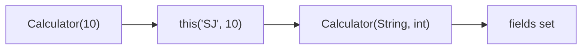

- `this()` only works **inside the same class** `[28:25](https://www.youtube.com/watch?v=_hHtmSt5dSg&t=1705s)`.
- Avoid duplicating initialization logic — centralize in one “full” constructor `[27:54](https://www.youtube.com/watch?v=_hHtmSt5dSg&t=1674s)`.

---

### Chaining with `super()` — parent first `[28:25](https://www.youtube.com/watch?v=_hHtmSt5dSg&t=1705s)`

```java
class Person {
    Person() {
        System.out.println("Person no-arg");
    }
}

class Manager extends Person {
    Manager() {
        // super();  // inserted by compiler if omitted
        System.out.println("Manager no-arg");
    }
}
```

**Object creation order** when `new Manager()` `[29:31](https://www.youtube.com/watch?v=_hHtmSt5dSg&t=1771s)`:

```text
1. Allocate memory for Manager (includes Person part)
2. Person constructor runs  (super chain)
3. Manager constructor runs
```

Console (his demo) `[30:33](https://www.youtube.com/watch?v=_hHtmSt5dSg&t=1833s)`:
1. `This is Person class no argument`
2. `Inside Manager constructor no argument`

**Hidden `super()`:** If child constructor does not write `super(...)`, compiler inserts **`super()`** as **first line** `[31:03](https://www.youtube.com/watch?v=_hHtmSt5dSg&t=1863s)`.

Explicit vs implicit — same output `[31:33](https://www.youtube.com/watch?v=_hHtmSt5dSg&t=1893s)`:

```java
Manager() {
    super();
    System.out.println("Inside Manager constructor no argument");
}
```

**Bottom-up construction:** Parent sub-object must be initialized before child-specific fields `[32:03](https://www.youtube.com/watch?v=_hHtmSt5dSg&t=1923s)`.

---

### Parameterized parent — mandatory `super(args)` `[32:34](https://www.youtube.com/watch?v=_hHtmSt5dSg&t=1954s)`

```java
class Person {
    int employeeId;
    Person(int employeeId) {
        this.employeeId = employeeId;
    }
}

class Manager extends Person {
    int age;
    Manager(int employeeId, int age) {
        super(employeeId);   // REQUIRED — parent has no no-arg ctor
        this.age = age;
    }
}
```

| Parent has | Child must |
|------------|------------|
| Only **no-arg** constructor | Can omit `super()` — compiler adds `super()` `[33:05](https://www.youtube.com/watch?v=_hHtmSt5dSg&t=1985s)` |
| **Parameterized** constructor(s), **no** no-arg | **Must** call matching `super(...)` with required arguments `[33:37](https://www.youtube.com/watch?v=_hHtmSt5dSg&t=2017s)` |

- Parent ctor initializes **parent fields**; child ctor initializes **child fields** (`age`) `[34:07](https://www.youtube.com/watch?v=_hHtmSt5dSg&t=2047s)`.
- He also calls parent→child flow **chaining through `super`** (distinct from `this()` chaining within one class) `[34:39](https://www.youtube.com/watch?v=_hHtmSt5dSg&t=2079s)`.

---

### Summary diagram: object creation with inheritance

```text
new Manager(empId, age)
        │
        ▼
   super(empId)  ──► Person(empId) runs
        │
        ▼
   Manager body   ──► this.age = age
        │
        ▼
   fully constructed Manager reference returned to caller
```

---

### Slide checklist (PDF alignment)

From slides (`07-08_Methods_Constructor` — constructor section):

- `new` → call constructor `[`*`new` keyword tells java to call constructor`]`
- Types: default, no-arg, parameterized, overload, private, chaining (`this` / `super`)
- Private ctor + static factory method for singleton-style access
- Parent parameterized → pass args via `super(...)`

---

### Interview questions / gotchas he highlights
- Constructor = **create + initialize** instance; same name as class; **no return type**.
- **`new`** triggers **constructor** invocation, not a same-named method with return type.
- No return type → implicit “returns” the new object; helps distinguish from methods.
- **Not** `final` / `abstract` / `static` / `synchronized` — know **each** reason (especially static + instance init, final/abstract + non-inheritance).
- **No constructors in interfaces** — cannot instantiate interface type.
- **Default constructor** only if **zero** user-written constructors.
- **No-arg** you write ≠ compiler **default** (body can differ).
- Any manual constructor → **no** compiler default → may break `new Foo()` unless you add no-arg.
- **Overload** constructors; **never override** constructors.
- **`this()`** = same class; **`super()`** = parent; parent runs **first**; hidden `super()` when parent has accessible no-arg.
- Parent has only parameterized ctor → child **must** `super(args)`.
- **Private** constructor blocks external `new`; use **static** `getInstance()` pattern for controlled creation.

### Quick revision
- Constructor: class-name method with **no return type**; initializes new instance.
- `new X()` → JVM allocates and runs matching `X(...)` constructor.
- Default ctor = compiler adds **only if** you declare **no** ctor.
- Explicit no-arg ctor can set fields; still zero parameters.
- Parameterized ctor: `this.field = param`; use `this.` to disambiguate shadowed names.
- Add any ctor → default ctor **gone** unless you write no-arg yourself.
- Overload ctors by parameter list; **no overriding** across inheritance.
- `private` ctor + static factory → singleton / controlled instantiation preview.
- `this(...)` chains ctors in same class; `super(...)` runs parent ctor first.
- No parent no-arg → must call `super(...)` with correct arguments.
- Interfaces: **no** constructors.


---

<a id="lec-10"></a>

## 10. 9. Java Memory Management and Garbage Collection in Depth


[↑ Index](#index) · [Parts](#parts)


> **Video:** [9. Java Memory Management and Garbage Collection in Depth](https://www.youtube.com/watch?v=vz6vSZRuS2M)

### What this lecture covers
- JVM-managed **RAM**: **stack** vs **heap** (roles, thread model, LIFO teardown)
- Walkthrough example: primitives, objects, string pool, method frames, scope
- Why heap objects outlive stack references → **garbage collection**
- `System.gc()` vs JVM control; **automatic memory management**
- Reference types: **strong**, **weak**, **soft** (and phantom mentioned)
- Reassigning references (`null`, alias, reassignment) and GC eligibility
- Heap layout: **young** (Eden, S0, S1) vs **old** generation; **minor** vs **major** GC
- **Metaspace** (non-heap) vs historical **PermGen**
- **Mark-and-sweep**, **compaction**
- GC implementations: **Serial**, **Parallel**, **CMS**, **G1**; stop-the-world, throughput vs latency

---

### Why this topic matters `[0:00](https://www.youtube.com/watch?v=vz6vSZRuS2M&t=0s)`
- Bridges earlier basics (classes, primitives, objects, methods) to **how memory is actually laid out** at runtime `[0:30](https://www.youtube.com/watch?v=vz6vSZRuS2M&t=30s)`.
- High value for **interviews** and production tuning (pause times, OOM, leaks) `[0:30](https://www.youtube.com/watch?v=vz6vSZRuS2M&t=30s)`.

---

### Big picture: who manages memory? `[1:00](https://www.youtube.com/watch?v=vz6vSZRuS2M&t=60s)`

```text
Application code (your Java)
        │
        ▼
      JVM  ── divides RAM into regions, runs GC, loads classes
        │
   ┌────┴────┐
 Stack      Heap (+ Metaspace / other non-heap areas)
```

- When he says **memory**, he means **RAM** used by the JVM process `[1:00](https://www.youtube.com/watch?v=vz6vSZRuS2M&t=60s)`.
- **JVM** creates and manages these regions — not the Java language keyword `new` alone `[1:00](https://www.youtube.com/watch?v=vz6vSZRuS2M&t=60s)`.

| Region | Primary role (his framing) |
|--------|---------------------------|
| **Stack** | Per-thread frames; primitives; **references** to heap objects |
| **Heap** | **Objects** (instances, arrays, most non-primitive data) |
| **Metaspace** (non-heap) | **Class metadata**, static/class data, constants — **not** object instances `[38:14](https://www.youtube.com/watch?v=vz6vSZRuS2M&t=2294s)` |

---

### Stack memory `[1:33](https://www.youtube.com/watch?v=vz6vSZRuS2M&t=93s)`

#### What lives on the stack `[1:33](https://www.youtube.com/watch?v=vz6vSZRuS2M&t=93s)`

| Stored on stack | Notes |
|-----------------|-------|
| **Temporary / local variables** | Method/block scope `[2:05](https://www.youtube.com/watch?v=vz6vSZRuS2M&t=125s)` |
| **Method call frames** | Each active method gets a **stack frame** (block of memory) `[2:35](https://www.youtube.com/watch?v=vz6vSZRuS2M&t=155s)` |
| **Primitive values** | Value stored **directly** in the frame `[3:06](https://www.youtube.com/watch?v=vz6vSZRuS2M&t=186s)` |
| **References** to heap objects | Variable holds **pointer-like reference**, not the object body `[3:37](https://www.youtube.com/watch?v=vz6vSZRuS2M&t=217s)` |

**Not on stack (his model):** the actual **object** created with `new` — that lives in **heap**; stack holds the **reference** `[3:37](https://www.youtube.com/watch?v=vz6vSZRuS2M&t=217s)`.

#### Thread model `[3:37](https://www.youtube.com/watch?v=vz6vSZRuS2M&t=217s)`

```text
Thread 1 ──► Stack 1
Thread 2 ──► Stack 2
Thread 3 ──► Stack 3
                │
                └──────► shared HEAP (all threads)
```

- **Each thread has its own stack** — why he drew multiple stack columns `[4:08](https://www.youtube.com/watch?v=vz6vSZRuS2M&t=248s)`.
- **Heap is shared** across threads `[4:08](https://www.youtube.com/watch?v=vz6vSZRuS2M&t=248s)`.

> **Note:** Heap sharing implies **visibility and concurrency** concerns (happens-before, `volatile`, locks) — not covered in this lecture but implied by shared heap.

#### Scope and LIFO teardown `[4:08](https://www.youtube.com/watch?v=vz6vSZRuS2M&t=248s)`
- Variables visible **only inside their scope** (method body, block) `[4:40](https://www.youtube.com/watch?v=vz6vSZRuS2M&t=280s)`.
- When scope ends, stack slots for those variables are **removed** `[4:40](https://www.youtube.com/watch?v=vz6vSZRuS2M&t=280s)`.
- Removal order for nested method calls: **LIFO** (last frame pushed = first popped) `[4:40](https://www.youtube.com/watch?v=vz6vSZRuS2M&t=280s)`.

#### Stack overflow `[4:40](https://www.youtube.com/watch?v=vz6vSZRuS2M&t=280s)`
- Fixed stack size per thread → infinite / very deep recursion fills stack → **`java.lang.StackOverflowError`** `[4:40](https://www.youtube.com/watch?v=vz6vSZRuS2M&t=280s)`.

#### Relative size
- **Heap generally larger** than a single thread stack; one heap, many stacks `[1:33](https://www.youtube.com/watch?v=vz6vSZRuS2M&t=93s)`.

---

### Heap memory `[1:33](https://www.youtube.com/watch?v=vz6vSZRuS2M&t=93s)` (intro)

| Property | Heap (his intro) |
|----------|------------------|
| Contents | **Objects** (and string pool area inside heap) |
| Ordering | **No strict allocation order** like stack frames `[slides]` |
| Cleanup | **Garbage collector** removes **unreferenced** objects `[15:33](https://www.youtube.com/watch?v=vz6vSZRuS2M&t=933s)` |
| Sharing | **All threads** share one heap `[slides]` |

---

### Code walkthrough: `MemoryManagement` class `[4:40](https://www.youtube.com/watch?v=vz6vSZRuS2M&t=280s)`

He uses a class with `main` containing `[5:11](https://www.youtube.com/watch?v=vz6vSZRuS2M&t=311s)`:
- One **primitive** (`int` = 10)
- One **object** (`new Person()`)
- One **string literal** (`"24"`)
- Call to **`memoryManagementTest(...)`** passing a reference
- Inside test method: another reference alias, string literal reuse, `new String("24")`

#### Step 1 — `main` frame created `[6:13](https://www.youtube.com/watch?v=vz6vSZRuS2M&t=373s)`
- JVM starts → **`main` invoked** → push **main stack frame** `[6:13](https://www.youtube.com/watch?v=vz6vSZRuS2M&t=373s)`.
- All locals in `main` live in that frame until `main` ends `[6:44](https://www.youtube.com/watch?v=vz6vSZRuS2M&t=404s)`.

#### Step 2 — primitive in main `[7:14](https://www.youtube.com/watch?v=vz6vSZRuS2M&t=434s)`

```java
int primitiveVariable = 10;
```

- **Value `10` stored in stack** (no reference indirection) `[7:14](https://www.youtube.com/watch?v=vz6vSZRuS2M&t=434s)`.

#### Step 3 — `new Person()` `[7:14](https://www.youtube.com/watch?v=vz6vSZRuS2M&t=434s)`
- **Person object** allocated in **heap** `[7:44](https://www.youtube.com/watch?v=vz6vSZRuS2M&t=464s)`.
- **`personObj` reference** in main’s frame points to that heap object `[7:44](https://www.youtube.com/watch?v=vz6vSZRuS2M&t=464s)`.

```text
Stack (main)          Heap
personObj ──────────► [ Person object ]
```

#### Step 4 — string literal `"24"` `[8:14](https://www.youtube.com/watch?v=vz6vSZRuS2M&t=494s)`
- String **literals** go to **string pool** (inside heap) — from prior variables lecture `[8:14](https://www.youtube.com/watch?v=vz6vSZRuS2M&t=494s)`.
- Stack variable (`stringLiteral`) holds **reference** to pooled `"24"` `[8:46](https://www.youtube.com/watch?v=vz6vSZRuS2M&t=526s)`.

#### Step 5 — `new MemoryManagement()` `[8:46](https://www.youtube.com/watch?v=vz6vSZRuS2M&t=526s)`
- Another **heap object**; `memObj` reference in **same main frame** `[9:18](https://www.youtube.com/watch?v=vz6vSZRuS2M&t=558s)`.

#### Step 6 — invoke `memoryManagementTest(personObj)` `[9:18](https://www.youtube.com/watch?v=vz6vSZRuS2M&t=558s)`
- New **stack frame** for `memoryManagementTest` `[9:49](https://www.youtube.com/watch?v=vz6vSZRuS2M&t=589s)`.
- Parameter receives **copy of reference value** → still points to **same Person** in heap `[10:19](https://www.youtube.com/watch?v=vz6vSZRuS2M&t=619s)`.

#### Step 7 — `personObj2` aliases same Person `[10:50](https://www.youtube.com/watch?v=vz6vSZRuS2M&t=650s)`

```java
Person personObj2 = personObj; // same reference target
```

- Two stack variables (parameter / local) can reference **one** heap object `[11:21](https://www.youtube.com/watch?v=vz6vSZRuS2M&t=681s)`.

#### Step 8 — second literal `"24"` reuses pool `[11:21](https://www.youtube.com/watch?v=vz6vSZRuS2M&t=681s)`
- JVM checks pool: `"24"` exists → **no duplicate** char sequence in pool; second variable points to **same** pooled instance `[11:51](https://www.youtube.com/watch?v=vz6vSZRuS2M&t=711s)`.

#### Step 9 — `new String("24")` `[11:51](https://www.youtube.com/watch?v=vz6vSZRuS2M&t=711s)`
- **`new` forces a separate heap String object** (even if content equals literal) `[12:23](https://www.youtube.com/watch?v=vz6vSZRuS2M&t=743s)`.
- `stringLiteral3` reference → distinct object (not the pool entry) `[12:23](https://www.youtube.com/watch?v=vz6vSZRuS2M&t=743s)`.

| Construct | Typical heap behavior (his teaching) |
|-----------|--------------------------------------|
| `"24"` | Pool entry (may intern) |
| `new String("24")` | New object on heap |

> **Note:** `String.intern()` and JDK string optimizations can blur interview answers; his point is **literal vs `new String`**.

#### Step 10 — test method ends → pop frame LIFO `[12:23](https://www.youtube.com/watch?v=vz6vSZRuS2M&t=743s)`
- Closing `}` of `memoryManagementTest` → **scope ends** `[12:54](https://www.youtube.com/watch?v=vz6vSZRuS2M&t=774s)`.
- All references/locals in that frame **removed from stack** in **LIFO** order (test frame popped before continuing main) `[12:54](https://www.youtube.com/watch?v=vz6vSZRuS2M&t=774s)`.
- **Heap objects remain** — only **stack references** disappeared `[13:27](https://www.youtube.com/watch?v=vz6vSZRuS2M&t=807s)`.

#### Step 11 — `main` ends → pop main frame `[13:58](https://www.youtube.com/watch?v=vz6vSZRuS2M&t=838s)`
- Removes `memObj`, string literal refs, `personObj`, primitive slot — **stack empty** `[15:02](https://www.youtube.com/watch?v=vz6vSZRuS2M&t=902s)`.
- **Person**, **MemoryManagement**, extra **String** still in heap with **no stack references** `[15:33](https://www.youtube.com/watch?v=vz6vSZRuS2M&t=933s)`.

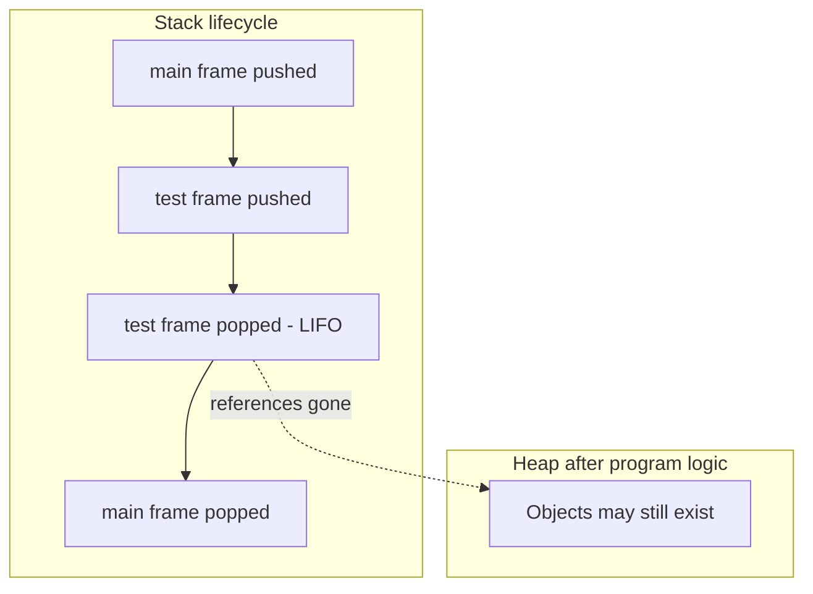

---

### Garbage collection: the problem stack does not solve `[15:33](https://www.youtube.com/watch?v=vz6vSZRuS2M&t=933s)`

**Question he poses:** We deleted **references** from stack — who deletes **objects** in heap? `[15:33](https://www.youtube.com/watch?v=vz6vSZRuS2M&t=933s)`

**Answer:** **Garbage Collector (GC)** removes objects **no longer reachable** from GC roots (strong paths from stack/static/etc.) `[16:03](https://www.youtube.com/watch?v=vz6vSZRuS2M&t=963s)`.

His simplified rule in this lecture:
- GC scans heap: “Is **any** live reference pointing here?”
- **No** → object eligible for collection `[16:03](https://www.youtube.com/watch?v=vz6vSZRuS2M&t=963s)`.
- Applies to **Person**, **MemoryManagement**, unused **String** objects; pool entries collected when **unreferenced** (subject to GC policy) `[16:33](https://www.youtube.com/watch?v=vz6vSZRuS2M&t=993s)`.

> **Note:** Reachability is more than stack locals — **GC roots** include thread stacks, static fields, JNI refs, etc. He focuses on stack→heap references for pedagogy.

---

### Automatic memory management & JVM control `[16:03](https://www.youtube.com/watch?v=vz6vSZRuS2M&t=963s)`

| Idea | Detail |
|------|--------|
| **Automatic** | Programmer does not `free()` heap objects manually `[17:03](https://www.youtube.com/watch?v=vz6vSZRuS2M&t=1023s)` |
| **Periodic GC** | JVM runs GC when it decides (memory pressure, heuristics) `[16:33](https://www.youtube.com/watch?v=vz6vSZRuS2M&t=993s)` |
| **`System.gc()`** | **Hint** to run GC — **no guarantee** JVM obeys `[16:33](https://www.youtube.com/watch?v=vz6vSZRuS2M&t=993s)` |
| **Frequency** | More heap pressure → GC tends to run **more often**; plenty of free heap → GC may run **less** `[17:34](https://www.youtube.com/watch?v=vz6vSZRuS2M&t=1054s)` |

```java
System.gc(); // suggestion only — JVM may ignore
```

> **Note:** Modern docs deprecate relying on `System.gc()` for production; use proper heap sizing and GC tuning.

---

### Reference types `[18:38](https://www.youtube.com/watch?v=vz6vSZRuS2M&t=1118s)`

He previews **strong**, **weak**, **soft** (and mentions **phantom** in passing at `[3:37](https://www.youtube.com/watch?v=vz6vSZRuS2M&t=217s)`).

#### Strong reference (default) `[19:08](https://www.youtube.com/watch?v=vz6vSZRuS2M&t=1148s)`

```java
Person pObj = new Person();
```

- Normal variable on stack → **strong reference** `[19:39](https://www.youtube.com/watch?v=vz6vSZRuS2M&t=1179s)`.
- GC **will not** collect object while strongly reachable `[19:39](https://www.youtube.com/watch?v=vz6vSZRuS2M&t=1179s)`.

#### Weak reference `[20:12](https://www.youtube.com/watch?v=vz6vSZRuS2M&t=1212s)`

```java
import java.lang.ref.WeakReference;

WeakReference<Person> weakPobj = new WeakReference<>(new Person());
```

- Object reachable **only weakly** may be collected **at GC cycle** even if weak ref object still exists `[21:13](https://www.youtube.com/watch?v=vz6vSZRuS2M&t=1273s)`.
- After collection, `weakPobj.get()` → **`null`** `[21:44](https://www.youtube.com/watch?v=vz6vSZRuS2M&t=1304s)`.

| | Strong | Weak |
|--|--------|------|
| GC behavior | Keep object while ref lives | **Eligible** when GC runs; ref does not protect target |
| After GC | Still usable | `get()` may return `null` |

**Use cases (beyond lecture):** `WeakHashMap`, canonical caches where entries should disappear when key unused.

#### Soft reference `[22:15](https://www.youtube.com/watch?v=vz6vSZRuS2M&t=1335s)`
- “Weaker than strong” like weak, but GC should clear **only when memory is urgently needed** `[22:45](https://www.youtube.com/watch?v=vz6vSZRuS2M&t=1365s)`.
- If heap has **sufficient free space**, GC may **keep** soft-referenced object longer `[23:47](https://www.youtube.com/watch?v=vz6vSZRuS2M&t=1427s)`.

| | Weak | Soft |
|--|------|------|
| When cleared | Typically **any** GC | When heap **under pressure** / “very urgent” need for space |
| Policy | More aggressive | More **reluctant** |

```java
import java.lang.ref.SoftReference;

SoftReference<Person> softRef = new SoftReference<>(new Person());
```

- Day-to-day code: almost always **strong** references `[23:16](https://www.youtube.com/watch?v=vz6vSZRuS2M&t=1396s)`.

#### Phantom reference (mentioned)
- Listed with weak/soft on slides; not demoed in depth.
- Used for **post-mortem** cleanup actions; `get()` always `null` — advanced topic.

---

### Changing references & GC eligibility `[24:17](https://www.youtube.com/watch?v=vz6vSZRuS2M&t=1457s)`

```text
Stack                         Heap
personObj ──────► [ Person #1 ]

personObj = null;
personObj ──X     [ Person #1 ]  ← eligible if no other strong refs

personObj2 ─────► [ Person #2 ]
personObj = personObj2;
personObj ─────► [ Person #2 ]
                  [ Person #1 ]  ← eligible if only old ref was personObj
```

1. **`obj = null`** — drop reference; object may be collected `[24:47](https://www.youtube.com/watch?v=vz6vSZRuS2M&t=1487s)`.
2. **Reassign** `obj1 = obj2` — `obj1` now points where `obj2` points; **previous** target may become unreachable `[25:49](https://www.youtube.com/watch?v=vz6vSZRuS2M&t=1549s)`.
3. **Heap full** also triggers GC involvement `[26:21](https://www.youtube.com/watch?v=vz6vSZRuS2M&t=1581s)`.

**Leak intuition (extend his model):** If heap objects still have **strong** references (e.g. static collections), GC **cannot** free them even if “logic” finished — not a stack-scope issue.

---

### Heap generations overview `[27:22](https://www.youtube.com/watch?v=vz6vSZRuS2M&t=1642s)`

```text
                    JVM process memory (simplified)
┌─────────────────────────────────────────────────────────────┐
│ HEAP (object instances)                                      │
│  ┌──────────────────────────┐  ┌─────────────────────────┐ │
│  │ Young Generation         │  │ Old Generation          │ │
│  │  Eden | S0 | S1          │  │  (tenured / old)        │ │
│  └──────────────────────────┘  └─────────────────────────┘ │
└─────────────────────────────────────────────────────────────┘
┌─────────────────────────────────────────────────────────────┐
│ NON-HEAP: Metaspace (class metadata, statics, constants…)    │
└─────────────────────────────────────────────────────────────┘
```

- **Young** + **old** = **heap** for objects `[27:54](https://www.youtube.com/watch?v=vz6vSZRuS2M&t=1674s)`.
- **Metaspace** = **outside** this object heap (non-heap) `[27:54](https://www.youtube.com/watch?v=vz6vSZRuS2M&t=1674s)`.

---

### Young generation: Eden + survivor spaces `[28:27](https://www.youtube.com/watch?v=vz6vSZRuS2M&t=1707s)`

| Area | Role |
|------|------|
| **Eden** | **All new objects** start here (first allocation) `[28:58](https://www.youtube.com/watch?v=vz6vSZRuS2M&t=1738s)` |
| **S0 / S1** (Survivor spaces) | Hold objects that **survived** at least one young GC; **ages** tracked `[31:01](https://www.youtube.com/watch?v=vz6vSZRuS2M&t=1861s)` |

**Typical pattern (his walkthrough):**

1. Create `O1`…`O5` → all in **Eden** `[29:29](https://www.youtube.com/watch?v=vz6vSZRuS2M&t=1769s)`.
2. **Minor GC** runs → **mark & sweep** in young gen `[29:59](https://www.youtube.com/watch?v=vz6vSZRuS2M&t=1799s)`.

---

### Mark-and-sweep (young GC) `[29:59](https://www.youtube.com/watch?v=vz6vSZRuS2M&t=1799s)`

**Phase 1 — Mark**
- Identify objects **with no references** (unreachable) → mark for deletion `[30:29](https://www.youtube.com/watch?v=vz6vSZRuS2M&t=1829s)`.
- Example: `O2`, `O5` unreachable `[30:29](https://www.youtube.com/watch?v=vz6vSZRuS2M&t=1829s)`.

**Phase 2 — Sweep**
1. **Delete** marked unreachable objects `[31:01](https://www.youtube.com/watch?v=vz6vSZRuS2M&t=1861s)`.
2. **Move survivors** from Eden into **one** survivor space (e.g. **S0**) `[31:01](https://www.youtube.com/watch?v=vz6vSZRuS2M&t=1861s)`.
3. Increment **age** of survivors (first survival → age **1**) `[31:31](https://www.youtube.com/watch?v=vz6vSZRuS2M&t=1891s)`.

This whole young-collection cycle = **minor GC** — **fast**, runs **often** `[31:31](https://www.youtube.com/watch?v=vz6vSZRuS2M&t=1891s)`.

```text
Before minor GC (Eden full-ish):
  Eden: O1 O2 O3 O4 O5
  S0/S1: empty

After minor GC:
  Eden: (cleared)
  S0: O1 O3 O4  (age 1)
  O2, O5 deleted
```

---

### Second minor GC — flip survivor spaces `[32:01](https://www.youtube.com/watch?v=vz6vSZRuS2M&t=1921s)`

- New objects `O6`, `O7` → **Eden** again `[32:01](https://www.youtube.com/watch?v=vz6vSZRuS2M&t=1921s)`.
- Another minor GC:
  - Mark unreferenced in Eden + survivors (e.g. `O7`, `O4` gone) `[32:31](https://www.youtube.com/watch?v=vz6vSZRuS2M&t=1951s)`.
  - Survivors moved to **other** survivor (Eden → **S1**, copy from **S0** → **S1**) — **alternating S0/S1** `[33:01](https://www.youtube.com/watch?v=vz6vSZRuS2M&t=1981s)`.
  - **Ages increase** (+1 per survival) `[33:32](https://www.youtube.com/watch?v=vz6vSZRuS2M&t=2012s)`.

**Invariant he stresses:** After GC, **Eden empty**, **one** survivor space empty, objects **ping-pong** between S0 and S1 with growing **age** `[33:32](https://www.youtube.com/watch?v=vz6vSZRuS2M&t=2012s)`.

---

### Promotion to old generation `[34:04](https://www.youtube.com/watch?v=vz6vSZRuS2M&t=2044s)`

- JVM has **age threshold** (example: **3**) `[34:04](https://www.youtube.com/watch?v=vz6vSZRuS2M&t=2044s)`.
- When object’s **age ≥ threshold** after a minor GC → **promoted** to **old generation** `[35:39](https://www.youtube.com/watch?v=vz6vSZRuS2M&t=2139s)`.
- Example: `O1` reaches age 3 → moved from survivor to **old gen** `[35:39](https://www.youtube.com/watch?v=vz6vSZRuS2M&t=2139s)`.

```text
Young (Eden + survivors)     Old
  O1 (age 3) ──promote──►    [ O1 ]
```

**Tenuring:** Long-lived objects graduate to old gen; short-lived die in young gen without promoting.

> **Note:** Actual JVM flag: `-XX:MaxTenuringThreshold` (and adaptive tenuring in modern collectors).

---

### Old generation & major GC `[36:11](https://www.youtube.com/watch?v=vz6vSZRuS2M&t=2171s)`

| | Young / minor GC | Old / major GC |
|--|------------------|----------------|
| **Frequency** | **Often** (seconds-level in his analogy) `[36:11](https://www.youtube.com/watch?v=vz6vSZRuS2M&t=2171s)` | **Rare** (e.g. half-hour analogy) `[36:41](https://www.youtube.com/watch?v=vz6vSZRuS2M&t=2201s)` |
| **Typical objects** | Short-lived, small churn | **Long-lived**, larger, many incoming references `[37:12](https://www.youtube.com/watch?v=vz6vSZRuS2M&t=2232s)` |
| **Cost** | Faster | **Slower** — more live data, more reference graph `[37:12](https://www.youtube.com/watch?v=vz6vSZRuS2M&t=2232s)` |
| **Algorithm shape** | Mark unreachable, sweep, copy survivors | Still mark/sweep (± compaction) `[37:12](https://www.youtube.com/watch?v=vz6vSZRuS2M&t=2232s)` |

- Old gen also called **tenured** / historically tied to **PermGen** naming confusion — he separates **object old gen** from **metaspace** `[38:45](https://www.youtube.com/watch?v=vz6vSZRuS2M&t=2325s)`.

---

### Metaspace (non-heap) `[37:43](https://www.youtube.com/watch?v=vz6vSZRuS2M&t=2263s)`

**Stores (his list):**
- **Class / static variables** (static fields) `[38:14](https://www.youtube.com/watch?v=vz6vSZRuS2M&t=2294s)`
- **Class metadata** — structure needed to instantiate objects `[38:14](https://www.youtube.com/watch?v=vz6vSZRuS2M&t=2294s)`
- **Constants** (`static final`, constant pool entries conceptually) `[38:14](https://www.youtube.com/watch?v=vz6vSZRuS2M&t=2294s)`

**Lifecycle:**
- Class loaded → metadata in metaspace `[38:45](https://www.youtube.com/watch?v=vz6vSZRuS2M&t=2325s)`.
- Class unloaded (rare for app classes) → metadata reclaimed `[38:45](https://www.youtube.com/watch?v=vz6vSZRuS2M&t=2325s)`.

#### PermGen vs Metaspace `[39:15](https://www.youtube.com/watch?v=vz6vSZRuS2M&t=2355s)`

| | PermGen (≤ Java 7 era) | Metaspace (Java 8+) |
|--|------------------------|---------------------|
| Location | **Part of heap** | **Native / non-heap** (not young/old object heap) `[39:46](https://www.youtube.com/watch?v=vz6vSZRuS2M&t=2386s)` |
| Size | **Fixed** cap | **Can grow** with need (still not unlimited) `[40:18](https://www.youtube.com/watch?v=vz6vSZRuS2M&t=2418s)` |
| OOM | `OutOfMemoryError: PermGen space` when full | `OutOfMemoryError: Metaspace` if limits hit |
| Kind of data | Similar metadata/static story | Similar role |

> **Note:** He says “before Java 7” / “Java 8 uses metaspace” — **PermGen removed in Java 8**; metaspace is default since then.

**Object heap today:** only **young + old** for instances; class metadata **beside** that in metaspace `[40:18](https://www.youtube.com/watch?v=vz6vSZRuS2M&t=2418s)`.

---

### Mark-and-sweep with compaction `[40:52](https://www.youtube.com/watch?v=vz6vSZRuS2M&t=2452s)`

**Problem after sweep without compaction:**

```text
[ live ][ free ][ live ][ free ][ live ]
         ↑ fragmentation — hard to allocate large object
```

- Sweep deletes holes but leaves **fragmented** free gaps `[41:53](https://www.youtube.com/watch?v=vz6vSZRuS2M&t=2513s)`.

**Compaction step:**
- **Slide surviving objects together** → one contiguous free block at end `[42:25](https://www.youtube.com/watch?v=vz6vSZRuS2M&t=2545s)`.
- Easier **bump-pointer** or sequential allocation for new objects `[42:25](https://www.youtube.com/watch?v=vz6vSZRuS2M&t=2545s)`.

```text
After compaction:
[ live ][ live ][ live ][      free block      ]
```

---

### GC algorithm implementations (collector types) `[42:57](https://www.youtube.com/watch?v=vz6vSZRuS2M&t=2577s)`

He names four families:

1. **Serial GC**
2. **Parallel GC**
3. **CMS** — Concurrent Mark Sweep
4. **G1** — Garbage-First

---

### Serial GC `[43:27](https://www.youtube.com/watch?v=vz6vSZRuS2M&t=2607s)`

- **Single GC thread** for both **minor** and **major** work `[43:27](https://www.youtube.com/watch?v=vz6vSZRuS2M&t=2607s)`.
- **Slowest** cleanup throughput; simple; suits small / single-core programs.

**Stop-the-world (STW):** When GC runs, **all application threads pause** `[44:30](https://www.youtube.com/watch?v=vz6vSZRuS2M&t=2670s)`.
- He nicknames this **“stop the world”** `[44:30](https://www.youtube.com/watch?v=vz6vSZRuS2M&t=2670s)`.
- GC is **expensive** because pauses directly hurt latency and throughput `[45:02](https://www.youtube.com/watch?v=vz6vSZRuS2M&t=2702s)`.

---

### Parallel GC `[45:02](https://www.youtube.com/watch?v=vz6vSZRuS2M&t=2702s)`

- **Multiple GC threads** in parallel (often tied to CPU cores) `[45:34](https://www.youtube.com/watch?v=vz6vSZRuS2M&t=2734s)`.
- Faster than serial → **shorter pauses** (still STW during young/old parallel phases).
- He states **Java 8** commonly used **Parallel GC** as a practical default in many deployments `[47:09](https://www.youtube.com/watch?v=vz6vSZRuS2M&t=2829s)`.

> **Note:** Java 9+ default on server-class machines is often **G1**; always verify with `java -XX:+PrintFlagsFinal` / docs for your JDK.

---

### CMS — Concurrent Mark Sweep `[46:06](https://www.youtube.com/watch?v=vz6vSZRuS2M&t=2766s)`

- GC tries to run **concurrently** with application threads — **less stopping** `[46:37](https://www.youtube.com/watch?v=vz6vSZRuS2M&t=2797s)`.
- JVM **does not guarantee** zero pauses — “best effort” `[46:37](https://www.youtube.com/watch?v=vz6vSZRuS2M&t=2797s)`.
- **Trade-off:** often **no compaction** → **fragmentation** risk over time `[47:09](https://www.youtube.com/watch?v=vz6vSZRuS2M&t=2829s)`.

| Pros | Cons |
|------|------|
| Reduced pause times vs pure STW | Not 100% concurrent; fragmentation; deprecated/removal in newer JDKs |

> **Note:** CMS removed in JDK 14+; know it for interviews on legacy systems.

---

### G1 GC `[47:09](https://www.youtube.com/watch?v=vz6vSZRuS2M&t=2829s)`

- “Better” concurrent collector goals:
  - Try hard to **limit long pauses** `[47:39](https://www.youtube.com/watch?v=vz6vSZRuS2M&t=2859s)`.
  - **Compaction** support — reduces fragmentation vs CMS in his comparison `[47:09](https://www.youtube.com/watch?v=vz6vSZRuS2M&t=2829s)`.
- Divides heap into **regions** (detail beyond lecture) — collects **garbage-first** regions with most reclaimable space.

He mentions slide text: **G1 default in Java 8** on some materials vs his verbal “Java 8 parallel” — treat as **version- and ergonomics-dependent**.

> **Note:** Align interview answers with JDK version: **G1** default (9+), **ZGC** / **Shenandoah** for very low pause goals on modern LTS.

---

### Throughput vs latency (GC tuning intuition) `[47:39](https://www.youtube.com/watch?v=vz6vSZRuS2M&t=2859s)`

| Term | His meaning |
|------|-------------|
| **Throughput** | Work done per time (e.g. requests/minute) `[47:39](https://www.youtube.com/watch?v=vz6vSZRuS2M&t=2859s)` |
| **Latency** | Delay per operation; **pause time** hurts latency `[48:09](https://www.youtube.com/watch?v=vz6vSZRuS2M&t=2889s)` |

- Fewer / shorter GC pauses → threads run more → **higher throughput**, **lower latency** `[48:09](https://www.youtube.com/watch?v=vz6vSZRuS2M&t=2889s)`.
- Example: 1000 req/min → 1500 req/min after pause reduction `[47:39](https://www.youtube.com/watch?v=vz6vSZRuS2M&t=2859s)`.

---

### End-to-end memory story (revision diagram)

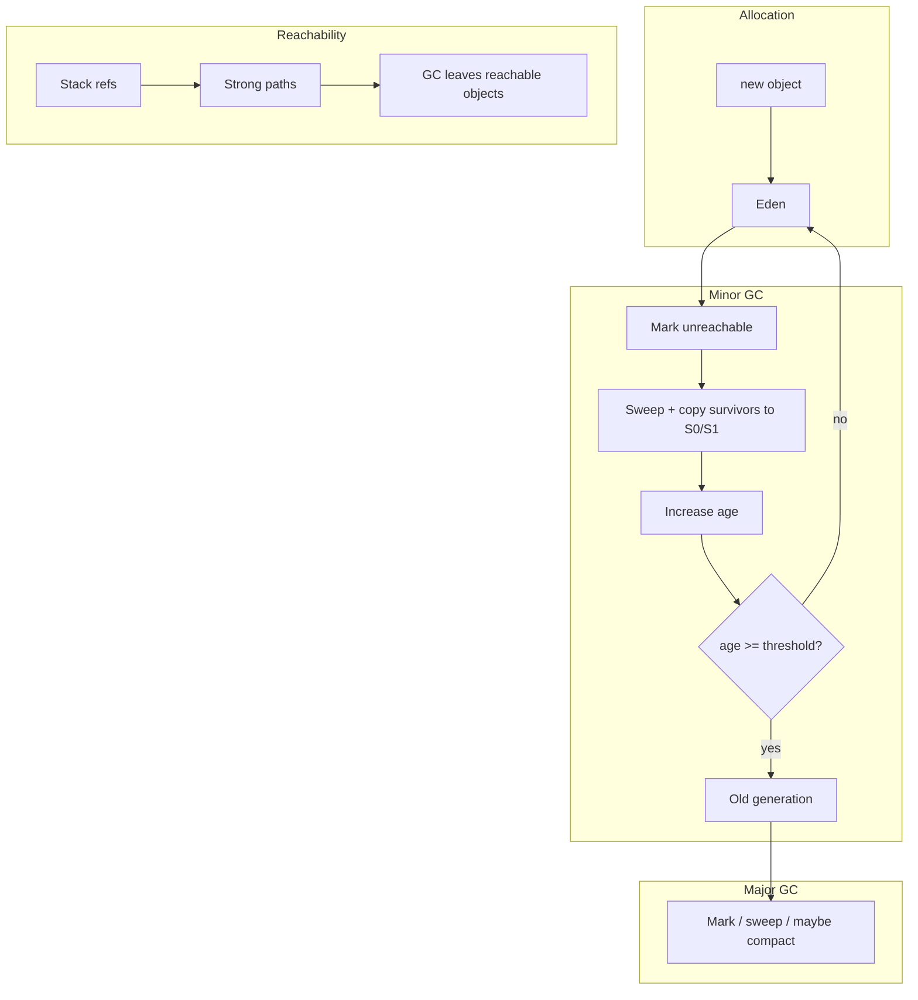

---

### Practical mental model for developers

1. **Write code assuming stack frames are cheap and short-lived; objects live on heap.**
2. **Short-lived temporaries** die in **young GC** — good (generational hypothesis).
3. **Long-lived caches / singletons** end up in **old gen** — expensive to collect; avoid accidental strong retention.
4. **Do not depend on `System.gc()`** for correctness or perf tests `[16:33](https://www.youtube.com/watch?v=vz6vSZRuS2M&t=993s)`.
5. **String literals** share pool; **`new String`** creates distinct objects unless interned `[12:23](https://www.youtube.com/watch?v=vz6vSZRuS2M&t=743s)`.
6. **Metaspace** issues ≠ heap heap issues — different OOM messages and flags.

---

### Common interview follow-ups (extend lecture)

| Question | Short answer |
|----------|--------------|
| Stack vs heap? | Stack: frames, primitives, refs; heap: objects; per-thread stack, shared heap |
| What is a GC root? | Starting points for reachability (stacks, statics, JNI, etc.) |
| Minor vs major GC? | Young vs old collection; minor frequent/fast |
| Eden vs survivor? | New vs survived young objects; copying between S0/S1 |
| Why generational GC? | Most objects die young — collect young area often |
| `finalize()`? | Largely deprecated/removed — do not rely on for cleanup (modern Java) |
| Memory leak in Java? | Possible via live strong references (collections, statics, listeners) |

---

### Interview questions / gotchas he highlights
- JVM splits RAM into **stack** (per thread) and **heap** (shared).
- Stack: locals, primitives, **references**; heap: **objects** and string pool.
- Scope ends → stack entries removed **LIFO**; heap objects may remain.
- **GC** frees **unreferenced** heap objects; **automatic** management.
- **`System.gc()`** is a hint — **no guarantee**; JVM controls timing.
- **Strong** ref prevents collection; **weak** cleared on GC; **soft** cleared under memory pressure.
- `null` and reassignment change reachability → eligibility for GC.
- Young gen: **Eden**, **S0**, **S1**; new objects in **Eden**; **minor GC** uses **mark & sweep** + copy survivors; **age** + **promotion** to old.
- Old gen: **major GC**, less frequent, heavier.
- **Metaspace** (non-heap) for class metadata/statics; **not** PermGen on Java 8+.
- PermGen: fixed part of heap; metaspace: expandable, non-heap.
- **Mark-sweep** vs **mark-sweep-compact** (fragmentation).
- Collectors: **Serial** (1 thread), **Parallel** (multi), **CMS** (concurrent, weak compaction story), **G1** (concurrent + compaction goals).
- GC ⇒ **stop-the-world** pauses (at least partially) → hurts throughput/latency.
- Tuning goal: **higher throughput**, **lower latency** via less pause time.

### Quick revision
- Stack = thread-private frames; primitives + object **references**; LIFO pop on method exit.
- Heap = shared **objects**; string **literal pool** in heap.
- No stack reference ⇒ object **candidate** for GC (if no other strong path).
- `System.gc()` ≠ forced GC; JVM decides when to collect.
- Strong / weak / soft control how aggressively GC may clear referents.
- `obj = null` or reassign → old object may become unreachable.
- New `new` → **Eden**; minor GC marks dead, sweeps, copies survivors to **S0/S1**, bumps **age**.
- Age threshold → **old generation**; **major GC** on old gen, slower and rarer.
- **Metaspace**: class metadata, statics, constants — outside object heap (Java 8+).
- Mark-sweep deletes; **compaction** packs live objects to reduce fragmentation.
- Serial = one GC thread; Parallel = many; CMS = concurrent (fragmentation); G1 = concurrent + compaction aim.
- GC pauses stall app threads → tune for throughput and latency.


---

<a id="lec-11"></a>

## 11. 10. Java Classes in Depth - Part1 | Nested Class, Concrete, Abstract, Object, Super and Sub Class


[↑ Index](#index) · [Parts](#parts)


> **Video:** [10. Java Classes in Depth - Part1 | Nested Class, Concrete, Abstract, Object, Super and Sub Class](https://www.youtube.com/watch?v=aecJeZgl__4)

### What this lecture covers
- Roadmap of **types of classes** in Java (this video stops before generics / POJO / enum / final / singleton / immutable / wrapper)
- **Concrete** vs **abstract** classes; abstraction via abstract class vs interface
- **Superclass** / **subclass**; implicit parent **`java.lang.Object`**
- **`Object`** as universal reference; **`getClass()`**
- **Nested classes**: static nested, member inner, local inner, anonymous inner
- Nested-class **access modifiers**, invocation rules, and rare **inheritance** patterns
- Interview-heavy topics he still calls “rare in production”

---

### Lecture split & class-type roadmap `[0:00](https://www.youtube.com/watch?v=aecJeZgl__4&t=0s)`

He lists many “kinds” of classes you will meet in Java and enterprise code:

| Category (his list) | Covered in this video? |
|---------------------|-------------------------|
| Concrete, abstract, super/sub, `Object`, nested (static / inner / local / anonymous) | **Yes** |
| Generic, POJO, enum, `final`, singleton, immutable, wrapper | **Part 2** (lecture 12 starts with generics) |

```text
Types of classes (playlist arc)
├── Part 1 (this video) ── concrete, abstract, Object, nested
└── Part 2 (next) ─────── generic, POJO, enum, final, singleton, immutable, wrapper
```

---

### Concrete class `[1:03](https://www.youtube.com/watch?v=aecJeZgl__4&t=63s)`

**Definition:** any class where you can **`new`** an instance — a **concrete** class `[1:03](https://www.youtube.com/watch?v=aecJeZgl__4&t=63s)`.

| Property | Meaning |
|----------|---------|
| Instantiation | `new ConcreteClass()` is allowed |
| Methods | **Every** method has a body (full implementation) — unlike an interface method that may be only a signature until implemented `[1:34](https://www.youtube.com/watch?v=aecJeZgl__4&t=94s)` |
| Origin | Can be a “normal” class, or a class that **implements** an interface, or **extends** another class — as long as all abstract obligations are satisfied `[1:34](https://www.youtube.com/watch?v=aecJeZgl__4&t=94s)` |

**Interface → concrete implementation** `[1:34](https://www.youtube.com/watch?v=aecJeZgl__4&t=94s)`:
- You **cannot** `new` the interface type.
- You **can** `new Rectangle()` (example) if `Rectangle implements Shape` and implements `display()` (or whatever the interface declares).

```java
interface Shape {
    void display();
}

class Rectangle implements Shape {
    @Override
    public void display() {
        System.out.println("Rectangle");
    }
}

// Shape s = new Shape();     // NOT allowed
Rectangle r = new Rectangle(); // concrete — OK
```

**Top-level class access modifiers** `[2:04](https://www.youtube.com/watch?v=aecJeZgl__4&t=124s)`:

| Modifier on a **top-level** class | Visibility |
|-----------------------------------|------------|
| `public` | Any package |
| *(none)* = **package-private** / **default** | Same package only |

Only **`public`** or **package-private** are legal on a **top-level** class — not `private` / `protected` at file level `[2:35](https://www.youtube.com/watch?v=aecJeZgl__4&t=155s)`. *(Nested classes are different — see below.)*

---

### Abstraction recap `[3:07](https://www.youtube.com/watch?v=aecJeZgl__4&t=187s)`

**Abstraction** = hide **how** something works; expose only **what** the client needs `[3:37](https://www.youtube.com/watch?v=aecJeZgl__4&t=217s)`.

- **Car analogy:** client calls `applyBrake()`; internal mechanics (hydraulics, ABS, etc.) stay hidden `[3:37](https://www.youtube.com/watch?v=aecJeZgl__4&t=217s)`.
- Shows **important features**; hides **internal implementation** `[4:09](https://www.youtube.com/watch?v=aecJeZgl__4&t=249s)`.

**Two mechanisms in Java** `[4:09](https://www.youtube.com/watch?v=aecJeZgl__4&t=249s)`:

| Mechanism | Typical abstraction level (his framing) |
|-----------|----------------------------------------|
| **`interface`** | **100%** abstraction — methods are declarations; implementation lives in implementers `[5:42](https://www.youtube.com/watch?v=aecJeZgl__4&t=342s)` |
| **`abstract class`** | **0–100%** — mix of abstract methods (no body) and concrete methods (with body) in the same class `[6:16](https://www.youtube.com/watch?v=aecJeZgl__4&t=376s)` |

> **Note:** Modern interfaces can have `default` and `static` methods with bodies; his “100% interface abstraction” is the classic teaching model from earlier in the course.

---

### Abstract class in depth `[4:41](https://www.youtube.com/watch?v=aecJeZgl__4&t=281s)`

Declare with **`abstract`** keyword on the class `[4:41](https://www.youtube.com/watch?v=aecJeZgl__4&t=281s)`.

- **Abstract method:** signature only — **no** implementation in the abstract class `[5:11](https://www.youtube.com/watch?v=aecJeZgl__4&t=311s)`.
- **Extends** (not `implements`) for class inheritance — child **must** supply missing implementations (unless child is also abstract) `[5:11](https://www.youtube.com/watch?v=aecJeZgl__4&t=311s)`.

**Slide-style hierarchy (his `Car` example)** `[6:48](https://www.youtube.com/watch?v=aecJeZgl__4&t=408s)`:

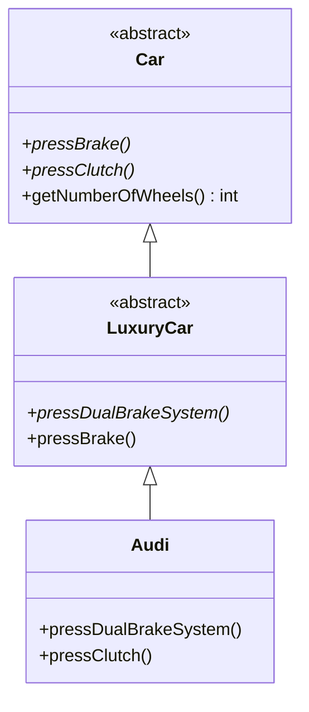

| Class | Role | Abstract methods | Concrete methods |
|-------|------|------------------|------------------|
| `Car` | Abstract base | `pressBrake`, `pressClutch` | e.g. `getNumberOfWheels()` returns `4` `[7:21](https://www.youtube.com/watch?v=aecJeZgl__4&t=441s)` |
| `LuxuryCar` | Abstract child | Adds `pressDualBrakeSystem`; **implements** `pressBrake` from parent `[7:52](https://www.youtube.com/watch?v=aecJeZgl__4&t=472s)` | Can inherit concrete methods from `Car` |
| `Audi` | **Concrete** leaf | Must implement **all** remaining abstract methods (`pressDualBrakeSystem`, `pressClutch`, etc.) `[8:23](https://www.youtube.com/watch?v=aecJeZgl__4&t=503s)` | Full implementation |

**Rules:**
- Abstract class may contain **both** abstract and non-abstract methods `[6:48](https://www.youtube.com/watch?v=aecJeZgl__4&t=408s)`.
- An abstract **child** of an abstract parent may **either** implement a parent abstract method **or** add **more** abstract methods `[7:52](https://www.youtube.com/watch?v=aecJeZgl__4&t=472s)`.
- **`new Car()`** / **`new LuxuryCar()`** → **not allowed** — incomplete abstraction `[9:24](https://www.youtube.com/watch?v=aecJeZgl__4&t=564s)`.
- **`new Audi()`** → allowed when `Audi` is concrete and completes the contract `[9:24](https://www.youtube.com/watch?v=aecJeZgl__4&t=564s)`.
- **Polymorphism:** `LuxuryCar ref = new Audi();` — parent reference, child object `[9:56](https://www.youtube.com/watch?v=aecJeZgl__4&t=596s)`.

```java
abstract class Car {
    abstract void pressBrake();
    abstract void pressClutch();
    int getNumberOfWheels() { return 4; }
}

abstract class LuxuryCar extends Car {
    abstract void pressDualBrakeSystem();
    @Override void pressBrake() { /* luxury implementation */ }
}

class Audi extends LuxuryCar {
    @Override void pressDualBrakeSystem() { }
    @Override void pressClutch() { }
}
```

---

### Superclass, subclass, and `Object` `[10:28](https://www.youtube.com/watch?v=aecJeZgl__4&t=628s)`

| Term | Meaning |
|------|---------|
| **Superclass** (parent) | The class being extended |
| **Subclass** (child) | `class B extends A` — **B** is subclass of **A** `[12:34](https://www.youtube.com/watch?v=aecJeZgl__4&t=754s)` |

**Interview core:** if a class does **not** explicitly `extends` anything, it still implicitly extends **`java.lang.Object`** `[11:30](https://www.youtube.com/watch?v=aecJeZgl__4&t=690s)`.

```text
java.lang.Object
    └── Person          (no explicit extends)
    └── A
            └── B       (B extends A; A still extends Object unless A extends something else)
```

Every class is ultimately a **subclass of `Object`** `[13:04](https://www.youtube.com/watch?v=aecJeZgl__4&t=784s)`.

**Useful methods on `Object`** (preview — threading details later) `[13:04](https://www.youtube.com/watch?v=aecJeZgl__4&t=784s)`:

| Method | Typical use (high level) |
|--------|---------------------------|
| `toString()` | String representation |
| `equals(Object)` | Value / identity equality (override in domain classes) |
| `hashCode()` | Hash buckets / collections |
| `clone()` | Copy object (special rules) |
| `wait()`, `notify()`, `notifyAll()` | Thread coordination — concurrency lectures `[13:34](https://www.youtube.com/watch?v=aecJeZgl__4&t=814s)` |
| `getClass()` | Runtime `Class<?>` metadata `[15:35](https://www.youtube.com/watch?v=aecJeZgl__4&t=935s)` |

**`Object` as “universal holder”** `[14:35](https://www.youtube.com/watch?v=aecJeZgl__4&t=875s)`:
- `Person` has no written parent, but **`Object obj = new Person();`** works — parent reference, child instance `[14:35](https://www.youtube.com/watch?v=aecJeZgl__4&t=875s)`.
- Same for `Audi` → store in `Object` reference `[15:05](https://www.youtube.com/watch?v=aecJeZgl__4&t=905s)`.
- When you do not know the concrete type at compile time, hold as `Object`, then use **`getClass()`** to discover runtime type and branch logic `[16:05](https://www.youtube.com/watch?v=aecJeZgl__4&t=965s)`.

```java
Object o1 = new Person();
System.out.println(o1.getClass()); // class Person

Object o2 = new Audi();
System.out.println(o2.getClass()); // class Audi
```

> **Note:** Prefer generics / pattern matching / `instanceof` in modern code over raw `Object` + manual casting; he introduces `Object` here as the foundation for lecture 12 generics.

---

### Nested classes — overview `[16:35](https://www.youtube.com/watch?v=aecJeZgl__4&t=995s)`

**Nested class** = a class **declared inside** another (outer) class `[18:40](https://www.youtube.com/watch?v=aecJeZgl__4&t=1120s)`.

**Terminology (do not confuse)** `[17:07](https://www.youtube.com/watch?v=aecJeZgl__4&t=1027s)`:

```text
Nested class
├── static nested class          (has static modifier)
└── non-static nested class      (= inner class)
        ├── member inner class
        ├── local inner class
        └── anonymous inner class
```

**Five kinds** total when you count static + three inner flavors `[17:39](https://www.youtube.com/watch?v=aecJeZgl__4&t=1059s)`.

**Production vs interview** `[18:09](https://www.youtube.com/watch?v=aecJeZgl__4&t=1089s)`:
- He reports **rare** day-to-day use in ~8 years of industry work.
- Still **frequently asked** in interviews — worth knowing cold.

**When to use (hint)** `[18:40](https://www.youtube.com/watch?v=aecJeZgl__4&t=1120s)`:
- Class **A** will be used **only** by class **B** → instead of `A.java`, nest **A inside B** to **group related types in one file** `[19:11](https://www.youtube.com/watch?v=aecJeZgl__4&t=1151s)`.
- Nested type’s **visibility scope** cannot exceed the outer class’s scope (public/default package rules on outer) `[20:11](https://www.youtube.com/watch?v=aecJeZgl__4&t=1211s)`.

---

### Static nested class `[20:43](https://www.youtube.com/watch?v=aecJeZgl__4&t=1243s)`

Declared **`static`** inside the outer class `[21:15](https://www.youtube.com/watch?v=aecJeZgl__4&t=1275s)`.

| Can access in outer | Static nested class |
|---------------------|---------------------|
| `static` fields / methods of outer | **Yes** `[21:46](https://www.youtube.com/watch?v=aecJeZgl__4&t=1306s)` |
| Instance fields of outer | **No** — needs an outer **instance** `[22:18](https://www.youtube.com/watch?v=aecJeZgl__4&t=1338s)` |

Same rule as **static methods** only touching **static** members `[21:46](https://www.youtube.com/watch?v=aecJeZgl__4&t=1306s)`.

**Invocation analogy** `[22:49](https://www.youtube.com/watch?v=aecJeZgl__4&t=1369s)`:

| Member kind | How you call it |
|-------------|-----------------|
| `static` method `display()` on outer | `OuterClass.display()` — no outer object `[23:20](https://www.youtube.com/watch?v=aecJeZgl__4&t=1400s)` |
| Instance method `print()` | `OuterClass o = new OuterClass(); o.print();` `[23:50](https://www.youtube.com/watch?v=aecJeZgl__4&t=1430s)` |
| **Static nested** class | `OuterClass.Nested nested = new OuterClass.Nested();` — **no** outer instance required `[24:21](https://www.youtube.com/watch?v=aecJeZgl__4&t=1461s)` |

```java
class Outer {
    int instanceVar = 1;
    static int classVar = 2;

    static class StaticNested {
        void show() {
            System.out.println(classVar);   // OK
            // System.out.println(instanceVar); // compile error
        }
    }
}

// usage
Outer.StaticNested n = new Outer.StaticNested();
```

---

### Nested class access modifiers (interview) `[25:22](https://www.youtube.com/watch?v=aecJeZgl__4&t=1522s)`

**Top-level** class: only `public` or package-private `[25:54](https://www.youtube.com/watch?v=aecJeZgl__4&t=1554s)`.

**Nested** class: may be **`public` / `protected` / `private` / package-private`** like a field or method `[25:54](https://www.youtube.com/watch?v=aecJeZgl__4&t=1554s)`.

**`private` static nested class** `[26:26](https://www.youtube.com/watch?v=aecJeZgl__4&t=1586s)`:
- Treat nested type like a **private member** — **cannot** `new` it from outside the outer class `[27:30](https://www.youtube.com/watch?v=aecJeZgl__4&t=1650s)`.
- Outer exposes a **public** method that **internally** constructs the private nested type and delegates `[27:30](https://www.youtube.com/watch?v=aecJeZgl__4&t=1650s)`.

---

### Member inner class (non-static nested) `[28:30](https://www.youtube.com/watch?v=aecJeZgl__4&t=1710s)`

No `static` keyword → **inner class** (non-static nested) `[28:30](https://www.youtube.com/watch?v=aecJeZgl__4&t=1710s)`.

| Access | Inner class |
|--------|-------------|
| Outer’s instance members | **Yes** |
| Outer’s static members | **Yes** `[29:00](https://www.youtube.com/watch?v=aecJeZgl__4&t=1740s)` |

**Invocation** — needs **outer instance first** `[29:31](https://www.youtube.com/watch?v=aecJeZgl__4&t=1771s)`:

```java
Outer outer = new Outer();
Outer.Inner inner = outer.new Inner();   // syntax variant; also Outer.Inner inner = outer.new Inner();
inner.print();
```

Compare to static nested: **`Outer.StaticNested n = new Outer.StaticNested();`** without `outer` `[30:04](https://www.youtube.com/watch?v=aecJeZgl__4&t=1804s)`.

**Member inner class** = inner class declared **directly** in the outer class body (the earlier example) `[31:05](https://www.youtube.com/watch?v=aecJeZgl__4&t=1865s)`. May use `private` / `protected` / `public` / default `[31:05](https://www.youtube.com/watch?v=aecJeZgl__4&t=1865s)`.

---

### Local inner class `[31:35](https://www.youtube.com/watch?v=aecJeZgl__4&t=1895s)`

Defined **inside a block** — method body, `if`, `for`, `while`, etc. `[31:35](https://www.youtube.com/watch?v=aecJeZgl__4&t=1895s)`.

| Rule | Detail |
|------|--------|
| Access modifiers | **Only package-private** — **no** `public` / `protected` / `private` on the local class `[32:06](https://www.youtube.com/watch?v=aecJeZgl__4&t=1926s)` |
| Lifetime | Exists only while the **block** runs; when block ends, class is unusable — like a local variable’s scope `[33:39](https://www.youtube.com/watch?v=aecJeZgl__4&t=2019s)` |
| Instantiation | **Only inside that block** `[32:38](https://www.youtube.com/watch?v=aecJeZgl__4&t=1958s)` |
| Can read | Outer instance/static members, locals from enclosing block (with effectively-final rules in modern Java) `[33:09](https://www.youtube.com/watch?v=aecJeZgl__4&t=1989s)` |

**Memory intuition** `[33:39](https://www.youtube.com/watch?v=aecJeZgl__4&t=2019s)`:
- Method activation → stack/frame for that invocation.
- Local inner class “dies” when the method/block finishes — no point exposing it with `public` `[34:42](https://www.youtube.com/watch?v=aecJeZgl__4&t=2082s)`.

**Invocation from outside** `[35:47](https://www.youtube.com/watch?v=aecJeZgl__4&t=2147s)`:
- External code calls outer’s `display()` (or similar).
- **Inside** `display()`, construct local class and call its methods — external world never names the local class directly `[36:18](https://www.youtube.com/watch?v=aecJeZgl__4&t=2178s)`.

---

### Inheritance involving nested classes `[37:19](https://www.youtube.com/watch?v=aecJeZgl__4&t=2239s)`

He stresses: **possible**, **almost never used** in large projects — but exams/interviews may ask `[37:19](https://www.youtube.com/watch?v=aecJeZgl__4&t=2239s)`.

#### Example 1 — inner extends inner (same outer) `[37:50](https://www.youtube.com/watch?v=aecJeZgl__4&t=2270s)`

- `InnerClass2 extends InnerClass1` inside the same `Outer`.
- `InnerClass2` sees its own members, parent inner members, and **outer** members `[38:20](https://www.youtube.com/watch?v=aecJeZgl__4&t=2300s)`.
- Create: `Outer o = new Outer();` then `o.new InnerClass2()` (pattern) and call methods `[38:50](https://www.youtube.com/watch?v=aecJeZgl__4&t=2330s)`.

#### Example 2 — static nested extended from another top-level class `[39:21](https://www.youtube.com/watch?v=aecJeZgl__4&t=2361s)`

```java
class Outer {
    static class Nested { void display() { } }
}

class Other extends Outer.Nested {
    void use() { display(); }
}
```

Static nested type is tied to **`Outer.Nested`** — like accessing a static member via qualified name `[40:23](https://www.youtube.com/watch?v=aecJeZgl__4&t=2423s)`. **No** special outer-instance constructor dance `[40:23](https://www.youtube.com/watch?v=aecJeZgl__4&t=2423s)`.

#### Example 3 — non-static inner extended from another class `[40:53](https://www.youtube.com/watch?v=aecJeZgl__4&t=2453s)`

Inner class is **bound to an instance** of `Outer` `[41:24](https://www.youtube.com/watch?v=aecJeZgl__4&t=2484s)`.

When `class Other extends Outer.Inner`:
- Child constructor chain must ensure an **`Outer` instance exists** before `super()` on the inner class `[42:27](https://www.youtube.com/watch?v=aecJeZgl__4&t=2547s)`.
- Pattern: `Other(Outer outer) { super(outer); }` — create outer, then call `super(outer)` so the inner superclass links to that outer instance `[43:28](https://www.youtube.com/watch?v=aecJeZgl__4&t=2608s)`.

```text
new Other()
  → must have Outer instance first (inner is per-outer-object)
  → super(outer) wires Inner parent to that Outer
```

Contrast static case: extending `Outer.Nested` does **not** need an `Outer` object `[43:58](https://www.youtube.com/watch?v=aecJeZgl__4&t=2638s)`.

---

### Anonymous inner class `[44:28](https://www.youtube.com/watch?v=aecJeZgl__4&t=2668s)`

**Anonymous class** = inner class **without a name** `[44:58](https://www.youtube.com/watch?v=aecJeZgl__4&t=2698s)`.

**When useful** `[45:29](https://www.youtube.com/watch?v=aecJeZgl__4&t=2729s)`:
- Override behavior **once** without declaring a separate `Audi.java` / subclass file.
- Common with **abstract classes** or **interfaces** when you need a **one-off** implementation `[45:29](https://www.youtube.com/watch?v=aecJeZgl__4&t=2729s)`.

**Syntax shape** `[45:59](https://www.youtube.com/watch?v=aecJeZgl__4&t=2759s)`:

```java
abstract class Car {
    abstract void pressBrake();
}

// anonymous subclass of Car
Car audi = new Car() {
    @Override
    void pressBrake() {
        System.out.println("Audi-specific brake");
    }
};  // semicolon ends the statement

audi.pressBrake();
```

You cannot `new Car()` on an abstract class alone — the **anonymous body** supplies the missing method bodies `[46:29](https://www.youtube.com/watch?v=aecJeZgl__4&t=2789s)`.

**What the compiler does** `[47:30](https://www.youtube.com/watch?v=aecJeZgl__4&t=2850s)`:
1. Generates a synthetic class e.g. `ObjectTest$1` (name varies) `[47:30](https://www.youtube.com/watch?v=aecJeZgl__4&t=2850s)`.
2. That class **`extends Car`** (or `implements Interface`) and contains your overrides `[48:00](https://www.youtube.com/watch?v=aecJeZgl__4&t=2880s)`.
3. Instantiates that synthetic class and assigns reference to your variable `[48:30](https://www.youtube.com/watch?v=aecJeZgl__4&t=2910s)`.

**Works the same for interfaces** — anonymous implementer instead of `implements` in a named class `[49:31](https://www.youtube.com/watch?v=aecJeZgl__4&t=2971s)` (slide).

> **Note:** For single abstract method interfaces, **lambda expressions** (Java 8+) are usually preferred over anonymous classes; anonymous classes remain needed for abstract classes, multiple methods, or overriding concrete methods.

---

### Deferred to lecture 12 `[50:03](https://www.youtube.com/watch?v=aecJeZgl__4&t=3003s)`

Generic classes, POJO, enum, `final` class, singleton, immutable class, wrapper classes — **part 2**.

---

### Interview questions / gotchas he highlights
- **Concrete class:** `new` allowed; all methods implemented; includes interface implementers.
- **Top-level class** access: only `public` or package-private — **not** `private`/`protected`.
- **Abstract class** vs **interface** for abstraction; abstract allows partial implementation.
- Cannot instantiate abstract types; concrete leaf must close all abstract methods.
- Every class extends **`Object`** implicitly — classic interview question.
- **`Object`** reference holds any instance; **`getClass()`** for runtime type.
- **Nested vs inner:** static nested (no outer instance) vs inner (needs outer instance).
- **Five** nested varieties; static nested only sees outer **static** members.
- **Nested** types can be `private`/`protected` even when top-level cannot.
- **Local** inner class: block-scoped, no access modifiers, instantiate only in block.
- **Anonymous** class: compiler-generated `Outer$N`; semicolon after closing `};`.
- Inheritance of inner class from outside: static `extends Outer.Nested` vs non-static needs `super(outer)`.
- Nested classes: know for interviews even if rare in production (his experience).

### Quick revision
- Concrete = full implementation + `new` works; interface type alone cannot be instantiated.
- Abstract class = 0–100% abstraction; mix abstract + concrete methods; `new Abstract()` illegal.
- Abstraction hides implementation (car brake); interface vs `abstract class` are the two paths.
- Super/sub: `extends` chain; default supertype is `java.lang.Object` for every class.
- `Object` holds any reference; `getClass()`, `equals`, `hashCode`, `toString`, wait/notify preview.
- Nested: static (class-scoped) vs inner (instance-scoped); member vs local vs anonymous.
- Static nested: `Outer.Nested n = new Outer.Nested()`; only static outer members inside.
- Inner: need `Outer o = new Outer(); o.new Inner()` (or equivalent).
- Local inner: inside blocks only; no `public`/`private`/`protected`; dies with block.
- Anonymous: `new Type() { ... };` — compiler makes `Type$1` subclass.
- Part 2: generics, POJO, enum, final, singleton, immutable, wrappers.


---

<a id="lec-12"></a>

## 12. 11. Java Generic Classes | Java Classes in Depth - Part2


[↑ Index](#index) · [Parts](#parts)


> **Video:** [11. Java Generic Classes | Java Classes in Depth - Part2](https://www.youtube.com/watch?v=NCx_ABybp2o)

### What this lecture covers
- Why **`Object`** fields force **casting** — motivation for **generics**
- **Generic classes**: type parameters (`<T>`), diamond syntax, multiple type params (`Pair<K,V>`)
- **Inheritance** with generic superclasses: non-generic vs generic child
- **Generic methods** (type param on method, not class)
- **Raw types** and implicit `Object` substitution
- **Bounded generics**: upper bound (`T extends Number`), **multiple bounds**
- **Wildcards** (`?`, `? extends`, `? super`) vs generic type parameters — flexibility trade-offs
- **Unbounded wildcard** `<?>`
- **Type erasure** at bytecode level

---

### Recap: `Object` as universal type `[0:00](https://www.youtube.com/watch?v=NCx_ABybp2o&t=0s)`

From part 1:
- Every class **extends `Object`** by default `[0:33](https://www.youtube.com/watch?v=NCx_ABybp2o&t=33s)`.
- A **parent reference** can hold a **child object** `[1:03](https://www.youtube.com/watch?v=NCx_ABybp2o&t=63s)`.

---

### The `Print` class problem (pre-generics) `[1:03](https://www.youtube.com/watch?v=NCx_ABybp2o&t=63s)`

```java
class Print {
    private Object value;

    public void setPrintValue(Object value) {
        this.value = value;
    }

    public Object getPrintValue() {
        return value;
    }
}
```

| Aspect | Behavior |
|--------|----------|
| `setPrintValue` | Accepts **any** reference type — `Integer`, `String`, custom classes — because all extend `Object` `[1:34](https://www.youtube.com/watch?v=NCx_ABybp2o&t=94s)` |
| `getPrintValue` | Returns **`Object`** — compile-time type is lost `[2:05](https://www.youtube.com/watch?v=NCx_ABybp2o&t=125s)` |
| Usage pain | Must **cast** before use: `(Integer) obj.getPrintValue()` `[2:36](https://www.youtube.com/watch?v=NCx_ABybp2o&t=156s)` |

**Mixed usage** `[3:06](https://www.youtube.com/watch?v=NCx_ABybp2o&t=186s)`:
- Same `Print` instance could hold `1` then `"hello"` — field type does not enforce consistency.
- Defensive pattern: `instanceof Integer` / `instanceof String` then cast `[3:37](https://www.youtube.com/watch?v=NCx_ABybp2o&t=217s)`.

**Generics** exist to write classes in a **type-safe, generic manner** and **avoid casting** caused by raw `Object` storage `[4:08](https://www.youtube.com/watch?v=NCx_ABybp2o&t=248s)`.

---

### Defining a generic class `[4:08](https://www.youtube.com/watch?v=NCx_ABybp2o&t=248s)`

**Syntax:** after class name, declare **type parameters** in angle brackets — commonly `<T>`, but any identifier (`A`, `B`, `K`, `V`, …) `[4:40](https://www.youtube.com/watch?v=NCx_ABybp2o&t=280s)`.

```java
class Print<T> {
    private T value;

    public void setPrintValue(T value) {
        this.value = value;
    }

    public T getPrintValue() {
        return value;
    }
}
```

Replace every former `Object` with **`T`** in fields / parameters / return types `[5:14](https://www.youtube.com/watch?v=NCx_ABybp2o&t=314s)`.

**Instantiation — parameterized type** `[5:45](https://www.youtube.com/watch?v=NCx_ABybp2o&t=345s)`:

```java
Print<Integer> obj = new Print<>();
obj.setPrintValue(1);           // OK
// obj.setPrintValue("hello");   // compile error — only Integer allowed [6:17](https://www.youtube.com/watch?v=NCx_ABybp2o&t=377s)

Integer x = obj.getPrintValue();  // no cast [7:19](https://www.youtube.com/watch?v=NCx_ABybp2o&t=439s)
```

**Type parameter `T` constraints** `[6:48](https://www.youtube.com/watch?v=NCx_ABybp2o&t=408s)`:
- Can be replaced by any **non-primitive** reference type — classes, interfaces, abstract types `[6:48](https://www.youtube.com/watch?v=NCx_ABybp2o&t=408s)`.
- **Cannot** use primitives (`int`, `double`, …) as type arguments — use **wrappers** (`Integer`, `Double`, …) `[6:48](https://www.youtube.com/watch?v=NCx_ABybp2o&t=408s)`.

| Allowed as `T` | Not allowed as `T` |
|--------------|-------------------|
| `String`, `Integer`, custom `Bus`, interfaces | `int`, `boolean`, `char`, … primitives |

---

### Inheritance with generic classes `[7:50](https://www.youtube.com/watch?v=NCx_ABybp2o&t=470s)`

#### Case 1 — non-generic subclass `[8:21](https://www.youtube.com/watch?v=NCx_ABybp2o&t=501s)`

Child does **not** declare its own `<T>`.

```java
class Print<T> { /* ... */ }

class ColorPrint extends Print<String> { }  // T fixed to String at extends time [8:52](https://www.youtube.com/watch?v=NCx_ABybp2o&t=532s)
```

**Rule:** when extending a generic class with a **non-generic** child, you must **fix** `T` at the `extends` clause — `Print<String>`, `Print<Integer>`, etc. `[8:52](https://www.youtube.com/watch?v=NCx_ABybp2o&t=532s)`.

```java
ColorPrint cp = new ColorPrint();
cp.setPrintValue("red");  // String only
```

#### Case 2 — generic subclass `[9:22](https://www.youtube.com/watch?v=NCx_ABybp2o&t=562s)`

```java
class ColorPrint<T> extends Print<T> { }

ColorPrint<String> cp = new ColorPrint<>();
cp.setPrintValue("hello");  // type chosen at object creation [9:53](https://www.youtube.com/watch?v=NCx_ABybp2o&t=593s)
```

**Rule:** if the child is also generic, **defer** the concrete type to **`new`** time — same as parent generic pattern `[9:53](https://www.youtube.com/watch?v=NCx_ABybp2o&t=593s)`.

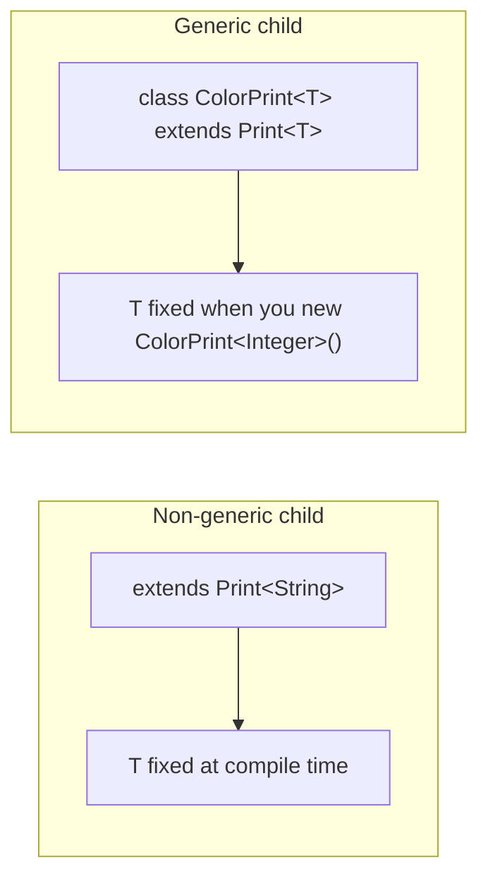

---

### Multiple type parameters `[10:26](https://www.youtube.com/watch?v=NCx_ABybp2o&t=626s)`

You may declare **many** type parameters: `<T1, T2, T3, …>` `[10:26](https://www.youtube.com/watch?v=NCx_ABybp2o&t=626s)`.

**`Pair<K, V>`** (key / value) `[10:57](https://www.youtube.com/watch?v=NCx_ABybp2o&t=657s)`:

```java
class Pair<K, V> {
    private K key;
    private V value;

    public void put(K key, V value) {
        this.key = key;
        this.value = value;
    }
    // getters omitted
}

Pair<String, Integer> p = new Pair<>();
p.put("age", 25);
```

**Diamond / constructor syntax** — both legal `[12:29](https://www.youtube.com/watch?v=NCx_ABybp2o&t=749s)`:

```java
Pair<String, Integer> p1 = new Pair<String, Integer>();
Pair<String, Integer> p2 = new Pair<>();  // diamond — type repeated only on left [13:01](https://www.youtube.com/watch?v=NCx_ABybp2o&t=781s)
```

If the left side already specifies `<String, Integer>`, the right may be `new Pair<>()` without repeating type args `[13:01](https://www.youtube.com/watch?v=NCx_ABybp2o&t=781s)`.

---

### Generic methods (class not generic) `[13:31](https://www.youtube.com/watch?v=NCx_ABybp2o&t=811s)`

Entire class need **not** be generic — a **single method** can declare its own type parameter `[14:01](https://www.youtube.com/watch?v=NCx_ABybp2o&t=841s)`.

**Syntax:** type parameter list **before** the return type `[14:32](https://www.youtube.com/watch?v=NCx_ABybp2o&t=872s)`:

```java
class PrintUtil {
    public <T> void setValue(T value) {
        System.out.println(value);
    }
}
```

| Placement | Scope |
|-----------|--------|
| `<T>` on **class** | `T` visible across all methods/fields of that class (where declared) `[17:07](https://www.youtube.com/watch?v=NCx_ABybp2o&t=1027s)` |
| `<T>` on **method** | `T` **only inside that method** `[17:38](https://www.youtube.com/watch?v=NCx_ABybp2o&t=1058s)` |

**Example** `[15:34](https://www.youtube.com/watch?v=NCx_ABybp2o&t=934s)`:

```java
class Vehicle { }
class Bus extends Vehicle { }
class Car extends Vehicle { }

class Print {
    public <T> void setValue(T v) { /* use v */ }
}

Print p = new Print();
p.setValue(new Bus());  // T inferred as Bus
p.setValue(new Car());  // T inferred as Car — same method, different T per call [16:35](https://www.youtube.com/watch?v=NCx_ABybp2o&t=995s)
```

---

### Raw types `[17:38](https://www.youtube.com/watch?v=NCx_ABybp2o&t=1058s)`

**Parameterized type:** `Print<String> p = new Print<String>();` — you supply the type argument `[18:08](https://www.youtube.com/watch?v=NCx_ABybp2o&t=1088s)`.

**Raw type:** use a generic class **without** type arguments `[18:40](https://www.youtube.com/watch?v=NCx_ABybp2o&t=1120s)`:

```java
Print raw = new Print();  // raw type [19:11](https://www.youtube.com/watch?v=NCx_ABybp2o&t=1151s)
```

**Compiler behavior:** treats missing type parameter as **`Object`** — behaves like the old pre-generic API `[19:41](https://www.youtube.com/watch?v=NCx_ABybp2o&t=1181s)`:

```java
raw.setPrintValue(1);       // OK — Object accepts Integer
raw.setPrintValue("hello"); // OK — Object accepts String [20:13](https://www.youtube.com/watch?v=NCx_ABybp2o&t=1213s)
```

Contrast: `Print<String> ps = new Print<>();` → only `String` in `setPrintValue` `[20:45](https://www.youtube.com/watch?v=NCx_ABybp2o&t=1245s)`.

> **Note:** Raw types are legal for backward compatibility but trigger **unchecked** warnings; avoid in new code.

---

### Bounded generics — motivation `[20:45](https://www.youtube.com/watch?v=NCx_ABybp2o&t=1245s)`

Unbounded `<T>` lets clients pass **any** reference type `[21:17](https://www.youtube.com/watch?v=NCx_ABybp2o&t=1277s)`.

**Bounded generics** = **restrict** which types may substitute for `T` at compile time `[21:49](https://www.youtube.com/watch?v=NCx_ABybp2o&t=1309s)`.

Usable on **generic classes** and **generic methods** `[21:49](https://www.youtube.com/watch?v=NCx_ABybp2o&t=1309s)`.

---

### Upper bound: `T extends Upper` `[21:49](https://www.youtube.com/watch?v=NCx_ABybp2o&t=1309s)`

**Syntax:** `class Print<T extends Number> { ... }` `[24:28](https://www.youtube.com/watch?v=NCx_ABybp2o&t=1468s)`

**Meaning:** `T` must be **`Number` or any subclass** of `Number` `[23:54](https://www.youtube.com/watch?v=NCx_ABybp2o&t=1434s)`.

```text
Object
 └── Number
      ├── Integer, Long, Double, Float, BigInteger, BigDecimal, ...
```

| Type argument | `T extends Number` |
|---------------|-------------------|
| `Integer`, `Double`, `Number` | **OK** `[25:59](https://www.youtube.com/watch?v=NCx_ABybp2o&t=1559s)` |
| `String` | **Compile error** — not under `Number` `[26:33](https://www.youtube.com/watch?v=NCx_ABybp2o&t=1593s)` |

**`extends` here ≠ class inheritance `extends`** `[24:58](https://www.youtube.com/watch?v=NCx_ABybp2o&t=1498s)`:
- In bounds, `T extends X` works for **classes and interfaces** (no separate `implements` keyword in the bound list) `[25:29](https://www.youtube.com/watch?v=NCx_ABybp2o&t=1529s)`.

```java
Print<Integer> ok = new Print<>();
Print<String> bad = new Print<>(); // error
```

---

### Multiple bounds (multi-bound) `[26:33](https://www.youtube.com/watch?v=NCx_ABybp2o&t=1593s)`

Java allows **one class** bound + **multiple interface** bounds on a type parameter `[28:36](https://www.youtube.com/watch?v=NCx_ABybp2o&t=1716s)`.

Recall:
- Class can **`extends` only one** class (no multiple inheritance of classes — diamond problem) `[27:03](https://www.youtube.com/watch?v=NCx_ABybp2o&t=1623s)`.
- Class can **`implements` many** interfaces `[27:34](https://www.youtube.com/watch?v=NCx_ABybp2o&t=1654s)`.

**Bound syntax mirrors that:**

```java
class Print<T extends ParentClass & InterfaceOne & InterfaceTwo> { }
```

| Position | Rule |
|----------|------|
| **First** bound | Must be a **concrete class** (if you include a class at all) `[29:08](https://www.youtube.com/watch?v=NCx_ABybp2o&t=1748s)` |
| **Rest** | Interfaces — any count `[29:40](https://www.youtube.com/watch?v=NCx_ABybp2o&t=1780s)` |

**Example** `[30:12](https://www.youtube.com/watch?v=NCx_ABybp2o&t=1812s)`:
- `class A extends Parent implements InterfaceOne, InterfaceTwo` → valid type for `T` `[30:44](https://www.youtube.com/watch?v=NCx_ABybp2o&t=1844s)`.
- `class A extends Parent implements InterfaceOne` only → **fails** bound requiring `InterfaceTwo` `[31:14](https://www.youtube.com/watch?v=NCx_ABybp2o&t=1874s)`.

---

### Arrays, generics, and why wildcards exist `[31:45](https://www.youtube.com/watch?v=NCx_ABybp2o&t=1905s)`

**Single objects — polymorphism works** `[33:48](https://www.youtube.com/watch?v=NCx_ABybp2o&t=2028s)`:

```java
Vehicle v = new Bus();  // valid — parent ref, child object [34:19](https://www.youtube.com/watch?v=NCx_ABybp2o&t=2059s)
```

**Lists — assignment is NOT covariant** `[34:19](https://www.youtube.com/watch?v=NCx_ABybp2o&t=2059s)`:

```java
List<Vehicle> vehicleList = new ArrayList<>();
List<Bus> busList = new ArrayList<>();

// List<Vehicle> vl = busList;   // INVALID [34:50](https://www.youtube.com/watch?v=NCx_ABybp2o&t=2090s)
// List<Bus> bl = vehicleList;   // INVALID [35:52](https://www.youtube.com/watch?v=NCx_ABybp2o&t=2152s)
```

**Why `vehicleList = busList` is unsafe** `[35:22](https://www.youtube.com/watch?v=NCx_ABybp2o&t=2122s)`:
- Through `vehicleList` you could `add(new Car())`.
- A `List<Bus>` reference must only ever contain buses — aliasing would break type safety.

**Why `busList = vehicleList` is unsafe** `[36:22](https://www.youtube.com/watch?v=NCx_ABybp2o&t=2182s)`:
- `vehicleList` may contain `Car` instances; `busList` must be buses only.

```text
List<Vehicle>  can hold Bus + Car
List<Bus>      can hold Bus only
⇒ List types are invariant in Java generics
```

**Method taking `List<Vehicle>`** `[37:25](https://www.youtube.com/watch?v=NCx_ABybp2o&t=2245s)`:
- `setPrintValue(List<Vehicle> list)` accepts `vehicleList` but **not** `busList` `[37:25](https://www.youtube.com/watch?v=NCx_ABybp2o&t=2245s)`.
- **Wildcards** fix “accept vehicle **or any subtype** list” use cases `[37:55](https://www.youtube.com/watch?v=NCx_ABybp2o&t=2275s)`.

---

### Wildcards overview `[37:55](https://www.youtube.com/watch?v=NCx_ABybp2o&t=2275s)`

Three forms (his taxonomy) `[37:55](https://www.youtube.com/watch?v=NCx_ABybp2o&t=2275s)`:

| Wildcard | Syntax | Accepts (for `List` example) |
|----------|--------|------------------------------|
| **Upper bound** | `List<? extends Vehicle>` | `List<Vehicle>`, `List<Bus>`, `List<Car>`, … `[38:25](https://www.youtube.com/watch?v=NCx_ABybp2o&t=2305s)` |
| **Lower bound** | `List<? super Vehicle>` | `List<Vehicle>`, `List<Object>`, supertypes of `Vehicle` `[39:27](https://www.youtube.com/watch?v=NCx_ABybp2o&t=2367s)` |
| **Unbounded** | `List<?>` | any element type `[47:43](https://www.youtube.com/watch?v=NCx_ABybp2o&t=2863s)` |

**PECS mnemonic** (industry standard; aligns with his upper/lower explanation):
- **Producer `extends`** — read from structure (`? extends T`).
- **Consumer `super`** — write into structure (`? super T`).

#### Upper-bound wildcard `[38:25](https://www.youtube.com/watch?v=NCx_ABybp2o&t=2305s)`

```java
void process(List<? extends Vehicle> list) { }
```

- `vehicleList` → OK
- `busList` → OK — `Bus` is subtype of `Vehicle` `[38:57](https://www.youtube.com/watch?v=NCx_ABybp2o&t=2337s)`

#### Lower-bound wildcard `[39:27](https://www.youtube.com/watch?v=NCx_ABybp2o&t=2367s)`

```java
void addVehicles(List<? super Vehicle> list) { }
```

- `List<Vehicle>` → OK
- `List<Bus>` → **not** OK — `Bus` is **below** `Vehicle`, not a supertype `[39:57](https://www.youtube.com/watch?v=NCx_ABybp2o&t=2397s)`
- `List<Object>` → OK — `Object` is above `Vehicle` in the hierarchy `[40:27](https://www.youtube.com/watch?v=NCx_ABybp2o&t=2427s)`

---

### Wildcard vs generic type parameter — `computeList` `[40:58](https://www.youtube.com/watch?v=NCx_ABybp2o&t=2458s)`

Two similar-looking APIs:

```java
// Wildcard version
void computeWildcard(List<? extends Number> source,
                     List<? extends Number> destination) { }

// Generic method version
<T extends Number> void computeGeneric(List<T> source,
                                       List<T> destination) { }
```

**Difference 1 — same `T` across parameters** `[44:08](https://www.youtube.com/watch?v=NCx_ABybp2o&t=2648s)`:

| Call | Wildcard method | Generic `<T>` method |
|------|-----------------|---------------------|
| `source = List<Integer>`, `dest = List<Float>` | **Allowed** — parameters independent `[44:38](https://www.youtube.com/watch?v=NCx_ABybp2o&t=2678s)` | **Compile error** — one `T` for both lists `[45:09](https://www.youtube.com/watch?v=NCx_ABybp2o&t=2709s)` |

Use **generic method** when all parameters must share the **exact same** type argument.
Use **wildcard** when each parameter may be a **different** subtype of the bound.

**Difference 2 — lower bound `super`** `[46:12](https://www.youtube.com/watch?v=NCx_ABybp2o&t=2772s)`:
- Wildcards support **`? super SomeType`** (lower bound).
- Generic type parameters use **`extends` only** — no `T super Number` on type params `[46:12](https://www.youtube.com/watch?v=NCx_ABybp2o&t=2772s)`.

**Difference 3 — multiple type params** `[46:43](https://www.youtube.com/watch?v=NCx_ABybp2o&t=2803s)`:
- Generic class/method: `<K, V, T, …>` many parameters.
- Wildcard: only **one** `?` per wildcard position — cannot write `<?, ?>` as a single wildcard substitution for two independent unknowns in the same way `[46:43](https://www.youtube.com/watch?v=NCx_ABybp2o&t=2803s)`.

**When to choose which** `[47:13](https://www.youtube.com/watch?v=NCx_ABybp2o&t=2833s)`:
- Need **strict same-type** coupling → generic type parameter.
- Need **flexible mixing** of subtypes under a bound → wildcard.
- Need **lower bound** (consumer) → wildcard with `super`.

---

### Unbounded wildcard `<?>` `[47:43](https://www.youtube.com/watch?v=NCx_ABybp2o&t=2863s)`

```java
void printAny(List<?> list) { }
```

**When to use** `[47:43](https://www.youtube.com/watch?v=NCx_ABybp2o&t=2863s)`:
- Method logic only needs **`Object`** API — `equals`, `hashCode`, `toString`, or “unknown element type” `[48:14](https://www.youtube.com/watch?v=NCx_ABybp2o&t=2894s)`.
- You **do not know** (or do not care) the concrete type parameter at compile time `[48:44](https://www.youtube.com/watch?v=NCx_ABybp2o&t=2924s)`.

```java
Object o = list.get(0);  // only safe assumption
```

You **cannot** `add` arbitrary typed elements to `List<?>` (except `null`) — compiler treats element type as unknown.

---

### Type erasure `[49:14](https://www.youtube.com/watch?v=NCx_ABybp2o&t=2954s)`

**Type erasure:** generic type information is **removed** when bytecode is generated — JVM runs mostly on **ordinary classes / Object / bounds** `[49:44](https://www.youtube.com/watch?v=NCx_ABybp2o&t=2984s)`.

| Source (what you write) | Bytecode (conceptual) |
|-------------------------|------------------------|
| `class Box<T> { T v; }` | `T` → **`Object`** `[50:14](https://www.youtube.com/watch?v=NCx_ABybp2o&t=3014s)` |
| `class Box<T extends Number> { T v; }` | `T` → **`Number`** (bound) `[50:14](https://www.youtube.com/watch?v=NCx_ABybp2o&t=3014s)` |
| Generic method `<T> void m(T x)` | Becomes method taking **`Object`** (unbounded) `[50:44](https://www.youtube.com/watch?v=NCx_ABybp2o&t=3044s)` |
| `<T extends Bus> void m(T x)` | Becomes method taking **`Bus`** `[51:16](https://www.youtube.com/watch?v=NCx_ABybp2o&t=3076s)` |

**Consequences (modern Java literacy)**:
- No `new T()`, no `T[]` arrays without tricks — erasure removes `T` at runtime.
- `instanceof T` illegal; use `instanceof` on concrete classes or bounded checks.
- Generics are a **compile-time** safety net; runtime sees casts the compiler inserted.

```java
// You write:
Print<Integer> p = new Print<>();
Integer n = p.getPrintValue();

// Compiler inserts casts after erasure to Object-based fields
```

---

### Practice & wrap-up `[51:16](https://www.youtube.com/watch?v=NCx_ABybp2o&t=3076s)`

He emphasizes hands-on practice for generics, bounds, wildcards, and erasure — common in APIs (`List<T>`, `Map<K,V>`, streams) `[51:46](https://www.youtube.com/watch?v=NCx_ABybp2o&t=3106s)`.

*(POJO, enum, final, singleton, immutable, wrapper — listed at end of part 1 roadmap — may appear in later playlist videos beyond this generics lecture.)*

---

### Interview questions / gotchas he highlights
- **`Object`** container → casting + `instanceof` hell; generics avoid that.
- Type params must be **reference types**, not primitives.
- **Non-generic child** of generic parent: fix type at `extends Print<String>`.
- **Generic child**: type fixed at `new ColorPrint<Integer>()`.
- **Diamond** `new Pair<>()` when left-hand side already parameterized.
- **Generic method:** `<T>` before return type; scope = that method only.
- **Raw type** = missing type arg → behaves like `Object`; accepts anything.
- **Upper bound** `T extends Number` — `extends` in bounds ≠ class `extends` only semantics.
- **Multi-bound:** one class first, then `& Interface1 & Interface2`.
- **`List<Bus>` is not a subtype of `List<Vehicle>`** — key invariant vs object assignment.
- **Wildcard `? extends`** for read/producer; **`? super`** for write/consumer.
- Wildcard allows **different** type args per parameter; `<T>` method forces **same** `T`.
- Generic type params **cannot** use `super` lower bound; wildcards can.
- Only **one** `?` per wildcard; generics allow multiple named params.
- **Type erasure** — generics compile away to `Object` or bound class.

### Quick revision
- Generics = type parameters at compile time; skip casts vs raw `Object`.
- Declare: `class Foo<T> { T x; }`; use: `Foo<Integer> f = new Foo<>();`.
- `T` = non-primitive only; use `Integer` not `int`.
- Non-generic subclass: `extends Foo<String>`; generic subclass: `class Bar<T> extends Foo<T>`.
- Multi-param: `Pair<K,V>`; diamond on right optional if left is typed.
- Generic method: `public <T> void m(T t)` — `T` scoped to method.
- Raw `new Foo()` → internal `Object`; loses safety.
- Upper bound: `T extends Number`; multi: `T extends Class & I1 & I2`.
- Lists invariant: `List<Bus>` ≠ `List<Vehicle>`; wildcards fix API flexibility.
- `? extends T` upper; `? super T` lower; `?` unbounded unknown.
- Wildcards looser across params; `<T>` ties params to one type.
- Erasure: bytecode drops generics; bounded `T` becomes bound class.


---

<a id="lec-13"></a>

## 13. 12. Java Enum, POJO and Final Classes Explained with Examples | Java Classes in Depth - Part3


[↑ Index](#index) · [Parts](#parts)


> **Video:** [12. Java Enum, POJO and Final Classes Explained with Examples | Java Classes in Depth - Part3](https://www.youtube.com/watch?v=zNCtAAqxjT0)

### What this lecture covers
- POJO definition, rules, and day-to-day use (request mapping, entities)
- Enum as a collection of constants (implicitly `static final`)
- Enum properties: extends `java.lang.Enum`, private constructors, no external instantiation
- Normal enums: `values()`, `ordinal()`, `valueOf()`, `name()`
- Enums with custom values, constructors, instance vs static methods
- Overriding methods per constant; abstract methods on enums
- Enum implementing interfaces
- Why enum beats `static final` ints (readability + type safety)
- Final classes (cannot be inherited)

---

### Agenda `[0:00](https://www.youtube.com/watch?v=zNCtAAqxjT0&t=0s)`
- Part 3 of “classes in depth”: **POJO**, **enum**, **final** class.
- Singleton, immutable, wrapper → next lecture (part 4).

---

### POJO — Plain Old Java Object `[0:31](https://www.youtube.com/watch?v=zNCtAAqxjT0&t=31s)`

**POJO** = plain, simple Java class — no fancy framework machinery.

Typical rules he lists `[1:04](https://www.youtube.com/watch?v=zNCtAAqxjT0&t=64s)`:
- Class is **public**
- Public **default constructor**
- Fields + **getters/setters**
- **No** annotations like `@Entity`, `@Table` on class/fields
- Does **not** extend another class and does **not** implement an interface

> Note: In industry “POJO” is often used loosely (many “POJOs” still have JPA annotations or implement `Serializable`). His stricter checklist is useful for interviews / purity checks.

#### Example shape `[2:05](https://www.youtube.com/watch?v=zNCtAAqxjT0&t=125s)`

```java
public class Student {
    String defaultName;      // package-private OK
    private String name;
    protected int age;
    // public fields also allowed — no access restriction on fields for “POJO-ness”

    public Student() { }     // public no-arg ctor

    public String getName() { return name; }
    public void setName(String name) { this.name = name; }
    // getters/setters for other fields...
}
```

All checklist items satisfied → this is a POJO `[3:05](https://www.youtube.com/watch?v=zNCtAAqxjT0&t=185s)`.

---

### Where POJOs are used `[3:36](https://www.youtube.com/watch?v=zNCtAAqxjT0&t=216s)`

#### 1) Map inbound request objects → internal model `[3:36](https://www.youtube.com/watch?v=zNCtAAqxjT0&t=216s)`
- Client sends a request object (`id`, `name`, …).
- Do **not** pass that request object through every class in the component.
- **Map** once into a POJO your code owns (`customerId`, `customerName`, …).
- If the external contract changes (`id` → `customer_id`), you change **one mapping place**; the rest of the code still speaks the POJO language `[5:10](https://www.youtube.com/watch?v=zNCtAAqxjT0&t=310s)`.

```
Client request ──► Component
                      │
                      ▼ map once
                   Internal POJO ──► Class1, Class2, Class3, ...
```

#### 2) Layered apps / persistence shape `[6:13](https://www.youtube.com/watch?v=zNCtAAqxjT0&t=373s)`
- Flow: Controller (REST) → business logic → repository.
- Often a “student entity” / table-shaped object (POJO-like) then persisted to DB.
- Two places he uses POJOs a lot: **API boundary mapping** and **DB/entity-shaped models** `[6:43](https://www.youtube.com/watch?v=zNCtAAqxjT0&t=403s)`.

---

### Enum — collection of constants `[7:13](https://www.youtube.com/watch?v=zNCtAAqxjT0&t=433s)`

- Constant (recap): value that cannot change → usually `static final`.
- Enum = **collection** of such constants; each constant is **implicitly** `static` and `final` — you don’t write those keywords `[8:18](https://www.youtube.com/watch?v=zNCtAAqxjT0&t=498s)`.
- Hold the question “why not just `static final`?” until advantages later `[8:49](https://www.youtube.com/watch?v=zNCtAAqxjT0&t=529s)`.

---

### Enum properties `[9:19](https://www.youtube.com/watch?v=zNCtAAqxjT0&t=559s)`

| Property | Detail |
|--|--|
| Cannot `extends` a class | Already extends `java.lang.Enum` (single inheritance) `[9:52](https://www.youtube.com/watch?v=zNCtAAqxjT0&t=592s)` |
| Can `implements` interfaces | Same as classes — any number `[10:54](https://www.youtube.com/watch?v=zNCtAAqxjT0&t=654s)` |
| Can have fields, ctors, methods | Covered below |
| Cannot be instantiated from outside | Constructor is always **private** (even default → private in bytecode) `[11:24](https://www.youtube.com/watch?v=zNCtAAqxjT0&t=684s)` |
| Cannot be subclassed by other classes | Restriction on extending the enum type `[12:27](https://www.youtube.com/watch?v=zNCtAAqxjT0&t=747s)` |
| Abstract methods allowed | **Every** constant must implement them `[12:27](https://www.youtube.com/watch?v=zNCtAAqxjT0&t=747s)` |

```java
public enum EnumSample {
    MONDAY, TUESDAY, WEDNESDAY, THURSDAY, FRIDAY, SATURDAY, SUNDAY;
}
```

Bytecode of the default ctor is `private` → `new EnumSample()` from outside is impossible `[11:56](https://www.youtube.com/watch?v=zNCtAAqxjT0&t=716s)`.

---

### Normal enum (no custom values) `[12:57](https://www.youtube.com/watch?v=zNCtAAqxjT0&t=777s)`

- Declared with `enum` keyword (not `class`).
- List constants, remember trailing `;` when more members follow.
- If you don’t assign custom values, JVM assigns **ordinals** starting at **0** `[14:32](https://www.youtube.com/watch?v=zNCtAAqxjT0&t=872s)`:
  - `MONDAY` → 0 … `SUNDAY` → 6

Analogy: coins / fixed categories where the set is closed `[13:29](https://www.youtube.com/watch?v=zNCtAAqxjT0&t=809s)`.

---

### Four common enum APIs `[15:34](https://www.youtube.com/watch?v=zNCtAAqxjT0&t=934s)`

Inherited / generated from the enum machinery (`java.lang.Enum` + compiler):

| Method | Kind | Purpose |
|--|--|--|
| `values()` | static | Array of all constants (for iteration) `[16:35](https://www.youtube.com/watch?v=zNCtAAqxjT0&t=995s)` |
| `ordinal()` | instance | Default 0-based index `[18:09](https://www.youtube.com/watch?v=zNCtAAqxjT0&t=1089s)` |
| `valueOf(String)` | static | Exact name match → constant; case-sensitive `[19:12](https://www.youtube.com/watch?v=zNCtAAqxjT0&t=1152s)` |
| `name()` | instance | Constant’s declared name string `[20:16](https://www.youtube.com/watch?v=zNCtAAqxjT0&t=1216s)` |

```java
for (EnumSample day : EnumSample.values()) {
    System.out.println(day.ordinal()); // 0..6
}

EnumSample fri = EnumSample.valueOf("FRIDAY");
System.out.println(fri.name()); // FRIDAY
```

`values()` / `valueOf` are not written by you — they come with the enum type `[16:35](https://www.youtube.com/watch?v=zNCtAAqxjT0&t=995s)`.

---

### Enum with custom values `[21:50](https://www.youtube.com/watch?v=zNCtAAqxjT0&t=1310s)`

- Fields declared on the enum apply **per constant** (each constant is an object of the enum type) `[22:20](https://www.youtube.com/watch?v=zNCtAAqxjT0&t=1340s)`.
- Private ctor is still invoked **from within** the enum when you write `MONDAY(101, "...")`.
- Need matching **parameterized constructor** + fields + getters `[24:23](https://www.youtube.com/watch?v=zNCtAAqxjT0&t=1463s)`.
- Methods that belong to the **type as a whole** (not per constant) → mark **`static`** `[24:54](https://www.youtube.com/watch?v=zNCtAAqxjT0&t=1494s)`.

```java
public enum EnumSample {
    MONDAY(101, "First day of the week"),
    TUESDAY(102, "Second day of the week"),
    // ...
    SUNDAY(107, "Second week off");

    private int val;
    private String comment;

    EnumSample(int val, String comment) {
        this.val = val;
        this.comment = comment;
    }

    public int getVal() { return val; }
    public String getComment() { return comment; }

    public static EnumSample getEnumFromValue(int value) {
        for (EnumSample sample : EnumSample.values()) {
            if (sample.val == value) return sample;
        }
        return null; // or throw
    }
}

// usage
EnumSample s = EnumSample.getEnumFromValue(107);
System.out.println(s.getComment()); // Second week off
```

Lookup via `values()` + field compare is a common pattern `[25:25](https://www.youtube.com/watch?v=zNCtAAqxjT0&t=1525s)`.

---

### Method override by constant `[27:28](https://www.youtube.com/watch?v=zNCtAAqxjT0&t=1648s)`

- Non-static methods after `;` exist **for every** constant.
- A constant can open a body and **override** that method.

```java
public enum EnumSample {
    MONDAY {
        @Override
        public void dummyMethod() {
            System.out.println("Monday dummy method");
        }
    },
    TUESDAY, WEDNESDAY, THURSDAY, FRIDAY, SATURDAY, SUNDAY;

    public void dummyMethod() {
        System.out.println("Default dummy method");
    }
}

EnumSample.FRIDAY.dummyMethod(); // Default...
EnumSample.MONDAY.dummyMethod(); // Monday...
```

Makes “each constant is its own object with its own method table” concrete `[30:03](https://www.youtube.com/watch?v=zNCtAAqxjT0&t=1803s)`.

---

### Enum with abstract method `[30:33](https://www.youtube.com/watch?v=zNCtAAqxjT0&t=1833s)`

- Declare `public abstract void dummyMethod();` on the enum.
- **Every** constant **must** provide an implementation (like subclasses of an abstract class).

```java
public enum EnumSample {
    MONDAY {
        @Override public void dummyMethod() { System.out.println("in Monday"); }
    },
    TUESDAY {
        @Override public void dummyMethod() { System.out.println("in Tuesday"); }
    },
    SUNDAY {
        @Override public void dummyMethod() { System.out.println("in Sunday"); }
    };

    public abstract void dummyMethod();
}
```

---

### Enum implements interface `[32:06](https://www.youtube.com/watch?v=zNCtAAqxjT0&t=1926s)`

- Prefer when behavior is **shared** by all constants (vs abstract forcing each constant to repeat).
- After `;`, implement interface methods once for all; constants can still override.

```java
interface MyInterface {
    String toLowerCase();
}

public enum EnumSample implements MyInterface {
    MONDAY, TUESDAY, WEDNESDAY, THURSDAY, FRIDAY, SATURDAY, SUNDAY;

    @Override
    public String toLowerCase() {
        return this.name().toLowerCase();
    }
}

System.out.println(EnumSample.MONDAY.toLowerCase()); // monday
```

Rare in day-to-day code, but good to know `[34:41](https://www.youtube.com/watch?v=zNCtAAqxjT0&t=2081s)`.

---

### Why enum over `static final` ints? `[35:41](https://www.youtube.com/watch?v=zNCtAAqxjT0&t=2141s)`

Two ways to model weekdays:

```java
// Way 1 — int constants
class WeekConstant {
    public static final int MONDAY = 0;
    // ...
    public static final int SUNDAY = 6;

    static boolean isWeekend(int day) {
        return day == SATURDAY || day == SUNDAY;
    }
}

// Way 2 — enum
boolean isWeekend(EnumSample day) {
    return day == EnumSample.SATURDAY || day == EnumSample.SUNDAY;
}
```

**Problems with ints** `[39:22](https://www.youtube.com/watch?v=zNCtAAqxjT0&t=2362s)`:
- Caller can pass `100` / `100001` — no compile-time control; method may behave unexpectedly.
- Call sites like `isWeekend(2)` are not self-documenting.

**Enum advantages** `[40:24](https://www.youtube.com/watch?v=zNCtAAqxjT0&t=2424s)`:
1. **Readability** — `EnumSample.WEDNESDAY` vs magic `2`.
2. **Control / type safety** — parameter is `EnumSample`; only the declared constants compile; `isWeekend(100)` is a compile error.

---

### Final class `[41:58](https://www.youtube.com/watch?v=zNCtAAqxjT0&t=2518s)`

- Mark class `final` when it **must not be inherited**.
- Extending it → compile error: cannot inherit from final class.

```java
final class TestClass { }

// class MyAnotherClass extends TestClass { } // compile error
```

Purpose of `final` on a class: **inheritance restriction** `[42:29](https://www.youtube.com/watch?v=zNCtAAqxjT0&t=2549s)`.

---

### Interview questions / gotchas he highlights
- POJO checklist: public class, public default ctor, getters/setters, no annotations, no extends/implements `[1:04](https://www.youtube.com/watch?v=zNCtAAqxjT0&t=64s)`
- Why map request DTO → internal POJO (change isolation) `[4:40](https://www.youtube.com/watch?v=zNCtAAqxjT0&t=280s)`
- Enums already extend `Enum` → cannot extend another class `[9:52](https://www.youtube.com/watch?v=zNCtAAqxjT0&t=592s)`
- Enum constructors are always private (bytecode) `[11:56](https://www.youtube.com/watch?v=zNCtAAqxjT0&t=716s)`
- `values` / `valueOf` / `ordinal` / `name` roles `[20:50](https://www.youtube.com/watch?v=zNCtAAqxjT0&t=1250s)`
- Custom fields → parameterized private ctor invoked per constant `[23:53](https://www.youtube.com/watch?v=zNCtAAqxjT0&t=1433s)`
- Class-level helpers on enum must be `static` `[24:54](https://www.youtube.com/watch?v=zNCtAAqxjT0&t=1494s)`
- Abstract enum methods force every constant to implement `[31:04](https://www.youtube.com/watch?v=zNCtAAqxjT0&t=1864s)`
- Enum vs `static final`: readability + compile-time control `[40:24](https://www.youtube.com/watch?v=zNCtAAqxjT0&t=2424s)`
- `final` class = no inheritance `[41:58](https://www.youtube.com/watch?v=zNCtAAqxjT0&t=2518s)`

### Quick revision
- POJO: simple public class, public default ctor, getters/setters, no annotations / extends / implements.
- Use POJO to map external request into an internal model shared by many classes.
- Enum = typed set of constants; constants are implicitly `static final`.
- Enum extends `java.lang.Enum`; ctor always private; can implement interfaces.
- `values()`, `ordinal()`, `valueOf(name)`, `name()` are the everyday APIs.
- Custom values need fields + matching private ctor; type-wide helpers are `static`.
- Per-constant override bodies; abstract methods require all constants to implement.
- Prefer enum over int constants for readability and type safety.
- `final` class cannot be subclassed.


---

<a id="lec-14"></a>

## 14. 13. Java Singleton and Immutable Class Explained with Examples | Java Classes in Depth - Part4


[↑ Index](#index) · [Parts](#parts)


> **Video:** [13. Java Singleton and Immutable Class Explained with Examples | Java Classes in Depth - Part4](https://www.youtube.com/watch?v=SqDbZOjW1uM)

### What this lecture covers
- Singleton goal: **one object** per JVM (e.g. DB connection)
- Six patterns: eager, lazy, synchronized method, double-checked locking (+ `volatile`), Bill Pugh, enum
- Memory / cache issues with DCL; why `volatile` matters
- Immutable class rules + defensive copy of mutable collections
- Wrapper classes — pointer back to Variables Part 2 (lecture 06/07 in playlist numbering)

---

### Agenda `[0:00](https://www.youtube.com/watch?v=SqDbZOjW1uM&t=0s)`
- Finishes the “classes” arc: **singleton**, **immutable**, brief **wrapper** reminder.
- Singleton is a heavy interview topic — many creation styles `[1:01](https://www.youtube.com/watch?v=SqDbZOjW1uM&t=61s)`.

---

### What is a Singleton? `[0:30](https://www.youtube.com/watch?v=SqDbZOjW1uM&t=30s)`

- Goal: **one and only one** instance of the class, no matter how / how often it is requested.
- Classic example: **DB connection** — set up once; then many queries (select/insert/update) reuse it; don’t open a new connection every call `[0:30](https://www.youtube.com/watch?v=SqDbZOjW1uM&t=30s)`.

**Six popular ways** `[1:31](https://www.youtube.com/watch?v=SqDbZOjW1uM&t=91s)`:
1. Eager initialization
2. Lazy initialization
3. Synchronized method
4. Double-checked locking (`volatile`)
5. Bill Pugh solution
6. Enum singleton

---

### 1) Eager initialization `[2:02](https://www.youtube.com/watch?v=SqDbZOjW1uM&t=122s)`

```java
public class DBConnection {
    private static DBConnection conObject = new DBConnection(); // eager

    private DBConnection() { }

    public static DBConnection getInstance() {
        return conObject;
    }
}
```

| Piece | Why |
|--|--|
| `private static` instance | Belongs to the **class**, not each object; not accessible/changed from outside `[2:32](https://www.youtube.com/watch?v=SqDbZOjW1uM&t=152s)` |
| `private` constructor | No `new DBConnection()` from outside `[3:03](https://www.youtube.com/watch?v=SqDbZOjW1uM&t=183s)` |
| `public static getInstance()` | Callers use `DBConnection.getInstance()`; always same object `[3:34](https://www.youtube.com/watch?v=SqDbZOjW1uM&t=214s)` |

**Eager** = created when class loads / app starts (statics preloaded) even if nobody calls `getInstance()` `[4:05](https://www.youtube.com/watch?v=SqDbZOjW1uM&t=245s)`.

**Disadvantage:** wastes memory if unused `[4:35](https://www.youtube.com/watch?v=SqDbZOjW1uM&t=275s)`.

---

### 2) Lazy initialization `[4:35](https://www.youtube.com/watch?v=SqDbZOjW1uM&t=275s)`

```java
public class DBConnection {
    private static DBConnection conObject; // null initially

    private DBConnection() { }

    public static DBConnection getInstance() {
        if (conObject == null) {
            conObject = new DBConnection();
        }
        return conObject;
    }
}
```

- Object created **only on first** `getInstance()` call `[5:08](https://www.youtube.com/watch?v=SqDbZOjW1uM&t=308s)`.
- **Race:** two threads both see `null` at the same time → **two objects** created `[5:39](https://www.youtube.com/watch?v=SqDbZOjW1uM&t=339s)`.

---

### 3) Synchronized method `[6:10](https://www.youtube.com/watch?v=SqDbZOjW1uM&t=370s)`

```java
public static synchronized DBConnection getInstance() {
    if (conObject == null) {
        conObject = new DBConnection();
    }
    return conObject;
}
```

- `synchronized` on the method: **lock → enter → unlock**; only one thread inside at a time `[6:41](https://www.youtube.com/watch?v=SqDbZOjW1uM&t=401s)`.
- Fixes the double-create race.

**Disadvantage:** every call (even after instance exists) pays lock/unlock → **very slow**; rarely used in practice `[7:43](https://www.youtube.com/watch?v=SqDbZOjW1uM&t=463s)`.

---

### 4) Double-checked locking (DCL) `[8:13](https://www.youtube.com/watch?v=SqDbZOjW1uM&t=493s)`

```java
public class DBConnection {
    private static volatile DBConnection conObject;

    private DBConnection() { }

    public static DBConnection getInstance() {
        if (conObject == null) {                 // check 1
            synchronized (DBConnection.class) {
                if (conObject == null) {         // check 2
                    conObject = new DBConnection();
                }
            }
        }
        return conObject;
    }
}
```

- Sync only on the **block**, not the whole method — lock once on first creation path `[9:16](https://www.youtube.com/watch?v=SqDbZOjW1uM&t=556s)`.
- Outer null-check: fast path when already created.
- Inner null-check: second thread that entered after lock wait must not create again `[9:46](https://www.youtube.com/watch?v=SqDbZOjW1uM&t=586s)`.

#### Memory / cache issue without `volatile` `[10:47](https://www.youtube.com/watch?v=SqDbZOjW1uM&t=647s)`

```
     Core-1                Core-2
    L1 cache              L1 cache
         \                  /
          \                /
           Shared Memory
```

- Thread on core-1 creates instance; new reference may sit in **L1 cache** before syncing to main memory `[12:20](https://www.youtube.com/watch?v=SqDbZOjW1uM&t=740s)`.
- Thread on core-2 still sees `null` in memory → enters sync, creates **second** object `[13:21](https://www.youtube.com/watch?v=SqDbZOjW1uM&t=801s)`.
- Another related hazard: **instruction reordering** during `new` (he mentions both; `volatile` addresses both) `[14:24](https://www.youtube.com/watch?v=SqDbZOjW1uM&t=864s)`.

#### Role of `volatile` `[14:54](https://www.youtube.com/watch?v=SqDbZOjW1uM&t=894s)`
- Reads/writes of the field go through **main memory**, not stale cache views.
- Interview trap: candidates write DCL **without** `volatile`; production-correct DCL needs it `[15:24](https://www.youtube.com/watch?v=SqDbZOjW1uM&t=924s)`.

**Remaining cost:** bypassing cache + occasional sync → still a bit slow `[15:54](https://www.youtube.com/watch?v=SqDbZOjW1uM&t=954s)`.

> Note: Modern JVMs / Java Memory Model make correct DCL + `volatile` well-defined since Java 5. He plans a deeper `volatile` video later.

---

### 5) Bill Pugh solution `[16:26](https://www.youtube.com/watch?v=SqDbZOjW1uM&t=986s)`

```java
public class DBConnection {
    private DBConnection() { }

    private static class Helper {
        private static final DBConnection INSTANCE = new DBConnection();
    }

    public static DBConnection getInstance() {
        return Helper.INSTANCE;
    }
}
```

- Uses **eager init inside a private static nested class**.
- Nested class is **not** loaded at app startup; loaded **when first referred** `[16:58](https://www.youtube.com/watch?v=SqDbZOjW1uM&t=1018s)`.
- No `volatile`, no `synchronized` on the hot path → fast and popular `[18:02](https://www.youtube.com/watch?v=SqDbZOjW1uM&t=1082s)`.

---

### 6) Enum singleton `[18:34](https://www.youtube.com/watch?v=SqDbZOjW1uM&t=1114s)`

```java
public enum DBConnection {
    INSTANCE;
    // methods...
}
```

- Enum constructors are **always private**.
- JVM guarantees **one instance per enum constant per JVM** → singleton by design `[19:05](https://www.youtube.com/watch?v=SqDbZOjW1uM&t=1145s)`.
- Very short compared to hand-rolled patterns `[19:36](https://www.youtube.com/watch?v=SqDbZOjW1uM&t=1176s)`.

> Note: Enum singletons are also naturally resistant to many reflection / serialization tricks that break classic private-ctor singletons (he expands reflection breakage in lecture 18).

---

### Immutable classes `[19:36](https://www.youtube.com/watch?v=SqDbZOjW1uM&t=1176s)`

Like `String`: once constructed, **state must not change**.

#### Rules `[20:08](https://www.youtube.com/watch?v=SqDbZOjW1uM&t=1208s)`

| Rule | Why |
|--|--|
| Class `final` | No subclass can mutate state `[20:40](https://www.youtube.com/watch?v=SqDbZOjW1uM&t=1240s)` |
| Fields `private` (+ typically `final`) | No external access / reassignment |
| Init only via constructor | One-time assignment |
| **No setters** | Only getters |
| Getters return **copies** of mutable members | Critical for collections `[21:10](https://www.youtube.com/watch?v=SqDbZOjW1uM&t=1270s)` |

#### Why copy collections? `[21:40](https://www.youtube.com/watch?v=SqDbZOjW1uM&t=1300s)`

```java
public final class ImmutableDemo {
    private final String name;
    private final List<String> petNames;

    public ImmutableDemo(String name, List<String> petNames) {
        this.name = name;
        this.petNames = petNames; // often also copy on input
    }

    public String getName() { return name; }

    // BAD: return petNames;  — caller can add/remove
    public List<String> getPetNames() {
        return new ArrayList<>(petNames); // copy
    }
}
```

- `final` on a `List` reference means the **reference** cannot point elsewhere; contents of the list can still change `[23:40](https://www.youtube.com/watch?v=SqDbZOjW1uM&t=1420s)`.
- Returning the live list leaks mutability; returning a **copy** keeps original state intact; mutated copy becomes GC fodder `[25:42](https://www.youtube.com/watch?v=SqDbZOjW1uM&t=1542s)`.

> Note: Also copy **into** the field in the constructor (`this.petNames = List.copyOf(petNames)` / `new ArrayList<>(...)`) so the caller cannot mutate via the original list reference they passed. He stresses the getter copy; input copy is the same idea.

---

### Wrapper classes (pointer) `[27:14](https://www.youtube.com/watch?v=SqDbZOjW1uM&t=1634s)`

- Already covered with primitives / reference types (playlist Variables Part 2).
- Eight primitives ↔ wrappers (`Integer`, `Long`, …); autoboxing / unboxing.
- Rewatch that lecture for depth; this video only closes the “classes” series `[27:45](https://www.youtube.com/watch?v=SqDbZOjW1uM&t=1665s)`.

---

### Interview questions / gotchas he highlights
- Singleton = exactly one instance; DB connection as motivating example `[0:30](https://www.youtube.com/watch?v=SqDbZOjW1uM&t=30s)`
- Know **all six** creation styles, not just one `[1:31](https://www.youtube.com/watch?v=SqDbZOjW1uM&t=91s)`
- Eager wastes memory; lazy races under concurrency `[4:35](https://www.youtube.com/watch?v=SqDbZOjW1uM&t=275s)`
- Method-level `synchronized` is correct but slow `[7:43](https://www.youtube.com/watch?v=SqDbZOjW1uM&t=463s)`
- DCL without `volatile` has cache / reordering bugs — interview favorite `[15:24](https://www.youtube.com/watch?v=SqDbZOjW1uM&t=924s)`
- Bill Pugh: nested class lazy-loads cleanly `[16:58](https://www.youtube.com/watch?v=SqDbZOjW1uM&t=1018s)`
- Enum is the shortest “JVM-backed” singleton `[19:05](https://www.youtube.com/watch?v=SqDbZOjW1uM&t=1145s)`
- Immutable: `final` class, private fields, no setters, **defensive copy** of collections `[21:10](https://www.youtube.com/watch?v=SqDbZOjW1uM&t=1270s)`
- `final List` ≠ immutable list contents `[23:40](https://www.youtube.com/watch?v=SqDbZOjW1uM&t=1420s)`

### Quick revision
- Singleton: one object; private ctor + controlled accessor.
- Eager: create at load time; simple, may waste memory.
- Lazy: create on first use; not thread-safe alone.
- Synchronized `getInstance`: safe, slow (lock every call).
- DCL: sync block + double null-check; use `volatile`.
- Bill Pugh: private static holder class with eager field.
- Enum singleton: one instance per JVM by design.
- Immutable: final class, private final fields, ctor init, no setters, copy mutable getters.
- Wrappers already covered earlier — don’t relearn here.


<a id="part-c"></a>

# Part C — Interfaces, Lambdas, Reflection & Annotations

[↑ Index](#index) · [Parts](#parts)

---

<a id="lec-15"></a>

## 15. 14. Java Interface in Depth - Part1


[↑ Index](#index) · [Parts](#parts)


> **Video:** [14. Java Interface in Depth - Part1](https://www.youtube.com/watch?v=aj3SLuDkGWg)
> *(Slide PDF is largely image/OCR-based; text also in `scripts/pdftext/14-15_Interfaces__original.txt`. Images: `scripts/pdfimg/14-15_Interfaces/`.)*

### What this lecture covers
- What an interface is (abstraction between systems)
- How to declare interfaces (modifiers, `extends` multiple interfaces)
- Why interfaces: abstraction, polymorphism, multiple inheritance
- Diamond problem with classes vs interfaces
- Methods & fields in interfaces (implicit `public` / `public static final`)
- Implementing interfaces (concrete vs abstract classes)
- Nested interfaces (inside interface vs inside class)
- Interface vs abstract class — 10 differences (pre–Java 8 baseline + Java 8/9 teaser)

---

### Agenda `[0:00](https://www.youtube.com/watch?v=aj3SLuDkGWg&t=0s)`
- Part 1: classic interface rules.
- Part 2 (next video): Java 8 default/static, Java 9 private methods.
- Functional interface + lambda → separate video.

---

### What is an interface? `[0:30](https://www.youtube.com/watch?v=aj3SLuDkGWg&t=30s)`

- Lets two systems interact **without** one knowing the other’s internal details.
- Short form: helps achieve **abstraction**.

**System analogy** `[1:01](https://www.youtube.com/watch?v=aj3SLuDkGWg&t=61s)`:
- System 2 exposes an interface (e.g. `fly`, `eat`).
- System 1 calls those operations; how System 2 implements them stays hidden.

**Car brake analogy** `[2:33](https://www.youtube.com/watch?v=aj3SLuDkGWg&t=153s)`:
- You press the brake pedal (interface).
- You don’t need to know hydraulic internals — that’s abstracted.

---

### How to define an interface `[3:03](https://www.youtube.com/watch?v=aj3SLuDkGWg&t=183s)`

Declaration pieces:
1. Modifier
2. `interface` keyword
3. Interface name
4. Optional comma-separated **parent interfaces** (`extends`)
5. Body

```java
public interface Bird extends LivingThing, Flyer {
    void fly();
}
```

#### Modifiers `[3:33](https://www.youtube.com/watch?v=aj3SLuDkGWg&t=213s)`
- Only **`public`** or **default (package)** allowed at top level.
- **`protected` / `private`** not allowed for a top-level interface.
- Omitting the modifier → package-private (default).

#### Extending interfaces `[4:37](https://www.youtube.com/watch?v=aj3SLuDkGWg&t=277s)`
- An interface can `extends` **multiple** other interfaces (comma-separated).
- Cannot extend a **class** — only interfaces `[5:07](https://www.youtube.com/watch?v=aj3SLuDkGWg&t=307s)`.

```java
public interface NonFlyingBird extends Bird, LivingThing {
    void canRun();
}
```

---

### Why we need interfaces `[6:09](https://www.youtube.com/watch?v=aj3SLuDkGWg&t=369s)`

#### 1) Abstraction (full / 100%) `[6:40](https://www.youtube.com/watch?v=aj3SLuDkGWg&t=400s)`
- Defines **what** a class must do, not **how**.
- Methods are signatures only (pre–Java 8 mental model).
- Implementing classes supply the how.

```java
public interface Bird {
    void fly(); // signature only
}

public class Eagle implements Bird {
    @Override
    public void fly() {
        // how Eagle flies
    }
}
```

#### 2) Polymorphism `[8:43](https://www.youtube.com/watch?v=aj3SLuDkGWg&t=523s)`
- Interface can be used as a **data type** / reference type.
- Cannot `new` an interface; only concrete implementors `[10:45](https://www.youtube.com/watch?v=aj3SLuDkGWg&t=645s)`.
- Runtime chooses which `fly()` based on the actual object (dynamic dispatch) `[12:18](https://www.youtube.com/watch?v=aj3SLuDkGWg&t=738s)`.

```java
Bird b1 = new Eagle();
Bird b2 = new Hen();
b1.fly(); // Eagle's fly
b2.fly(); // Hen's fly
```

#### 3) Multiple inheritance `[13:52](https://www.youtube.com/watch?v=aj3SLuDkGWg&t=832s)`
- In Java, multiple inheritance of **classes** is forbidden.
- Multiple inheritance via **interfaces** is allowed — major advantage.

---

### Diamond problem `[14:22](https://www.youtube.com/watch?v=aj3SLuDkGWg&t=862s)`

If classes could multiply inherit:

```
   WaterAnimal          LandAnimal
   canBreathe()         canBreathe()
            \            /
             \          /
              Crocodile
```

- `crocodile.canBreathe()` — which parent method? Ambiguous → Java forbids class multi-extends `[15:25](https://www.youtube.com/watch?v=aj3SLuDkGWg&t=925s)`.

**With interfaces** `[16:28](https://www.youtube.com/watch?v=aj3SLuDkGWg&t=988s)`:
- Both interfaces declare `boolean canBreathe();` (signature only).
- `Crocodile implements LandAnimal, WaterAnimal` and provides **one** implementation (overrides both).
- No ambiguity — the class’s method is called `[17:30](https://www.youtube.com/watch?v=aj3SLuDkGWg&t=1050s)`.

```java
interface LandAnimal { boolean canBreathe(); }
interface WaterAnimal { boolean canBreathe(); }

class Crocodile implements LandAnimal, WaterAnimal {
    @Override
    public boolean canBreathe() { return true; }
}
```

---

### Methods in an interface `[18:31](https://www.youtube.com/watch?v=aj3SLuDkGWg&t=1111s)`

Pre–Java 8 / classic rules in this part:

1. **All methods are implicitly `public`** — writing `public` or omitting it is the same `[19:02](https://www.youtube.com/watch?v=aj3SLuDkGWg&t=1142s)`.
2. **Cannot declare a method `final`** `[20:02](https://www.youtube.com/watch?v=aj3SLuDkGWg&t=1202s)`.
   - `final` means “cannot override”.
   - Interface methods **must** be implemented by implementors → `final` contradicts that `[20:32](https://www.youtube.com/watch?v=aj3SLuDkGWg&t=1232s)`.

```java
public interface Bird {
    void fly();           // public abstract
    public void hasBeak(); // same — public abstract
}
```

---

### Fields in an interface `[21:34](https://www.youtube.com/watch?v=aj3SLuDkGWg&t=1294s)`

- Fields are implicitly **`public static final`** (constants).
- Writing the modifiers or not — same meaning `[22:05](https://www.youtube.com/watch?v=aj3SLuDkGWg&t=1325s)`.
- Cannot make them `private` / `protected` — always public constants `[22:37](https://www.youtube.com/watch?v=aj3SLuDkGWg&t=1357s)`.

```java
public interface Bird {
    int MAX_HEIGHT_IN_FEET = 2000;
    // equivalent to:
    // public static final int MAX_HEIGHT_IN_FEET = 2000;
}
```

---

### Interface implementation `[23:40](https://www.youtube.com/watch?v=aj3SLuDkGWg&t=1420s)`

Keyword: **`implements`**.

```java
public class Eagle implements Bird {
    @Override
    public void fly() { /* ... */ }
}
```

#### Rules `[24:11](https://www.youtube.com/watch?v=aj3SLuDkGWg&t=1451s)`

1. **Overriding method cannot narrow access**
   Interface method is public → implementor must keep it `public`. `protected` / package-private override fails `[24:41](https://www.youtube.com/watch?v=aj3SLuDkGWg&t=1481s)`.

2. **Concrete class must implement all interface methods**
   All abstract signatures need bodies `[25:13](https://www.youtube.com/watch?v=aj3SLuDkGWg&t=1513s)`.

3. **Abstract class is not forced to implement everything** `[26:13](https://www.youtube.com/watch?v=aj3SLuDkGWg&t=1573s)`
   Can implement some, leave others abstract, add more abstract methods.

4. **A class can implement multiple interfaces** (multiple inheritance benefit) `[29:45](https://www.youtube.com/watch?v=aj3SLuDkGWg&t=1785s)`.

#### Abstract class + interface example `[26:43](https://www.youtube.com/watch?v=aj3SLuDkGWg&t=1603s)`

```java
public interface Bird {
    void canFly();
    void noOfLegs();
}

public abstract class Eagle implements Bird {
    @Override
    public void canFly() { /* implemented */ }

    // noOfLegs() still abstract — OK for abstract class
    public abstract void beakLength();
}

public class WhiteEagle extends Eagle {
    @Override
    public void noOfLegs() { /* ... */ }

    @Override
    public void beakLength() { /* ... */ }
}
```

Concrete leaf class must close **all** remaining abstract methods from interface + abstract parents `[28:45](https://www.youtube.com/watch?v=aj3SLuDkGWg&t=1725s)`.

---

### Nested interfaces `[30:17](https://www.youtube.com/watch?v=aj3SLuDkGWg&t=1817s)`

- Interface declared inside another interface, or inside a class.
- Use: group **logically related** interfaces.
- Rare in his 8+ years of work, but asked in interviews `[30:49](https://www.youtube.com/watch?v=aj3SLuDkGWg&t=1849s)`.

#### Rules `[31:19](https://www.youtube.com/watch?v=aj3SLuDkGWg&t=1879s)`

| Nesting | Access |
|--|--|
| Nested interface **inside an interface** | Must be **`public`** (everything in interface is public) `[31:49](https://www.youtube.com/watch?v=aj3SLuDkGWg&t=1909s)` |
| Nested interface **inside a class** | Any modifier: public / protected / private / default `[35:55](https://www.youtube.com/watch?v=aj3SLuDkGWg&t=2155s)` |

#### Usage patterns `[32:51](https://www.youtube.com/watch?v=aj3SLuDkGWg&t=1971s)`

```java
public interface Bird {
    void canFly();

    public interface NonFlyingBird {
        void canRun();
    }
}

// 1) Implement outer only → only outer methods
class EagleOuter implements Bird {
    public void canFly() { }
}

// 2) Implement inner only → Bird.NonFlyingBird
class EagleInner implements Bird.NonFlyingBird {
    public void canRun() { }
}

// 3) Implement both
class EagleBoth implements Bird, Bird.NonFlyingBird {
    public void canFly() { }
    public void canRun() { }
}
```

- Implementing outer does **not** require implementing inner, and vice versa `[35:24](https://www.youtube.com/watch?v=aj3SLuDkGWg&t=2124s)`.
- Hold nested interface reference: `Bird.NonFlyingBird obj = new EagleInner();` `[34:23](https://www.youtube.com/watch?v=aj3SLuDkGWg&t=2063s)`.

Inside a class:

```java
public class Bird {
    protected interface NonFlyingBird {
        void canRun();
    }
}

public class Eagle implements Bird.NonFlyingBird {
    public void canRun() { }
}
```

---

### Interface vs abstract class (10 differences) `[38:01](https://www.youtube.com/watch?v=aj3SLuDkGWg&t=2281s)`

| # | Abstract class | Interface |
|--|--|--|
| 1 | Keyword `abstract` | Keyword `interface` |
| 2 | Child uses `extends` | Class uses `implements` |
| 3 | Abstract + concrete methods | Only abstract methods **before Java 8**; from Java 8+: default/static (+ Java 9 private) `[39:32](https://www.youtube.com/watch?v=aj3SLuDkGWg&t=2372s)` |
| 4 | Extend one class + implement many interfaces | Extend **only** other interfaces |
| 5 | Fields: static/non-static, final/non-final | Fields are **constants** (`public static final`) |
| 6 | Members can be private/protected/public/default | Members public by default; Java 9 adds private methods `[41:06](https://www.youtube.com/watch?v=aj3SLuDkGWg&t=2466s)` |
| 7 | Multiple inheritance **not** supported | Multiple inheritance **supported** |
| 8 | Can implement an interface | Cannot “implement” / fill an abstract class |
| 9 | Can have constructors | **Cannot** have constructors `[42:41](https://www.youtube.com/watch?v=aj3SLuDkGWg&t=2561s)` |
| 10 | Need `abstract` keyword on abstract methods; can be public/protected/default | Methods abstract by default; always public (classically) `[43:14](https://www.youtube.com/watch?v=aj3SLuDkGWg&t=2594s)` |

> Note: Point 3/6 are historically accurate for “classic” interfaces; Java 8/9 features are Part 2. Sealed interfaces / other modern features are beyond this lecture.

---

### Polymorphism walkthrough (Eagle / Hen) `[9:13](https://www.youtube.com/watch?v=aj3SLuDkGWg&t=553s)`

```java
public interface Bird {
    void fly();
}

public class Eagle implements Bird {
    public void fly() { System.out.println("Eagle flying"); }
}

public class Hen implements Bird {
    public void fly() { System.out.println("Hen flying"); }
}

Bird birdObject1 = new Eagle();
Bird birdObject2 = new Hen();
birdObject1.fly(); // runtime lookup → Eagle
birdObject2.fly(); // runtime lookup → Hen
```

Many classes can implement `Bird`; the reference type stays `Bird`, the runtime object decides which `fly` runs `[11:48](https://www.youtube.com/watch?v=aj3SLuDkGWg&t=708s)`.

---

### Access-specifier trap (illegal override) `[24:41](https://www.youtube.com/watch?v=aj3SLuDkGWg&t=1481s)`

```java
public interface Bird {
    void fly(); // public
}

public class Eagle implements Bird {
    @Override
    protected void fly() { } // ILLEGAL — more restrictive than public
}
```

Must keep `public void fly()`.

---

### Interview questions / gotchas he highlights
- Interface = abstraction between systems; brake pedal analogy `[2:33](https://www.youtube.com/watch?v=aj3SLuDkGWg&t=153s)`
- Top-level interface: public or default only `[3:33](https://www.youtube.com/watch?v=aj3SLuDkGWg&t=213s)`
- Three reasons: abstraction, polymorphism, multiple inheritance `[6:09](https://www.youtube.com/watch?v=aj3SLuDkGWg&t=369s)`
- Cannot instantiate interface; reference holds implementor `[10:45](https://www.youtube.com/watch?v=aj3SLuDkGWg&t=645s)`
- Diamond problem forces no multi-extends of classes; interfaces OK `[15:25](https://www.youtube.com/watch?v=aj3SLuDkGWg&t=925s)`
- Methods implicitly public; cannot be `final` `[20:02](https://www.youtube.com/watch?v=aj3SLuDkGWg&t=1202s)`
- Fields implicitly `public static final` `[21:34](https://www.youtube.com/watch?v=aj3SLuDkGWg&t=1294s)`
- Cannot weaken access when implementing `[24:41](https://www.youtube.com/watch?v=aj3SLuDkGWg&t=1481s)`
- Abstract class need not implement all; concrete class must `[26:13](https://www.youtube.com/watch?v=aj3SLuDkGWg&t=1573s)`
- Nested interface in interface → public only; in class → any access `[31:49](https://www.youtube.com/watch?v=aj3SLuDkGWg&t=1909s)`
- Outer vs inner implement independently `[35:24](https://www.youtube.com/watch?v=aj3SLuDkGWg&t=2124s)`
- Memorize interface vs abstract class table for interviews `[38:01](https://www.youtube.com/watch?v=aj3SLuDkGWg&t=2281s)`

### Quick revision
- Interface: contract for interaction; achieves abstraction.
- Declare: `public|default interface Name extends I1, I2 { }`.
- Why: abstraction, polymorphic references, multiple inheritance.
- Diamond: classes conflict; interfaces resolve via one class implementation.
- Methods: public abstract (classically); not final.
- Fields: public static final constants.
- Concrete implementors must implement all; abstract classes may leave some.
- Nested interfaces: public-only inside interfaces; any access inside classes.
- Before Java 8: interface ≈ pure abstract API; Java 8/9 add method bodies (next lecture).


---

<a id="lec-16"></a>

## 16. 15. Default, Static & Private Method in Interface - Java8 and Java9 features | Java Interfaces Part2


[↑ Index](#index) · [Parts](#parts)


> **Video:** [15. Default, Static & Private Method in Interface - Java8 and Java9 features | Java Interfaces Part2](https://www.youtube.com/watch?v=ZFPajbsXIwM)

### What this lecture covers
- Problem default methods solve (evolving interfaces without breaking implementors)
- Why Java 8 introduced them (`Collection.stream()` story)
- Default method conflicts when implementing multiple interfaces
- Three ways a child interface can treat a parent’s default method
- Static methods in interfaces (Java 8)
- Private & private static methods (Java 9) — rules and callability

---

### Agenda `[0:01](https://www.youtube.com/watch?v=ZFPajbsXIwM&t=1s)`
- Part 1 was classic interfaces.
- This video: **default**, **static** (Java 8); **private** / **private static** (Java 9).
- Functional interface + lambda → separate lecture (he doesn’t mix them here).

---

### Before Java 8 `[0:32](https://www.youtube.com/watch?v=ZFPajbsXIwM&t=32s)`

- Interface could only have **abstract** methods.
- Every implementing class had to provide every method.

---

### The gap: adding a method breaks everyone `[2:10](https://www.youtube.com/watch?v=ZFPajbsXIwM&t=130s)`

```java
public interface Bird {
    void canFly();
}

class Eagle implements Bird {
    public void canFly() { /* ... */ }
}
class Sparrow implements Bird {
    public void canFly() { /* ... */ }
}
```

New requirement: add `getMinimumFlyHeight()` to `Bird`.

- If it’s another abstract method, **every** implementor must change — even if the body would be identical `[3:15](https://www.youtube.com/watch?v=ZFPajbsXIwM&t=195s)`.
- That’s the legacy-interface evolution gap default methods fill `[3:46](https://www.youtube.com/watch?v=ZFPajbsXIwM&t=226s)`.

---

### Default methods (Java 8) `[4:16](https://www.youtube.com/watch?v=ZFPajbsXIwM&t=256s)`

```java
public interface Bird {
    void canFly(); // still abstract — implementors must implement

    default int getMinimumFlyHeight() {
        return 100;
    }
}

class Eagle implements Bird {
    public void canFly() { /* ... */ }
    // getMinimumFlyHeight inherited — no override required
}

Eagle e = new Eagle();
e.getMinimumFlyHeight(); // works on the implementor instance
```

- Keyword: **`default`** + provide a body in the interface `[4:47](https://www.youtube.com/watch?v=ZFPajbsXIwM&t=287s)`.
- Implementors inherit the behavior unless they override.

---

### Why Java 8 specifically? Streams story `[6:21](https://www.youtube.com/watch?v=ZFPajbsXIwM&t=381s)`

- Java 8 added **Streams**.
- `stream()` was added on the **`Collection` interface**.
- Huge number of implementing classes (`ArrayList`, `HashSet`, …).
- Making `stream()` abstract would force touching **all** those classes.
- Making it **`default`** lets them add the API in one place `[7:22](https://www.youtube.com/watch?v=ZFPajbsXIwM&t=442s)`.

**Takeaway:** default methods exist to **add functionality to existing legacy interfaces** without breaking implementors — `Collection.stream()` is the motivating example `[8:27](https://www.youtube.com/watch?v=ZFPajbsXIwM&t=507s)`.

---

### Default method + multiple inheritance conflict `[8:58](https://www.youtube.com/watch?v=ZFPajbsXIwM&t=538s)`

```java
public interface Bird {
    default boolean canBreathe() { return true; }
}
public interface LivingThing {
    default boolean canBreathe() { return true; }
}

// ERROR — ambiguous which default to inherit
public class Eagle implements Bird, LivingThing {
    // must override and choose / merge
    @Override
    public boolean canBreathe() {
        return Bird.super.canBreathe(); // or own logic
    }
}
```

When two interfaces provide the **same default method signature**, the class **must** override and resolve the conflict `[10:00](https://www.youtube.com/watch?v=ZFPajbsXIwM&t=600s)`.

---

### Extending an interface that has a default method — 3 ways `[10:32](https://www.youtube.com/watch?v=ZFPajbsXIwM&t=632s)`

Parent:

```java
public interface LivingThing {
    default boolean canBreathe() { return true; }
}
```

#### Way 1 — child does nothing `[11:02](https://www.youtube.com/watch?v=ZFPajbsXIwM&t=662s)`
- Child interface leaves default as-is.
- Implementors inherit the parent default.

```java
public interface Bird extends LivingThing { }
class Eagle implements Bird { }
new Eagle().canBreathe(); // LivingThing's default
```

#### Way 2 — redeclare as abstract `[12:36](https://www.youtube.com/watch?v=ZFPajbsXIwM&t=756s)`
- Child declares the same method **abstract** again → implementors **must** implement.

```java
public interface Bird extends LivingThing {
    boolean canBreathe(); // abstract again
}
class Eagle implements Bird {
    public boolean canBreathe() { return true; } // required
}
```

#### Way 3 — override the default `[14:06](https://www.youtube.com/watch?v=ZFPajbsXIwM&t=846s)`
- Child provides its own `default` body.
- Can call parent with `ParentName.super.methodName()`.

```java
public interface Bird extends LivingThing {
    @Override
    default boolean canBreathe() {
        boolean parent = LivingThing.super.canBreathe();
        // add more logic...
        return parent;
    }
}
```

---

### Static methods in interfaces (Java 8) `[16:10](https://www.youtube.com/watch?v=ZFPajbsXIwM&t=970s)`

```java
public interface Bird {
    static boolean canBreathe() {
        return true;
    }
}

class Eagle implements Bird {
    void demo() {
        Bird.canBreathe(); // call via interface name
        // cannot @Override canBreathe as instance method meaningfully
    }
}
```

Rules he stresses `[16:41](https://www.youtube.com/watch?v=ZFPajbsXIwM&t=1001s)`:
- Provide implementation **in the interface**.
- **Cannot be overridden** by implementing classes (unlike default).
- Access with **`InterfaceName.method()`**.
- Implicitly **public** (Java 8).

#### Why `stream()` was default, not static `[18:13](https://www.youtube.com/watch?v=ZFPajbsXIwM&t=1093s)`
- Some `Collection` implementors **override** `stream()` with specialized behavior.
- Static methods cannot be overridden that way → **default** was the right tool.

---

### Private methods (Java 9) `[19:15](https://www.youtube.com/watch?v=ZFPajbsXIwM&t=1155s)`

- Java 8: static methods in interfaces are public.
- Java 9: **`private`** and **`private static`** methods allowed.

```java
public interface Bird {
    void canFly(); // ≡ public abstract void canFly();

    default void minimumFlyingHeight() {
        myStaticPublicMethod();
        myPrivateMethod();
        myPrivateStaticMethod();
    }

    static void myStaticPublicMethod() {
        myPrivateStaticMethod(); // static → only static helpers
    }

    private void myPrivateMethod() {
        // shared helper body
    }

    private static void myPrivateStaticMethod() {
        // shared static helper
    }
}
```

#### Why private methods? `[22:24](https://www.youtube.com/watch?v=ZFPajbsXIwM&t=1344s)`
- Multiple default methods may share ~80% of code.
- Extract shared logic into private helpers → less duplication, clearer defaults.
- Became necessary once default methods existed.

#### Rules `[21:53](https://www.youtube.com/watch?v=ZFPajbsXIwM&t=1313s)`

| Rule | Detail |
|--|--|
| Visibility | Only usable **inside** that interface |
| Who can call private instance methods? | Default (instance) methods in the same interface |
| Who can call private static? | Static methods **and** default methods |
| Static → static only | Same rule as classes: static methods only call static members `[24:30](https://www.youtube.com/watch?v=ZFPajbsXIwM&t=1470s)` |
| Default (non-static) | Can call private, private static, and public static |
| Private cannot be abstract | Must have a body; abstract methods stay public `[26:32](https://www.youtube.com/watch?v=ZFPajbsXIwM&t=1592s)` |

---

### Method kinds in interfaces (summary)

| Kind | Since | Body? | Overridable by class? | Access |
|--|--|--|--|--|
| Abstract | Always | No | Must implement | public |
| Default | Java 8 | Yes | Yes | public |
| Static | Java 8 | Yes | No | public |
| Private | Java 9 | Yes | N/A (not visible) | private |
| Private static | Java 9 | Yes | N/A | private |

---

### Interview questions / gotchas he highlights
- Default = evolve interfaces without breaking all implementors `[3:46](https://www.youtube.com/watch?v=ZFPajbsXIwM&t=226s)`
- Motivating example: `Collection.stream()` `[6:21](https://www.youtube.com/watch?v=ZFPajbsXIwM&t=381s)`
- Two defaults with same signature → class must override `[10:00](https://www.youtube.com/watch?v=ZFPajbsXIwM&t=600s)`
- Three extend strategies: inherit / re-abstract / override (+ `Parent.super`) `[11:02](https://www.youtube.com/watch?v=ZFPajbsXIwM&t=662s)`
- Static: call via interface name; not overridable — hence not used for `stream()` `[18:13](https://www.youtube.com/watch?v=ZFPajbsXIwM&t=1093s)`
- Private helpers for shared default code (Java 9) `[22:56](https://www.youtube.com/watch?v=ZFPajbsXIwM&t=1376s)`
- Static can only call private **static**; default can call both `[25:31](https://www.youtube.com/watch?v=ZFPajbsXIwM&t=1531s)`
- Abstract methods cannot be private `[26:32](https://www.youtube.com/watch?v=ZFPajbsXIwM&t=1592s)`

### Quick revision
- Default methods: body in interface; optional for implementors to override.
- Introduced so APIs like `stream()` could land on `Collection` safely.
- Conflicting defaults from two interfaces → mandatory override in the class.
- Child interface: leave default / make abstract / override (optionally call `Parent.super`).
- Interface static methods: public, called as `Iface.m()`, not overridable.
- Java 9 private / private static: helpers for default/static only, inside the interface.
- Abstract stays public; private methods must have bodies.


---

<a id="lec-17"></a>

## 17. 16. Functional Interface and Lambda Expression - Java8 features | Java Interfaces Part3


[↑ Index](#index) · [Parts](#parts)


> **Video:** [16. Functional Interface and Lambda Expression - Java8 features | Java Interfaces Part3](https://www.youtube.com/watch?v=YXRBBOjgrFU)

### What this lecture covers
- Functional interface (SAM) definition + optional `@FunctionalInterface`
- Allowed extras: default, static, `Object` methods
- Three ways to implement: `implements`, anonymous class, **lambda**
- Why lambdas pair with functional interfaces (less verbosity)
- Built-in types in `java.util.function`: Consumer, Supplier, Function, Predicate
- Extension use cases when FIs extend other interfaces

---

### Agenda `[0:00](https://www.youtube.com/watch?v=YXRBBOjgrFU&t=0s)`
- Heavy interview topic (Java 8).
- Cover: what FI is, what lambda is, how they work together, advantages, built-in types, extend use cases.

---

### What is a functional interface? `[0:31](https://www.youtube.com/watch?v=YXRBBOjgrFU&t=31s)`

- Interface with **exactly one abstract method**.
- Also called **SAM** — Single Abstract Method `[1:32](https://www.youtube.com/watch?v=YXRBBOjgrFU&t=92s)`.
- Methods without a body in an interface are `public abstract` by default.

```java
@FunctionalInterface  // optional but recommended
public interface Bird {
    void canFly(String val);
}
```

#### `@FunctionalInterface` `[1:32](https://www.youtube.com/watch?v=YXRBBOjgrFU&t=92s)`
- **Optional** — one abstract method alone already makes it a FI.
- With the annotation: adding a **second** abstract method → **compile error** (enforces the contract) `[2:32](https://www.youtube.com/watch?v=YXRBBOjgrFU&t=152s)`.
- Without the annotation: you *can* add a second abstract method, but then it is **no longer** a FI `[3:03](https://www.youtube.com/watch?v=YXRBBOjgrFU&t=183s)`.

---

### What else can a FI contain? `[3:35](https://www.youtube.com/watch?v=YXRBBOjgrFU&t=215s)`

Still a functional interface if it has **only one abstract method**, plus:

- `default` methods
- `static` methods
- Methods matching **`Object`** (`toString`, `equals`, `hashCode`, …) — **not counted** as the SAM `[4:07](https://www.youtube.com/watch?v=YXRBBOjgrFU&t=247s)`

#### Why Object methods don’t count `[4:38](https://www.youtube.com/watch?v=YXRBBOjgrFU&t=278s)`

```java
interface TestInterface {
    String toString(); // same signature as Object
}

class Demo implements TestInterface {
    // no need to implement toString — Object already provides it
}
```

Every class extends `Object`, so that method is already implemented `[5:12](https://www.youtube.com/watch?v=YXRBBOjgrFU&t=312s)`.

```java
@FunctionalInterface
public interface Bird {
    void canFly(String val);           // THE abstract method

    default void nest() { }
    static void info() { }
    String toString();                 // Object method — OK
}
```

---

### Three ways to implement a functional interface `[6:47](https://www.youtube.com/watch?v=YXRBBOjgrFU&t=407s)`

#### 1) Named class + `implements` `[7:19](https://www.youtube.com/watch?v=YXRBBOjgrFU&t=439s)`

```java
@FunctionalInterface
interface Bird {
    void canFly(String val);
}

class Eagle implements Bird {
    public void canFly(String val) {
        System.out.println("flying " + val);
    }
}

Bird eagleObject = new Eagle();
eagleObject.canFly("vertical");
```

#### 2) Anonymous class `[8:20](https://www.youtube.com/watch?v=YXRBBOjgrFU&t=500s)`

```java
Bird eagleObject = new Bird() {
    @Override
    public void canFly(String val) {
        System.out.println("flying " + val);
    }
};
eagleObject.canFly("vertical");
```

- Compiler creates a nameless class that implements the interface `[9:52](https://www.youtube.com/watch?v=YXRBBOjgrFU&t=592s)`.
- Covered in the nested/anonymous class lecture — review if needed `[10:24](https://www.youtube.com/watch?v=YXRBBOjgrFU&t=624s)`.

#### 3) Lambda expression (Java 8) `[10:54](https://www.youtube.com/watch?v=YXRBBOjgrFU&t=654s)`

- Lambda = concise way to **implement a functional interface**.
- Why needed when two other ways exist? Anonymous form is **verbose** for a single method `[11:24](https://www.youtube.com/watch?v=YXRBBOjgrFU&t=684s)`.
- Because a FI has only one abstract method, you don’t write the method name — the target is unambiguous `[12:24](https://www.youtube.com/watch?v=YXRBBOjgrFU&t=744s)`.

```java
Bird eagleObject = (val) -> {
    System.out.println("flying " + val);
};
// single-line body — braces optional:
Bird eagleObject2 = (val) -> System.out.println("flying " + val);

eagleObject.canFly("vertical");
```

**Shape:** `(params) -> body`
- Arrow / lambda operator: `->` `[13:24](https://www.youtube.com/watch?v=YXRBBOjgrFU&t=804s)`
- No params → `() -> ...`
- One or more params → list them (types often inferred)
- Multi-statement body → `{ ... }` + semicolon after the assignment `[14:26](https://www.youtube.com/watch?v=YXRBBOjgrFU&t=866s)`
- Single expression → braces optional; `return` implied for non-void when expression form is used `[14:26](https://www.youtube.com/watch?v=YXRBBOjgrFU&t=866s)`

---

### Built-in functional interfaces (`java.util.function`) `[15:27](https://www.youtube.com/watch?v=YXRBBOjgrFU&t=927s)`

Four core types he covers:

| Type | Abstract method | Signature idea |
|--|--|--|
| **Consumer\<T\>** | `accept(T)` | 1 in, **no** result `[16:28](https://www.youtube.com/watch?v=YXRBBOjgrFU&t=988s)` |
| **Supplier\<T\>** | `get()` | **no** in, produces result `[17:29](https://www.youtube.com/watch?v=YXRBBOjgrFU&t=1049s)` |
| **Function\<T,R\>** | `apply(T)` | 1 in **T**, result **R** `[21:34](https://www.youtube.com/watch?v=YXRBBOjgrFU&t=1294s)` |
| **Predicate\<T\>** | `test(T)` | 1 in, **boolean** out `[23:05](https://www.youtube.com/watch?v=YXRBBOjgrFU&t=1385s)` |

If these fit your need, reuse them; otherwise write your own FI `[25:06](https://www.youtube.com/watch?v=YXRBBOjgrFU&t=1506s)`.

#### Consumer example `[18:00](https://www.youtube.com/watch?v=YXRBBOjgrFU&t=1080s)`

```java
Consumer<Integer> logging = (value) -> {
    if (value > 10) {
        System.out.println("login");
    }
};
logging.accept(11);
```

#### Supplier example `[19:32](https://www.youtube.com/watch?v=YXRBBOjgrFU&t=1172s)`

```java
Supplier<String> data = () -> "this is the data";
// or with block + return:
Supplier<String> data2 = () -> { return "this is the data"; };

System.out.println(data.get());
```

- Expression form: no `return` keyword needed.
- Block form: explicit `return` `[21:04](https://www.youtube.com/watch?v=YXRBBOjgrFU&t=1264s)`.

#### Function example `[22:05](https://www.youtube.com/watch?v=YXRBBOjgrFU&t=1325s)`

```java
Function<Integer, String> toStr = (num) -> {
    return num.toString();
};
String s = toStr.apply(42);
```

#### Predicate example `[23:35](https://www.youtube.com/watch?v=YXRBBOjgrFU&t=1415s)`

```java
Predicate<Integer> isEven = (a) -> {
    if (a % 2 == 0) return true;
    else return false;
};
// or: Predicate<Integer> isEven = a -> a % 2 == 0;

boolean ok = isEven.test(4);
```

You don’t write `test` inside the lambda — the FI has only that one abstract method `[24:36](https://www.youtube.com/watch?v=YXRBBOjgrFU&t=1476s)`.

---

### Functional interface extending other interfaces `[25:36](https://www.youtube.com/watch?v=YXRBBOjgrFU&t=1536s)`

#### Use case 1: FI extending non-FI `[26:08](https://www.youtube.com/watch?v=YXRBBOjgrFU&t=1568s)`

```java
// BAD — Bird inherits canBreathe + adds canFly → 2 abstract methods
interface LivingThing {
    boolean canBreathe();
}
@FunctionalInterface
interface Bird extends LivingThing {
    void canFly(String val); // compilation error with @FunctionalInterface
}
```

Parent abstract methods **carry over**. FI must still have **exactly one** abstract method total.

**OK variant:** parent only has `default` methods → child can add one abstract method `[26:39](https://www.youtube.com/watch?v=YXRBBOjgrFU&t=1599s)`.

```java
interface LivingThing {
    default boolean canBreathe() { return true; }
}
@FunctionalInterface
interface Bird extends LivingThing {
    void canFly(String val); // OK — only one abstract
}
```

#### Use case 2: Normal interface extending a FI `[27:10](https://www.youtube.com/watch?v=YXRBBOjgrFU&t=1630s)`

```java
@FunctionalInterface
interface LivingThing {
    boolean canBreathe();
}

interface Bird extends LivingThing {
    void canFly(String val); // now 2 abstract — OK, Bird is NOT a FI
}
```

Without `@FunctionalInterface` on the child, multiple abstracts are fine — child just isn’t functional `[27:42](https://www.youtube.com/watch?v=YXRBBOjgrFU&t=1662s)`.

#### Use case 3: FI extending FI `[28:12](https://www.youtube.com/watch?v=YXRBBOjgrFU&t=1692s)`

```java
// BAD — different abstract methods → two SAMs
@FunctionalInterface
interface LivingThing { boolean canBreathe(); }
@FunctionalInterface
interface Bird extends LivingThing {
    void canFly(String val); // error
}

// OK — same method signature (override / same SAM)
@FunctionalInterface
interface LivingThing { boolean canBreathe(); }
@FunctionalInterface
interface Bird extends LivingThing {
    boolean canBreathe(); // same signature — still one abstract method
}
```

Lambda against the child `[29:43](https://www.youtube.com/watch?v=YXRBBOjgrFU&t=1783s)`:

```java
Bird eagle = () -> true;
eagle.canBreathe();
```

---

### Closing takeaway `[30:44](https://www.youtube.com/watch?v=YXRBBOjgrFU&t=1844s)`

- Lambda is a way to implement a **functional** interface.
- It cuts anonymous-class boilerplate because the single abstract method is known.
- Practice with Consumer / Supplier / Function / Predicate until the pattern is automatic.

---

### Interview questions / gotchas he highlights
- FI = one abstract method (SAM); `@FunctionalInterface` enforces it `[1:32](https://www.youtube.com/watch?v=YXRBBOjgrFU&t=92s)`
- Default/static/Object methods don’t break FI status `[3:35](https://www.youtube.com/watch?v=YXRBBOjgrFU&t=215s)`
- Three implement styles: class, anonymous, lambda `[6:47](https://www.youtube.com/watch?v=YXRBBOjgrFU&t=407s)`
- Lambda only targets FIs — method name omitted because there’s only one SAM `[24:36](https://www.youtube.com/watch?v=YXRBBOjgrFU&t=1476s)`
- Know Consumer / Supplier / Function / Predicate + their methods `[15:58](https://www.youtube.com/watch?v=YXRBBOjgrFU&t=958s)`
- Extending interfaces: abstract methods accumulate; same signature OK for FI→FI `[28:42](https://www.youtube.com/watch?v=YXRBBOjgrFU&t=1722s)`

### Quick revision
- Functional interface = exactly one abstract method (SAM).
- `@FunctionalInterface` is optional but prevents accidental extra abstracts.
- Default, static, and Object methods are allowed extras.
- Implement via class, anonymous class, or lambda (`->`).
- Lambda reduces verbose anonymous code when the target is a FI.
- Consumer accept; Supplier get; Function apply; Predicate test.
- Prefer built-ins; write custom FI when arity/signature doesn’t fit.
- FI extending anything that adds a second distinct abstract method breaks FI-ness.


---

<a id="lec-18"></a>

## 18. 17. Java Reflection in Depth (Using Examples)


[↑ Index](#index) · [Parts](#parts)


> **Video:** [17. Java Reflection in Depth (Using Examples)](https://www.youtube.com/watch?v=P4UAoYiaHg4)

### What this lecture covers
- What reflection is (examine + mutate at runtime)
- `java.lang.Class` metadata objects created by the JVM
- Three ways to obtain a `Class` object
- Reflecting classes, methods, fields, constructors
- Invoking methods; reading/writing public & private fields (`setAccessible`)
- How reflection **breaks Singleton** via private constructors
- Why reflection is discouraged (breaks encapsulation, slow)

---

### Agenda / when to care `[0:00](https://www.youtube.com/watch?v=P4UAoYiaHg4&t=0s)`
- Used **rarely** in app code; common interview topic.
- Frameworks (Spring, serializers, test tools) use it heavily under the hood.
- He also explains **why** rare use is preferred.

---

### What is reflection? `[0:30](https://www.youtube.com/watch?v=P4UAoYiaHg4&t=30s)`

Used at **runtime** to:
- **Examine** classes, methods, fields, interfaces, modifiers, constructors, return types, parameters, …
- **Change behavior** by changing field values (and more) while the program runs `[1:00](https://www.youtube.com/watch?v=P4UAoYiaHg4&t=60s)`

Examples of questions you can answer at runtime `[1:33](https://www.youtube.com/watch?v=P4UAoYiaHg4&t=93s)`:
- What methods / fields exist?
- Return type? Modifiers? Implemented interfaces?
- Change public **and private** field values?

Package for reflective types: **`java.lang.reflect`** (`Method`, `Field`, `Constructor`, …) `[12:28](https://www.youtube.com/watch?v=P4UAoYiaHg4&t=748s)`.

---

### `Class` (the class named `Class`) `[2:04](https://www.youtube.com/watch?v=P4UAoYiaHg4&t=124s)`

- To reflect a type, first get a **`Class`** instance for it.
- Don’t confuse “class” (keyword) with the type **`java.lang.Class`**.

#### What is `Class`? `[3:08](https://www.youtube.com/watch?v=P4UAoYiaHg4&t=188s)`
- An instance of `Class` represents a loaded type at runtime.
- For each loaded type (`Bird`, `Animal`, `Lion`, …), the **JVM creates one `Class` object** `[3:38](https://www.youtube.com/watch?v=P4UAoYiaHg4&t=218s)`.
- When the JVM loads a class (as needed), it also attaches that metadata `Class` object `[4:38](https://www.youtube.com/watch?v=P4UAoYiaHg4&t=278s)`.
- That object holds metadata: methods, fields, constructors, modifiers, … and exposes getters like `getMethods()`, `getFields()`, … `[5:12](https://www.youtube.com/watch?v=P4UAoYiaHg4&t=312s)`.

---

### Three ways to get a `Class` object `[6:43](https://www.youtube.com/watch?v=P4UAoYiaHg4&t=403s)`

```java
// 1) Class.forName(String) — by fully qualified name
Class<?> birdClass = Class.forName("Bird"); // use FQN in real code

// 2) TypeName.class
Class<?> birdClass2 = Bird.class;

// 3) instance.getClass()
Bird birdObj = new Bird();
Class<?> birdClass3 = birdObj.getClass();
```

| Way | Notes |
|--|--|
| `forName` | String name; can throw `ClassNotFoundException` `[7:14](https://www.youtube.com/watch?v=P4UAoYiaHg4&t=434s)` |
| `.class` | Compile-time known type `[8:18](https://www.youtube.com/watch?v=P4UAoYiaHg4&t=498s)` |
| `getClass()` | From a live instance `[8:51](https://www.youtube.com/watch?v=P4UAoYiaHg4&t=531s)` |

You don’t create these `Class` objects yourself — the JVM does; you **obtain** them.

---

### Reflecting a class — example `[9:23](https://www.youtube.com/watch?v=P4UAoYiaHg4&t=563s)`

```java
public class Eagle {
    public String breed;
    private boolean canSwim;
    public void fly() { System.out.println("fly"); }
    public void eat() { System.out.println("eat"); }
}

Class<?> eagleClass = Eagle.class;
System.out.println(eagleClass.getName());       // Eagle
System.out.println(Modifier.toString(eagleClass.getModifiers())); // public
```

- Pattern: get `Class` → call **get*** metadata APIs (no set* for structure) `[10:56](https://www.youtube.com/watch?v=P4UAoYiaHg4&t=656s)`.
- Many getters exist (`getFields`, `getDeclaredFields`, `getConstructors`, …) — learn by using, not memorizing every name `[11:28](https://www.youtube.com/watch?v=P4UAoYiaHg4&t=688s)`.

---

### Reflecting methods `[12:59](https://www.youtube.com/watch?v=P4UAoYiaHg4&t=779s)`

```java
Class<?> eagleClass = Eagle.class;
Method[] methods = eagleClass.getMethods(); // public methods of class + superclasses
for (Method method : methods) {
    System.out.println(method.getName());
    System.out.println(method.getReturnType());
    System.out.println(method.getDeclaringClass());
}
```

#### `getMethods()` vs `getDeclaredMethods()` `[13:59](https://www.youtube.com/watch?v=P4UAoYiaHg4&t=839s)`

| API | Returns |
|--|--|
| `getMethods()` | **Public** methods of this class **and** superclasses (includes `Object`: `wait`, `notify`, …) `[15:02](https://www.youtube.com/watch?v=P4UAoYiaHg4&t=902s)` |
| `getDeclaredMethods()` | **All** methods declared **in this class only** (public + private); no parent methods `[16:32](https://www.youtube.com/watch?v=P4UAoYiaHg4&t=992s)` |

Private methods don’t appear in `getMethods()` — use `getDeclaredMethods()` / `getDeclaredMethod(...)`.

`Method` also exposes: exceptions, modifiers, parameter count/types, annotations, … `[17:03](https://www.youtube.com/watch?v=P4UAoYiaHg4&t=1023s)`.

---

### Invoking a method via reflection `[18:05](https://www.youtube.com/watch?v=P4UAoYiaHg4&t=1085s)`

```java
public class Eagle {
    public void fly(int intParam, boolean boolParam, String strParam) {
        System.out.println("fly " + intParam + " " + boolParam + " " + strParam);
    }
}

Class<?> eagleClass = Class.forName("Eagle");
Object eagleObject = eagleClass.newInstance(); // deprecated; see note

Method flyMethod = eagleClass.getMethod(
    "fly", int.class, boolean.class, String.class);

flyMethod.invoke(eagleObject, 1, true, "hello");
```

Steps `[19:05](https://www.youtube.com/watch?v=P4UAoYiaHg4&t=1145s)`:
1. Get `Class`
2. Create an instance (`newInstance` / constructor)
3. `getMethod(name, paramTypes...)` matching signature
4. `method.invoke(instance, args...)`

> Note: `Class.newInstance()` is deprecated since Java 9; prefer `clazz.getDeclaredConstructor().newInstance()`. His demo still uses `newInstance`.

---

### Reflecting fields `[21:39](https://www.youtube.com/watch?v=P4UAoYiaHg4&t=1299s)`

```java
Class<?> eagleClass = Eagle.class;

Field[] publicFields = eagleClass.getFields(); // public only
for (Field f : publicFields) {
    System.out.println(f.getName() + " " + f.getType() + " "
        + Modifier.toString(f.getModifiers()));
}

Field[] allDeclared = eagleClass.getDeclaredFields(); // public + private
```

| API | Scope |
|--|--|
| `getFields()` | Public fields (incl. inherited public) `[22:41](https://www.youtube.com/watch?v=P4UAoYiaHg4&t=1361s)` |
| `getDeclaredFields()` / `getDeclaredField(name)` | Declared in this class, any access `[23:12](https://www.youtube.com/watch?v=P4UAoYiaHg4&t=1392s)` |

Wrong field name → `NoSuchFieldException` `[26:49](https://www.youtube.com/watch?v=P4UAoYiaHg4&t=1609s)`.

---

### Setting field values (change behavior) `[24:13](https://www.youtube.com/watch?v=P4UAoYiaHg4&t=1453s)`

#### Public field `[24:45](https://www.youtube.com/watch?v=P4UAoYiaHg4&t=1485s)`

```java
Class<?> eagleClass = Eagle.class;
Eagle eagleObj = new Eagle();
Field field = eagleClass.getDeclaredField("breed");
field.set(eagleObj, "EagleBrownBreed");
System.out.println(eagleObj.breed);
```

Or create instance reflectively: `eagleClass.newInstance()` / constructor `[25:46](https://www.youtube.com/watch?v=P4UAoYiaHg4&t=1546s)`.

#### Private field — fails without accessibility `[27:20](https://www.youtube.com/watch?v=P4UAoYiaHg4&t=1640s)`

```java
Field field = eagleClass.getDeclaredField("canSwim");
field.set(eagleObj, true);
// IllegalAccessException: cannot access private member from Main
```

#### Private field — with `setAccessible(true)` `[28:56](https://www.youtube.com/watch?v=P4UAoYiaHg4&t=1736s)`

```java
Field field = eagleClass.getDeclaredField("canSwim");
field.setAccessible(true); // "hack" — grant access
field.set(eagleObj, true);
System.out.println(field.getBoolean(eagleObj));
```

**Encapsulation break:** `private` no longer protects against reflective access `[30:27](https://www.youtube.com/watch?v=P4UAoYiaHg4&t=1827s)`.

> Note: On modern JDKs with strong encapsulation (modules), `setAccessible` may still fail for JDK internals; for your own classes it typically still works unless blocked by a SecurityManager / `--illegal-access` policies.

---

### Reflecting constructors — breaks Singleton `[30:57](https://www.youtube.com/watch?v=P4UAoYiaHg4&t=1857s)`

```java
public class Eagle {
    private Eagle() { }
    public void fly() { System.out.println("fly"); }
}

Class<?> eagleClass = Eagle.class;
Constructor<?>[] ctors = eagleClass.getDeclaredConstructors();
for (Constructor<?> ctor : ctors) {
    System.out.println(Modifier.toString(ctor.getModifiers())); // private
    ctor.setAccessible(true);
    Eagle eagleObject = (Eagle) ctor.newInstance();
    eagleObject.fly();
}
```

Even with a **private** constructor (classic singleton guard), reflection can:
1. Fetch declared constructors
2. `setAccessible(true)`
3. `newInstance()` → **extra instances** `[34:03](https://www.youtube.com/watch?v=P4UAoYiaHg4&t=2043s)`

That’s how reflection **breaks Singleton** — interview favorite `[34:33](https://www.youtube.com/watch?v=P4UAoYiaHg4&t=2073s)`.

#### Soft guard he mentions `[36:35](https://www.youtube.com/watch?v=P4UAoYiaHg4&t=2195s)`

Inside the private constructor, if an instance already exists, throw:

```java
private Eagle() {
    if (instance != null) {
        throw new RuntimeException("Use getInstance()");
    }
}
```

Helps against reflective second construction; enum singleton is stronger overall. He says fuller singleton defense is a separate deep dive.

---

### Why avoid reflection? `[35:03](https://www.youtube.com/watch?v=P4UAoYiaHg4&t=2103s)`

1. **Breaks OO encapsulation** — private methods/fields/ctors become accessible.
2. **Slow** — name lookups and resolution happen at **runtime**; direct calls are cheaper `[35:34](https://www.youtube.com/watch?v=P4UAoYiaHg4&t=2134s)`.
3. **Harder to read** — more complex than normal method calls `[36:04](https://www.youtube.com/watch?v=P4UAoYiaHg4&t=2164s)`.

Use only when you truly need dynamic metadata/behavior (frameworks, plugins). Prefer normal Java when the type is known.

---

### Useful `Class` getters (from slides) `[11:28](https://www.youtube.com/watch?v=P4UAoYiaHg4&t=688s)`

He shows a long list of getters on `Class` — all **get**, no structural **set**. Examples:

| Area | Examples |
|--|--|
| Identity / name | `getName`, `getSimpleName`, `getCanonicalName`, `getPackage` |
| Hierarchy | `getSuperclass`, `getInterfaces`, `getGenericSuperclass` |
| Members | `getField(s)`, `getDeclaredField(s)`, `getMethod(s)`, `getDeclaredMethod(s)`, `getConstructor(s)`, `getDeclaredConstructor(s)` |
| Nested types | `getClasses`, `getDeclaredClasses`, enclosing class/method/ctor |
| Annotations | `getAnnotation`, `getAnnotations`, `getDeclaredAnnotations` |
| Misc | `getModifiers`, `getEnumConstants`, `cast`, `asSubclass`, resources |

You don’t memorize every API — start from the `Class` object and explore what you need `[11:28](https://www.youtube.com/watch?v=P4UAoYiaHg4&t=688s)`.

---

### `Method` metadata APIs `[17:03](https://www.youtube.com/watch?v=P4UAoYiaHg4&t=1023s)`

Once you have a `Method`, you can ask:
- Name, return type, declaring class
- Parameter types / count
- Exceptions thrown
- Modifiers
- Annotations / default values (where applicable)

Same idea for `Field` (`getName`, `getType`, `getModifiers`, typed getters like `getBoolean`, …) and `Constructor` (`getParameterTypes`, `newInstance`, …) — slides list many of these `[23:42](https://www.youtube.com/watch?v=P4UAoYiaHg4&t=1422s)`.

---

### End-to-end cheat sheet

```
Need metadata about type T?
  ├─ Class<?> c = T.class | Class.forName(...) | instance.getClass()
  ├─ Methods:  c.getMethods() | c.getDeclaredMethods() | c.getMethod(name, types...)
  ├─ Fields:   c.getFields()  | c.getDeclaredFields()  | c.getDeclaredField(name)
  ├─ Ctors:    c.getConstructors() | c.getDeclaredConstructors()
  ├─ Invoke:   method.invoke(instance, args...)
  ├─ Mutate:   field.set(instance, value)   // + setAccessible(true) if private
  └─ New obj:  ctor.setAccessible(true); ctor.newInstance(args...)
```

---

### Practice checklist he asks for `[37:05](https://www.youtube.com/watch?v=P4UAoYiaHg4&t=2225s)`

Don’t only watch — write code for:
- Public and private methods (list + invoke)
- Public and private fields (read + set)
- Private constructor (`setAccessible` + `newInstance`)
- Observe how Singleton can be broken, then try the “throw if instance != null” guard

---

### Interview questions / gotchas he highlights
- Reflection = examine + mutate at runtime `[0:30](https://www.youtube.com/watch?v=P4UAoYiaHg4&t=30s)`
- JVM creates one `Class` metadata object per loaded type `[3:38](https://www.youtube.com/watch?v=P4UAoYiaHg4&t=218s)`
- Three obtainers: `forName`, `.class`, `getClass()` `[6:43](https://www.youtube.com/watch?v=P4UAoYiaHg4&t=403s)`
- `getMethods` vs `getDeclaredMethods` (public+parents vs all declared here) `[13:59](https://www.youtube.com/watch?v=P4UAoYiaHg4&t=839s)`
- Same distinction for fields / constructors `[22:41](https://www.youtube.com/watch?v=P4UAoYiaHg4&t=1361s)`
- Invoke via `Method.invoke`; set fields via `Field.set` `[18:35](https://www.youtube.com/watch?v=P4UAoYiaHg4&t=1115s)`
- Private access needs `setAccessible(true)` `[29:26](https://www.youtube.com/watch?v=P4UAoYiaHg4&t=1766s)`
- Reflection can instantiate via private ctor → breaks Singleton `[34:33](https://www.youtube.com/watch?v=P4UAoYiaHg4&t=2073s)`
- Discouraged: encapsulation + performance `[35:03](https://www.youtube.com/watch?v=P4UAoYiaHg4&t=2103s)`

### Quick revision
- Reflection inspects/modifies types at runtime via `Class` + `java.lang.reflect.*`.
- Get `Class` with `forName`, `.class`, or `getClass()`.
- `getX` ≈ public (+ inherited); `getDeclaredX` ≈ everything declared on this type.
- Invoke methods with `Method.invoke`; create objects with constructors / `newInstance`.
- Private members need `setAccessible(true)`.
- Private ctor + reflection can create extra singleton instances.
- Prefer normal calls; reflection is for frameworks / true dynamic cases.


---

<a id="lec-19"></a>

## 19. 18. Java Annotations with Examples


[↑ Index](#index) · [Parts](#parts)


> **Video:** [18. Java Annotations with Examples](https://www.youtube.com/watch?v=H5WYze-FL50)

### What this lecture covers
- Annotations as **metadata** (optional; read via reflection)
- Taxonomy: predefined vs custom; code annotations vs meta-annotations
- Predefined on code: `@Deprecated`, `@Override`, `@SuppressWarnings`, `@FunctionalInterface`, `@SafeVarargs`
- Heap pollution + `@SafeVarargs`
- Meta-annotations: `@Target`, `@Retention`, `@Documented`, `@Inherited`, `@Repeatable`
- Custom annotations (`@interface`), members, defaults

**Prerequisite:** reflection lecture — annotations are metadata accessed reflectively `[0:33](https://www.youtube.com/watch?v=H5WYze-FL50&t=33s)`.

---

### What is an annotation? `[0:33](https://www.youtube.com/watch?v=H5WYze-FL50&t=33s)`

- Adds **metadata** to Java code (data about data).
- **Optional** — omitting it doesn’t break compilation by itself `[1:36](https://www.youtube.com/watch?v=H5WYze-FL50&t=96s)`.
- At runtime (or compile time), tools/JVM/compiler can read metadata and apply logic.
- Read metadata with **reflection** (same idea as reflecting methods/fields) `[2:06](https://www.youtube.com/watch?v=H5WYze-FL50&t=126s)`.
- Can apply on classes, methods, interfaces, fields, parameters, … `[2:36](https://www.youtube.com/watch?v=H5WYze-FL50&t=156s)`.
- Syntax: **`@Name`**.

#### Familiar example: `@Override` `[3:06](https://www.youtube.com/watch?v=H5WYze-FL50&t=186s)`

```java
interface Bird {
    void fly();
}

class Eagle implements Bird {
    @Override
    public void fly() { }
}
```

- Without `@Override`, the method still works.
- With it, you tell the compiler: “this must match a parent/interface method” — mismatch → compile error `[4:06](https://www.youtube.com/watch?v=H5WYze-FL50&t=246s)`.

---

### Categories of annotations `[5:06](https://www.youtube.com/watch?v=H5WYze-FL50&t=306s)`

```
Annotations
├── Predefined (JDK)
│   ├── Used on Java code (@Deprecated, @Override, @SuppressWarnings,
│   │                     @FunctionalInterface, @SafeVarargs)
│   └── Meta-annotations (used on annotations)
│         @Target, @Retention, @Documented, @Inherited, @Repeatable
└── Custom / user-defined (@YourName)
```

He covers in order: code annotations → meta-annotations → custom `[7:08](https://www.youtube.com/watch?v=H5WYze-FL50&t=428s)`.

---

### `@Deprecated` `[7:39](https://www.youtube.com/watch?v=H5WYze-FL50&t=459s)`

- Marks class / method / field as **deprecated**: no further improvement; prefer a newer alternative `[8:09](https://www.youtube.com/watch?v=H5WYze-FL50&t=489s)`.
- Callers get a **compile-time warning**.
- Applicable to: constructor, field, local variable, method, package, parameter, type (class/interface/enum) `[9:10](https://www.youtube.com/watch?v=H5WYze-FL50&t=550s)`.

```java
public class Mobile {
    @Deprecated
    public void dummyMethod() { }
}

Mobile m = new Mobile();
m.dummyMethod(); // warning: deprecated API usage
```

Compiler (via metadata) sees `@Deprecated` and warns `[10:46](https://www.youtube.com/watch?v=H5WYze-FL50&t=646s)`.

---

### `@Override` `[11:17](https://www.youtube.com/watch?v=H5WYze-FL50&t=677s)`

- Compile-time check that the method truly overrides / implements a parent method.
- Wrong signature → **compile error** `[11:50](https://www.youtube.com/watch?v=H5WYze-FL50&t=710s)`.
- Target: **methods only** `[12:22](https://www.youtube.com/watch?v=H5WYze-FL50&t=742s)`.

---

### `@SuppressWarnings` `[12:54](https://www.youtube.com/watch?v=H5WYze-FL50&t=774s)`

- Tells the compiler to **ignore** specified warnings.
- Example: suppress deprecation warnings when calling `@Deprecated` APIs `[13:24](https://www.youtube.com/watch?v=H5WYze-FL50&t=804s)`.

```java
@SuppressWarnings("deprecation")
public void useOldApi() {
    new Mobile().dummyMethod();
}

@SuppressWarnings("deprecation") // on class → whole class
class Main { /* ... */ }

@SuppressWarnings("unused")
@SuppressWarnings("all") // suppress everything
```

- Argument is a **string** name of the warning category (`deprecation`, `unused`, `all`, …) `[14:59](https://www.youtube.com/watch?v=H5WYze-FL50&t=899s)`.
- IDE “Add SuppressWarnings” often inserts the right string; Oracle docs list them `[15:30](https://www.youtube.com/watch?v=H5WYze-FL50&t=930s)`.
- **Caution:** warnings can prevent runtime bugs (e.g. divide-by-zero style issues). Suppress only when you understand why `[16:32](https://www.youtube.com/watch?v=H5WYze-FL50&t=992s)`.
- Can place on field, method, parameter, constructor, local variable, type `[17:04](https://www.youtube.com/watch?v=H5WYze-FL50&t=1024s)`.

---

### `@FunctionalInterface` `[17:35](https://www.youtube.com/watch?v=H5WYze-FL50&t=1055s)`

- Marks intent: interface must have **exactly one abstract method**.
- Second abstract method → compile error `[18:05](https://www.youtube.com/watch?v=H5WYze-FL50&t=1085s)`.
- Without the annotation, two abstracts compile but are not a FI.
- Declared target: **TYPE** (class / interface / enum) — practically used on interfaces `[19:07](https://www.youtube.com/watch?v=H5WYze-FL50&t=1147s)`.

---

### `@SafeVarargs` `[19:38](https://www.youtube.com/watch?v=H5WYze-FL50&t=1178s)`

- Suppresses **heap pollution** warnings on methods/constructors that take **varargs** (`T...`) `[20:39](https://www.youtube.com/watch?v=H5WYze-FL50&t=1239s)`.
- Only meaningful on methods that actually have varargs parameters `[21:12](https://www.youtube.com/watch?v=H5WYze-FL50&t=1272s)`.
- Method should be **`static` or `final`** (not overridable) so a child can’t drop the annotation `[21:44](https://www.youtube.com/watch?v=H5WYze-FL50&t=1304s)`.
- **Java 9+:** also allowed on **`private`** methods (also non-overridable) `[22:44](https://www.youtube.com/watch?v=H5WYze-FL50&t=1364s)`.

#### What is heap pollution? `[23:45](https://www.youtube.com/watch?v=H5WYze-FL50&t=1425s)`

- Heap holds objects.
- **Heap pollution:** a variable of type A ends up referring to an object of incompatible type B (e.g. `String` reference chain holding `Integer`) `[24:15](https://www.youtube.com/watch?v=H5WYze-FL50&t=1455s)`.

#### Link to varargs `[25:18](https://www.youtube.com/watch?v=H5WYze-FL50&t=1518s)`

- Varargs (`int... a`) accept 0..n args; compiler packs them into an **array**.
- With generic varargs, casting to `Object[]` can let you stuff wrong types into the array backing:

```java
void printLogValues(List<Integer>... logNumberList) {
    Object[] objectList = logNumberList; // same array, wider type
    List<String> stringValuesList = new ArrayList<>();
    stringValuesList.add("hello");
    objectList[0] = stringValuesList; // polluted: List<Integer>... slot now holds List<String>
}
```

- Compiler warns about **possible** heap pollution from parameterized varargs `[30:27](https://www.youtube.com/watch?v=H5WYze-FL50&t=1827s)`.
- If you’re sure your method is safe, annotate `@SafeVarargs` to silence it `[31:30](https://www.youtube.com/watch?v=H5WYze-FL50&t=1890s)`.

```java
@SafeVarargs
static final void printLogValues(List<Integer>... lists) {
    // safe implementation — no aliasing to Object[] abuse
}
```

---

### Meta-annotation: `@Target` `[32:33](https://www.youtube.com/watch?v=H5WYze-FL50&t=1953s)`

- Declares **where** an annotation may be applied.
- Explains why `@Override` is methods-only, `@Deprecated` is broader, etc. `[33:05](https://www.youtube.com/watch?v=H5WYze-FL50&t=1985s)`.

Peeking at JDK `@Override`:

```java
@Target(ElementType.METHOD)
@Retention(RetentionPolicy.SOURCE)
public @interface Override { }
```

Creating annotations uses **`@interface`** (not a normal interface) `[34:06](https://www.youtube.com/watch?v=H5WYze-FL50&t=2046s)`.

`@SafeVarargs` roughly:

```java
@Target({ElementType.CONSTRUCTOR, ElementType.METHOD})
public @interface SafeVarargs { }
```

#### `ElementType` values `[36:41](https://www.youtube.com/watch?v=H5WYze-FL50&t=2201s)`

| ElementType | Meaning |
|--|--|
| `TYPE` | Class, interface, enum |
| `FIELD` | Field declarations |
| `METHOD` | Methods |
| `PARAMETER` | Method parameters |
| `CONSTRUCTOR` | Constructors |
| `LOCAL_VARIABLE` | Locals |
| `ANNOTATION_TYPE` | Other annotations → **meta** `[37:41](https://www.youtube.com/watch?v=H5WYze-FL50&t=2261s)` |
| `PACKAGE` | `package-info.java` |
| `TYPE_PARAMETER` | Generic type params `<T>` `[40:16](https://www.youtube.com/watch?v=H5WYze-FL50&t=2416s)` |
| `TYPE_USE` | Java 8 — anywhere a type is used, e.g. `List<@NonNull String>` `[40:46](https://www.youtube.com/watch?v=H5WYze-FL50&t=2446s)` |

`@Target` itself is targeted at `ANNOTATION_TYPE` — that’s why it’s a meta-annotation `[38:43](https://www.youtube.com/watch?v=H5WYze-FL50&t=2323s)`.

To make your annotation usable on other annotations, include `ElementType.ANNOTATION_TYPE` `[39:14](https://www.youtube.com/watch?v=H5WYze-FL50&t=2354s)`.

---

### Meta-annotation: `@Retention` `[41:17](https://www.youtube.com/watch?v=H5WYze-FL50&t=2477s)`

Controls how long annotation info is kept:

| Policy | `.java` | `.class` after compile | Runtime / reflection |
|--|--|--|--|
| `SOURCE` | yes | **discarded** by compiler | no `[41:47](https://www.youtube.com/watch?v=H5WYze-FL50&t=2507s)` |
| `CLASS` | yes | recorded | **ignored** by JVM at runtime `[44:23](https://www.youtube.com/watch?v=H5WYze-FL50&t=2663s)` |
| `RUNTIME` | yes | recorded | **available**; reflection works `[44:55](https://www.youtube.com/watch?v=H5WYze-FL50&t=2695s)` |

- `@Override` uses `SOURCE` — present in source, gone in `.class` after compiler used it `[42:48](https://www.youtube.com/watch?v=H5WYze-FL50&t=2568s)`.
- `@SafeVarargs` uses `RUNTIME` — still visible in bytecode / tools `[44:55](https://www.youtube.com/watch?v=H5WYze-FL50&t=2695s)`.

#### Custom + reflection demo `[45:56](https://www.youtube.com/watch?v=H5WYze-FL50&t=2756s)`

```java
@Retention(RetentionPolicy.RUNTIME)
@Target(ElementType.TYPE)
public @interface MyAnnotation { }

@MyAnnotation
class TestClass { }

public class Main {
    public static void main(String[] args) {
        Annotation a = new TestClass().getClass().getAnnotation(MyAnnotation.class);
        System.out.println(a); // present
    }
}
```

Without `@Retention(RUNTIME)`, `getAnnotation` returns **`null`** at runtime `[48:30](https://www.youtube.com/watch?v=H5WYze-FL50&t=2910s)`.

`@Retention`’s own `@Target` is `ANNOTATION_TYPE` `[49:31](https://www.youtube.com/watch?v=H5WYze-FL50&t=2971s)`.

---

### Meta-annotation: `@Documented` `[50:01](https://www.youtube.com/watch?v=H5WYze-FL50&t=3001s)`

- By default, annotations are **ignored** when generating Javadoc.
- `@Override` is not `@Documented` → won’t show on the method in Javadoc `[50:32](https://www.youtube.com/watch?v=H5WYze-FL50&t=3032s)`.
- `@SafeVarargs` is documented → appears in generated docs `[51:33](https://www.youtube.com/watch?v=H5WYze-FL50&t=3093s)`.
- Add `@Documented` if you want your annotation visible in Javadoc (IntelliJ/Eclipse “Generate JavaDoc”) `[52:05](https://www.youtube.com/watch?v=H5WYze-FL50&t=3125s)`.

---

### Meta-annotation: `@Inherited` `[52:35](https://www.youtube.com/watch?v=H5WYze-FL50&t=3155s)`

- By default, annotations on a **parent class** are **not** visible on child classes `[52:35](https://www.youtube.com/watch?v=H5WYze-FL50&t=3155s)`.
- With `@Inherited`, reflecting the child can still see the parent’s class-level annotation `[53:36](https://www.youtube.com/watch?v=H5WYze-FL50&t=3216s)`.

```java
@Retention(RetentionPolicy.RUNTIME)
@Target(ElementType.TYPE)
@Inherited
public @interface MyCustomAnnotation { }

@MyCustomAnnotation
class ParentClass { }

class ChildClass extends ParentClass { }

new ChildClass().getClass().getAnnotation(MyCustomAnnotation.class);
// non-null when @Inherited present; null if removed
```

- Effect is for **class** inheritance of type annotations; not a general “inherit method annotations” feature `[55:09](https://www.youtube.com/watch?v=H5WYze-FL50&t=3309s)`.
- Slides note: no effect if annotation is used on something other than a class (per his slide wording).

---

### Meta-annotation: `@Repeatable` (Java 8) `[55:39](https://www.youtube.com/watch?v=H5WYze-FL50&t=3339s)`

- Normally you cannot put the same annotation twice on one element (`@Deprecated` twice → illegal).
- `@Repeatable` allows multiple applications of the same annotation type `[56:10](https://www.youtube.com/watch?v=H5WYze-FL50&t=3370s)`.

**Two-step setup** `[59:15](https://www.youtube.com/watch?v=H5WYze-FL50&t=3555s)`:

1. Mark the annotation `@Repeatable(Container.class)`
2. Define a **container** annotation holding an **array** of the repeatable type

```java
@Retention(RetentionPolicy.RUNTIME)
@Target(ElementType.TYPE)
@Repeatable(Categories.class)
public @interface Category {
    String name();
}

@Retention(RetentionPolicy.RUNTIME)
@Target(ElementType.TYPE)
public @interface Categories {
    Category[] value();
}

@Category(name = "Bird")
@Category(name = "LivingThing")
@Category(name = "carnivorous")
class Eagle { }

Category[] arr = new Eagle().getClass().getAnnotationsByType(Category.class);
for (Category c : arr) {
    System.out.println(c.name()); // Bird, LivingThing, carnivorous
}
```

- Members look like methods (`String name();`) but act as key/value metadata `[60:47](https://www.youtube.com/watch?v=H5WYze-FL50&t=3647s)`.
- Members are optional if you don’t need payload — container `value()` array is still required for repeatable storage `[63:57](https://www.youtube.com/watch?v=H5WYze-FL50&t=3837s)`.

---

### Custom annotations `[64:30](https://www.youtube.com/watch?v=H5WYze-FL50&t=3870s)`

Create with **`@interface`**:

#### Empty body `[65:00](https://www.youtube.com/watch?v=H5WYze-FL50&t=3900s)`

```java
public @interface MyCustomAnnotation { }

@MyCustomAnnotation
class Demo { }
```

Add `@Target`, `@Retention`, `@Documented`, etc. as needed for placement / runtime / docs `[65:31](https://www.youtube.com/watch?v=H5WYze-FL50&t=3931s)`.

#### With members (annotation “fields”) `[66:01](https://www.youtube.com/watch?v=H5WYze-FL50&t=3961s)`

```java
public @interface MyCustomAnnotation {
    String name();
    int val();
}

@MyCustomAnnotation(name = "testing", val = 2)
class Demo { }
```

Rules `[67:03](https://www.youtube.com/watch?v=H5WYze-FL50&t=4023s)`:
- Look like methods: return type + name + `()` — **no parameters, no body**.
- Return types limited to: **primitives**, **String**, **Class**, **enum**, **annotation**, or **arrays** of those.
- Array-of-annotation is what `@Repeatable` containers use.

#### Default values `[68:33](https://www.youtube.com/watch?v=H5WYze-FL50&t=4113s)`

```java
public @interface MyCustomAnnotation {
    String name() default "hello";
}

@MyCustomAnnotation  // name == "hello"
class Demo { }

@MyCustomAnnotation(name = "SJ")
class Demo2 { }
```

> Note (slide): default value cannot be `null`.

---

### End-to-end mental model

```
Write @Foo on code
        │
        ▼
@Target decides legal locations
@Retention decides SOURCE / CLASS / RUNTIME
@Documented → Javadoc
@Inherited → class hierarchy visibility
@Repeatable → multiple instances via container
        │
        ▼
At RUNTIME (if RetentionPolicy.RUNTIME):
  clazz.getAnnotation(Foo.class)
  clazz.getAnnotationsByType(Foo.class)
```

---

### Side-by-side: predefined annotations (where + effect)

| Annotation | Typical target | Effect if “misused” / ignored |
|--|--|--|
| `@Deprecated` | type, method, field, … | Call sites: **warning** |
| `@Override` | method | Wrong signature: **compile error** |
| `@SuppressWarnings("…")` | type, method, field, … | Hides compiler warnings (risk) |
| `@FunctionalInterface` | type (interface) | >1 abstract method: **compile error** |
| `@SafeVarargs` | static/final(/private) varargs method/ctor | Suppresses heap-pollution **warning** |

---

### Side-by-side: meta-annotations

| Meta | Purpose | Remembers |
|--|--|--|
| `@Target` | Legal locations | `ElementType.*` |
| `@Retention` | Lifetime | SOURCE / CLASS / RUNTIME |
| `@Documented` | Javadoc visibility | Default = hidden |
| `@Inherited` | Class hierarchy | Parent type annotation → child `getAnnotation` |
| `@Repeatable` | Multiple uses | Needs container with `T[] value()` |

---

### Full custom annotation template (what companies use) `[65:00](https://www.youtube.com/watch?v=H5WYze-FL50&t=3900s)`

```java
import java.lang.annotation.*;

@Documented
@Inherited
@Retention(RetentionPolicy.RUNTIME)
@Target(ElementType.TYPE)
public @interface Audited {
    String value() default "";
    Severity severity() default Severity.INFO;

    enum Severity { INFO, WARN, CRITICAL }
}

// usage
@Audited(value = "payments", severity = Audited.Severity.CRITICAL)
public class PaymentService { }
```

Reading it (ties back to reflection lecture):

```java
Audited a = PaymentService.class.getAnnotation(Audited.class);
if (a != null) {
    System.out.println(a.value() + " " + a.severity());
}
```

This is the day-to-day pattern: mark types/methods, retain at RUNTIME, process with reflection or a framework.

---

### Varargs quick recap (needed for `@SafeVarargs`) `[25:18](https://www.youtube.com/watch?v=H5WYze-FL50&t=1518s)`

```java
void method(int... a) { }

method();           // 0 args
method(1);          // 1
method(1, 2, 3);    // n — compiler builds int[]
```

Without varargs you’d overload empty / 1-arg / 2-arg methods. Internally varargs **is** an array — that’s why aliasing to `Object[]` enables heap pollution.

---

### Interview questions / gotchas he highlights
- Annotation = optional metadata; reflection to read it `[1:36](https://www.youtube.com/watch?v=H5WYze-FL50&t=96s)`
- Predefined vs custom; code vs meta `[5:06](https://www.youtube.com/watch?v=H5WYze-FL50&t=306s)`
- `@Deprecated` → warning; `@Override` → error if wrong `[7:39](https://www.youtube.com/watch?v=H5WYze-FL50&t=459s)`
- Don’t casually `@SuppressWarnings("all")` — can hide real issues `[16:32](https://www.youtube.com/watch?v=H5WYze-FL50&t=992s)`
- Heap pollution definition + varargs abuse path `[24:15](https://www.youtube.com/watch?v=H5WYze-FL50&t=1455s)`
- `@SafeVarargs` only on non-overridable varargs methods (static/final; private since 9) `[21:44](https://www.youtube.com/watch?v=H5WYze-FL50&t=1304s)`
- `@Target` / `ElementType` including `TYPE_USE` (Java 8) `[40:46](https://www.youtube.com/watch?v=H5WYze-FL50&t=2446s)`
- Three retention policies — only RUNTIME is reflectable `[41:47](https://www.youtube.com/watch?v=H5WYze-FL50&t=2507s)`
- `@Inherited` for class-level annotation inheritance `[53:36](https://www.youtube.com/watch?v=H5WYze-FL50&t=3216s)`
- `@Repeatable` needs a container annotation with array `[59:15](https://www.youtube.com/watch?v=H5WYze-FL50&t=3555s)`
- Custom via `@interface`; members with restricted return types + optional defaults `[66:01](https://www.youtube.com/watch?v=H5WYze-FL50&t=3961s)`

### Quick revision
- Annotations add optional metadata; denoted `@Name`; often read via reflection.
- JDK code annotations: Deprecated, Override, SuppressWarnings, FunctionalInterface, SafeVarargs.
- Heap pollution: typed reference holds wrong-type object; varargs + Object[] can cause it.
- Meta: Target (where), Retention (SOURCE/CLASS/RUNTIME), Documented, Inherited, Repeatable.
- Only RUNTIME retention is visible to reflective lookups.
- Repeatable = annotation + container holding `Annotation[] value()`.
- Custom: `@interface`, members like `Type name()`, optional `default`.


<a id="part-d"></a>

# Part D — Exceptions, Operators & Control Flow

[↑ Index](#index) · [Parts](#parts)

---

<a id="lec-20"></a>

## 20. 19. Exception Handling in Java with Examples


[↑ Index](#index) · [Parts](#parts)


> **Video:** [19. Exception Handling in Java with Examples](https://www.youtube.com/watch?v=tw4wWCsGNe4)

### What this lecture covers
- What an exception is; exception object (type, message, stack trace)
- How the runtime walks the call stack looking for a handler
- Hierarchy: `Object` → `Throwable` → `Error` / `Exception`
- Error vs Exception (interview staple)
- Unchecked (runtime) vs checked (compile-time) exceptions, with examples
- Handling with `throws` vs `try` / `catch` / `finally`
- Five keywords: `try`, `catch`, `finally`, `throw`, `throws`
- Multiple catch, catch order, multi-catch (`|`)
- Custom / user-defined exceptions
- Why exception handling helps; cost; when to avoid try/catch

---

### What is an exception? `[0:31](https://www.youtube.com/watch?v=tw4wWCsGNe4&t=31s)`

- An **event** during program execution that **disrupts normal flow**.
- Program = set of instructions; at some instruction something breaks the “go to the next line” path.
- Runtime creates an **exception object** with:
  - **Type** (e.g. `ArithmeticException`)
  - **Message** (e.g. `/ by zero`)
  - **Stack trace** (call chain from failure site back toward `main`)

Runtime uses that object to find a handler. `[2:05](https://www.youtube.com/watch?v=tw4wWCsGNe4&t=125s)`

---

### Call-stack search for a handler `[2:36](https://www.youtube.com/watch?v=tw4wWCsGNe4&t=156s)`

```text
main → method1 → method2 → method3  (exception here)
                              ↓
                    Can method3 handle? No → method2 → method1 → main
                              ↓
                    Nobody → terminate abruptly + print stack trace
```

Demo: divide-by-zero in `method3`; nobody catches → program ends with stack from `method3` up through callers. `[4:40](https://www.youtube.com/watch?v=tw4wWCsGNe4&t=280s)`

Example shape of stack output:

```text
Exception in thread "main" java.lang.ArithmeticException: / by zero
    at Main.method3(...)
    at Main.method2(...)
    at Main.method1(...)
    at Main.main(...)
```

---

### Exception hierarchy `[7:13](https://www.youtube.com/watch?v=tw4wWCsGNe4&t=433s)`

```text
Object
 └── Throwable
      ├── Error          (JVM / system — generally don't handle)
      └── Exception
           ├── Unchecked / RuntimeException
           └── Checked   (compile-time — must handle or declare)
```

#### Error vs Exception `[8:16](https://www.youtube.com/watch?v=tw4wWCsGNe4&t=496s)`

| | **Error** | **Exception** |
|--|-----------|----------------|
| Cause | Usually JVM / environment | Your code / recoverable situations |
| Examples | `OutOfMemoryError`, `StackOverflowError` | `IOException`, `ArithmeticException`, … |
| Handle? | Generally **no** — not under app control | **Yes** — topic of this lecture |

- **OOM:** heap full (e.g. huge array allocating objects). `[9:21](https://www.youtube.com/watch?v=tw4wWCsGNe4&t=561s)`
- **StackOverflow:** unbounded recursion filling the call stack. `[10:26](https://www.youtube.com/watch?v=tw4wWCsGNe4&t=626s)`

> Note: `Error` and `RuntimeException` are both **unchecked** (compiler doesn’t force handling). Errors are still not meant to be caught in normal app code.

---

### Checked vs unchecked `[11:28](https://www.youtube.com/watch?v=tw4wWCsGNe4&t=688s)`

| | **Unchecked / Runtime** | **Checked / Compile-time** |
|--|-------------------------|----------------------------|
| Also called | Runtime exceptions | Checked exceptions |
| Compile? | Compiles without handling | Must **catch** or **declare** (`throws`) or compile fails |
| When fails | At run time | Forced at compile time |

**Is Error checked or unchecked?** → Unchecked (appears at runtime). `[13:01](https://www.youtube.com/watch?v=tw4wWCsGNe4&t=781s)`

#### Runtime examples he walks through `[17:42](https://www.youtube.com/watch?v=tw4wWCsGNe4&t=1062s)`

1. **`ClassCastException`** — cast `Integer` held in `Object` to `String`.
2. **`ArithmeticException`** — `5 / 0`.
3. **`ArrayIndexOutOfBoundsException`** — size-2 array, access index 3.
4. **`StringIndexOutOfBoundsException`** — `"hello".charAt(5)`.
5. **`NullPointerException`** — `null.charAt(...)`.
6. **`NumberFormatException`** (under `IllegalArgumentException`) — `Integer.parseInt("ABC")`.

```java
Object val = 0;
System.out.println((String) val); // ClassCastException at runtime

int x = 5 / 0; // ArithmeticException

int[] a = new int[2];
System.out.println(a[3]); // ArrayIndexOutOfBoundsException

String s = null;
s.charAt(0); // NullPointerException

Integer.parseInt("ABC"); // NumberFormatException
```

#### Checked examples (high level) `[14:03](https://www.youtube.com/watch?v=tw4wWCsGNe4&t=843s)`

`ClassNotFoundException`, `InterruptedException`, `IOException`, `FileNotFoundException`, `EOFException`, `SQLException`, …

Throwing checked without handling:

```java
public static void method1() {
    throw new ClassNotFoundException(); // compile error:
    // unreported exception ... must be caught or declared to be thrown
}
```

---

### Handling with `throws` (delegate to caller) `[25:01](https://www.youtube.com/watch?v=tw4wWCsGNe4&t=1501s)`

- `throws` is written **on the method** signature.
- Means: this method **might** throw that exception; **caller must handle** (or throw again).
- Not “actual handling” — **delegation**.

```java
public static void method1() throws ClassNotFoundException {
    throw new ClassNotFoundException();
}

public static void main(String[] args) throws ClassNotFoundException {
    method1(); // if main also throws → uncaught → abrupt terminate
}
```

If nobody in the chain catches → program still terminates. `[28:35](https://www.youtube.com/watch?v=tw4wWCsGNe4&t=1715s)`

---

### Handling with `try` / `catch` (real handling) `[29:37](https://www.youtube.com/watch?v=tw4wWCsGNe4&t=1777s)`

```java
public static void method1() {
    try {
        throw new ClassNotFoundException();
    } catch (ClassNotFoundException e) {
        e.printStackTrace(); // log / recover / custom message
    }
}
```

Or: method `throws`, caller wraps call in try/catch. `[34:13](https://www.youtube.com/watch?v=tw4wWCsGNe4&t=2053s)`

**Runtime vs checked again:** throwing `ArithmeticException` needs neither try/catch nor throws for compilation — but catching is still good practice. `[35:13](https://www.youtube.com/watch?v=tw4wWCsGNe4&t=2113s)`

---

### Five keywords `[36:47](https://www.youtube.com/watch?v=tw4wWCsGNe4&t=2207s)`

| Keyword | Role |
|---------|------|
| **`try`** | Block of code that might throw |
| **`catch`** | Handle a matching exception type |
| **`finally`** | Always runs (almost) after try/catch — cleanup / logs |
| **`throw`** | Throw a new exception or rethrow |
| **`throws`** | Declare that a method may propagate checked exceptions |

`throw` only with `Throwable` subtypes — not arbitrary classes. `[37:18](https://www.youtube.com/watch?v=tw4wWCsGNe4&t=2238s)`

Valid try forms: `try-catch`, `try-finally`, `try-catch-finally`. `[38:49](https://www.youtube.com/watch?v=tw4wWCsGNe4&t=2329s)`

---

### Catch rules `[39:50](https://www.youtube.com/watch?v=tw4wWCsGNe4&t=2390s)`

1. **Catch only what try can throw** — if try only calls a method that declares `ClassNotFoundException | InterruptedException`, a catch for `FileNotFoundException` is a compile error unless something in try can throw it.
2. **Multiple catch blocks** OK — one after another.
3. **Order: specific → general.** Catching `Exception` first then `ClassNotFoundException` → “already caught” error.
4. Parent catch can handle child types (e.g. `Exception` catches `InterruptedException`).
5. **Multi-catch (Java 7+):** one catch for several types:

```java
catch (ClassNotFoundException | InterruptedException e) {
    // shared handling
} catch (Exception e) {
    // fallback
}
```

Method can declare multiple: `throws ClassNotFoundException, InterruptedException`. `[40:22](https://www.youtube.com/watch?v=tw4wWCsGNe4&t=2422s)`

---

### `finally` `[47:02](https://www.youtube.com/watch?v=tw4wWCsGNe4&t=2822s)`

- After try, or after try-catch; **at most one** finally.
- Runs even if try/`catch` **return** — “always” executed for normal control flow.
- Typical uses: **close streams**, **logging**, generic cleanup.
- **Does not run** if: OOM / StackOverflow / JVM die / process killed / machine shut down. `[51:09](https://www.youtube.com/watch?v=tw4wWCsGNe4&t=3069s)`

```java
try {
    // work
    return;
} finally {
    System.out.println("inside finally"); // still runs before leave
}
```

**try-finally without catch:** checked exception still not handled → method must `throws` (or add catch). Finally ≠ catch. `[52:13](https://www.youtube.com/watch?v=tw4wWCsGNe4&t=3133s)`

For **runtime** exceptions, try without catch/throws still compiles. `[53:47](https://www.youtube.com/watch?v=tw4wWCsGNe4&t=3227s)`

> Note: Prefer try-with-resources (`AutoCloseable`) for streams in modern Java; finally-close is the classic pattern he teaches here.

---

### `throw` and rethrow `[55:20](https://www.youtube.com/watch?v=tw4wWCsGNe4&t=3320s)`

1. **Throw new:** `throw new Exception("...");` under a condition.
2. **Rethrow:** catch, do logging / enrich, then `throw e;` so caller still handles.

```java
try {
    method1();
} catch (ClassNotFoundException e) {
    // log / add context
    throw e; // rethrow — caller must declare or catch
}
```

Why catch if you rethrow? Local side effects (logging) before bubbling up. `[57:22](https://www.youtube.com/watch?v=tw4wWCsGNe4&t=3442s)`

---

### Custom exceptions `[58:27](https://www.youtube.com/watch?v=tw4wWCsGNe4&t=3507s)`

```java
public class MyCustomException extends Exception {
    MyCustomException(String message) {
        super(message);
    }
}

public static void method1() throws MyCustomException {
    throw new MyCustomException("some issue arise");
}
```

- Extend `Exception` → **checked** (must handle/declare).
- Extend `RuntimeException` → unchecked.
- Can also extend a more specific type (e.g. subclass of `ClassNotFoundException`).

---

### Why handle exceptions? (advantages) `[61:37](https://www.youtube.com/watch?v=tw4wWCsGNe4&t=3697s)`

1. **Cleaner code** — separate regular logic from error handling (vs cascading `if` + error codes `-1`, `-2`, `-3`).
2. **Recover** — catch, fix/log, continue when safe.
3. **Debugging** — stack trace, type, message, line numbers.
4. **Security** — scrub / omit sensitive fields (PII) from logs before printing.

**Without vs with** school-class capacity example: nested validations + return codes vs try + specific catches. `[63:07](https://www.youtube.com/watch?v=tw4wWCsGNe4&t=3787s)`

Also avoids manually cascading error codes through `method2 → method1 → main`. `[67:13](https://www.youtube.com/watch?v=tw4wWCsGNe4&t=4033s)`

---

### Cost and when to avoid `[70:15](https://www.youtube.com/watch?v=tw4wWCsGNe4&t=4215s)`

- Exception handling is **relatively expensive** if the stack is deep and nothing handles until far up (or never).
- Prefer a simple guard when enough:

```java
// Prefer when obvious:
if (b == 0) return -1;
return a / b;

// Instead of try { return a/b; } catch (ArithmeticException e) { return -1; }
```

---

### Interview questions / gotchas he highlights
- Difference between **Error** and **Exception**
- **Checked vs unchecked**; Error is unchecked
- Exception object contents: type, message, stack trace
- `throws` = declare/delegate; try/catch = handle
- Catch order: specific before parent; “already caught”
- Catch only types try can throw
- Finally “always” runs (except JVM death / kill)
- Custom exception by extending Exception / RuntimeException
- Exception handling cost vs simple validation

### Quick revision
- Exception = disruptive event → exception object → stack walk for handler
- `Throwable` → Error (don’t handle) / Exception (handle)
- Unchecked = RuntimeException (+ Error); Checked = must catch or throws
- `throw` creates/rethrows; `throws` declares on method
- try → catch* → finally?; multi-catch with `|`
- Custom checked: `extends Exception`
- Prefer guards over try/catch for trivial cases like divide-by-zero check


---

<a id="lec-21"></a>

## 21. 20. Operators in Java | Different Types of Operators in JAVA


[↑ Index](#index) · [Parts](#parts)


> **Video:** [20. Operators in Java | Different Types of Operators in JAVA](https://www.youtube.com/watch?v=ZsyUkt0v-ko)

### What this lecture covers
- Operator, operand, expression
- Nine categories: arithmetic, relational, logical, unary, assignment, bitwise, shift, ternary, `instanceof`
- Short-circuit behaviour of `&&` / `||`
- Prefix vs postfix `++` / `--`
- Bitwise AND/OR/XOR/NOT (two’s complement, `~n = -(n+1)`)
- Left / signed right / unsigned right shift
- Ternary as if-else shorthand
- Operator precedence and associativity
- Practice expression walkthrough + homework expression

---

### Operator, operand, expression `[0:31](https://www.youtube.com/watch?v=ZsyUkt0v-ko&t=31s)`

| Term | Meaning |
|------|---------|
| **Operator** | Indicates the **action** (`+`, `-`, `*`, …) |
| **Operand** | Item(s) the action applies to — variables or constants |
| **Expression** | One or more operands and zero or more operators (`5 + 3 * 4`) |

```java
int a = 3, b = 4;
a + b;   // operands: variables a, b; operator: +
5 + 3;   // operands: constants
```

Focus areas he flags for DSA: **bitwise** and **shift**. `[0:00](https://www.youtube.com/watch?v=ZsyUkt0v-ko&t=0s)`

---

### 1. Arithmetic `[3:07](https://www.youtube.com/watch?v=ZsyUkt0v-ko&t=187s)`

`+` `-` `*` `/` `%` — same idea as other languages.

```java
5 / 2  // 2 (integer division)
5 % 2  // 1
```

---

### 2. Relational `[4:08](https://www.youtube.com/watch?v=ZsyUkt0v-ko&t=248s)`

Compare two operands → always **`boolean`** (`true`/`false`).

`==` `!=` `>` `<` `>=` `<=`

```java
int a = 4, b = 7;
a == b; // false
a != b; // true
a < b;  // true
```

---

### 3. Logical `[5:40](https://www.youtube.com/watch?v=ZsyUkt0v-ko&t=340s)`

Combine conditions → `true`/`false`.

| Op | Meaning |
|----|---------|
| `&&` | AND — true only if **all** true |
| `\|\|` | OR — true if **at least one** true |

(`!` he places under **unary**.)

#### Short-circuit `[8:16](https://www.youtube.com/watch?v=ZsyUkt0v-ko&t=496s)`

- **`&&`:** if left is `false`, right is **not evaluated**.
- **`||`:** if left is `true`, right is **not evaluated**.

```java
int a = 4, b = 7;
(a < 3) && (a != b);  // false; second not needed
(a > 3) && (a != b);  // true; both evaluated
(a < 3) || (a != b);  // true; second evaluated
(a > 3) || (a != b);  // true; second skipped
```

---

### 4. Unary `[11:19](https://www.youtube.com/watch?v=ZsyUkt0v-ko&t=679s)`

Work on **one** operand: `++` `--` `-` `+` `!`

#### Prefix vs postfix `[12:21](https://www.youtube.com/watch?v=ZsyUkt0v-ko&t=741s)`

| Form | Behaviour |
|------|-----------|
| **Postfix** `a++` / `a--` | Use current value, **then** change |
| **Prefix** `++a` / `--a` | Change **first**, then use |

```java
int a = 5;
System.out.println(a++); // prints 5; a becomes 6
System.out.println(++a); // a→7; prints 7
System.out.println(a--); // prints 7; a→6
System.out.println(--a); // a→5; prints 5
```

- `!flag` — flips boolean.
- Unary `-` / `+` — negate / affirm.

---

### 5. Assignment `[16:26](https://www.youtube.com/watch?v=ZsyUkt0v-ko&t=986s)`

`=` plus compound: `+=` `-=` `*=` `/=` `%=`

```java
a = a + 4;  // same as
a += 4;
```

Walkthrough: start `variable = 0`, then `+=`, `-=`, `*=`, `/=` with another int. `[18:58](https://www.youtube.com/watch?v=ZsyUkt0v-ko&t=1138s)`

---

### 6. Bitwise `[19:59](https://www.youtube.com/watch?v=ZsyUkt0v-ko&t=1199s)`

Operate on bits (`0`/`1`); hardware-friendly → **fast**.

| Op | Name | Rule (per bit) |
|----|------|----------------|
| `&` | AND | 1 only if both 1 |
| `\|` | OR | 1 if either 1 |
| `^` | XOR | 1 if bits **differ** |
| `~` | NOT | Flip each bit (unary) |

Truth sketch:

```text
a b | &  |  ^
0 0 | 0  0  0
0 1 | 0  1  1
1 0 | 0  1  1
1 1 | 1  1  0
```

Example `a=4` (`0100`), `b=6` (`0110`) with 4-bit view: `[23:03](https://www.youtube.com/watch?v=ZsyUkt0v-ko&t=1383s)`

```java
4 & 6  // 4  (0100)
4 | 6  // 6  (0110)
4 ^ 6  // 2  (0010)
```

#### Bitwise NOT and signed ints `[25:07](https://www.youtube.com/watch?v=ZsyUkt0v-ko&t=1507s)`

- Java `int` is **signed** (no unsigned int).
- **MSB** = sign bit: `0` positive, `1` negative.
- Formula: **`~n == -(n + 1)`** → `~4 == -5`.

4-bit intuition for `~4`:

```text
+4:  0100
~4:  1011  → MSB=1 → negative
     value = -8 + 0 + 2 + 1 = -5
```

Confirm `-5` via **two’s complement** of `+5`: invert bits, add 1 → matches. `[32:01](https://www.youtube.com/watch?v=ZsyUkt0v-ko&t=1921s)`

`~` can also be thought of as unary (single operand). `[34:36](https://www.youtube.com/watch?v=ZsyUkt0v-ko&t=2076s)`

---

### 7. Bitwise shift `[35:07](https://www.youtube.com/watch?v=ZsyUkt0v-ko&t=2107s)`

Mnemonic: arrow points the direction of the shift.

| Op | Name | Fill |
|----|------|------|
| `<<` | Left (signed) | LSB filled with **0** |
| `>>` | Signed right | MSB filled with **sign bit** |
| `>>>` | Unsigned right | MSB filled with **0** |

- No `<<<` — LSB has no sign meaning; left always fills 0. `[38:43](https://www.youtube.com/watch?v=ZsyUkt0v-ko&t=2323s)`
- Left shift ≈ **×2** per step; right ≈ **÷2**. `[43:25](https://www.youtube.com/watch?v=ZsyUkt0v-ko&t=2605s)`

```java
int a = 4;     // ...0100
a << 1;        // 8
a << 2;        // 16

a >> 1;        // 2; positive → MSB stays 0
// for negative (e.g. -5 as 1011...): >> fills 1s (sign extend)
// >>> always fills 0 regardless of sign
```

---

### 8. Ternary `[43:56](https://www.youtube.com/watch?v=ZsyUkt0v-ko&t=2636s)`

Mimics if-else:

```java
condition ? expressionIfTrue : expressionIfFalse;

int a = 4, b = 5;
int max = (a > b) ? a : b; // 5
```

---

### 9. Type comparison: `instanceof` `[47:05](https://www.youtube.com/watch?v=ZsyUkt0v-ko&t=2825s)`

Checks whether an object is an instance of a type (class/interface). Returns boolean.

```java
class Parent {}
class Child1 extends Parent {}
class Child2 extends Parent {}

Parent obj = new Child2();
obj instanceof Child2; // true
obj instanceof Child1; // false
obj instanceof Parent; // true (child is-a parent)

Object unknown = new RandomClass();
unknown instanceof Child2; // false
```

Useful when a parent reference (or `Object`) may hold different children. Sometimes grouped with relational ops. `[49:11](https://www.youtube.com/watch?v=ZsyUkt0v-ko&t=2951s)`

> Note: Pattern matching for `instanceof` (Java 16+) is a later playlist topic; here it’s classic `instanceof`.

---

### Precedence and associativity `[50:13](https://www.youtube.com/watch?v=ZsyUkt0v-ko&t=3013s)`

- Higher-precedence operators bind first: `5 + 2 * 3` → `5 + 6` → `11` (`*` before `+`).
- Same precedence → **associativity**:
  - Multiplicative `* / %` → **left to right** (`5 * 2 / 2` → `(5*2)/2`)
  - Assignment `=` → **right to left** (`a = b = c` → `b=c` then `a=b`)

Keep a precedence table handy rather than memorizing everything. `[50:45](https://www.youtube.com/watch?v=ZsyUkt0v-ko&t=3045s)`

#### Walked example `[53:51](https://www.youtube.com/watch?v=ZsyUkt0v-ko&t=3231s)`

Starting `a = 4`, evaluate something like:

```text
a + a++ + ++a * --a + a--
```

Steps he shows (postfix/prefix first, then `*`):

1. Replace with values respecting postfix/prefix side effects → roughly `4 + 4 + 6 * 5 + 5`
2. Multiply: `4 + 4 + 30 + 5`
3. Sum → **43**; final `a` → **4**

(Slide OCR shows a similar worked example ending near 39/43 depending on exact expression — follow the video timestamps if you re-solve.)

#### Homework prompt `[55:57](https://www.youtube.com/watch?v=ZsyUkt0v-ko&t=3357s)`

Given `x = 2`, evaluate (his spoken form):

```java
// ++x + ++x / x++ - 1   (confirm exact grouping from video comments)
```

Practice postfix/prefix + precedence yourself.

---

### Interview questions / gotchas he highlights
- Short-circuit of `&&` / `||`
- Prefix vs postfix evaluation order
- `~n = -(n+1)`; Java ints are signed; MSB is sign
- Difference `>>` vs `>>>`; why no unsigned left shift
- `instanceof` with inheritance / `Object`
- Precedence vs associativity; assignment right-to-left
- Bitwise/shift importance for DSA

### Quick revision
- Expression = operands + operators
- Relational/logical → boolean; logical short-circuits
- Unary: `++/--` prefix vs postfix; `!` `+` `-` `~`
- Bitwise `& | ^ ~`; shift `<< >> >>>`
- Ternary `?:`; `instanceof` for type check
- Precedence table + left/right associativity
- Prefer bit ops when solving DSA bit problems


---

<a id="lec-22"></a>

## 22. 21. Control Flow Statements in Java | Decision Making, Looping and Branching Statements


[↑ Index](#index) · [Parts](#parts)


> **Video:** [21. Control Flow Statements in Java | Decision Making, Looping and Branching Statements](https://www.youtube.com/watch?v=Z2B5CYMEWfc)

### What this lecture covers
- Three families: decision making, iterative, branching
- if / if-else / if-else-if ladder / nested if
- Classic `switch` statement (fall-through, break, default, combining cases)
- Switch rules: types, constants, exhaustiveness for statements
- Switch **expressions** (Java 12+): `->`, `yield`, must cover all cases
- for / while / do-while / for-each
- `break` and `continue` (inner loop only for break)

---

### Big picture `[0:00](https://www.youtube.com/watch?v=Z2B5CYMEWfc&t=0s)`

```text
Control flow
├── Decision making: if, if-else, if-else-if, nested if, switch, switch expression
├── Iterative: for, while, do-while, for-each
└── Branching: break, continue
```

> Note: He says switch **expressions** from Java 12. Preview/incubator was earlier; standardized in Java 14. Older JDKs won’t compile arrow/yield form.

---

### Decision making

#### 1. Simple if (`if-then`) `[1:01](https://www.youtube.com/watch?v=Z2B5CYMEWfc&t=61s)`

Condition must be boolean. If true → block runs; then code after the if continues either way.

```java
int val = 10;
if (val > 8) {
    System.out.println("only if val > 8");
}
System.out.println("always runs");
```

#### 2. if-else `[2:36](https://www.youtube.com/watch?v=Z2B5CYMEWfc&t=156s)`

True → if block; false → else block.

```java
int val = 7;
if (val > 8) { /* ... */ }
else { System.out.println("val <= 8"); }
```

#### 3. if-else-if ladder `[3:36](https://www.youtube.com/watch?v=Z2B5CYMEWfc&t=216s)`

Top → bottom; first true block runs; optional final `else` if none match.

```java
int val = 13;
if (val == 1) { }
else if (val == 2) { }
else if (val == 3) { }
else { System.out.println("val is: " + val); }
```

`else` is optional. `[6:09](https://www.youtube.com/watch?v=Z2B5CYMEWfc&t=369s)`

#### 4. Nested if `[6:41](https://www.youtube.com/watch?v=Z2B5CYMEWfc&t=401s)`

if/else inside if or else — any depth.

```java
int val = 13;
if (val > 8) {
    System.out.println("greater than 8");
    if (val < 15) {
        System.out.println("greater than 8 but less than 15");
    } else { /* ... */ }
}
```

---

### Switch statement `[8:14](https://www.youtube.com/watch?v=Z2B5CYMEWfc&t=494s)`

Similar to if-else-if ladder: match expression value against `case` labels top to bottom; `default` if none match.

```java
switch (expression) {
    case value1:
        // ...
        break;
    case value2:
        // ...
        break;
    default: // optional
        // ...
}
```

#### Break and fall-through `[10:18](https://www.youtube.com/watch?v=Z2B5CYMEWfc&t=618s)`

- `break` exits the switch.
- **Without break:** execution **falls through** into following cases’ code (classic gotcha).

```java
int a = 1, b = 2;
switch (a + b) { // 3
    case 1: ...
    case 2: ...
    case 3:
        System.out.println("a+b is 3");
        // no break → also runs next case body
    case 4:
        System.out.println("a+b is 4");
    default:
        System.out.println("a+b is " + (a + b));
}
```

#### Default placement `[16:33](https://www.youtube.com/watch?v=Z2B5CYMEWfc&t=993s)`

- No required order: cases and `default` can be anywhere.
- If `default` is **last**, break is optional (nothing after).
- If `default` is **not last**, you usually need `break` or fall-through continues into cases below.

Matching a middle case without breaks only runs **that case and following labels**, not “always run default at end”. `[17:34](https://www.youtube.com/watch?v=Z2B5CYMEWfc&t=1054s)`

#### Combining cases `[19:12](https://www.youtube.com/watch?v=Z2B5CYMEWfc&t=1152s)`

```java
String month = "March";
switch (month) {
    case "January":
    case "February":
    case "March":
        System.out.println("quarter 1");
        break;
    // or (newer multi-label style he mentions): case "January", "February", "March":
}
```

---

### Switch statement rules `[21:13](https://www.youtube.com/watch?v=Z2B5CYMEWfc&t=1273s)`

1. **Duplicate case values** not allowed.
2. **Expression type and case constant types** must match (e.g. String expression → String cases).
3. Case labels: **literals or compile-time constants** (`final` variables OK; plain variables not).

```java
final int value = 1;
switch (2 + 1 - 2) {
    case value: // OK because final
        break;
}
```

4. **Need not cover all cases** — missing Friday/Saturday with no default is fine for a **statement**; unmatched → no case runs. `[24:47](https://www.youtube.com/watch?v=Z2B5CYMEWfc&t=1487s)`
5. **Nested switch** allowed. `[25:48](https://www.youtube.com/watch?v=Z2B5CYMEWfc&t=1548s)`
6. **Supported types** (10 total): `[26:51](https://www.youtube.com/watch?v=Z2B5CYMEWfc&t=1611s)`

| Kind | Types |
|------|--------|
| Primitive | `int`, `short`, `byte`, `char` |
| Wrappers | `Integer`, `Short`, `Byte`, `Character` |
| Other | `enum`, `String` |

No `float`/`double` (equality comparison model). String/enum fit because of immutability / constant nature he ties back to earlier lectures.

7. Classic switch **cannot return a value** into a variable with `return` inside cases — that’s why expressions + `yield` exist. `[28:55](https://www.youtube.com/watch?v=Z2B5CYMEWfc&t=1735s)`

---

### Switch expressions (Java 12+) `[30:27](https://www.youtube.com/watch?v=Z2B5CYMEWfc&t=1827s)`

Two ways to produce a value:

#### A. Arrow label `case N ->` `[30:58](https://www.youtube.com/watch?v=Z2B5CYMEWfc&t=1858s)`

```java
int val = 1;
String outputVal = switch (val) {
    case 1 -> "one";
    case 2 -> "two";
    default -> "other";
};
```

- No `break` needed — arrow **completes** that arm.
- Cleaner; less fall-through risk.
- **Must cover all possible inputs** (or compile error: “does not cover all possible input values”). Enums: all constants or `default`. `[33:35](https://www.youtube.com/watch?v=Z2B5CYMEWfc&t=2015s)`
- Arrow form alone: **single expression**, not a multi-statement block.

#### B. `yield` for blocks `[35:42](https://www.youtube.com/watch?v=Z2B5CYMEWfc&t=2142s)`

When an arm needs a block of statements then a value:

```java
String outputVal = switch (val) {
    case 1 -> {
        // logic...
        yield "one";
    }
    case 2 -> {
        yield "two";
    }
    default -> "other";
};
```

---

### Iterative statements

#### for loop `[37:46](https://www.youtube.com/watch?v=Z2B5CYMEWfc&t=2266s)`

```java
for (initialization; condition; update) {
    // body
}

for (int val = 1; val <= 10; val++) {
    System.out.println(val); // 1..10
}
```

Flow: init → check condition → body → update → check → …

**Nested for:** for each outer value, inner runs fully — classic 2D matrix walk (x outer, y inner). `[40:19](https://www.youtube.com/watch?v=Z2B5CYMEWfc&t=2419s)`

Use **`;`** not `,` between the three for-parts.

#### while `[42:19](https://www.youtube.com/watch?v=Z2B5CYMEWfc&t=2539s)`

Init outside; condition then body; update usually inside body.

```java
int val = 1;
while (val <= 5) {
    System.out.println(val);
    val++;
}
```

#### do-while `[43:20](https://www.youtube.com/watch?v=Z2B5CYMEWfc&t=2600s)`

Body runs **at least once**; condition checked after. Don’t forget trailing `;`.

```java
int val = 1;
do {
    System.out.println(val);
    val++;
} while (val <= 5);
```

#### for-each (enhanced for) `[44:52](https://www.youtube.com/watch?v=Z2B5CYMEWfc&t=2692s)`

Iterate arrays / collections (collections deep-dive next videos).

```java
int[] valArray = {1, 2, 3, 4, 5};
for (int val : valArray) {
    System.out.println(val);
}
```

---

### Branching `[47:00](https://www.youtube.com/watch?v=Z2B5CYMEWfc&t=2820s)`

#### break `[47:32](https://www.youtube.com/watch?v=Z2B5CYMEWfc&t=2852s)`

Exits the **innermost** loop/switch immediately.

```java
for (int val = 1; val <= 10; val++) {
    if (val == 3) break;
    System.out.println(val); // 1, 2
}
```

Nested: `break` in inner loop only stops the inner loop; outer continues. `[48:33](https://www.youtube.com/watch?v=Z2B5CYMEWfc&t=2913s)`

#### continue `[49:34](https://www.youtube.com/watch?v=Z2B5CYMEWfc&t=2974s)`

Skips rest of **current** iteration; goes to next update/condition.

```java
for (int val = 1; val <= 10; val++) {
    if (val == 3) continue;
    System.out.println(val); // 1,2,4,...,10 — 3 skipped
}
```

---

### Interview questions / gotchas he highlights
- Fall-through without `break`
- Default not always last; need break if not last
- Case labels must be constant/`final`
- Switch supported types (10); no float/double
- Statement need not be exhaustive; **expression must**
- `->` vs `yield` for multi-statement arms
- `break` only innermost loop
- do-while runs once minimum

### Quick revision
- Decision: if family + switch (+ Java 12 expressions)
- Switch statement: break/fall-through; combine cases; types/constants
- Switch expression: exhaustive; `->` or `yield`
- Loops: for / while / do-while / for-each
- Branch: break exits; continue skips iteration


<a id="part-e"></a>

# Part E — Collections Framework & Streams

[↑ Index](#index) · [Parts](#parts)

---

<a id="lec-23"></a>

## 23. 22. Collections in Java - Part1 | Java Collections Framework in depth


[↑ Index](#index) · [Parts](#parts)


> **Video:** [22. Collections in Java - Part1 | Java Collections Framework in depth](https://www.youtube.com/watch?v=TT1-qsuHMXs)

### What this lecture covers
- What JCF is (Java 1.2, `java.util`)
- Why JCF existed (pre-JCF Array/Vector/Hashtable — no common interface)
- Hierarchy sketch: Iterable → Collection → Queue/List/Set; Map separate
- `Iterable`: traverse collections; `iterator()`, for-each, `forEach` (Java 8)
- `Iterator` methods: `hasNext`, `next`, `remove`
- `Collection` common methods (`size`, `add`, `remove`, …, streams preview)
- **Collection** (interface) vs **Collections** (utility class)

---

### What is the Java Collections Framework? `[0:00](https://www.youtube.com/watch?v=TT1-qsuHMXs&t=0s)`

- Added in **Java 1.2**.
- A **collection** = group of objects / elements (arrays are also a kind of collection of values).
- Lives in **`java.util`**.
- A **framework** = ready-made **architecture** (interfaces + classes + methods) to add/update/delete/search without reinventing infrastructure; you can still build on top.

---

### Why do we need JCF? `[2:36](https://www.youtube.com/watch?v=TT1-qsuHMXs&t=156s)`

**Before JCF:** Array, Vector, Hashtable already existed — but **no common interface**.

```java
int[] arr = new int[4];
arr[0] = 1;
int x = arr[0];           // array access style

Vector<Integer> v = new Vector<>();
v.add(1);
v.get(0);                 // Vector style — different API
```

Problem: remember **different method names** per structure.
JCF fix: shared interfaces (`Collection`, etc.) so `add`/`remove`/… mean the same across implementations; you focus on **which structure fits the use case** (stack vs queue vs list), not memorizing APIs. `[5:09](https://www.youtube.com/watch?v=TT1-qsuHMXs&t=309s)`

Interview answer he wants: “We had collections before, but **no common interface** → hard to remember methods; JCF unified them.” `[9:54](https://www.youtube.com/watch?v=TT1-qsuHMXs&t=594s)`

Use-case flavour examples (preview): `[8:51](https://www.youtube.com/watch?v=TT1-qsuHMXs&t=531s)`

- **Stack:** LIFO — push on top, pop from top.
- **Queue:** FIFO — enqueue rear, dequeue front.

---

### Hierarchy (high level) `[10:25](https://www.youtube.com/watch?v=TT1-qsuHMXs&t=625s)`

```text
Iterable                          Map  (separate — key/value; not under Iterable)
   └── Collection
         ├── Queue  → PriorityQueue, ArrayDeque, ...
         ├── List   → ArrayList, LinkedList, Vector, Stack, ...
         └── Set    → HashSet, LinkedHashSet, TreeSet, ...
```

- Light blue on slides = **interfaces**; pink/purple = **concrete classes**.
- **Map** is **not** a child of `Iterable`/`Collection` — different model (key→value). Why maps aren’t under Collection is deferred to a later lecture. `[10:56](https://www.youtube.com/watch?v=TT1-qsuHMXs&t=656s)`

Timeline note: Collection hierarchy largely **1.2**; **`Iterable` added in 1.5**. `[11:27](https://www.youtube.com/watch?v=TT1-qsuHMXs&t=687s)`

---

### `Iterable` — traverse collections `[12:29](https://www.youtube.com/watch?v=TT1-qsuHMXs&t=749s)`

Purpose: walk PriorityQueue, ArrayDeque, LinkedList, ArrayList, Vector, Stack, …

#### Frequently used

| Method | Since | Role |
|--------|-------|------|
| `iterator()` | 1.5 on Iterable | Returns `Iterator` |
| `forEach(Consumer)` | 1.8 | Iterate with lambda |

#### Way 1 — `Iterator` `[13:30](https://www.youtube.com/watch?v=TT1-qsuHMXs&t=810s)`

```java
List<Integer> values = new ArrayList<>();
values.add(1); values.add(2); values.add(3); values.add(4);

Iterator<Integer> it = values.iterator();
while (it.hasNext()) {
    Integer value = it.next();
    System.out.println(value);
    if (value == 3) {
        it.remove(); // removes last element returned by next()
    }
}
// list now 1, 2, 4
```

`Iterator` API:

| Method | Meaning |
|--------|---------|
| `hasNext()` | More elements left? |
| `next()` | Next element |
| `remove()` | Remove last element returned by `next()` |

#### Way 2 — enhanced for-each `[19:10](https://www.youtube.com/watch?v=TT1-qsuHMXs&t=1150s)`

Implementing `Iterable` makes an object a valid for-each target:

```java
for (Integer value : values) {
    System.out.println(value);
}
```

#### Way 3 — `forEach` + lambda (Java 8) `[20:11](https://www.youtube.com/watch?v=TT1-qsuHMXs&t=1211s)`

```java
values.forEach(val -> System.out.println(val));
// Consumer functional interface under the hood
```

Requires comfort with functional interfaces / lambdas (earlier playlist video).

#### “How did we iterate before Iterable 1.5?” `[24:21](https://www.youtube.com/watch?v=TT1-qsuHMXs&t=1461s)`

- `Iterator` object and `Collection.iterator()` existed since **1.2**.
- Java 1.5 pulled traversal into **`Iterable`** for convenience; Java 8 added `forEach` there.

---

### `Collection` interface `[26:22](https://www.youtube.com/watch?v=TT1-qsuHMXs&t=1582s)`

Represents a group of elements; declares methods concrete collections must implement.

#### Common methods he lists `[27:23](https://www.youtube.com/watch?v=TT1-qsuHMXs&t=1643s)`

| Method | Role |
|--------|------|
| `size()` | Element count |
| `isEmpty()` | Empty? |
| `contains(o)` | Search |
| `toArray()` | To array |
| `add(e)` | Insert |
| `remove(...)` | Remove |
| `addAll(c)` | Insert all from another collection |
| `removeAll(c)` | Remove every element that appears in `c` |
| `clear()` | Remove all |
| `equals(...)` | Equality of collections |
| `stream()` / `parallelStream()` | Java 8 — filtering/processing (dedicated later video) |
| `iterator()` | Also on Collection since 1.2 |

#### Demo walkthrough `[30:28](https://www.youtube.com/watch?v=TT1-qsuHMXs&t=1828s)`

```java
List<Integer> values = new ArrayList<>();
values.add(2); values.add(3); values.add(4);

values.size();              // 3
values.isEmpty();           // false
values.contains(5);         // false
values.add(5);
values.contains(5);         // true

values.remove(3);           // int → treated as INDEX → removes index 3 (the 5)
values.contains(5);         // false

values.remove(Integer.valueOf(3)); // Object → remove value 3
values.contains(3);         // false

Stack<Integer> stackValues = new Stack<>();
stackValues.add(6); stackValues.add(7); stackValues.add(8);
values.addAll(stackValues);
values.containsAll(stackValues); // true

values.remove(Integer.valueOf(7));
values.containsAll(stackValues); // false

values.removeAll(stackValues);   // remove 6,7,8 that remain
values.clear();
values.isEmpty();                // true
```

**`List.remove` gotcha:** bare `int` = index; `Integer` object = value. `[31:29](https://www.youtube.com/watch?v=TT1-qsuHMXs&t=1889s)`

Same method names work across ArrayList, Stack, PriorityQueue, … — that’s the framework win. `[35:02](https://www.youtube.com/watch?v=TT1-qsuHMXs&t=2102s)`

---

### Collection vs Collections `[37:07](https://www.youtube.com/watch?v=TT1-qsuHMXs&t=2227s)`

| | **Collection** | **Collections** |
|--|----------------|-----------------|
| Kind | **Interface** in JCF | **Utility class** |
| Content | Instance methods for collections | **Static** helpers |
| Examples | `add`, `remove`, `size` | `sort`, `binarySearch`, `reverse`, `shuffle`, `swap`, `copy`, `min`, `max`, `rotate`, … |

```java
List<Integer> values = new ArrayList<>();
values.add(1); values.add(3); values.add(2); values.add(4);

Collections.max(values); // 4
Collections.min(values); // 1
Collections.sort(values); // 1,2,3,4
values.forEach(System.out::println);
```

Call as `Collections.sort(...)` — no instance needed.

---

### Hierarchy diagram (as on slides) `[6:10](https://www.youtube.com/watch?v=TT1-qsuHMXs&t=370s)`

```text
                    Iterable
                        │
                   Collection
          ┌─────────────┼─────────────┐
        Queue         List           Set
          │             │             │
   PriorityQueue   ArrayList      HashSet
   ArrayDeque      LinkedList     LinkedHashSet
   …               Vector/Stack   TreeSet
                   …

Map (separate)
  HashMap, Hashtable, LinkedHashMap, TreeMap, …
```

Concrete classes implement the interfaces; program to the interface (`List<Integer> x = new ArrayList<>()`) so the same methods apply when you swap implementations. `[14:00](https://www.youtube.com/watch?v=TT1-qsuHMXs&t=840s)`

---

### `containsAll` nuance from the demo `[33:30](https://www.youtube.com/watch?v=TT1-qsuHMXs&t=2010s)`

After `addAll(stackValues)`, `values.containsAll(stackValues)` is true only if **every** element of the argument collection is present. Removing one overlapping element from `values` → `containsAll` becomes false.

`removeAll(c)` removes from the receiver every element that appears in `c` (set-difference style).

---

### Streams teaser (not covered here) `[29:28](https://www.youtube.com/watch?v=TT1-qsuHMXs&t=1768s)`

`stream()` / `parallelStream()` (Java 8) give a pipeline for filter/map/search. He postpones a full dedicated lecture until after the concrete collection types — don’t treat this video as Streams training.

---

### What’s next (teaser) `[40:12](https://www.youtube.com/watch?v=TT1-qsuHMXs&t=2412s)`

- Dive into each concrete type (when to use which) — Queue/PriorityQueue next.
- Map branch (why separate from Iterable) — later.
- Streams in a dedicated video after the collection types.
- Practice Collection methods on ArrayList; they transfer to Stack/PQ/etc.

---

### Interview questions / gotchas he highlights
- Why JCF? Common interface vs pre-1.2 APIs
- Iterable vs Collection roles; Iterable 1.5 vs Collection 1.2
- Three iteration styles (Iterator / for-each / forEach)
- `remove(int)` vs `remove(Integer)` on List
- Collection (interface) vs Collections (utility)
- Map not under Collection/Iterable
- Framework = built-in architecture; pick structure by use case, not by memorizing APIs

### Quick revision
- JCF 1.2, `java.util` — architecture for groups of objects
- Iterable → Collection → Queue | List | Set; Map aside
- Iterate: Iterator (`hasNext`/`next`/`remove`), enhanced for, `forEach` (λ)
- Collection methods shared by all implementations (`size`, `add`, `addAll`, `removeAll`, `clear`, …)
- Collections.* static utilities for sort/search/min/max/reverse/shuffle/…
- Pre-JCF pain: Array vs Vector vs Hashtable had incompatible APIs


---

<a id="lec-24"></a>

## 24. 23. Collections in Java - Part2 | Comparator Vs Comparable | PriorityQueue


[↑ Index](#index) · [Parts](#parts)


> **Video:** [23. Collections in Java - Part2 | Comparator Vs Comparable | PriorityQueue](https://www.youtube.com/watch?v=vVfZIWMEzMM)

### What this lecture covers
- `Queue` interface: FIFO idea + exceptions (PriorityQueue)
- Six Queue methods: add/offer, poll/remove, peek/element
- `PriorityQueue` as heap (min by default, max via Comparator)
- Heap behaviour, polling order, time complexities
- Need for Comparator/Comparable (object sorting, custom order)
- Comparator: `compare`, return contract, ascending vs descending tricks
- Ways to supply Comparator (lambda, class, anonymous)
- Comparable: `compareTo` on the type itself — one natural order
- Comparator vs Comparable comparison for interviews

---

### Queue basics `[0:00](https://www.youtube.com/watch?v=vVfZIWMEzMM&t=0s)`

Mental model: line at a ticket counter — **enqueue at rear**, **dequeue at front** → **FIFO**.

But flavours exist; **PriorityQueue** does **not** preserve FIFO insertion order.

- `Queue` extends `Collection` → all Collection methods **plus** queue-specific ones. `[1:32](https://www.youtube.com/watch?v=vVfZIWMEzMM&t=92s)`

#### Queue methods `[2:03](https://www.youtube.com/watch?v=vVfZIWMEzMM&t=123s)`

| Pair | Action | On failure |
|------|--------|------------|
| **`add(e)`** | Insert | Throws (e.g. capacity); **null → NPE** |
| **`offer(e)`** | Insert | Returns **`false`** (no exception for capacity fail); null still NPE |
| **`poll()`** | Remove+return head | Returns **`null`** if empty |
| **`remove()`** | Remove+return head | **`NoSuchElementException`** if empty |
| **`peek()`** | Read head, don’t remove | **`null`** if empty |
| **`element()`** | Read head, don’t remove | **`NoSuchElementException`** if empty |

```text
          throws / exception          soft fail
Insert:   add                         offer
Remove:   remove                      poll
Examine:  element                     peek
```

Hierarchy reminder: Iterable → Collection → Queue ← PriorityQueue implements. `[5:37](https://www.youtube.com/watch?v=vVfZIWMEzMM&t=337s)`

---

### PriorityQueue `[6:09](https://www.youtube.com/watch?v=vVfZIWMEzMM&t=369s)`

- For DSA **heap** problems in Java → use **`PriorityQueue`**.
- Two flavours: **min** priority queue / **max** priority queue ≈ **min-heap** / **max-heap**.
- Internally heap-ordered.
- Order: **natural ordering** by default, or **`Comparator`** at construction. `[6:39](https://www.youtube.com/watch?v=vVfZIWMEzMM&t=399s)`

#### Min PQ (default) `[7:09](https://www.youtube.com/watch?v=vVfZIWMEzMM&t=429s)`

```java
PriorityQueue<Integer> minPQ = new PriorityQueue<>(); // natural order → ascending → min-heap
minPQ.add(5);
minPQ.add(2);
minPQ.add(8);
minPQ.add(1);
// heapify → min at root
minPQ.forEach(System.out::println); // level-order print, e.g. 1,2,8,5 — not sorted iteration!

while (!minPQ.isEmpty()) {
    System.out.println(minPQ.poll()); // 1, then 2, then 5, then 8
}
```

- Empty constructor → natural order for `Integer` = ascending = **min-heap**.
- Strings → lexicographic natural order.
- Iteration/`forEach` follows **heap layout** (level order), not sorted list order.
- `poll` always removes current min and re-heapifies. `[11:21](https://www.youtube.com/watch?v=vVfZIWMEzMM&t=681s)`

FIFO would have been 5,2,8,1 — PriorityQueue reorders by priority instead. `[12:21](https://www.youtube.com/watch?v=vVfZIWMEzMM&t=741s)`

#### Max PQ via Comparator `[13:23](https://www.youtube.com/watch?v=vVfZIWMEzMM&t=803s)`

```java
PriorityQueue<Integer> maxPQ = new PriorityQueue<>((a, b) -> b - a); // reverse natural
// or Collections.reverseOrder()
maxPQ.add(5); maxPQ.add(2); maxPQ.add(8); maxPQ.add(1);
while (!maxPQ.isEmpty()) System.out.println(maxPQ.poll()); // 8,5,2,1
```

When to use: need heap / always get min or max fast — **not** when you need stable insertion order. `[15:25](https://www.youtube.com/watch?v=vVfZIWMEzMM&t=925s)`

#### Time complexity `[16:25](https://www.youtube.com/watch?v=vVfZIWMEzMM&t=985s)`

| Op | Complexity |
|----|------------|
| add / offer | O(log n) |
| peek | O(1) |
| poll / remove head | O(log n) |
| remove arbitrary | O(n) |

---

### Why Comparator & Comparable? `[17:30](https://www.youtube.com/watch?v=vVfZIWMEzMM&t=1050s)`

Both **help sorting** (tell the algorithm whether to **swap**); they don’t replace the sort algorithm.

#### Problem 1 — primitive ascending is easy `[18:01](https://www.youtube.com/watch?v=vVfZIWMEzMM&t=1081s)`

```java
int[] array = {7, 1, 2, 3, 4};
Arrays.sort(array); // ascending via built-in algorithm
```

Need **descending**? Need an ordering hook.

#### Problem 2 — object arrays `[19:06](https://www.youtube.com/watch?v=vVfZIWMEzMM&t=1146s)`

```java
class Car {
    String carName;
    String carType;
    Car(String name, String type) { carName = name; carType = type; }
}

Car[] carArray = {
    new Car("SUV", "petrol"),
    new Car("Sedan", "diesel"),
    new Car("Hatchback", "cng")
};
Arrays.sort(carArray);
// ClassCastException: Car cannot be cast to Comparable
```

Sort compares pairs and needs a rule to swap — without Comparable/Comparator, no rule. `[20:38](https://www.youtube.com/watch?v=vVfZIWMEzMM&t=1238s)`

Use cases for both: `[23:11](https://www.youtube.com/watch?v=vVfZIWMEzMM&t=1391s)`

1. Change natural order (e.g. descending).
2. Sort user-defined / object collections.

---

### Comparator `[24:14](https://www.youtube.com/watch?v=vVfZIWMEzMM&t=1454s)`

- **Functional interface**: `int compare(T o1, T o2)`.
- Sort algorithm calls `compare` to decide swaps.

#### Return contract `[25:48](https://www.youtube.com/watch?v=vVfZIWMEzMM&t=1548s)`

| Result | Meaning (v1 vs v2) |
|--------|---------------------|
| **> 0** (often +1) | v1 “greater” than v2 → algorithms typically **swap** toward ascending |
| **0** | equal |
| **< 0** (often -1) | v1 “less” than v2 |

JDK sorts (merge/tim/quick variants) check `compare(...) > 0` then swap — written for **ascending**. Flip formula for descending. `[29:57](https://www.youtube.com/watch?v=vVfZIWMEzMM&t=1797s)`

```java
Integer[] a = {6, 4, 1, 9, 2, 11};
Arrays.sort(a, (v1, v2) -> v1 - v2); // ascending
Arrays.sort(a, (v1, v2) -> v2 - v1); // descending
```

**Important:** Comparator doesn’t sort; **`Arrays.sort` / `Collections.sort`** sorts and **asks** Comparator whether to swap. `[33:06](https://www.youtube.com/watch?v=vVfZIWMEzMM&t=1986s)`

#### Why `Arrays.sort(Integer[])` works without Comparator `[34:38](https://www.youtube.com/watch?v=vVfZIWMEzMM&t=2078s)`

Path uses **`Comparable.compareTo`**. `Integer` already implements `Comparable` with ascending numeric compare.

#### Sorting `Car` with Comparator `[41:21](https://www.youtube.com/watch?v=vVfZIWMEzMM&t=2481s)`

```java
// by type, descending (obj2 vs obj1)
Arrays.sort(carArray, (o1, o2) -> o2.carType.compareTo(o1.carType));

// by name, ascending
Arrays.sort(carArray, (o1, o2) -> o1.carName.compareTo(o2.carName));
// hatchback, sedan, SUV (lexicographic)

// by name, descending
Collections.sort(cars, (o1, o2) -> o2.carName.compareTo(o1.carName));
```

`Collections.sort(list)` converts to array and calls `Arrays.sort` internally. `[47:31](https://www.youtube.com/watch?v=vVfZIWMEzMM&t=2851s)`

#### Three ways to provide Comparator `[46:01](https://www.youtube.com/watch?v=vVfZIWMEzMM&t=2761s)`

1. **Lambda** (preferred in class).
2. **Named class** implementing `Comparator<Car>`.
3. **Anonymous class**.
4. (Also) implement `Comparator` on `Car` itself — locks one compare style on the type.

```java
class CarNameComparator implements Comparator<Car> {
    public int compare(Car o1, Car o2) {
        return o2.carName.compareTo(o1.carName); // descending by name
    }
}
Collections.sort(cars, new CarNameComparator());
```

Max-heap PriorityQueue: pass `(a, b) -> b - a` (or equivalent). `[40:50](https://www.youtube.com/watch?v=vVfZIWMEzMM&t=2450s)`

> Note: Prefer `Integer.compare(a,b)` / `Comparator.reverseOrder()` over `a-b` to avoid overflow; he uses subtraction for teaching.

---

### Comparable `[50:36](https://www.youtube.com/watch?v=vVfZIWMEzMM&t=3036s)`

- Interface with **`int compareTo(T o)`** — **one** argument.
- Invoked as `this.compareTo(other)` → natural order lives **on the class**.
- Not labeled `@FunctionalInterface` in the same “pass anywhere” spirit — you typically **`implements Comparable<Car>` on Car**.

```java
class Car implements Comparable<Car> {
    String carName, carType;
    public int compareTo(Car other) {
        return this.carType.compareTo(other.carType); // one fixed rule
    }
}

List<Car> list = new ArrayList<>();
list.add(new Car("SUV", "petrol"));
list.add(new Car("Sedan", "cng"));
Collections.sort(list); // uses compareTo — no Comparator needed
```

`Integer`’s `compareTo` is ascending; you **cannot** change Integer’s class for descending → use **Comparator** instead. `[54:13](https://www.youtube.com/watch?v=vVfZIWMEzMM&t=3253s)`

---

### Comparator vs Comparable (summary) `[59:25](https://www.youtube.com/watch?v=vVfZIWMEzMM&t=3565s)`

| | **Comparator** | **Comparable** |
|--|----------------|----------------|
| Method | `compare(o1, o2)` | `compareTo(o)` |
| Where | External / lambda / separate class | Inside the element type |
| Orders | Many (name asc, type desc, …) | **One** natural order |
| Change type? | No need to edit `Car` / `Integer` | Must edit the class |
| Pass to sort | `sort(arr, comparator)` | `sort(arr)` uses natural order |

---

### Worked swap intuition (Comparator) `[30:30](https://www.youtube.com/watch?v=vVfZIWMEzMM&t=1830s)`

Algorithm rule (as he frames JDK code): **if `compare(v1,v2) > 0` then swap** (push toward ascending).

| Comparator body | Effect |
|-----------------|--------|
| `v1 - v2` | Ascending (6 vs 11 → negative → no swap) |
| `v2 - v1` | Descending (6 vs 11 → positive → swap → 11 before 6) |
| `o1.name.compareTo(o2.name)` | Ascending by name |
| `o2.name.compareTo(o1.name)` | Descending by name |

Same idea wires into `PriorityQueue`’s heap ordering when you pass a Comparator to the constructor.

---

### Interview questions / gotchas he highlights
- Queue method pairs: exception vs null/false; null insert → NPE
- PriorityQueue = heap; default min; forEach ≠ sorted order
- Complexities of PQ ops (arbitrary remove O(n))
- `Car cannot be cast to Comparable`
- Comparator doesn’t sort — algorithm uses compare for swap decisions
- Ascending `v1-v2` vs descending `v2-v1`
- Comparable = one natural order on the type; Comparator for flexibility
- PriorityQueue constructor takes Comparator for max-heap
- Three ways to supply Comparator (class / anonymous / lambda)

### Quick revision
- Queue: add/offer, remove/poll, element/peek
- PriorityQueue: min-heap default; Comparator → max-heap; O(log n) add/poll
- Sorting objects needs Comparable or Comparator
- Comparator: external, many strategies, functional `compare(o1,o2)`
- Comparable: `compareTo` on class, single natural order
- Collections.sort ↔ Arrays.sort under the hood
- Don’t use PQ when you need FIFO insertion order


---

<a id="lec-25"></a>

## 25. 24. Collections in Java - Part3 | Deque and List in Depth


[↑ Index](#index) · [Parts](#parts)


> **Video:** [24. Collections in Java - Part3 | Deque and List in Depth](https://www.youtube.com/watch?v=0P6ToH8mi14)

### What this lecture covers
- `Deque` = double-ended queue; methods vs Queue
- Using Deque as FIFO queue and as LIFO stack (`push`/`pop`)
- `ArrayDeque`: implementation, amortized O(1), resize
- Thread-safety: PriorityBlockingQueue, ConcurrentLinkedDeque
- PQ vs ArrayDeque comparison table
- `List`: index-based access anywhere vs queue ends-only
- List-specific APIs: add/set/indexOf, `ListIterator`, `subList`, `replaceAll`, `sort`
- `ArrayList` complexities & CopyOnWriteArrayList
- `LinkedList` as List + Deque
- `Vector` / `Stack` synchronized variants

---

### Deque overview `[0:33](https://www.youtube.com/watch?v=0P6ToH8mi14&t=33s)`

**Deque** = **D**ouble-**e**nded **que**ue — insert/remove at **both** ends.

Normal queue: add rear, remove front.
Deque: add/remove **first or last**.

Extends `Queue`; keeps Queue methods and adds more. `[2:07](https://www.youtube.com/watch?v=0P6ToH8mi14&t=127s)`

#### New Deque methods (12) `[2:38](https://www.youtube.com/watch?v=0P6ToH8mi14&t=158s)`

| Op | Throws on fail | Soft fail |
|----|----------------|-----------|
| Insert front | `addFirst(e)` | `offerFirst(e)` → true/false |
| Insert rear | `addLast(e)` | `offerLast(e)` |
| Remove front | `removeFirst()` | `pollFirst()` → null if empty |
| Remove rear | `removeLast()` | `pollLast()` |
| Examine front | `getFirst()` | `peekFirst()` → null if empty |
| Examine rear | `getLast()` | `peekLast()` |

#### What do inherited Queue methods do? `[6:10](https://www.youtube.com/watch?v=0P6ToH8mi14&t=370s)`

| Queue method | Deque delegates to |
|--------------|--------------------|
| `add` / `offer` | `addLast` / `offerLast` |
| `poll` / `remove` | `pollFirst` / `removeFirst` |
| `peek` / `element` | `peekFirst` / … |

→ Default Queue methods keep **FIFO** behaviour on a Deque.

#### Deque as Stack `[7:41](https://www.youtube.com/watch?v=0P6ToH8mi14&t=461s)`

Always `addFirst` + `removeFirst` (or `push`/`pop`):

```text
push 1,2,3,4,5 → top is 5
pop → 5,4,3,2,1  (LIFO)
```

```java
// Deque convenience:
push(e) → addFirst(e)
pop()   → removeFirst()
```

---

### ArrayDeque `[9:46](https://www.youtube.com/watch?v=0P6ToH8mi14&t=586s)`

Concrete class implementing Deque (and thus Queue).

#### As queue `[10:47](https://www.youtube.com/watch?v=0P6ToH8mi14&t=647s)`

```java
ArrayDeque<Integer> q = new ArrayDeque<>();
q.addLast(1); q.addLast(5); q.addLast(10);
q.removeFirst(); // 1, then 5, then 10
```

#### As stack `[11:48](https://www.youtube.com/watch?v=0P6ToH8mi14&t=708s)`

```java
ArrayDeque<Integer> stack = new ArrayDeque<>();
stack.addFirst(1); stack.addFirst(5); stack.addFirst(10);
stack.removeFirst(); // 10, then 5, then 1
```

#### Complexity `[12:18](https://www.youtube.com/watch?v=0P6ToH8mi14&t=738s)`

| Op | Cost |
|----|------|
| Insert first/last | **Amortized O(1)** (O(n) when resize: double capacity, copy) |
| Delete first/last | O(1) |
| Peek/examine ends | O(1) |
| Space | O(n) |

Default initial capacity **8**; grows by doubling when full. `[14:25](https://www.youtube.com/watch?v=0P6ToH8mi14&t=865s)`

---

### PriorityQueue vs ArrayDeque `[16:31](https://www.youtube.com/watch?v=0P6ToH8mi14&t=991s)`

| | **PriorityQueue** | **ArrayDeque** |
|--|-------------------|----------------|
| Thread-safe? | No | No |
| Insertion order? | No (heap) | Yes |
| Null allowed? | No | No |
| Duplicates? | Yes | Yes |
| Thread-safe cousin | `PriorityBlockingQueue` | `ConcurrentLinkedDeque` |

Multi-threaded shared structure → don’t use plain PQ/ArrayDeque; use concurrent variants. `[16:31](https://www.youtube.com/watch?v=0P6ToH8mi14&t=991s)`

```java
PriorityBlockingQueue<Integer> pbq = new PriorityBlockingQueue<>();
ConcurrentLinkedDeque<Integer> cld = new ConcurrentLinkedDeque<>();
cld.addFirst(1); cld.addLast(2);
```

Empty PriorityBlockingQueue Constructor → still **min-heap** by default; Comparator for max. `[18:35](https://www.youtube.com/watch?v=0P6ToH8mi14&t=1115s)`

---

### List — how different from Queue? `[20:38](https://www.youtube.com/watch?v=0P6ToH8mi14&t=1238s)`

Common description: ordered collection allowing duplicates.

Queue also holds objects and can allow duplicates — difference:

| | **Queue / Deque** | **List** |
|--|-------------------|----------|
| Access | Ends (front/rear) | **Any index** |
| Model | Ends API | Array-like indices `0..n-1` |

List → insert/remove/get by **index**; backed conceptually by array (ArrayList) or links (LinkedList). `[22:10](https://www.youtube.com/watch?v=0P6ToH8mi14&t=1330s)`

---

### List interface methods `[22:40](https://www.youtube.com/watch?v=0P6ToH8mi14&t=1360s)`

All `Collection` methods **plus**:

| Method | Behaviour |
|--------|-----------|
| `add(index, e)` | Insert at index; **shift right** existing & subsequent |
| `addAll(index, c)` | Insert whole collection at index; shift right |
| `replaceAll(UnaryOperator)` | Transform each element (λ) |
| `sort(Comparator)` | Sort in place |
| `get(index)` | Element at index |
| `set(index, e)` | **Replace** at index (no shift) |
| `remove(index)` | Remove; **shift left** |
| `indexOf(o)` / `lastIndexOf(o)` | First/last occurrence; -1 if missing |
| `listIterator()` / `listIterator(index)` | Bidirectional iterator |
| `subList(from, to)` | View: from **inclusive**, to **exclusive**; backed by list |

#### add vs set `[27:51](https://www.youtube.com/watch?v=0P6ToH8mi14&t=1671s)`

```java
list.add(4, -100); // inserts; old index 4 moves to 5
list.set(4, -100); // replaces value at 4; no shift
```

#### subList caveat `[32:28](https://www.youtube.com/watch?v=0P6ToH8mi14&t=1948s)`

Changes to subList reflect in parent and vice versa (live view).

---

### ArrayList examples `[33:59](https://www.youtube.com/watch?v=0P6ToH8mi14&t=2039s)`

```java
List<Integer> list1 = new ArrayList<>();
list1.add(0, 100);
list1.add(1, 200);
list1.add(2, 300); // build carefully with indices

List<Integer> list2 = new ArrayList<>();
list2.add(400); list2.add(500); list2.add(600);
list1.addAll(2, list2); // insert list2 at index 2 → shift rest

list1.replaceAll(v -> v * -1); // UnaryOperator via lambda

list1.sort((v1, v2) -> v1 - v2); // ascending

list1.get(2);
list1.set(2, -4000);  // replace
list1.remove(2);      // shift left
list1.indexOf(-200);
list1.lastIndexOf(-200);
```

#### ListIterator — forward `[42:53](https://www.youtube.com/watch?v=0P6ToH8mi14&t=2573s)`

`ListIterator` extends `Iterator` (`hasNext`, `next`, `remove`) and adds:

`hasPrevious`, `previous`, `nextIndex`, `previousIndex`, `set`, `add`

```java
ListIterator<Integer> lit = list1.listIterator();
while (lit.hasNext()) {
    Integer value = lit.next();
    System.out.println(value + " nextIdx=" + lit.nextIndex()
        + " prevIdx=" + lit.previousIndex());
    if (value == -200) {
        lit.add(-100);
        // inserts between previous and next; subsequent next() unchanged target
    }
}
```

`add` during iteration: insert **before** what `next()` would return and **after** what `previous()` would return; “subsequent calls to next not affected.” `[47:04](https://www.youtube.com/watch?v=0P6ToH8mi14&t=2824s)`

#### ListIterator — backward `[52:13](https://www.youtube.com/watch?v=0P6ToH8mi14&t=3133s)`

```java
ListIterator<Integer> lit = list1.listIterator(list1.size()); // cursor at end
while (lit.hasPrevious()) {
    Integer value = lit.previous();
    if (value == -100) {
        lit.set(-50); // replace last returned by next/previous
    }
}
```

Pass index to `listIterator(i)` to start mid-list.

#### ArrayList complexity & properties `[56:21](https://www.youtube.com/watch?v=0P6ToH8mi14&t=3381s)`

| Op | Cost |
|----|------|
| Add at end | Amortized O(1); O(n) if resize |
| Add/remove at index | O(n) (shifting) |
| get by index | O(1) |
| Search by value | O(n) |
| Space | O(n) |

| Property | ArrayList |
|----------|-----------|
| Thread-safe | No → use **`CopyOnWriteArrayList`** |
| Insertion order | Yes |
| Null | Allowed |
| Duplicates | Allowed |

Copy-on-write: mutating ops copy underlying array — safe for concurrent readers/writers pattern he describes. `[58:27](https://www.youtube.com/watch?v=0P6ToH8mi14&t=3507s)`

---

### LinkedList `[59:29](https://www.youtube.com/watch?v=0P6ToH8mi14&t=3569s)`

Implements **both `List` and `Deque`**:

- Deque ops: `addFirst`/`addLast`/`removeFirst`/…
- List ops: `add(index)`, `get(index)`, …

Internal structure: **linked nodes** (pointers), same name as the DS.

```java
LinkedList<Integer> ll = new LinkedList<>();
ll.addLast(200); ll.addLast(300); ll.addLast(400);
ll.addFirst(100);
ll.getFirst(); // 100

ll.add(1, 200); // index-based insert between nodes
ll.get(1);      // 200
```

#### Complexity `[64:07](https://www.youtube.com/watch?v=0P6ToH8mi14&t=3847s)`

| Op | Cost |
|----|------|
| Insert/delete at ends | O(1) |
| Insert/delete at index | O(n) lookup + O(1) link change |
| get(index) | O(n) traverse |
| Space | O(n) |

No array shifting — often “faster” for mid inserts than ArrayList **once you’re at the node**, but finding index is O(n).

| Property | LinkedList |
|----------|------------|
| Thread-safe | No |
| Insertion order | Yes |
| Null / duplicates | Yes / Yes |

---

### Vector `[66:08](https://www.youtube.com/watch?v=0P6ToH8mi14&t=3968s)`

- Same index API spirit as ArrayList.
- **Synchronized** methods → thread-safe, **less efficient**.
- Null/duplicates/order: yes like ArrayList.
- No separate “thread-safe version” needed — it is the sync list.

```java
Vector<Integer> v = new Vector<>();
v.add(1); // synchronized internally
```

---

### Stack `[68:42](https://www.youtube.com/watch?v=0P6ToH8mi14&t=4122s)`

- Extends **Vector** → synchronized → **thread-safe LIFO**.
- Why exist if Deque can be a stack? Deque/`ArrayDeque` stack usage is **not** synchronized; `Stack` is.
- API: `push` / `pop` (synchronized).

```java
Stack<Integer> s = new Stack<>();
s.push(1); s.pop();
```

| | Stack |
|--|-------|
| Insert/delete top | O(1) |
| Search | O(n) |
| Thread-safe | Yes (via Vector) |
| Null / duplicates | Yes |
| “Insertion order” on pop | LIFO — not FIFO retrieval |

He nuances “maintains insertion order”: storage order yes; retrieval order is LIFO. `[70:46](https://www.youtube.com/watch?v=0P6ToH8mi14&t=4246s)`

> Note: Modern style prefers `Deque` (`ArrayDeque`) for stacks; `Stack` is legacy. Thread-safe stacks often use concurrent Deques or explicit locks.

---

### Choosing structures (synthesis from this lecture)

| Need | Prefer |
|------|--------|
| FIFO queue, single-threaded | `ArrayDeque` as Queue |
| LIFO stack, single-threaded | `ArrayDeque` (`push`/`pop`) |
| Min/max priority / heap | `PriorityQueue` (+ Comparator for max) |
| Random access by index, mostly append | `ArrayList` |
| Heavy insert/delete at ends + occasional index | `LinkedList` |
| Thread-safe list | `CopyOnWriteArrayList` or `Vector` (legacy) |
| Thread-safe stack | `Stack` (legacy) or concurrent Deque |
| Concurrent deque | `ConcurrentLinkedDeque` |
| Concurrent priority queue | `PriorityBlockingQueue` |

He ends by saying Map (and then Set, Streams) come next. `[71:17](https://www.youtube.com/watch?v=0P6ToH8mi14&t=4277s)`

---

### Interview questions / gotchas he highlights
- Deque vs Queue; Queue methods map to *Last/*First
- ArrayDeque amortized O(1) and resize (default cap 8, double)
- List vs Queue: any index vs ends only
- `add` shifts; `set` replaces
- ListIterator bidirectional + add/set semantics during traversal
- subList is a backed view (mutations reflect both ways)
- ArrayList vs LinkedList tradeoffs (shift vs traverse)
- Vector/Stack synchronized; ArrayDeque stack is not
- Concurrent cousins of PQ and ArrayDeque
- Why Stack exists if Deque can stack → thread-safety via Vector

### Quick revision
- Deque: both ends; ArrayDeque amortized O(1); can be stack or queue
- List: index API; ArrayList O(1) get, O(n) mid insert
- LinkedList: List+Deque; O(1) ends, O(n) by index
- Vector/Stack: synchronized; prefer Deque for new non-concurrent code
- Thread-safe: CopyOnWriteArrayList, PriorityBlockingQueue, ConcurrentLinkedDeque
- Null: forbidden in PQ/ArrayDeque; allowed in ArrayList/LinkedList/Vector/Stack


---

<a id="lec-26"></a>

## 26. 25. Collections in Java - Part4 | HashMap Internal Working in Java


[↑ Index](#index) · [Parts](#parts)


> **Video:** [25. Collections in Java - Part4 | HashMap Internal Working in Java](https://www.youtube.com/watch?v=VjYRxcbmEso)

### What this lecture covers
- Why Map is **not** under Collection/Iterable (key–value needs different API)
- Map properties & core methods
- HashMap internals: `table` of `Node`/`Entry`, hashing, index, chaining
- Collision handling; get/put walkthrough
- `hashCode` / `equals` contract
- Load factor, threshold, rehashing
- Treeify threshold (Java 8): list → balanced tree (≈ red-black)
- Amortized O(1) vs worst case O(log n) after treeify
- Methods demo: putIfAbsent, entrySet, keySet, values, getOrDefault, remove
- HashMap vs Hashtable vs ConcurrentHashMap (nulls, thread-safety)

---

### Why Map before Set? `[0:00](https://www.youtube.com/watch?v=VjYRxcbmEso&t=0s)`

Sets are built on maps:

| Set | Backed by |
|-----|-----------|
| HashSet | HashMap |
| LinkedHashSet | LinkedHashMap |
| TreeSet | TreeMap |

Understand Map first → Set internals make sense.

HashMap design = **top interview topic**. `[0:31](https://www.youtube.com/watch?v=VjYRxcbmEso&t=31s)`

---

### Why Map is not a Collection `[1:02](https://www.youtube.com/watch?v=VjYRxcbmEso&t=62s)`

- Collection APIs deal with **single values** (list/set/queue of elements).
- Map stores **key → value** mappings → needs put/get/containsKey/…
- Collection methods don’t fit → Map sits as a **sibling** branch in the hierarchy, not under Iterable/Collection.

---

### Map properties `[2:32](https://www.youtube.com/watch?v=VjYRxcbmEso&t=152s)`

- Interface; implementations: **HashMap**, **Hashtable**, **LinkedHashMap**, **TreeMap**, …
- Maps keys to values (e.g. roll number → student name).
- **Keys unique** — duplicate key **overwrites** value.
- **Values** may duplicate.

Slide summary of flavours (more in later videos):

| Impl | Trait |
|------|--------|
| HashMap | No order guarantee |
| Hashtable | Synchronized HashMap-like |
| LinkedHashMap | Insertion (or access) order |
| TreeMap | Sorted by key |

---

### Map methods (frequently used) `[4:03](https://www.youtube.com/watch?v=VjYRxcbmEso&t=243s)`

| Method | Role |
|--------|------|
| `size()` | Number of mappings |
| `isEmpty()` | No mappings? |
| `containsKey(k)` / `containsValue(v)` | Presence |
| `get(k)` | Value for key (or null) |
| `put(k,v)` | Insert or overwrite |
| `remove(k)` | Remove mapping |
| `putAll(m)` | Copy mappings |
| `clear()` | Remove all |
| `keySet()` | Set view of keys (backed) |
| `values()` | Collection view of values |
| `entrySet()` | Set of `Map.Entry` |
| `putIfAbsent(k,v)` | Put only if absent / null value (see demo) |
| `getOrDefault(k, def)` | Default if missing |

High-level get/put is beginner stuff; interviews dig into **how**. `[7:13](https://www.youtube.com/watch?v=VjYRxcbmEso&t=433s)`

---

### Entry / Node — how HashMap stores data `[8:15](https://www.youtube.com/watch?v=VjYRxcbmEso&t=495s)`

Four ideas to learn: **load factor**, **Entry**, **rehashing**, **performance**.

#### `Map.Entry` sub-interface `[9:17](https://www.youtube.com/watch?v=VjYRxcbmEso&t=557s)`

- Nested interface: access as **`Map.Entry`**.
- HashMap’s concrete node: **`Node<K,V> implements Map.Entry<K,V>`**.

Each node holds:

```text
hash | key | value | next
```

`next` links collision chain (or tree after treeify).

#### Table `[12:26](https://www.youtube.com/watch?v=VjYRxcbmEso&t=746s)`

```text
Node<K,V>[] table;   // "buckets" / "bins"
```

- Default initial capacity **16** (indices 0–15) if you `new HashMap<>()`.
- Can pass capacity in constructor.

```java
Map<Integer, String> map = new HashMap<>();      // capacity 16
Map<Integer, String> map3 = new HashMap<>(3);    // custom (teaching size)
```

---

### put — step by step `[14:29](https://www.youtube.com/watch?v=VjYRxcbmEso&t=869s)`

Teaching with tiny table size 3:

1. **`hash(key)`** — compute hash from key (JDK mixes `key.hashCode()`).
2. **index** = hash **mod table length** (conceptually; JDK uses bit mask with power-of-two sizes) → bucket `0..length-1`.
3. If bucket empty → place new `Node(hash, key, value, null)`.
4. If occupied → **collision**:
   - Walk chain; if **same key** (`equals`) → **overwrite value**.
   - Else append/link new node (`next`).

```java
map.put(1, "SJ");  // hash → mod → e.g. index 1
map.put(5, "PJ");  // maybe index 2
map.put(10, "KJ"); // maybe also index 1 → chain off existing node
```

Many keys hashing to same index → **linked list** in that bucket. `[22:21](https://www.youtube.com/watch?v=VjYRxcbmEso&t=1341s)`

---

### get — step by step `[24:59](https://www.youtube.com/watch?v=VjYRxcbmEso&t=1499s)`

1. `hash(key)` — **must match** what put used for that key.
2. Mod / mask → bucket index.
3. Traverse list/tree; compare **hash + key.equals**; return value when found.

```java
map.get(5); // same hash as put(5) → same bucket → walk until key 5 → "PJ"
```

---

### hashCode / equals contract `[27:04](https://www.youtube.com/watch?v=VjYRxcbmEso&t=1624s)`

| Contract | Meaning |
|----------|---------|
| **1** | If `a.equals(b)` → **`a.hashCode() == b.hashCode()`** (same object always same hash) |
| **2** | Same hashCode **does not** imply equals (collisions OK) |

Why #1 matters: put and get of the same key must land in the **same bucket**.

Why #2 matters: never decide equality from hash alone — always check key (`equals`). Lookup matches **hash and key**. `[31:43](https://www.youtube.com/watch?v=VjYRxcbmEso&t=1903s)`

---

### Average O(1) — load factor & rehash `[32:43](https://www.youtube.com/watch?v=VjYRxcbmEso&t=1963s)`

Problem: if everything collides into one long list → get/put become **O(n)**.

#### Load factor (default **0.75**) `[35:18](https://www.youtube.com/watch?v=VjYRxcbmEso&t=2118s)`

```text
threshold = capacity × loadFactor
e.g. 16 × 0.75 = 12
```

When mapping count exceeds threshold → **rehash**:

- Double capacity (16 → 32 → 64 … powers of two).
- Recompute bucket indices; redistribute entries.

Effect: more buckets → fewer collisions → keep chains short → **amortized O(1)** average. `[38:22](https://www.youtube.com/watch?v=VjYRxcbmEso&t=2302s)`

Load factor alone doesn’t **guarantee** no long chains if hashes are pathological.

---

### Treeify threshold (Java 8) `[39:58](https://www.youtube.com/watch?v=VjYRxcbmEso&t=2398s)`

Even with large capacity, one bucket can get a long list.

- **TREEIFY_THRESHOLD = 8**: when a bin’s node count reaches this and capacity is large enough, convert **linked list → balanced BST** (red-black tree).
- Search becomes **O(log n)** in that bin instead of O(n).

```text
put → check bin count
  if count hits treeify threshold → treeifyBin(...)
```

#### Complexity he wants you to say in interviews `[44:36](https://www.youtube.com/watch?v=VjYRxcbmEso&t=2676s)`

| | Complexity |
|--|------------|
| Average get/put/remove | **Amortized O(1)** |
| Worst with plain list | O(n) |
| Worst after treeify | **O(log n)** |

Don’t say “always O(1)”; mention list first, treeify at 8, then log n worst case.

> Note: Untreeify can happen if bin shrinks; treeify also requires minimum table capacity (TREEIFY_CAPACITY 64) in real JDK — he focuses on threshold 8 + red-black idea.

---

### Method demo `[46:06](https://www.youtube.com/watch?v=VjYRxcbmEso&t=2766s)`

```java
Map<Integer, String> map = new HashMap<>();
map.put(null, "TEST");   // null key OK in HashMap
map.put(0, null);        // null value OK
map.put(1, "A");
map.put(2, "B");

map.putIfAbsent(null, "X"); // key exists, value non-null → no overwrite
map.putIfAbsent(0, "ZERO"); // key exists but value was null → writes ZERO
map.putIfAbsent(3, "C");    // key missing → insert

for (Map.Entry<Integer, String> e : map.entrySet()) {
    System.out.println(e.getKey() + " " + e.getValue());
}

map.isEmpty();       // false
map.size();          // 5
map.containsKey(3);  // true
map.get(1);          // "A"
map.getOrDefault(9, "default value");
map.remove(null);    // returns removed value "TEST"

for (Integer k : map.keySet()) { /* keys */ }
for (String v : map.values()) { /* values */ }
```

**`entrySet`:** view over entries (nodes) — iterate `getKey()` / `getValue()`. `[50:18](https://www.youtube.com/watch?v=VjYRxcbmEso&t=3018s)`

**`putIfAbsent` (as he frames):** write if key missing **or** existing value is null. `[48:13](https://www.youtube.com/watch?v=VjYRxcbmEso&t=2893s)`

> Note: Javadoc: returns existing value if key already mapped (including to null in some versions’ nuance). His teaching demo emphasizes “absent or null value → write”.

---

### HashMap vs Hashtable `[55:27](https://www.youtube.com/watch?v=VjYRxcbmEso&t=3327s)`

| | **HashMap** | **Hashtable** |
|--|-------------|---------------|
| Thread-safe | No | Yes (synchronized) |
| null key | **One** null key allowed | **No** null key |
| null value | Allowed | **No** |
| Order | Not maintained | Not maintained |
| Concurrent alt | **`ConcurrentHashMap`** | — |

Hashtable ≈ synchronized HashMap with stricter null rules. Prefer ConcurrentHashMap for modern concurrent maps. `[56:28](https://www.youtube.com/watch?v=VjYRxcbmEso&t=3388s)`

LinkedHashMap / TreeMap → next videos.

---

### Mental diagram

```text
table[0..cap-1]
   │
   ├─ [i] → Node(h,k,v) → Node → Node → …   (chain)
   │                      └─ if length ≥ 8 → red-black tree
   └─ [j] → null
```

put/get: hash(key) → index → walk chain/tree with equals.

---

### Practice checklist he pushes at the end `[57:30](https://www.youtube.com/watch?v=VjYRxcbmEso&t=3450s)`

Don’t memorize “map stores key and value” only. Be able to draw:

1. `Node[] table` with default size 16
2. put: hash → index → place or chain
3. collision chain growing
4. load-factor threshold → rehash / double
5. bin length ≥ 8 → treeify to balanced BST
6. get: same hash path + equals walk

LinkedHashMap and TreeMap are explicitly deferred to the next video(s).

---

### Interview questions / gotchas he highlights
- Why Map not under Collection
- Internal array of Entry/Node; default capacity 16; load factor 0.75
- put/get algorithm (hash → index → chain)
- hashCode/equals two contracts
- Collision = chaining; overwrite on equal key
- Rehash on threshold; treeify at 8 (≈ red-black)
- Amortized O(1); worst O(log n) with trees (not O(n) after treeify)
- HashMap allows null key/value; does not maintain order; not thread-safe
- Hashtable sync + no nulls; ConcurrentHashMap for concurrent use
- Sets built on maps — reason this lecture precedes Set
- Design HashMap from scratch = popular interview ask

### Quick revision
- Map: unique keys, key→value; separate from Collection
- HashMap: Node[] table, hash+index, chain or tree
- Default cap 16, load 0.75 → rehash; treeify threshold 8
- equals ⇒ same hashCode; same hash ⇏ equals
- Average O(1); tree bin worst O(log n)
- entrySet/keySet/values views; putIfAbsent/getOrDefault
- HashMap ≠ thread-safe; Hashtable/CHM for sync
- HashSet/LinkedHashSet/TreeSet wait on this foundation


---

<a id="lec-27"></a>

## 27. Collections in Java - Part5 | LinkedHashMap and TreeMap in depth


[↑ Index](#index) · [Parts](#parts)


> **Video:** [26. Collections in Java - Part5 | LinkedHashMap and TreeMap in depth](https://www.youtube.com/watch?v=SDsUL7VFyvg)

### What this lecture covers
- How `LinkedHashMap` differs from `HashMap` (order guarantees)
- Insertion order vs access order
- Doubly linked list nodes (`before` / `after`) on top of HashMap buckets
- Step-by-step put walk-through (buckets + order list)
- Using access-order for LRU-style caching / purge
- Making `LinkedHashMap` thread-safe with `Collections.synchronizedMap`
- `TreeMap` hierarchy: `Map` → `SortedMap` → `NavigableMap` → `TreeMap`
- Red-black tree, natural order vs `Comparator`, O(log n)
- SortedMap methods: `headMap`, `tailMap`, `firstKey`, `lastKey`
- NavigableMap methods: lower/floor/ceiling/higher, poll, descending views
- Preview of Set + Streams next

---

### Agenda `[0:00](https://www.youtube.com/watch?v=SDsUL7VFyvg&t=0s)`
- Yesterday: HashMap / Hashtable.
- Today: **LinkedHashMap** and **TreeMap** in depth.

### LinkedHashMap overview `[0:00](https://www.youtube.com/watch?v=SDsUL7VFyvg&t=0s)`
- LinkedHashMap ≈ HashMap, but it **maintains order**.
- Two ordering modes:
  1. **Insertion order** — iterate in the order keys were first put.
  2. **Access order** — least recently used toward the front; most recently used toward the end.

### Insertion order vs access order `[0:31](https://www.youtube.com/watch?v=SDsUL7VFyvg&t=31s)`
- **Insertion:** put `1, 2, 3, 4` → iteration yields `1, 2, 3, 4`.
- **Access:** after you `get(3)`, order becomes like `1, 2, 4, 3` — recently accessed key moves to the end.
- Access order walks from **less frequently used → more frequently used** (MRU at the end).
- HashMap: **no** order guarantee. LinkedHashMap: insertion and/or access order. `[1:33](https://www.youtube.com/watch?v=SDsUL7VFyvg&t=93s)`

---

### Why LinkedHashMap can keep order: doubly linked list `[2:03](https://www.youtube.com/watch?v=SDsUL7VFyvg&t=123s)`
- Same bucket array + chaining as HashMap.
- Extra structure: a **doubly linked list** over entries in insertion (or access) sequence.
- Example puts: keys `1→A`, `21→B`, `23→C`, `141→D`, `25→E` into a small map (illustrative size 3).
- Collisions still chain via `next` in the bucket; order list is separate via `before`/`after`.

#### Bucket picture (same as HashMap) `[2:36](https://www.youtube.com/watch?v=SDsUL7VFyvg&t=156s)`
Illustrative layout after puts (indices depend on hash % capacity):

```text
Entry[] table (size 3 for demo)
[0] 1:A → 21:B          (collision chain via next)
[1] 23:C → 25:E
[2] 141:D
```

#### Order list on top `[3:37](https://www.youtube.com/watch?v=SDsUL7VFyvg&t=217s)`
```text
HEAD ⇄ 1:A ⇄ 21:B ⇄ 23:C ⇄ 141:D ⇄ 25:E ⇄ null
         ↑ before/after on every node
```
- Each entry node has **before** and **after** pointers plus the usual HashMap fields.
- Head: `before == null`. Tail: `after == null`.
- Bidirectional links keep iteration order independent of bucket indices. `[5:11](https://www.youtube.com/watch?v=SDsUL7VFyvg&t=311s)`

### Node fields: HashMap vs LinkedHashMap `[5:41](https://www.youtube.com/watch?v=SDsUL7VFyvg&t=341s)`

| | HashMap `Node` | LinkedHashMap `Entry` |
|--|----------------|------------------------|
| Fields | `hash`, `key`, `value`, `next` | same **plus** `before`, `after` |
| Inheritance | — | LinkedHashMap **extends** HashMap; entry extends `HashMap.Node` |

- Source: LinkedHashMap’s nested entry adds the two extra links for the order list. `[6:43](https://www.youtube.com/watch?v=SDsUL7VFyvg&t=403s)`
- LinkedHashMap also implements `Map` (via HashMap).

---

### Walk-through of puts updating both structures `[7:45](https://www.youtube.com/watch?v=SDsUL7VFyvg&t=465s)`

Because LinkedHashMap is a child of HashMap, put still: hash key → mod table size → place in bucket (or chain on collision). Extra work maintains the doubly linked list.

1. **Put key `1`** `[8:16](https://www.youtube.com/watch?v=SDsUL7VFyvg&t=496s)`: hash → bucket 0; becomes **head** of order list; `before`/`after` null.
2. **Put key `21`** `[8:47](https://www.youtube.com/watch?v=SDsUL7VFyvg&t=527s)`: collides into same bucket → `next` of first node; order list: head’s `after` → 21; 21’s `before` → head; 21’s `after` null.
3. **Put key `23`** `[10:19](https://www.youtube.com/watch?v=SDsUL7VFyvg&t=619s)`: new bucket (e.g. index 1); append to order list after 21.
4. **Put key `141`** `[11:21](https://www.youtube.com/watch?v=SDsUL7VFyvg&t=681s)`: another bucket (e.g. index 2); append after 23.
5. **Put key `25`** `[12:24](https://www.youtube.com/watch?v=SDsUL7VFyvg&t=744s)`: collision with 23’s bucket → chain via `next`; order list: 141’s `after` → 25; 25’s `before` → 141; 25’s `after` null.

**Takeaway:** bucket chaining = HashMap collision handling. **Order list = LinkedHashMap’s extra work.** Many lines in diagrams are just those before/after links. `[12:54](https://www.youtube.com/watch?v=SDsUL7VFyvg&t=774s)`

---

### Demo: insertion order vs HashMap `[13:25](https://www.youtube.com/watch?v=SDsUL7VFyvg&t=805s)`
```java
Map<Integer, String> map = new LinkedHashMap<>();
map.put(1, "A");
map.put(21, "B");
map.put(23, "C");
map.put(141, "D");
map.put(25, "E");
// Iteration: 1, 21, 23, 141, 25 (insertion order)

Map<Integer, String> hm = new HashMap<>();
// same puts — iteration order NOT guaranteed (e.g. 25 may appear before 141)
```

#### How for-each walks LinkedHashMap `[14:28](https://www.youtube.com/watch?v=SDsUL7VFyvg&t=868s)`
- Start at **head**; while node ≠ null print entry; move to `after`.
- Does **not** scan buckets left-to-right — that’s why order is stable.

---

### Access order via constructor `[15:29](https://www.youtube.com/watch?v=SDsUL7VFyvg&t=929s)`
- Default / no-arg constructor → **insertion order** (`accessOrder = false`).
- Access-order constructor: `[16:31](https://www.youtube.com/watch?v=SDsUL7VFyvg&t=991s)`
```java
Map<Integer, String> map = new LinkedHashMap<>(16, 0.75f, true);
// initialCapacity, loadFactor, accessOrder=true
```
- Multiple constructor flavors; if you omit `accessOrder`, it stays `false` (“empty insertion-order linked list”).

#### Access-order demo `[17:33](https://www.youtube.com/watch?v=SDsUL7VFyvg&t=1053s)`
After puts `1, 21, 23, 141, 25`, call `map.get(23)`:
- Node for 23 is **removed from its place** and **moved to the end** of the doubly linked list.
- Iteration becomes: `1, 21, 141, 25, 23`.

#### How `get` implements access order `[18:34](https://www.youtube.com/watch?v=SDsUL7VFyvg&t=1114s)`
- Lookup itself same as HashMap (O(1) average).
- Extra: if `accessOrder`, **move accessed node to last** (unlink + re-link list).
- He steps into LinkedHashMap’s `get` / after-node-access path in the JDK.

#### Caching / LRU angle `[19:37](https://www.youtube.com/watch?v=SDsUL7VFyvg&t=1177s)`
- Purge from the **front** (LRU / less frequently used).
- Keep MRU at the **end**.
- Classic pattern: subclass LinkedHashMap and override `removeEldestEntry` for size-bounded LRU (he describes the purge-from-start idea).

---

### Complexity & thread safety `[20:07](https://www.youtube.com/watch?v=SDsUL7VFyvg&t=1207s)`
- Average **O(1)** get/put like HashMap.
- Worst O(n) or O(log n) if treeified (same story as HashMap).
- Internally “just” extra linked-list maintenance — same big-O class.
- **Not thread-safe.** No dedicated concurrent LinkedHashMap. `[20:38](https://www.youtube.com/watch?v=SDsUL7VFyvg&t=1238s)`

#### `Collections.synchronizedMap` `[21:10](https://www.youtube.com/watch?v=SDsUL7VFyvg&t=1270s)`
```java
Map<Integer, String> map2 =
    Collections.synchronizedMap(new LinkedHashMap<>());
```
- Util class method returns a wrapper.
- Wrapper’s `put`/`get` enter a **synchronized** block, then delegate to the real LinkedHashMap.
- You don’t hand-write `synchronized` on every call; multi-threaded use is then safe (iterate still needs external sync on the mutex — classic Collections sync caveat).

---

### TreeMap — hierarchy `[22:44](https://www.youtube.com/watch?v=SDsUL7VFyvg&t=1364s)`
```text
Map
 └── SortedMap          (interface)
      └── NavigableMap  (interface)
           └── TreeMap  (concrete class)
```
- Sorted by **natural order of keys** or by a **Comparator** at construction. `[23:49](https://www.youtube.com/watch?v=SDsUL7VFyvg&t=1429s)`
- Orders: ascending / descending (via comparator) — **not** insertion or access order.

### Red-black tree & complexity `[24:19](https://www.youtube.com/watch?v=SDsUL7VFyvg&t=1459s)`
- Internally: **red-black tree** (self-balancing BST).
- Insert / get / remove: **O(log n)** average — slower than HashMap / LinkedHashMap / Hashtable amortized O(1).

### Comparator vs natural order `[25:21](https://www.youtube.com/watch?v=SDsUL7VFyvg&t=1521s)`
```java
Map<Integer, String> desc = new TreeMap<>((k1, k2) -> k2 - k1);
// puts → keys in decreasing order, e.g. 21, 13, 11, 5

Map<Integer, String> asc = new TreeMap<>();
// natural Integer order → 5, 11, 13, 21
```
- Comparator already covered earlier in the playlist (descending = `k2 - k1` style).

### TreeMap node & BST insert sketch `[26:22](https://www.youtube.com/watch?v=SDsUL7VFyvg&t=1582s)`
- Node fields conceptually: `key`, `value`, `parent`, `left`, `right` (+ color for RB tree).
- Put `(4,"SJ")` → root, parent null, left/right null. `[26:54](https://www.youtube.com/watch?v=SDsUL7VFyvg&t=1614s)`
- Put `(1,"PJ")` → 1 < 4 → left child; parent = 4.
- Put `(5,"KJ")` → 5 > 4 → right child.
- Further inserts follow BST rules; red-black balancing keeps height ~log n → complexity higher than HashMap. `[27:55](https://www.youtube.com/watch?v=SDsUL7VFyvg&t=1675s)`

---

### SortedMap methods `[28:25](https://www.youtube.com/watch?v=SDsUL7VFyvg&t=1705s)`
Keys in natural order e.g. `5, 11, 13, 21` (TreeMap referenced as `SortedMap`):

| Method | Behaviour (his demo) |
|--------|----------------------|
| `headMap(toKey)` | keys **strictly less than** `toKey` (toKey exclusive). `headMap(13)` → `{5=TJ, 11=PJ}` |
| `tailMap(fromKey)` | fromKey **inclusive** to end. `tailMap(13)` → `{13=KJ, 21=SJ}` |
| `firstKey()` | smallest key → `5` |
| `lastKey()` | largest key → `21` |

- Rule he stresses: **“to” exclusive, “from” inclusive** on these SortedMap overloads. `[30:01](https://www.youtube.com/watch?v=SDsUL7VFyvg&t=1801s)`
- He notes he rarely used these in ~8 years of work, but they exist for range views. `[30:31](https://www.youtube.com/watch?v=SDsUL7VFyvg&t=1831s)`

---

### NavigableMap methods `[30:31](https://www.youtube.com/watch?v=SDsUL7VFyvg&t=1831s)`
TreeMap implements NavigableMap (~14–17 methods; mostly self-explanatory). Sorted ascending e.g. `1, 21, 23, 25, 141`:

| Method | Meaning |
|--------|---------|
| `lowerEntry(k)` / `lowerKey(k)` | strictly **less than** k (entry or key only) |
| `floorEntry(k)` / `floorKey(k)` | **≤** k (equal if present, else lower) |
| `ceilingEntry(k)` / `ceilingKey(k)` | **≥** k |
| `higherEntry(k)` / `higherKey(k)` | strictly **greater than** k |
| `firstEntry()` / `lastEntry()` | extremes |
| `pollFirstEntry()` / `pollLastEntry()` | return **and remove** least / greatest |
| `descendingMap()` | reverse view of the map |
| `navigableKeySet()` / `descendingKeySet()` | key views ascending / descending |
| `headMap(k, inclusive)` / `tailMap(k, inclusive)` | range views with boolean inclusive flag |

#### Walk-through examples `[31:04](https://www.youtube.com/watch?v=SDsUL7VFyvg&t=1864s)`
- `lowerEntry(23)` → `21=B`; `lowerKey(23)` → `21` only. `[31:34](https://www.youtube.com/watch?v=SDsUL7VFyvg&t=1894s)`
- `floorEntry(24)` → `23=C` (24 missing); `floorEntry(23)` → `23` itself. `[32:36](https://www.youtube.com/watch?v=SDsUL7VFyvg&t=1956s)`
- `ceilingEntry(23)` → `23`; `ceilingEntry(24)` → `25`. `[33:37](https://www.youtube.com/watch?v=SDsUL7VFyvg&t=2017s)`
- `higherKey(23)` → `25`; `higherKey(25)` → `141`. `[34:09](https://www.youtube.com/watch?v=SDsUL7VFyvg&t=2049s)`
- `firstEntry` / `lastEntry`; `pollFirstEntry` removes least; `pollLastEntry` removes greatest. `[34:41](https://www.youtube.com/watch?v=SDsUL7VFyvg&t=2081s)`
- `descendingMap()` reverses view; `navigableKeySet()` ascending keys; `descendingKeySet()` descending. `[35:12](https://www.youtube.com/watch?v=SDsUL7VFyvg&t=2112s)`
- `headMap(23, true)` → `{1=A, 21=B, 23=C}`; `tailMap(23, true)` → `{23=C, 25=E, 141=D}`. `[36:13](https://www.youtube.com/watch?v=SDsUL7VFyvg&t=2173s)`
  - Navigable overloads make inclusive/exclusive **explicit** (clearer than SortedMap’s fixed exclusivity).

---

### Wrap-up & what’s next `[36:44](https://www.youtube.com/watch?v=SDsUL7VFyvg&t=2204s)`
- Map family largely done.
- **Set** next — easy once Map is clear (HashSet uses HashMap, LinkedHashSet → LinkedHashMap, TreeSet → TreeMap).
- After Set: **Streams** (very important).

---

### Interview questions / gotchas he highlights
- How does LinkedHashMap keep order? → **doubly linked list** + HashMap buckets.
- Insertion vs access order; constructor `accessOrder` flag.
- Access order / LRU caching use case (purge from front).
- LinkedHashMap not concurrent; use `Collections.synchronizedMap`.
- TreeMap = red-black tree, O(log n), sorted by key/comparator — not insertion order.
- Difference lower vs floor, higher vs ceiling.
- SortedMap `headMap` exclusive / `tailMap` inclusive (classic trap).
- Poll methods **remove**; descending views.
- Navigable `headMap`/`tailMap` take inclusive boolean.

### Quick revision
- LinkedHashMap extends HashMap; nodes add `before`/`after`.
- Default = insertion order; `(cap, load, true)` = access order (MRU at end).
- Iterate by walking `after` from head — order guaranteed.
- Access-order `get` moves node to end → LRU purge from front.
- Complexity same as HashMap average O(1); not thread-safe.
- TreeMap: SortedMap/NavigableMap; red-black; O(log n).
- Natural order or Comparator; no null keys (typical TreeMap rule).
- head/tail/first/last + navigable lower/floor/ceiling/higher/poll/descending.
- Next: Set, then Streams.


---

<a id="lec-28"></a>

## 28. Collections in Java - Part6 | SET


[↑ Index](#index) · [Parts](#parts)


> **Video:** [27. Collections in Java - Part6 | SET](https://www.youtube.com/watch?v=gikFgvzFuwo)

### What this lecture covers
- Set properties (no duplicates, at most one null, no index access)
- Why Set uniqueness works (backed by Map keys)
- HashSet → HashMap; LinkedHashSet → LinkedHashMap; TreeSet → TreeMap
- Set algebra: `addAll` (union), `removeAll` (difference), `retainAll` (intersection)
- Full demo of union / intersection / difference
- ConcurrentModificationException when mutating while iterating a non-thread-safe Set
- Thread-safe Set via `ConcurrentHashMap.newKeySet()`
- LinkedHashSet: insertion order only (no access-order control)
- TreeSet: sorted, no null, O(log n), Comparator support
- Why Set is taught after Map

---

### Why Set after Map `[0:00](https://www.youtube.com/watch?v=gikFgvzFuwo&t=0s)`
- Prerequisite: HashMap / LinkedHashMap / TreeMap videos — watch those first.
- Internally they are “the same thing”:
  - **HashSet** → HashMap
  - **LinkedHashSet** → LinkedHashMap
  - **TreeSet** → TreeMap
- After Set, only **Streams** left in Collections. `[0:31](https://www.youtube.com/watch?v=gikFgvzFuwo&t=31s)`

### Set properties `[0:31](https://www.youtube.com/watch?v=gikFgvzFuwo&t=31s)`
1. Collection of objects with **no duplicate** values.
2. At most **one null** (for HashSet / LinkedHashSet; TreeSet cannot store null).
3. Unlike List: **not** an ordered collection in the general Set contract (HashSet does not promise insertion order). `[1:31](https://www.youtube.com/watch?v=gikFgvzFuwo&t=91s)`
4. LinkedHashSet **does** keep insertion order.
5. Cannot access by **index** (no `get(i)`). `[2:01](https://www.youtube.com/watch?v=gikFgvzFuwo&t=121s)`

He prompts you to answer in comments:
- Why no duplicates? → Map keys unique.
- Why LinkedHashSet keeps insertion order? → LinkedHashMap doubly linked list.
- How to sort a Set? → TreeSet (TreeMap).
- What DS is used? → HashMap (for HashSet).

If you skipped Map videos, this lecture feels “rushed”; if you watched them, it clicks. `[2:32](https://www.youtube.com/watch?v=gikFgvzFuwo&t=152s)`

---

### HashSet internals: element as Map key `[3:03](https://www.youtube.com/watch?v=gikFgvzFuwo&t=183s)`
- You only add “values” (`1, 5, 9, 11, 13, 41`), but Map needs key+value.
- Puzzle: how can HashSet use HashMap?

#### The dummy-value trick `[4:05](https://www.youtube.com/watch?v=gikFgvzFuwo&t=245s)`
```java
// conceptual
map.put(element, PRESENT); // PRESENT is a static dummy Object
```
When you `set.add(12)`:
- Internally `map.put(12, PRESENT)`.
- **Key** = your element; **value** = shared dummy `Object` (named `PRESENT` in JDK source).

#### Open HashSet.add `[5:06](https://www.youtube.com/watch?v=gikFgvzFuwo&t=306s)`
```java
public boolean add(E e) {
    return map.put(e, PRESENT) == null;
}
```
- First insert of a key → `put` returns `null` → `add` returns `true`.
- Duplicate key → `put` returns old value → `add` returns `false` (no exception).
- All “set elements” live in the **key set**; values are meaningless placeholders. `[5:36](https://www.youtube.com/watch?v=gikFgvzFuwo&t=336s)`

---

### Set interface methods `[6:07](https://www.youtube.com/watch?v=gikFgvzFuwo&t=367s)`
- Set extends Collection → size, isEmpty, contains, remove, clear, iterator, stream, parallelStream, equals, …
- Slide note: “no brand-new methods specific only to Set” beyond Collection — but Collection methods used as set algebra matter.
- `add(E)`: insert if absent → `true`; if already present → `false`. `[6:39](https://www.youtube.com/watch?v=gikFgvzFuwo&t=399s)`

### Mathematical set operations `[7:12](https://www.youtube.com/watch?v=gikFgvzFuwo&t=432s)`

| Method | Math analogue | Effect on `set1` given `set2` |
|--------|---------------|-------------------------------|
| `addAll(set2)` | **Union** | all unique elements from both |
| `removeAll(set2)` | **Difference** | remove from set1 anything also in set2 |
| `retainAll(set2)` | **Intersection** | keep only elements present in both |

#### Worked example `[7:44](https://www.youtube.com/watch?v=gikFgvzFuwo&t=464s)`
```text
set1 = [12, 11, 33, 4]
set2 = [11, 9, 88, 10, 5, 12]

union (set1.addAll(set2))
  → [12, 11, 33, 4, 9, 88, 10, 5]
  (duplicates 11, 12 simply not re-inserted)

difference (set1.removeAll(set2))
  → [33, 4]
  (11 and 12 removed because present in set2)

intersection (set1.retainAll(set2))
  → [12, 11]
```
- Internally these loop and call single-element `add`/`remove`.
- Duplicate during union: key already present → nothing overridden meaningfully → return false path. `[8:14](https://www.youtube.com/watch?v=gikFgvzFuwo&t=494s)`
- Feels exactly like school mathematics: ∪, −, ∩. `[9:18](https://www.youtube.com/watch?v=gikFgvzFuwo&t=558s)`

#### Code-shaped demo `[10:21](https://www.youtube.com/watch?v=gikFgvzFuwo&t=621s)`
```java
Set<Integer> set1 = new HashSet<>();
set1.add(12); set1.add(11); set1.add(33); set1.add(4);
Set<Integer> set2 = new HashSet<>();
set2.add(11); set2.add(9); set2.add(88); set2.add(10); set2.add(5); set2.add(12);

set1.addAll(set2);      // union — print
// rebuild sets...
set1.retainAll(set2);   // intersection — 11, 12
// rebuild...
set1.removeAll(set2);   // difference — 33, 4
```
- Try it yourself; order of HashSet print is not guaranteed.

---

### HashSet properties summary `[9:50](https://www.youtube.com/watch?v=gikFgvzFuwo&t=590s)` / `[11:25](https://www.youtube.com/watch?v=gikFgvzFuwo&t=685s)`

| Question | Answer | Why |
|----------|--------|-----|
| Thread-safe? | No | HashMap isn’t |
| Insertion order? | No | HashMap isn’t |
| Null allowed? | Yes, one | same as HashMap |
| Duplicates? | No | Map keys |
| Complexity | Same as HashMap | amortized O(1) add/contains |

### Thread-safe Set `[11:25](https://www.youtube.com/watch?v=gikFgvzFuwo&t=685s)`
```java
Set<Integer> safe = ConcurrentHashMap.newKeySet();
```
- `ConcurrentHashMap` exposes `newKeySet()` → concurrent Set backed by CHM key machinery.
- Use when multiple threads mutate the same set.

---

### ConcurrentModificationException while iterating `[12:27](https://www.youtube.com/watch?v=gikFgvzFuwo&t=747s)`
```java
Set<Integer> set = new HashSet<>();
// fill 1..5
Iterator<Integer> it = set.iterator();
while (it.hasNext()) {
    it.next();
    set.add(99); // structural modify while iterating → CME
}
```
- Fail-fast iterators on non-concurrent collections throw **ConcurrentModificationException** if the collection is structurally modified during iteration (even on **one** thread — “concurrent” here means concurrent modification of the structure, not necessarily two OS threads). `[12:58](https://www.youtube.com/watch?v=gikFgvzFuwo&t=778s)`
- Story: “one thread reading, someone also inserting” → CME.
- With a thread-safe / concurrent Set, concurrent read+add is designed for; fail-fast CME from HashSet won’t apply the same way. `[14:01](https://www.youtube.com/watch?v=gikFgvzFuwo&t=841s)`
- Reason to use concurrent Set when iterate+mutate scenarios exist. `[14:32](https://www.youtube.com/watch?v=gikFgvzFuwo&t=872s)`

Time complexity of HashSet ≈ HashMap (because it *is* HashMap under the hood). `[15:03](https://www.youtube.com/watch?v=gikFgvzFuwo&t=903s)`

---

### LinkedHashSet `[15:03](https://www.youtube.com/watch?v=gikFgvzFuwo&t=903s)`
- Backed by **LinkedHashMap**.
- Maintains **insertion order** (doubly linked list — same as previous lecture).
- Not thread-safe (LinkedHashMap isn’t).
- Can wrap similarly: synchronized utilities around a LinkedHashMap-backed structure (he points back to previous lecture’s `Collections.synchronizedMap` pattern). `[15:35](https://www.youtube.com/watch?v=gikFgvzFuwo&t=935s)`

### Why LinkedHashSet has no access order `[15:35](https://www.youtube.com/watch?v=gikFgvzFuwo&t=935s)`
- LinkedHashMap can take `accessOrder=true`.
- LinkedHashSet constructors **never pass** `accessOrder=true` into the map — always insertion-order map. `[16:41](https://www.youtube.com/watch?v=gikFgvzFuwo&t=1001s)`
- Even if you wish for access order, the API doesn’t expose it; the boolean is hard-wired / ignored as a dummy. `[17:11](https://www.youtube.com/watch?v=gikFgvzFuwo&t=1031s)`
- Demo: add `2, 77, 82, 63, 5` → iterate same sequence because of the order list. `[17:42](https://www.youtube.com/watch?v=gikFgvzFuwo&t=1062s)`
- Only keys matter; values are dummy objects. Complexity ≈ LinkedHashMap → average **O(1)**. `[18:13](https://www.youtube.com/watch?v=gikFgvzFuwo&t=1093s)`

---

### TreeSet `[18:43](https://www.youtube.com/watch?v=gikFgvzFuwo&t=1123s)`
- Backed by **TreeMap** (`new TreeMap` inside constructors).
- Complexity **O(log n)** (red-black / balanced BST).
- **Cannot store null** (TreeMap doesn’t allow null keys with natural ordering).
- Default = natural ascending for `Comparable` elements. `[19:15](https://www.youtube.com/watch?v=gikFgvzFuwo&t=1155s)`
```java
Set<Integer> asc = new TreeSet<>();
asc.add(63); asc.add(82); /* … */ // iterates sorted ascending

Set<Integer> desc = new TreeSet<>((a, b) -> b - a);
// descending — same Comparator idea as TreeMap
```
- Open source: TreeSet holds a `NavigableMap` / TreeMap. `[19:49](https://www.youtube.com/watch?v=gikFgvzFuwo&t=1189s)`

---

### Why Set after Map pedagogically `[20:19](https://www.youtube.com/watch?v=gikFgvzFuwo&t=1219s)`
- Teaching Set before Map would raise “how does uniqueness work?” endlessly.
- After Map: Set is “keys only; values are dummies; same complexities.”
- Next Collections topic: **Streams**.

---

### Interview questions / gotchas he highlights
- Why no duplicates in Set? → Map key uniqueness + dummy value.
- HashSet vs LinkedHashSet vs TreeSet backing maps.
- Union / difference / intersection method names (`addAll` / `removeAll` / `retainAll`).
- ConcurrentModificationException on fail-fast iteration + mutate.
- `ConcurrentHashMap.newKeySet()` for concurrent Set.
- LinkedHashSet cannot do access-order (API never enables it).
- TreeSet: no null, O(log n), Comparator for descending.
- HashSet not ordered / not thread-safe.

### Quick revision
- Set: unique elements; HashSet allows one null; no index access.
- HashSet.add → `map.put(e, PRESENT)`.
- addAll / removeAll / retainAll = ∪ / − / ∩.
- HashSet unordered & not thread-safe; LinkedHashSet ordered; TreeSet sorted.
- CME if you mutate HashSet during iteration.
- Concurrent Set: `ConcurrentHashMap.newKeySet()`.
- LinkedHashSet = insertion order only (no access order).
- TreeSet = TreeMap; O(log n); Comparator optional.
- Next lecture: Streams (last Collections topic).


---

<a id="lec-29"></a>

## 29. Streams in Java8 | Collections in Java - Part7


[↑ Index](#index) · [Parts](#parts)


> **Video:** [28. Streams in Java8 | Collections in Java - Part7](https://www.youtube.com/watch?v=nEno48RpDR4)

### What this lecture covers
- Stream as a pipeline over data (filter, sort, map, …)
- Three steps: create stream → intermediate ops → terminal op
- Laziness of intermediate operations
- Source-agnostic: original collection unchanged
- Ways to create streams (Collection, Array, `of`, Builder, `iterate`)
- Intermediate ops: filter, map, flatMap, distinct, sorted, peek, limit, skip, mapToInt/Long/Double
- Element-at-a-time pipeline vs stateful ops like `sorted`
- Terminal ops: forEach, toArray, reduce, collect, min/max, count, any/all/noneMatch, findFirst/findAny
- Stream is single-use after terminal
- Parallel streams, Spliterator, Fork/Join (preview)

### What is a Stream? `[0:00](https://www.youtube.com/watch?v=nEno48RpDR4&t=0s)`
- Last Collections video; critical for interviews and daily code.
- Mental model: **pipeline** — elements flow through stages (sort, filter, …).
- Best payoff on **bulk** data; parallel capability is the real power vs tiny lists where for-loops look similar.

### Three steps of a stream pipeline `[1:30](https://www.youtube.com/watch?v=nEno48RpDR4&t=90s)`
```text
[Data source: List / Array / …]
        │
   ① Create / open Stream
        │
   ② Zero or more Intermediate operations  →  each returns a Stream
        │
   ③ Exactly one Terminal operation  →  result + stream closed
```

### Intermediate operations `[2:32](https://www.youtube.com/watch?v=nEno48RpDR4&t=152s)`
- Examples: `filter`, `sorted`, `map`, …
- Transform Stream → Stream (not final result).
- Example chain: unsorted stream → `sorted` → sorted stream → `filter(>3)` → filtered stream.
- **Lazy:** do not run until a **terminal** operation is invoked.

### Terminal operations `[5:33](https://www.youtube.com/watch?v=nEno48RpDR4&t=333s)`
- Only **one** terminal op per pipeline.
- Triggers processing, produces result, **closes** the stream.
- After terminal: no more intermediate or terminal ops on that stream.
- Examples: `collect`, `reduce`, `count`, …
- Source collection is **never mutated** — result is a new structure / value.

### Imperative vs stream example `[8:07](https://www.youtube.com/watch?v=nEno48RpDR4&t=487s)`
Salaries: `3000, 4100, 9000, 1000, 3500` — count how many `> 3000` → **3**.

```java
// imperative
int count = 0;
for (int sal : salaryList) {
    if (sal > 3000) count++;
}

// stream
long count = salaryList.stream()
    .filter(sal -> sal > 3000)
    .count();
```
- ① `stream()`  ② `filter` (Predicate / lambda)  ③ `count` (terminal).
- Intermediate count: **zero or more** (not mandatory). Terminal: **one**.

---

### Ways to create a Stream `[13:14](https://www.youtube.com/watch?v=nEno48RpDR4&t=794s)`

#### 1. From Collection `[13:46](https://www.youtube.com/watch?v=nEno48RpDR4&t=826s)`
```java
List<Integer> salaryList = Arrays.asList(3000, 4100, 9000, 1000, 3500);
Stream<Integer> s = salaryList.stream();
```

#### 2. From Array `[14:16](https://www.youtube.com/watch?v=nEno48RpDR4&t=856s)`
```java
Integer[] arr = {3000, 4100, 9000, 1000, 3500};
Stream<Integer> s = Arrays.stream(arr);
```

#### 3. `Stream.of` (static / varargs) `[14:46](https://www.youtube.com/watch?v=nEno48RpDR4&t=886s)`
```java
Stream<Integer> s = Stream.of(1000, 3500, 4000, 9000);
```

#### 4. Stream Builder `[15:46](https://www.youtube.com/watch?v=nEno48RpDR4&t=946s)`
```java
Stream.Builder<Integer> b = Stream.builder();
b.add(1000).add(9900).add(3500);
Stream<Integer> s = b.build();
```
- Builder pattern (same idea as LLD builder).

#### 5. `Stream.iterate` + `limit` `[16:17](https://www.youtube.com/watch?v=nEno48RpDR4&t=977s)`
```java
Stream<Integer> s = Stream.iterate(1000, n -> n + 5000).limit(5);
// 1000, 6000, 11000, 16000, 21000
```
- Unbounded without `limit` — always pair `iterate` with a short-circuit / limit.

---

### Intermediate operations (detail)

#### `filter` — Predicate `[18:52](https://www.youtube.com/watch?v=nEno48RpDR4&t=1132s)`
```java
Stream<String> names = Stream.of("Hello", "everybody", "How", "are", "you", "Doing");
List<String> shortNames = names
    .filter(name -> name.length() <= 3)
    .collect(Collectors.toList());
// "How", "are", "you"
```
- `filter` takes `Predicate<T>`: one arg → boolean; true keeps element in downstream stream.

#### `map` — Function `[23:01](https://www.youtube.com/watch?v=nEno48RpDR4&t=1381s)`
```java
List<String> lower = Stream.of("Hello", "everybody", "How", "are", "you", "Doing")
    .map(String::toLowerCase)
    .collect(Collectors.toList());
```
- `Function<T,R>`: one in, one out — **transform** each element (1:1).

#### `flatMap` — flatten nested collections `[25:34](https://www.youtube.com/watch?v=nEno48RpDR4&t=1534s)`
```java
List<List<String>> nested = Arrays.asList(
    Arrays.asList("I", "love", "Java"),
    Arrays.asList("concepts", "are", "clear"),
    Arrays.asList("It's", "very", "easy")
);
List<String> flat = nested.stream()
    .flatMap(List::stream)
    .collect(Collectors.toList());
// one flat list of words

// also transform inside:
nested.stream()
    .flatMap(list -> list.stream().map(String::toLowerCase))
    .collect(Collectors.toList());
```
- Function returns a **Stream** per element; flatMap concatenates them into one stream.

#### `distinct` `[31:20](https://www.youtube.com/watch?v=nEno48RpDR4&t=1880s)`
```java
Integer[] arr = {1, 5, 2, 7, 4, 4, 2, 0, 9};
List<Integer> unique = Arrays.stream(arr).distinct().collect(Collectors.toList());
```

#### `sorted` `[32:21](https://www.youtube.com/watch?v=nEno48RpDR4&t=1941s)`
```java
Arrays.stream(arr).sorted();                    // natural order
Arrays.stream(arr).sorted((a, b) -> b - a);     // descending via Comparator
```

#### `peek` — Consumer for debugging `[33:23](https://www.youtube.com/watch?v=nEno48RpDR4&t=2003s)`
```java
numbers.stream()
    .filter(v -> v > 2)
    .peek(System.out::println)   // side effect; still returns Stream
    ...
```
- `Consumer<T>`: accepts value, returns void — peek at intermediate state without terminating.

#### `limit` / `skip` `[34:25](https://www.youtube.com/watch?v=nEno48RpDR4&t=2065s)`
```java
List<Integer> numbers = Arrays.asList(2, 1, 3, 4, 6);
numbers.stream().limit(3).collect(Collectors.toList()); // 2,1,3
numbers.stream().skip(3).collect(Collectors.toList());  // 4,6
```

#### Primitive streams: `mapToInt` / IntStream `[35:29](https://www.youtube.com/watch?v=nEno48RpDR4&t=2129s)`
```java
int[] prims = {2, 1, 4, 7};
IntStream is = Arrays.stream(prims);  // IntStream, not Stream<Integer>
is.filter(v -> v > 2).toArray();

List<String> asStrings = Arrays.asList("2", "1", "4", "7");
int[] ints = asStrings.stream()
    .mapToInt(Integer::parseInt)
    .toArray();
```
- Also `mapToLong`, `mapToDouble` for primitive long/double streams (avoid boxing).

---

### Laziness demo `[39:40](https://www.youtube.com/watch?v=nEno48RpDR4&t=2380s)`
```java
Stream<Integer> s = numbers.stream()
    .filter(v -> v >= 3)
    .peek(System.out::println);
// run main → prints NOTHING (no terminal yet)

s.count(); // now peeks print 4,7,10 and count=3
```
- Intermediate stages are recorded; execution starts at terminal.

### Element-at-a-time vs stateful ops (`sorted`) `[42:42](https://www.youtube.com/watch?v=nEno48RpDR4&t=2562s)`
Pipeline:
```java
numbers.stream()                       // e.g. 2,1,4,7,10
    .filter(v -> v >= 3)
    .peek(v -> System.out.println("after filter: " + v))
    .map(v -> -v)
    .peek(v -> System.out.println("after negating: " + v))
    .sorted()
    .peek(v -> System.out.println("after Sorted: " + v))
    .collect(Collectors.toList());
```

**Naive expectation (stage-complete):** filter all → peek all → map all → …

**Actual (vertical / fused):** push one element as far as possible until a **stateful** barrier.

Actual order of peeks roughly:
```text
after filter: 4
after negating: -4
after filter: 7
after negating: -7
after filter: 10
after negating: -10
after Sorted: -10
after Sorted: -7
after Sorted: -4
```
- `filter` / `map` / `peek` work **per element**.
- `sorted` needs the **whole** upstream stream buffered before emitting.
- Benefit: short-circuit terminals (`anyMatch`, `findFirst`) can stop early without scanning everything — e.g. find any `> 3` may stop at first matching element after prior ops.
- Stateful intermediates (`sorted`, `distinct`, …) force buffering.

---

### Terminal operations `[54:02](https://www.youtube.com/watch?v=nEno48RpDR4&t=3242s)`

| Op | Role |
|----|------|
| `forEach(Consumer)` | action per element; void; triggers pipeline |
| `toArray()` | `Object[]`; or `toArray(Integer[]::new)` for typed array |
| `reduce(BinaryOperator)` | associative fold (sum, product, …) → `Optional` |
| `collect(Collectors.toList())` | gather into collection |
| `min` / `max(Comparator)` | extreme by comparator → `Optional` |
| `count()` | number of elements |
| `anyMatch` / `allMatch` / `noneMatch` | boolean predicates |
| `findFirst()` | first element (`Optional`) |
| `findAny()` | any element (esp. useful with parallel) |

#### `reduce` walk-through `[57:07](https://www.youtube.com/watch?v=nEno48RpDR4&t=3427s)`
```java
Optional<Integer> sum = Stream.of(2, 1, 4, 7, 10)
    .reduce((a, b) -> a + b);
// ((2+1)+4)+7)+10 = 24
```
- `BinaryOperator`: two in → one out. Product similarly with `*`.
- Empty stream → empty Optional (avoid NPE via `isPresent` / `orElse`).

#### `min` subtlety `[60:44](https://www.youtube.com/watch?v=nEno48RpDR4&t=3644s)`
```java
// natural order comparator (a-b): min of {4,7,10} → 4
.min((a, b) -> a - b);

// reverse comparator (b-a): "min" returns first of descending order → 10
.min((a, b) -> b - a);
```
- His framing: think “first element after sort by that comparator,” not always mathematical minimum.

### Stream is single-use `[64:19](https://www.youtube.com/watch?v=nEno48RpDR4&t=3859s)`
```java
Stream<Integer> filtered = numbers.stream().filter(v -> v >= 3);
filtered.forEach(System.out::println);
filtered.collect(Collectors.toList()); // IllegalStateException: stream has already been operated upon or closed
```
- After terminal → closed. Need a **new** `stream()` from the source.

### Parallel streams `[66:21](https://www.youtube.com/watch?v=nEno48RpDR4&t=3981s)`
- He rarely used parallel streams in ~8 years of work; still interview-relevant.
- `collection.parallelStream()` instead of `stream()`.
- Demo: square numbers sequentially vs parallel — parallel faster in his timing (e.g. ~64 ms → ~5 ms on demo data — illustrative only).
- Internals:
  1. **Spliterator** splits data (`trySplit` finds mid, recursively splits).
  2. Chunks submitted to **Fork/Join pool** (fork = divide, join = combine).
- Full Fork/Join covered later in multithreading playlist.

```text
         Task
        /    \
   subtask  subtask
      / \      / \
   ... fork ... join results → output
```

### Interview questions / gotchas he highlights
- Three pipeline steps; intermediate lazy; terminal triggers + closes.
- Source collection immutable w.r.t. stream processing.
- `iterate` without `limit` is infinite.
- `filter` Predicate vs `map` Function vs `flatMap` Stream-returning Function.
- Why peek prints nothing without terminal (laziness).
- Vertical element processing vs `sorted` needing full data.
- Short-circuit advantage for bulk + early exit.
- Stream closed after one terminal — cannot reuse.
- Parallel = Spliterator + Fork/Join; not always needed day-to-day.

### Quick revision
- Stream = pipeline over a data source for bulk ops.
- Create → 0..n intermediate → 1 terminal.
- Intermediate: filter, map, flatMap, distinct, sorted, peek, limit, skip, mapTo*.
- Terminal: forEach, toArray, reduce, collect, min/max, count, *Match, find*.
- Lazy until terminal; source untouched.
- Elements often processed vertically until stateful ops.
- One terminal closes the stream.
- `parallelStream()` for multi-core via Fork/Join (preview).
- Collections series complete; Multithreading next.


<a id="part-f"></a>

# Part F — Multithreading & Concurrency

[↑ Index](#index) · [Parts](#parts)

---

<a id="lec-30"></a>

## 30. Multithreading and Concurrency in Java: Part1 | Threads, Process and their Memory Model in depth


[↑ Index](#index) · [Parts](#parts)


> **Video:** [29. Multithreading and Concurrency in Java: Part1 | Threads, Process and their Memory Model in depth](https://www.youtube.com/watch?v=TpYIcJN9EV8)

### What this lecture covers
- Full multithreading topic list (Part 1 focuses on process vs thread + memory model)
- Process definition and when JVM creates a process
- Thread as lightweight process / smallest CPU instruction sequence
- Main thread on process start
- Per-process JVM instance and heap sizing (`-Xms` / `-Xmx`)
- Shared vs thread-local memory areas (code/data/heap vs stack/register/PC)
- End-to-end flow: compile → execute → JIT → schedule → CPU
- Context switching vs true parallelism on multi-core
- Multithreading definition, benefits, challenges
- Multitasking vs multithreading

---

### Series roadmap `[0:00](https://www.youtube.com/watch?v=TpYIcJN9EV8&t=0s)`
- Starts multithreading & concurrency playlist; full subtopic list will go in the description.
- Today (Part 1): process, thread, and their memory model in depth — two core topics from the roadmap.

### Process vs thread — interview weight `[0:30](https://www.youtube.com/watch?v=TpYIcJN9EV8&t=30s)`
- “What is process vs thread?” is a top interview question with deep follow-ups.
- Even strong engineers get stuck — don’t underestimate it; many logics build on this.

### Process definition `[1:34](https://www.youtube.com/watch?v=TpYIcJN9EV8&t=94s)`
- Diagram idea: **Process** contains multiple **Threads**.
- **Process** = an **instance of a program that is getting executed**.

#### Compile then execute `[2:06](https://www.youtube.com/watch?v=TpYIcJN9EV8&t=126s)`
1. `javac Test.java` → bytecode for JVM.
2. `java Test` → **JVM starts a new process** to run that program (class with `main`).
- At execution time the process is **created**; the definition “program being executed” is about that running instance. `[3:09](https://www.youtube.com/watch?v=TpYIcJN9EV8&t=189s)`
- Executing a program needs resources (memory, threads, …); **OS allocates** them to the process when created. `[4:10](https://www.youtube.com/watch?v=TpYIcJN9EV8&t=250s)`

### Processes don’t share resources `[4:40](https://www.youtube.com/watch?v=TpYIcJN9EV8&t=280s)`
- Process1 has its own heap/resources; Process2 has its own — independent; can run concurrently from the OS view.
- Two processes never share each other’s resource set. `[5:12](https://www.youtube.com/watch?v=TpYIcJN9EV8&t=312s)`
- Natural question: “But we said JVM has one heap?” — he parks this; baby steps first. `[5:44](https://www.youtube.com/watch?v=TpYIcJN9EV8&t=344s)`

**Basic process takeaway:** every `java …` execution creates a process with its own allocated resources; processes don’t share those resources. `[6:16](https://www.youtube.com/watch?v=TpYIcJN9EV8&t=376s)`

---

### Thread definition `[6:16](https://www.youtube.com/watch?v=TpYIcJN9EV8&t=376s)`
- One process → many threads (from the diagram).
- Thread = **lightweight process** OR **smallest sequence of instructions executed by the CPU independently**. `[6:48](https://www.youtube.com/watch?v=TpYIcJN9EV8&t=408s)`
- After bytecode → machine code, CPU runs instruction sequences; each independent sequence ≈ a thread. `[7:20](https://www.youtube.com/watch?v=TpYIcJN9EV8&t=440s)`
- Different slices of machine code can be owned by different threads. `[7:51](https://www.youtube.com/watch?v=TpYIcJN9EV8&t=471s)`
- On process creation: **one initial thread = main**. From main you spawn more for concurrent work. `[8:21](https://www.youtube.com/watch?v=TpYIcJN9EV8&t=501s)`

### Main thread demo `[8:21](https://www.youtube.com/watch?v=TpYIcJN9EV8&t=501s)`
```java
public class MultithreadingLearning {
    public static void main(String[] args) {
        System.out.println("Thread Name: " + Thread.currentThread().getName());
    }
}
// Output: Thread Name: main
```
- `javac` → bytecode; `java MultithreadingLearning` → process + resources + **main** thread. `[8:53](https://www.youtube.com/watch?v=TpYIcJN9EV8&t=533s)`
- Behind `java ClassName`: bytecode→machine code, submit to CPU, memory — all process/JVM machinery; you just see console output. `[9:24](https://www.youtube.com/watch?v=TpYIcJN9EV8&t=564s)`
- Process starts with one thread named **main**. `[9:56](https://www.youtube.com/watch?v=TpYIcJN9EV8&t=596s)`

#### Spawning more threads from main `[10:27](https://www.youtube.com/watch?v=TpYIcJN9EV8&t=627s)`
```text
main thread runs
   ├─ create Thread-1 → some tasks
   ├─ create Thread-2 → some tasks
   └─ main continues with more instructions
```
- One process can have Thread1, Thread2, Thread3, … `[10:58](https://www.youtube.com/watch?v=TpYIcJN9EV8&t=658s)`

### Recap before going deeper `[11:30](https://www.youtube.com/watch?v=TpYIcJN9EV8&t=690s)`
- Process created when you execute a program; handles execution pipeline (memory, bytecode→machine, CPU).
- Threads = smaller instruction sequences inside that process.
- Basics clear → go deeper into memory layout. `[12:31](https://www.youtube.com/watch?v=TpYIcJN9EV8&t=751s)`

---

### Deeper memory model `[12:31](https://www.youtube.com/watch?v=TpYIcJN9EV8&t=751s)`
Recall memory-management / GC lecture: JVM has heap + stack. Deeper cut — JVM areas include: `[13:03](https://www.youtube.com/watch?v=TpYIcJN9EV8&t=783s)`
- Heap
- Stack
- Code segment
- Data segment
- Registers
- Program counter (PC)
- …and more managed by JVM

Heap/stack matter for GC; the others matter for how threads run.

### New process ⇒ new JVM instance `[14:06](https://www.youtube.com/watch?v=TpYIcJN9EV8&t=846s)`
- On `java MainClass`:
  1. Process created.
  2. A **new JVM instance** allocated to that process, with its own memory areas. `[14:36](https://www.youtube.com/watch?v=TpYIcJN9EV8&t=876s)`
- Process1 → JVM Instance1 (heap1, …); Process2 → JVM Instance2 (heap2, …). `[15:37](https://www.youtube.com/watch?v=TpYIcJN9EV8&t=937s)`
- Each instance has heap, code segment, data segment, registers, stack, PC, etc. `[16:08](https://www.youtube.com/watch?v=TpYIcJN9EV8&t=968s)`

### Heap sizing per process `[16:08](https://www.youtube.com/watch?v=TpYIcJN9EV8&t=968s)`
Question: if “JVM heap” is e.g. 10 GB, how much does **this** process get?

```bash
java -Xms256m -Xmx2g MainClassName
```
| Flag | Meaning |
|------|---------|
| `-Xms256m` | initial heap size 256 MB |
| `-Xmx2g` | max heap 2 GB — beyond → `OutOfMemoryError` |

- Set at process/program launch. `[17:12](https://www.youtube.com/watch?v=TpYIcJN9EV8&t=1032s)`
- That JVM instance is capped even if the machine has more RAM. `[18:16](https://www.youtube.com/watch?v=TpYIcJN9EV8&t=1096s)`
- Different processes can get different `-Xmx` (e.g. 1G vs 2G). `[18:47](https://www.youtube.com/watch?v=TpYIcJN9EV8&t=1127s)`

> **Note:** Phrasing like “one global JVM heap of 10 GB sliced across processes” is a bit loose. In practice each `java` launch is a **separate JVM process** with its own heap sized by its own `-Xmx`. Useful takeaway: processes don’t share heap; you size heap per process.

---

### What threads share vs keep private `[19:17](https://www.youtube.com/watch?v=TpYIcJN9EV8&t=1157s)`

Assume three threads in one process:

**Shared among threads of the same process:**
| Area | Contents / notes |
|------|------------------|
| **Code segment** | Compiled bytecode / native machine code; **read-only**; all threads see same code |
| **Data segment** | Global & static variables; threads can read/write → **synchronization required** |
| **Heap** | Objects from `new`; shared within process; **not** shared across processes; sync required |

**Per-thread (not shared):** `[19:47](https://www.youtube.com/watch?v=TpYIcJN9EV8&t=1187s)`
| Area | Role |
|------|------|
| **Stack** | Method calls, local variables |
| **Registers** | Intermediate values; JIT optimization; **context switch** save/restore |
| **Program counter** | Points at next instruction in code segment for that thread |

```text
Physical / machine memory
├── Process1 / JVM1
│     shared: Heap, Code Seg, Data Seg
│     T1: Stack+Reg+PC   T2: Stack+Reg+PC   T3: …
└── Process2 / JVM2
      own Heap / Code / Data (different addresses)
```

Processes map heaps to **different physical addresses** — Process1’s heap pointer does not alias Process2. `[23:57](https://www.youtube.com/watch?v=TpYIcJN9EV8&t=1437s)`

### Code / data / heap details `[20:50](https://www.youtube.com/watch?v=TpYIcJN9EV8&t=1250s)`
- **Code segment:** after `javac`, `java Main` creates process + JVM; interpreter/JIT turns bytecode → machine code stored here. `[21:22](https://www.youtube.com/watch?v=TpYIcJN9EV8&t=1282s)` Read-only — threads don’t rewrite machine code. `[22:55](https://www.youtube.com/watch?v=TpYIcJN9EV8&t=1375s)`
- **Data segment:** globals/statics shared; concurrent mutation needs sync. `[22:25](https://www.youtube.com/watch?v=TpYIcJN9EV8&t=1345s)`
- **Heap:** runtime objects via `new`; shared by threads of one process only; threads can mutate → sync required. `[23:26](https://www.youtube.com/watch?v=TpYIcJN9EV8&t=1406s)`
- Heap size can differ process-to-process. `[24:58](https://www.youtube.com/watch?v=TpYIcJN9EV8&t=1498s)`

### Stack, register, PC `[24:58](https://www.youtube.com/watch?v=TpYIcJN9EV8&t=1498s)`
- **Stack:** same mental model as memory-management lecture, but **one stack per thread** (locals + call frames).
- **Register:** holds intermediates while JIT/CPU reshuffles/optimizes instructions; also key to context switching. `[25:29](https://www.youtube.com/watch?v=TpYIcJN9EV8&t=1529s)` Each thread has its own register set (logical). `[26:29](https://www.youtube.com/watch?v=TpYIcJN9EV8&t=1589s)`
- **PC (program counter):** address of current/next instruction in code segment; increments after successful execution. `[26:29](https://www.youtube.com/watch?v=TpYIcJN9EV8&t=1589s)` Points into shared code segment — “this thread should run *this* part of the machine code.” `[27:00](https://www.youtube.com/watch?v=TpYIcJN9EV8&t=1620s)`

---

### End-to-end execution story `[28:02](https://www.youtube.com/watch?v=TpYIcJN9EV8&t=1682s)`
1. Write `Main.java` with main + work for T1 and T2. `[28:35](https://www.youtube.com/watch?v=TpYIcJN9EV8&t=1715s)`
2. `javac Main.java` → bytecode. `[29:07](https://www.youtube.com/watch?v=TpYIcJN9EV8&t=1747s)`
3. `java -Xmx1g Main` → process + JVM instance (heap capped). `[29:37](https://www.youtube.com/watch?v=TpYIcJN9EV8&t=1777s)`
4. Interpreter/JIT converts bytecode → machine code into **code segment**. `[30:40](https://www.youtube.com/watch?v=TpYIcJN9EV8&t=1840s)`
5. Threads created (main, T1, T2); each gets **stack + registers + PC**. `[31:11](https://www.youtube.com/watch?v=TpYIcJN9EV8&t=1871s)`
6. Each PC points into code segment at that thread’s next instruction. `[32:13](https://www.youtube.com/watch?v=TpYIcJN9EV8&t=1933s)`
7. **OS / JVM schedulers** assign threads to CPU(s) — JVM doesn’t “run” machine code itself; **CPU** does. `[33:49](https://www.youtube.com/watch?v=TpYIcJN9EV8&t=2029s)`

### Context switching (single core) `[34:19](https://www.youtube.com/watch?v=TpYIcJN9EV8&t=2059s)`
- One CPU, three threads: time-sliced (e.g. ~1s illustrative quantum).
- Main runs → uses registers → OS assigns to CPU. `[34:50](https://www.youtube.com/watch?v=TpYIcJN9EV8&t=2090s)`
- When quantum ends: CPU intermediate state saved into **that thread’s registers** → next thread scheduled. `[36:54](https://www.youtube.com/watch?v=TpYIcJN9EV8&t=2214s)`
- When main resumes: restore its registers into CPU → continue from ~50% done, not from zero. `[38:26](https://www.youtube.com/watch?v=TpYIcJN9EV8&t=2306s)`
- Looks concurrent; on one core it’s **interleaved**, not simultaneous. `[38:57](https://www.youtube.com/watch?v=TpYIcJN9EV8&t=2337s)`

**Why per-thread registers matter:** they store mid-work CPU state across switches. `[42:03](https://www.youtube.com/watch?v=TpYIcJN9EV8&t=2523s)`

### True parallelism (multi-core) `[38:57](https://www.youtube.com/watch?v=TpYIcJN9EV8&t=2337s)`
- 2+ cores can run 2+ threads **actually** in parallel. `[39:27](https://www.youtube.com/watch?v=TpYIcJN9EV8&t=2367s)`
- 20 threads on 2 cores → still context switching.
- 3 threads on 4 cores → can all run truly parallel (no switch needed among those three). `[40:29](https://www.youtube.com/watch?v=TpYIcJN9EV8&t=2429s)`
- PCs keep advancing through shared code segment as each core executes. `[41:01](https://www.youtube.com/watch?v=TpYIcJN9EV8&t=2461s)`

---

### Multithreading definition `[42:33](https://www.youtube.com/watch?v=TpYIcJN9EV8&t=2553s)`
- Program performs **multiple operations at the same time** (concurrently / in parallel).
- Threads share memory (code, data, heap) yet run independently via private stack/PC/registers. `[43:05](https://www.youtube.com/watch?v=TpYIcJN9EV8&t=2585s)`

### Benefits `[43:37](https://www.youtube.com/watch?v=TpYIcJN9EV8&t=2617s)`
- Improved performance via **task parallelism** (use multiple cores — split work across threads).
- Better **responsiveness** (faster perceived results for clients). `[44:08](https://www.youtube.com/watch?v=TpYIcJN9EV8&t=2648s)`
- Efficient **resource sharing** (cheaper than multiple full processes). `[44:38](https://www.youtube.com/watch?v=TpYIcJN9EV8&t=2678s)`

### Challenges `[44:38](https://www.youtube.com/watch?v=TpYIcJN9EV8&t=2678s)`
- Concurrency bugs: **deadlock**, **data inconsistency** (shared heap / data segment). `[45:09](https://www.youtube.com/watch?v=TpYIcJN9EV8&t=2709s)`
- Sync overhead (locks / synchronized).
- Harder testing & debugging — he has seen nasty live concurrency bugs that are hard to reproduce locally. `[45:40](https://www.youtube.com/watch?v=TpYIcJN9EV8&t=2740s)`

### Multitasking vs multithreading `[45:40](https://www.youtube.com/watch?v=TpYIcJN9EV8&t=2740s)`

| | Multitasking | Multithreading |
|--|--------------|----------------|
| Unit | Multiple **processes** (tasks) | Multiple **threads** inside one process |
| Resource sharing | Processes **do not** share heap/code/data | Threads **share** heap, code, data segment |
| Isolation | Strong | Weaker — need sync on shared data |

- Process1 vs Process2 = multitasking (separate tasks). `[46:15](https://www.youtube.com/watch?v=TpYIcJN9EV8&t=2775s)`
- Threads inside one process = multithreading (share resources).
- OS context-switching between processes = multitasking view; threads sharing one process’s memory = multithreading. `[46:46](https://www.youtube.com/watch?v=TpYIcJN9EV8&t=2806s)`

### Close `[47:16](https://www.youtube.com/watch?v=TpYIcJN9EV8&t=2836s)`
- Context switch, JVM instance per process, shared vs private areas should be clear.
- Next: **how to create threads in Java**.

---

### Interview questions / gotchas he highlights
- Process vs thread definitions with follow-ups on memory.
- When is process created? (`java …`)
- Main thread automatic on process start.
- Shared vs private areas — sync needed on shared mutable data.
- Context switch uses per-thread registers.
- Concurrent-looking vs truly parallel (cores vs threads).
- Multitasking ≠ multithreading (process isolation vs thread sharing).
- `-Xms` / `-Xmx` for heap limits per process.

### Quick revision
- Process = running program instance with OS-allocated resources.
- Thread = independent instruction stream; main starts first.
- Each `java` run ≈ process + JVM instance; size heap with `-Xms`/`-Xmx`.
- Shared: code (RO), data, heap. Private: stack, registers, PC.
- JIT fills code segment; PC indexes into it; OS schedules onto CPU.
- One core → context switch; enough cores → true parallel.
- MT benefits: parallelism, responsiveness, sharing; costs: races, deadlocks, sync, debug pain.
- Multitasking = multi-process; multithreading = multi-thread in one process.
- Next: how to create threads in Java.


---

<a id="lec-31"></a>

## 31. Thread Creation, Thread Lifecycle and Inter-Thread Communication | Multithreading in Java: Part2


[↑ Index](#index) · [Parts](#parts)


> **Video:** [30. Thread Creation, Thread Lifecycle and Inter-Thread Communication | Multithreading in Java: Part2](https://www.youtube.com/watch?v=AYiE7_loIsE)

### What this lecture covers
- Two ways to create threads: `Runnable` vs extending `Thread` (and why both exist)
- How `Thread.start()` → `run()` → target Runnable
- Thread lifecycle states (New, Runnable/Running, Blocked, Waiting, Timed Waiting, Terminated)
- Monitor locks and `synchronized` (method vs block)
- Inter-thread communication: `wait` / `notify` / `notifyAll`
- Spurious wakeup → prefer `while` over `if` for wait conditions
- Assignment: classic producer–consumer with fixed-size queue
- Preview: deprecated `stop` / how to stop threads (next lecture)

### Creating threads — two APIs `[0:00](https://www.youtube.com/watch?v=AYiE7_loIsE&t=0s)`
1. Implement **`Runnable`**
2. Extend **`Thread`**

### Why two ways? (interview staple) `[0:32](https://www.youtube.com/watch?v=AYiE7_loIsE&t=32s)`
- Java: a class may **extend only one** class, but implement **many** interfaces.
- If your class already extends something else, you **cannot** also extend `Thread` — implement `Runnable` instead.
- Industry preference: **Runnable** (composition-friendly; class isn’t forced to be a Thread subclass).

### Architecture `[2:05](https://www.youtube.com/watch?v=AYiE7_loIsE&t=125s)`
- `Runnable` = functional interface with abstract `run()`.
- `Thread` **implements** `Runnable` and owns lifecycle APIs: `start`, `sleep`, interrupt, etc.
- `Thread.run()` default: if a target Runnable was passed to the constructor, call `target.run()`; else do nothing.

---

### Way 1: implement Runnable `[4:08](https://www.youtube.com/watch?v=AYiE7_loIsE&t=248s)`

**Important:** your class is **not** a Thread — it’s a task. `Thread` is the actual thread.

```java
public class MultithreadingLearning implements Runnable {
    @Override
    public void run() {
        System.out.println("code executed by thread: "
            + Thread.currentThread().getName());
    }
}

// main:
System.out.println(Thread.currentThread().getName()); // main
Runnable r = new MultithreadingLearning();
Thread t = new Thread(r);   // construct thread, pass Runnable as target
t.start();                  // NEW → RUNNABLE; JVM will call run()
System.out.println("Finish main method: main");
// other thread prints: code executed by thread: Thread-0
```

Internal sketch when `start()` leads to `Thread.run()`:
```java
// conceptual Thread.run()
if (target != null) {
    target.run(); // your MultithreadingLearning.run()
}
```
- Constructor stores the Runnable as **target**.
- Many task classes can implement Runnable (and extend other parents / implement other interfaces); you pass whichever task into `new Thread(runnable)`.

Lambda shortcut (functional interface):
```java
new Thread(() -> obj.task1()).start();
```

### Way 2: extend Thread `[13:51](https://www.youtube.com/watch?v=AYiE7_loIsE&t=831s)`
```java
public class MultithreadingLearning extends Thread {
    @Override
    public void run() {
        System.out.println("code executed by thread: "
            + Thread.currentThread().getName());
    }
}

MultithreadingLearning t = new MultithreadingLearning();
t.start(); // subclass IS-A Thread — no separate Thread + Runnable needed
```
- Must **override `run()`** — parent’s `run()` only delegates to a target Runnable (which you didn’t set) and otherwise does nothing.
- Cannot extend another class if you already extend Thread.

---

### Thread lifecycle `[19:34](https://www.youtube.com/watch?v=AYiE7_loIsE&t=1174s)`

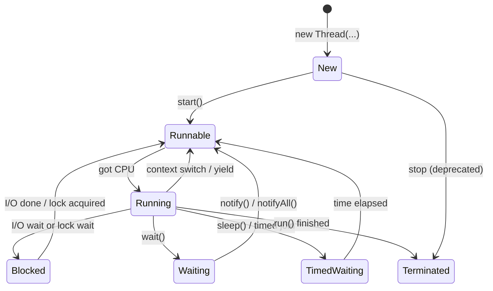

| State | Meaning | Monitor locks |
|-------|---------|---------------|
| **New** | Object created; not started | — |
| **Runnable** | Ready / waiting for CPU (often includes “Running” as got-CPU) | holds locks while in sync sections |
| **Running** | Executing (conceptual; often folded into Runnable in docs) | — |
| **Blocked** | Waiting on I/O or to enter a monitor held by another thread | **releases** all monitor locks when blocked for wait-style? *(he says blocked releases monitors — careful: classic Java: waiting to enter synchronized does not yet hold; `wait()` releases; blocking on I/O does not release monitors)* |
| **Waiting** | `wait()` until `notify`/`notifyAll` | **releases** monitor locks |
| **Timed Waiting** | `sleep(ms)`, timed wait/join | **`sleep` does NOT release** monitor locks |
| **Terminated** | finished; cannot restart | — |

His teaching points to memorize for interview:
- Runnable vs Running: waiting for CPU vs has CPU; often discussed as one Runnable state.
- Blocked: DB/file I/O wait, or waiting to acquire a lock.
- Waiting: explicit `wait()`; needs `notify`/`notifyAll`.
- Timed waiting: `sleep` — auto-return after time; **does not release** monitors.
- Terminated: dead end.

> **Note:** Precise JLS: `Object.wait()` releases the monitor; `Thread.sleep()` does not. Entering a `synchronized` block waits to *acquire* a monitor (BLOCKED) without holding it yet. Prefer official state names (`RUNNABLE`, `BLOCKED`, `WAITING`, `TIMED_WAITING`, `TERMINATED`) in interviews.

---

### Monitor lock `[28:16](https://www.youtube.com/watch?v=AYiE7_loIsE&t=1696s)`
- Ensures **only one thread** executes a critical section (`synchronized` method/block) for a given lock object.
- Every object has an intrinsic **monitor**.
- Same object + synchronized → mutual exclusion.
- Different objects → different monitors → both threads may enter “same” method concurrently.

```java
// same obj → serialized
obj.method1(); // T1
obj.method1(); // T2 waits if method1 synchronized on this

// obj1 vs obj2 → can both enter
obj1.method1();
obj2.method1();
```

### MonitorLockExample demo `[32:29](https://www.youtube.com/watch?v=AYiE7_loIsE&t=1949s)`
```java
class MonitorLockExample {
    public synchronized void task1() {
        System.out.println("inside task1");
        try { Thread.sleep(10000); } catch (InterruptedException e) {}
        System.out.println("task1 completed");
    }
    public void task2() {
        System.out.println("task2 before synchronized");
        synchronized (this) {
            System.out.println("task2 inside synchronized");
        }
    }
    public void task3() {
        System.out.println("task3");
    }
}
// Three threads, SAME obj:
// T1 → task1 (holds monitor, sleeps 10s)
// T2 → task2: prints "before", then waits for monitor
// T3 → task3: no sync → prints immediately
// After T1 exits sync → T2 enters
```
- Method-level sync and `synchronized (this)` share the **same** object monitor.
- Unsynchronized methods don’t need the monitor.

---

### Producer / consumer with wait–notify `[45:02](https://www.youtube.com/watch?v=AYiE7_loIsE&t=2702s)`

Shared resource sketch:
```java
class SharedResource {
    private boolean itemAvailable = false;

    public synchronized void addItem() {
        itemAvailable = true;
        notifyAll(); // wake waiters on THIS object's monitor
    }

    public synchronized void consumeItem() {
        while (!itemAvailable) {   // while, not if — spurious wakeup
            try { wait(); } catch (InterruptedException e) {}
        }
        System.out.println("item consumed");
        itemAvailable = false;
    }
}
```
Flow he walks:
1. Create one shared object; producer & consumer threads use it.
2. Threads start → Runnable.
3. Consumer often reaches `consumeItem` first → `itemAvailable == false` → **`wait()`** → releases monitor, Waiting.
4. Producer sleeps (~5s) then `addItem` → acquires monitor → sets true → `notifyAll` → releases.
5. Consumer wakes, re-checks condition, consumes, sets false.

**Spurious wakeup:** Oracle docs — a waiting thread may wake without notify. Always re-check condition in a **`while`** loop.

Lambda vs named Runnable classes — both OK; lambda shorter.

### Assignment `[65:00](https://www.youtube.com/watch?v=AYiE7_loIsE&t=3900s)`
Classic **bounded buffer** producer–consumer:
- Fixed-size queue shared by producer & consumer.
- Producer waits if buffer **full**.
- Consumer waits if buffer **empty**.
- Solution discussed next lecture (Part 3).

### Deprecated stop / how to terminate `[67:04](https://www.youtube.com/watch?v=AYiE7_loIsE&t=4024s)`
- `Thread.stop()` (and related) deprecated — why and alternatives next session.

### Interview questions / gotchas he highlights
- Why two thread-creation styles? Single inheritance vs multiple interfaces.
- Prefer Runnable in production.
- `start()` vs calling `run()` directly (latter runs on current thread — implied by start→run story).
- Lifecycle states; sleep doesn’t release monitors; wait does.
- Monitor = per-object; sync methods on different instances don’t exclude each other.
- wait/notify only inside synchronized on the same object.
- Spurious wakeup → `while (!condition) wait();`
- Producer–consumer assignment.

### Quick revision
- Create threads: `new Thread(runnable).start()` or subclass Thread + `start()`.
- Prefer Runnable for flexibility.
- `start` schedules; JVM calls `run`; target Runnable invoked if present.
- States: New → Runnable ↔ Blocked/Waiting/TimedWaiting → Terminated.
- Monitor lock serializes critical sections on one object.
- wait releases lock; sleep does not.
- notify/notifyAll wake waiters; use while for conditions.
- Next: producer–consumer solution, join, daemon, priority, deprecated stop/suspend/resume.


---

<a id="lec-32"></a>

## 32. Thread Joining, Daemon Thread, Thread Priority | Multithreading in Java: Part3


[↑ Index](#index) · [Parts](#parts)


> **Video:** [31. Thread Joining, Daemon Thread, Thread Priority | Multithreading in Java: Part3](https://www.youtube.com/watch?v=cdsFwGDVzpg)

### What this lecture covers
- Solution to bounded producer–consumer (fixed-size queue + wait/notify)
- Why `stop` / `suspend` / `resume` are deprecated (no lock release → deadlock risk)
- Live demo: suspend while holding a monitor → other thread stuck
- `Thread.join()` for coordination
- Thread priority (1–10): hint only — never rely on it
- Daemon vs user threads; GC / autosave / logging examples

---

### Agenda `[0:00](https://www.youtube.com/watch?v=cdsFwGDVzpg&t=0s)`
Part 3 of multithreading:
- Producer–consumer solution (assignment from Part 2)
- Why stop / resume / suspend are deprecated
- Thread joining
- Thread priority
- Daemon threads

---

### Producer–consumer solution `[0:30](https://www.youtube.com/watch?v=cdsFwGDVzpg&t=30s)`

**Problem:**
- Producer & consumer share a **fixed-size** queue.
- Producer waits if full; consumer waits if empty. `[1:01](https://www.youtube.com/watch?v=cdsFwGDVzpg&t=61s)`
- Builds on wait / notify / monitor lock from previous lecture. `[1:32](https://www.youtube.com/watch?v=cdsFwGDVzpg&t=92s)`

#### Shared resource `[2:03](https://www.youtube.com/watch?v=cdsFwGDVzpg&t=123s)`
```java
class SharedResource {
    private Queue<Integer> queue;
    private final int bufferSize;

    SharedResource(int bufferSize) {
        this.bufferSize = bufferSize;
        // LinkedList is unbounded — capacity enforced via bufferSize
        this.queue = new LinkedList<>();
    }

    public synchronized void produce(int item) throws InterruptedException {
        while (queue.size() == bufferSize) {
            // buffer full — wait for consumer
            System.out.println("Buffer full, producer waiting");
            wait();
        }
        queue.add(item);
        System.out.println("Produced: " + item);
        notify(); // wake a waiting consumer (or producer)
    }

    public synchronized void consume() throws InterruptedException {
        while (queue.isEmpty()) {
            System.out.println("Buffer empty, consumer waiting");
            wait();
        }
        Integer item = queue.poll();
        System.out.println("Consumed: " + item);
        notify(); // space freed — wake a waiting producer
    }
}
```

#### Why LinkedList + bufferSize `[2:34](https://www.youtube.com/watch?v=cdsFwGDVzpg&t=154s)`
- `LinkedList` as Queue is unbounded by default.
- Track fullness with `queue.size() == bufferSize`.

#### Produce / consume rules `[3:06](https://www.youtube.com/watch?v=cdsFwGDVzpg&t=186s)`
- Before produce: if full → `wait()`; else add → `notify`.
- Before consume: if empty → `wait()`; else poll → `notify` (space free for producer). `[3:39](https://www.youtube.com/watch?v=cdsFwGDVzpg&t=219s)`

#### Main demo `[4:10](https://www.youtube.com/watch?v=cdsFwGDVzpg&t=250s)`
```java
SharedResource shared = new SharedResource(3); // capacity 3

Thread producer = new Thread(() -> {
    try {
        for (int i = 0; i < 6; i++) shared.produce(i);
    } catch (InterruptedException e) { /* … */ }
});

Thread consumer = new Thread(() -> {
    try {
        for (int i = 0; i < 6; i++) shared.consume();
    } catch (InterruptedException e) { /* … */ }
});

producer.start();
consumer.start();
```
- Both methods synchronized → same object monitor. `[6:46](https://www.youtube.com/watch?v=cdsFwGDVzpg&t=406s)`
- Only one of produce/consume holds the lock at a time (even though different methods).
- Example interleaving: consumer first → empty → wait (releases lock) → producer adds → notify → consumer races for lock again. `[7:16](https://www.youtube.com/watch?v=cdsFwGDVzpg&t=436s)`
- Output order varies by scheduling — implement yourself to solidify. `[8:21](https://www.youtube.com/watch?v=cdsFwGDVzpg&t=501s)`

> **Note:** Prefer `notifyAll()` when multiple waiters of different kinds can be waiting; `notify()` wakes one arbitrary waiter. His demo uses `notify`.

---

### Why stop / suspend / resume are deprecated `[9:23](https://www.youtube.com/watch?v=cdsFwGDVzpg&t=563s)`

**Interview staple:** Can you use stop/resume/suspend? Technically callable but **deprecated** — don’t use.

| Method | Intended effect | Problem |
|--------|-----------------|---------|
| **`stop`** | Terminate thread abruptly | Dies without orderly cleanup; **locks not released** → other threads wait forever (**deadlock**) `[10:23](https://www.youtube.com/watch?v=cdsFwGDVzpg&t=623s)` |
| **`suspend`** | Pause thread (like wait) | Unlike `wait()`, **does not release** monitor locks → same deadlock risk `[11:54](https://www.youtube.com/watch?v=cdsFwGDVzpg&t=714s)` |
| **`resume`** | Continue suspended thread | Exists only for suspend; deprecated because suspend is `[12:25](https://www.youtube.com/watch?v=cdsFwGDVzpg&t=745s)` |

Contrast with safe APIs: `[9:53](https://www.youtube.com/watch?v=cdsFwGDVzpg&t=593s)`
- `wait()` → releases monitors; `notify` resumes.
- `sleep()` → timed inactive but **keeps** locks.
- `stop` → terminate → **no** lock release, no resource cleanup.

**Deadlock sketch:** T1 holds lock on Resource1; T2 waits for it; T1 is `stop`ped or `suspend`ed → lock never released → T2 waits forever. `[11:24](https://www.youtube.com/watch?v=cdsFwGDVzpg&t=684s)`

Use **wait/notify** instead of suspend/resume.

#### Implementing the deadlock demo `[12:58](https://www.youtube.com/watch?v=cdsFwGDVzpg&t=778s)`
Desired timeline:
1. Main starts; create T1, T2.
2. Start both; T1 acquires lock on shared resource first (`synchronized produce`), sleeps ~8s **holding** lock (`sleep` does not release). `[17:11](https://www.youtube.com/watch?v=cdsFwGDVzpg&t=1031s)`
3. T2 delayed 1s then tries same method → waits for monitor. `[20:25](https://www.youtube.com/watch?v=cdsFwGDVzpg&t=1225s)`
4. Main waits ~3s then `t1.suspend()` (deprecated) — T1 frozen **still holding** lock. `[21:25](https://www.youtube.com/watch?v=cdsFwGDVzpg&t=1285s)`
5. T2 stuck forever; without `resume`, program hangs — must kill manually. `[26:35](https://www.youtube.com/watch?v=cdsFwGDVzpg&t=1595s)`
6. With deprecated `resume`, T1 continues, finishes sleep, releases lock, T2 proceeds — proves the hazard. `[24:31](https://www.youtube.com/watch?v=cdsFwGDVzpg&t=1471s)`

```java
// shared: synchronized produce() { print acquired; sleep(8000); print released; }
t1.start(); t2.start();
Thread.sleep(3000);
t1.suspend(); // deprecated — lock NOT released
// t1.resume(); // only then T2 can enter
```

**Interview answer:** Don’t use stop/suspend/resume; they can leave monitors held and cause deadlock.

---

### Thread joining `[27:05](https://www.youtube.com/watch?v=cdsFwGDVzpg&t=1625s)`
- `thread1.join()` — **current** thread blocks until `thread1` finishes.

#### Without join `[28:05](https://www.youtube.com/watch?v=cdsFwGDVzpg&t=1685s)`
```java
System.out.println("main started");
Thread t1 = new Thread(() -> { /* ~8s work */ });
t1.start();
System.out.println("main finished"); // often prints BEFORE t1 finishes
```
Main can finish immediately after `start()` while t1 still runs. `[29:07](https://www.youtube.com/watch?v=cdsFwGDVzpg&t=1747s)`

#### With join `[30:10](https://www.youtube.com/watch?v=cdsFwGDVzpg&t=1810s)`
```java
t1.start();
System.out.println("main waiting for t1");
t1.join(); // main blocked here until t1 done
System.out.println("main finished");
```
- Main waits however long t1 takes; when t1 completes, main resumes. `[31:14](https://www.youtube.com/watch?v=cdsFwGDVzpg&t=1874s)`

#### Use cases `[31:44](https://www.youtube.com/watch?v=cdsFwGDVzpg&t=1904s)`
- Coordinate dependencies — wait for T1 and T2 before continuing:
  ```java
  t1.join();
  t2.join();
  // proceed knowing both finished
  ```
- Cleaner than hand-rolled wait/notify just to know “thread finished.”
- Gives control when later work depends on earlier threads. `[32:15](https://www.youtube.com/watch?v=cdsFwGDVzpg&t=1935s)`

---

### Thread priority `[32:46](https://www.youtube.com/watch?v=cdsFwGDVzpg&t=1966s)`
```java
t1.setPriority(Thread.MAX_PRIORITY); // 10
t2.setPriority(Thread.NORM_PRIORITY); // 5 (default)
t3.setPriority(Thread.MIN_PRIORITY); // 1
// or any int 1..10
```
| Constant | Value |
|----------|-------|
| `MIN_PRIORITY` | 1 (lowest) |
| `NORM_PRIORITY` | 5 |
| `MAX_PRIORITY` | 10 (highest) |

- New thread **inherits** parent’s priority (main default 5). `[35:47](https://www.youtube.com/watch?v=cdsFwGDVzpg&t=2147s)`
- **JVM does not guarantee** order by priority — only a **hint** to the scheduler. `[33:46](https://www.youtube.com/watch?v=cdsFwGDVzpg&t=2026s)`
- You might hope T3(10) → T1(5) → T2(4) → T4(1); often you won’t see that. `[34:17](https://www.youtube.com/watch?v=cdsFwGDVzpg&t=2057s)`
- **Never rely on priority in production**; rarely used in real code. `[34:47](https://www.youtube.com/watch?v=cdsFwGDVzpg&t=2087s)`
- Interview: “Would you use / rely on thread priority?” → **No** — no guarantee / not a strict rule. `[35:17](https://www.youtube.com/watch?v=cdsFwGDVzpg&t=2117s)`
- Run 10 times: maybe 1 time “looks ordered,” 9 times not. `[36:18](https://www.youtube.com/watch?v=cdsFwGDVzpg&t=2178s)`

---

### Daemon threads `[36:18](https://www.youtube.com/watch?v=cdsFwGDVzpg&t=2178s)`
- “Daemon” ≈ background / async helper (industry jargon: daemon components, …). `[36:50](https://www.youtube.com/watch?v=cdsFwGDVzpg&t=2210s)`
- Two kinds: **user threads** vs **daemon threads**. `[37:20](https://www.youtube.com/watch?v=cdsFwGDVzpg&t=2240s)`
- Default for threads you create: **user**.
- Mark daemon **before** start:
```java
Thread t = new Thread(() -> { /* work */ });
t.setDaemon(true); // must be before start()
t.start();
```

#### Lifecycle rule `[39:23](https://www.youtube.com/watch?v=cdsFwGDVzpg&t=2363s)`
- JVM stays alive while any **user** thread is alive.
- When **all user threads** finish, daemon threads are **stopped**.
- Normal user worker: main exits early → **worker still completes**. `[39:54](https://www.youtube.com/watch?v=cdsFwGDVzpg&t=2394s)`
- Same worker with `setDaemon(true)`: when main (last user thread) ends, **daemon dies mid-work** (may not finish sleep / clean unlock path as you’d expect). `[41:28](https://www.youtube.com/watch?v=cdsFwGDVzpg&t=2488s)`

#### Classic uses `[42:59](https://www.youtube.com/watch?v=cdsFwGDVzpg&t=2579s)`
- **Garbage collector** (JVM daemon) — frees memory while program runs; stops with the app.
- **Autosave** in editors — periodic save while you work; dies when editor session ends. `[43:30](https://www.youtube.com/watch?v=cdsFwGDVzpg&t=2610s)`
- **Background logging** while app runs — logging only meaningful while program is alive. `[44:01](https://www.youtube.com/watch?v=cdsFwGDVzpg&t=2641s)`

When “real” work (user threads) ends, helpers should go away too. `[44:31](https://www.youtube.com/watch?v=cdsFwGDVzpg&t=2671s)`

---

### Interview questions / gotchas he highlights
- Implement bounded producer–consumer with wait/notify.
- Why stop/suspend/resume deprecated → locks not released → deadlock.
- Demo: suspend holder while another waits for same monitor.
- `join` = current waits for that thread’s finish.
- Priority is a hint, not a contract — don’t use for correctness.
- Daemon dies when no user threads remain; `setDaemon` before `start`.
- Examples: GC, autosave, logging.

### Quick revision
- Bounded queue: while full/empty wait; notify after produce/consume.
- stop/suspend/resume deprecated — no reliable lock release.
- Prefer wait/notify (and modern alternatives) over suspend/resume.
- `t.join()` blocks current until `t` finishes.
- Priority 1–10, inherited, non-guaranteed — avoid depending on it.
- `setDaemon(true)` before `start`; daemons are background-only.
- GC / autosave / logging are daemon-style tasks.
- Next: custom locks (Reentrant, ReadWrite, Stamped, Semaphore) + Condition.


---

<a id="lec-33"></a>

## 33. Locks and Condition | Java Multithreading Part4 | Reentrant, ReadWrite, Stamped & Semaphore Lock


[↑ Index](#index) · [Parts](#parts)


> **Video:** [32. Locks and Condition | Java Multithreading Part4 | Reentrant, ReadWrite, Stamped & Semaphore Lock](https://www.youtube.com/watch?v=DPob5NLzKFI)

### What this lecture covers
- Limit of intrinsic `synchronized` (per-object monitors)
- Custom locks independent of which instance calls the code
- Four lock types: **ReentrantLock**, **ReadWriteLock**, **StampedLock**, **Semaphore**
- Shared vs exclusive locking; when ReadWriteLock shines
- Pessimistic vs optimistic locking; StampedLock optimistic read + `validate`
- Semaphore permits (N threads in critical section)
- Inter-thread communication with locks: **Condition** (`await` / `signal` / `signalAll`)

### Recap: synchronized = object monitor `[0:00](https://www.youtube.com/watch?v=DPob5NLzKFI&t=0s)`
- `synchronized` critical section → **monitor lock** on an object.
- Same instance → mutual exclusion.
- **Different instances** of the same class → different monitors → both threads can enter “the same” synchronized method concurrently.

```java
// resource1.produce() and resource2.produce() both synchronized
// → both can acquire locks (lock is on different objects)
```

### Requirement that synchronized cannot meet `[3:31](https://www.youtube.com/watch?v=DPob5NLzKFI&t=211s)`
- Need: **only one thread** in a critical section **even if callers use different SharedResource instances**.
- Real apps create many objects; still want a single gate for that code path.
- Solution: **explicit / custom locks** that do **not** depend on `this` — you share one `Lock` object across instances.

Four types he covers:
1. ReentrantLock
2. ReadWriteLock
3. Semaphore
4. StampedLock

---

### 1. ReentrantLock `[5:36](https://www.youtube.com/watch?v=DPob5NLzKFI&t=336s)`
```java
class SharedResource {
    void producer(Lock lock) {
        try {
            lock.lock();
            System.out.println("lock acquired by " + Thread.currentThread().getName());
            Thread.sleep(4000); // hold critical section
        } catch (InterruptedException e) {
            // handle
        } finally {
            lock.unlock(); // always unlock in finally
        }
    }
}

Lock lock = new ReentrantLock();
SharedResource r1 = new SharedResource();
SharedResource r2 = new SharedResource();
new Thread(() -> r1.producer(lock)).start();
new Thread(() -> r2.producer(lock)).start();
// Even with different instances, same Lock → serialized access
```
- Create `ReentrantLock`, call `lock()` / `unlock()`.
- Unlock in **`finally`** so exceptions still release.
- Lock identity is the **Lock instance**, not the SharedResource instance.

---

### Shared vs exclusive locks `[10:46](https://www.youtube.com/watch?v=DPob5NLzKFI&t=646s)`

| | Shared (read) lock | Exclusive (write) lock |
|--|--------------------|------------------------|
| Multiple holders? | Yes — many readers | No — one writer |
| Allowed while shared held? | Another shared ✓; exclusive ✗ | Nothing else |
| Allowed while exclusive held? | No shared, no exclusive | — |
| Data ops | Read only | Read + write |

Rules he summarizes:
- Many threads can hold **shared** locks together and **read**.
- Exclusive only if **no** lock currently held.
- Once exclusive is held, no other shared or exclusive until release.

---

### 2. ReadWriteLock `[14:57](https://www.youtube.com/watch?v=DPob5NLzKFI&t=897s)`
- Read lock = shared; write lock = exclusive.
- API: `ReadWriteLock` interface; common impl `ReentrantReadWriteLock`.

```java
ReadWriteLock rw = new ReentrantReadWriteLock();

void producer(ReadWriteLock lock) { // readers
    try {
        lock.readLock().lock();
        // READ only — don't mutate shared state here
        Thread.sleep(8000);
    } finally {
        lock.readLock().unlock();
    }
}

void consume(ReadWriteLock lock) { // writer
    try {
        lock.writeLock().lock();
        // exclusive mutation
    } finally {
        lock.writeLock().unlock();
    }
}

// T1 & T2 both call producer → both get read locks
// T3 calls consume → waits until both readers unlock
```
Demo output pattern: both read locks acquired → both released → then write lock acquired.

**When to use:** reads **much** more frequent than writes (e.g. 1000 reads / 10 writes) — readers don’t block each other.

---

### Pessimistic vs optimistic locking `[21:13](https://www.youtube.com/watch?v=DPob5NLzKFI&t=1273s)`
- Synchronized / Reentrant / ReadWrite = **pessimistic** — acquire a lock before touching data.
- **Optimistic:** **no lock** while working; validate before commit.

#### DB-style optimistic example `[22:45](https://www.youtube.com/watch?v=DPob5NLzKFI&t=1365s)`
Table rows with a **version** column (starts at 1; increments on each successful update).

1. T1 and T2 both **read** row id=123, version=1 (no lock).
2. Both compute updates locally.
3. T2 updates first: `UPDATE ... SET type=?, version=2 WHERE id=123 AND version=1` → success.
4. T1 tries same with `version=1` → fails (version already 2) → **rollback**, re-read version=2, retry.

Concurrency without holding a lock during the whole think/update window.

---

### 3. StampedLock `[27:52](https://www.youtube.com/watch?v=DPob5NLzKFI&t=1672s)`
Two roles:
1. Read/write locking (like ReadWriteLock).
2. **Optimistic read**.

#### Read/write mode
```java
StampedLock lock = new StampedLock();

long stamp = lock.readLock();
try {
    // read
} finally {
    lock.unlockRead(stamp); // must pass stamp
}

long stampW = lock.writeLock();
try {
    // write
} finally {
    lock.unlockWrite(stampW);
}
```
- `lock()` methods return a **`long` stamp**; unlock needs that stamp.
- Stamp encodes lock state / version — needed for optimistic validation.

#### Optimistic mode `[29:25](https://www.youtube.com/watch?v=DPob5NLzKFI&t=1765s)`
```java
long stamp = lock.tryOptimisticRead(); // NO lock taken — snapshot state
// ... compute intended update ...
if (lock.validate(stamp)) {
    // no write happened since optimistic read → commit
} else {
    // someone wrote → rollback / retry
}
// no unlock for optimistic read — nothing was locked
```

Demo idea:
- Producer: optimistic read, mutate local intent (10→11), sleep 6s, `validate` — if invalid, roll back to 10.
- Consumer: takes **writeLock**, works, unlocks (bumps stamp/version).
- If consumer wrote during producer’s sleep → validate fails → rollback.
- If no writer → validate succeeds.

> **Note:** In production optimistic patterns often upgrade to a real read/write lock on validation failure (`stamp = lock.tryConvertToWriteLock(stamp)` etc.). He focuses on tryOptimisticRead + validate.

---

### 4. Semaphore `[36:42](https://www.youtube.com/watch?v=DPob5NLzKFI&t=2202s)`
- Same idea as OS semaphore: control **how many** threads may enter.
- `new Semaphore(2)` → **2 permits** → at most two threads in the section at once.

```java
Semaphore sem = new Semaphore(2);

void producer() {
    try {
        sem.acquire(); // take a permit (blocks if 0)
        Thread.sleep(4000);
    } catch (InterruptedException e) {
    } finally {
        sem.release(); // return permit
    }
}
// Four threads call producer → first two enter; others wait; as permits free, next enter
```

**Use cases:**
- Two printers → allow 2 concurrent print jobs.
- **Connection pool** of size 5 → `Semaphore(5)` so at most five threads hold a connection.

---

### Condition (await / signal) `[40:49](https://www.youtube.com/watch?v=DPob5NLzKFI&t=2449s)`
Problem: `wait` / `notify` work with **intrinsic monitors** (`synchronized`). Custom locks don’t use that monitor → need **`Condition`**.

| Intrinsic | Condition (java.util.concurrent.locks) |
|-----------|----------------------------------------|
| `wait()` | `await()` |
| `notify()` | `signal()` |
| `notifyAll()` | `signalAll()` |

```java
Lock lock = new ReentrantLock();
Condition condition = lock.newCondition();
boolean available = false;

void produce() {
    lock.lock();
    try {
        while (available) {
            condition.await(); // wait on this Condition / Lock
        }
        available = true;
        condition.signal(); // wake one waiter
    } finally {
        lock.unlock();
    }
}

void consume() {
    lock.lock();
    try {
        while (!available) {
            condition.await();
        }
        available = false;
        condition.signal();
    } finally {
        lock.unlock();
    }
}
```
- Condition is created from a Lock: `lock.newCondition()`.
- Waiting is on the **lock/condition**, not on an arbitrary object monitor.
- Same producer–consumer logic as before; API names change.

---

### Why this matters `[45:58](https://www.youtube.com/watch?v=DPob5NLzKFI&t=2758s)`
- Concurrent collections and frameworks use these lock styles.
- Know shared vs exclusive, optimistic vs pessimistic, semaphore permits, and Condition for communication without `synchronized`.

### Interview questions / gotchas he highlights
- Synchronized fails when mutual exclusion must span **different instances** → share one Lock.
- Always `unlock` in `finally`.
- ReadWriteLock: many readers OR one writer; good for read-heavy workloads.
- Optimistic locking: version/stamp + validate; no lock during work.
- Why StampedLock returns stamps on lock/unlock.
- Semaphore(n) allows n concurrent entrants — pools/printers.
- With explicit locks use Condition, not wait/notify.
- signal vs signalAll analogous to notify vs notifyAll.

### Quick revision
- Intrinsic sync = per-object monitor; custom locks = shared Lock object.
- ReentrantLock: `lock`/`unlock`; unlock in finally.
- ReadWriteLock: shared reads, exclusive writes; read-heavy apps.
- StampedLock: RW + `tryOptimisticRead`/`validate`; stamps on lock/unlock.
- Semaphore(n): n permits; acquire/release.
- Condition: `await`/`signal`/`signalAll` paired with Lock.
- Practice all four + Condition with producer–consumer variants.


---

<a id="lec-34"></a>

## 34. 33. Lock-Free Concurrency | Compare-and-Swap | Atomic & Volatile Variables | Multithreading Part5


[↑ Index](#index) · [Parts](#parts)


> **Video:** [33. Lock-Free Concurrency | Compare-and-Swap | Atomic & Volatile Variables | Multithreading Part5](https://www.youtube.com/watch?v=JGb4qNEBW6Q)

### What this lecture covers
- Two ways to achieve concurrency: **lock-based** vs **lock-free**
- Why lock-free is **not** a full substitute for locks (narrow use cases)
- **Optimistic concurrency control** (DB row-version reminder) as a bridge to CAS
- **CAS (Compare-And-Swap)**: CPU-level atomic op, three parameters, ABA problem
- **Atomic variables** (`AtomicInteger`, `AtomicBoolean`, `AtomicLong`, `AtomicReference`)
- Why `counter++` is **not** atomic (load / modify / store race)
- **Volatile** vs Atomic: visibility vs atomicity — do **not** mix them up
- Quick revisit of **concurrent collections** and which use locks vs CAS

---

### Agenda & interview framing `[0:01](https://www.youtube.com/watch?v=JGb4qNEBW6Q&t=1s)`
- Topics: Atomic variables, difference with **volatile**, quick look at concurrent collections (already covered in Collections, revisited here).
- Interview prompt: *“In how many ways can you achieve concurrency?”* `[0:31](https://www.youtube.com/watch?v=JGb4qNEBW6Q&t=31s)`
  - Answer: **two** ways — lock-based and lock-free.

### Lock-based vs lock-free `[0:31](https://www.youtube.com/watch?v=JGb4qNEBW6Q&t=31s)`

| | **Lock-based** | **Lock-free** |
|--|----------------|---------------|
| Idea | Only one thread in critical section (via lock) | Concurrency **without** locks |
| Examples already covered | `synchronized`, ReentrantLock, StampedLock, ReadWriteLock, Semaphore | CAS + Atomic* classes |
| Speed | Slower (contention, park/unpark, etc.) | Generally **faster** for its niche |
| Scope | Complex business logic, multi-step critical sections | **Very specific** use cases |

- Lock-free is **not** an alternative that replaces locks everywhere `[1:33](https://www.youtube.com/watch?v=JGb4qNEBW6Q&t=93s)`.
- Use locks when there is **complex business logic**; use lock-free only in a **narrow** scenario (he promises the use case shortly) `[2:03](https://www.youtube.com/watch?v=JGb4qNEBW6Q&t=123s)`.

### Technique behind lock-free: CAS `[2:36](https://www.youtube.com/watch?v=JGb4qNEBW6Q&t=156s)`
- Technique: **Compare-And-Swap (CAS)**.
- Java classes that use it (slides list four): `AtomicInteger`, `AtomicBoolean`, `AtomicLong`, `AtomicReference`.

---

### Reminder: optimistic concurrency control `[3:08](https://www.youtube.com/watch?v=JGb4qNEBW6Q&t=188s)`
- Prefer the name **optimistic concurrency control** (also lock-free protocol), not “optimistic locking” in the mutex sense.
- Both OCC and CAS are lock-free protocols — useful mental link `[3:39](https://www.youtube.com/watch?v=JGb4qNEBW6Q&t=219s)`.

#### Student row example `[3:39](https://www.youtube.com/watch?v=JGb4qNEBW6Q&t=219s)`
- Row: roll `123`, name `Raj`, **row version = 1**.
- Thread1 and Thread2 both **read** the row and remember version **1**.
- Thread1 wants name → `RajK`; Thread2 wants name → `Raja`.
- Thread1 updates first:

```sql
UPDATE student SET name = 'RajK', version = version + 1
WHERE roll = 123 AND version = 1;
```

- Success → version becomes **2**.
- Thread2’s update with `version = 1` **fails** (version already changed) `[6:17](https://www.youtube.com/watch?v=JGb4qNEBW6Q&t=377s)`.
- Thread2 must **re-read** (now version 2), re-apply change, update with `version = 2` → version becomes **3** `[6:47](https://www.youtube.com/watch?v=JGb4qNEBW6Q&t=407s)`.

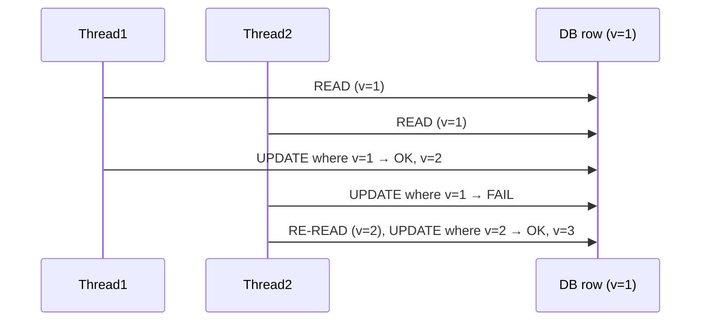

---

### CAS: Compare-And-Swap `[7:50](https://www.youtube.com/watch?v=JGb4qNEBW6Q&t=470s)`

#### Properties `[7:50](https://www.youtube.com/watch?v=JGb4qNEBW6Q&t=470s)`
- **Low-level** CPU operation (modern CPUs support it).
- **Atomic** = single unit: even with multiple cores / threads, CAS itself has atomicity `[8:21](https://www.youtube.com/watch?v=JGb4qNEBW6Q&t=501s)`.

#### Three parameters `[8:52](https://www.youtube.com/watch?v=JGb4qNEBW6Q&t=532s)`
1. **Memory location** — where the variable lives (e.g. `M1`, value `x = 10`)
2. **Expected value** — what you believe is currently there
3. **New value** — what to write if expectation matches

#### Steps `[9:24](https://www.youtube.com/watch?v=JGb4qNEBW6Q&t=564s)`
1. **Load / read** current value from memory.
2. **Compare** memory value vs expected.
3. If match → **swap / update** memory with new value; if not → fail (someone else changed it).

```
CAS(memory, expected, newValue):
  current = READ(memory)
  if current == expected:
      WRITE(memory, newValue)
      return true
  else:
      return false
```

#### Link to optimistic concurrency `[10:58](https://www.youtube.com/watch?v=JGb4qNEBW6Q&t=658s)`
- DB OCC’s `WHERE version = expected` is the same *idea* as CAS’s expected-value check.
- OCC ≈ inspired by CAS; CAS runs in **CPU**; OCC usually in **DB** `[11:58](https://www.youtube.com/watch?v=JGb4qNEBW6Q&t=718s)`.
- Java Atomic* classes give you a way to use the CPU CAS from Java.

---

### ABA problem `[12:28](https://www.youtube.com/watch?v=JGb4qNEBW6Q&t=748s)`

Scenario:
- Memory has `10`. Thread1 plans CAS(`M1`, expected=`10`, new=`12`) then later another update.
- Meanwhile other work: `10 → 12 → 10` again.
- Thread1’s CAS still sees `10` == expected → **succeeds**, even though the `10` is a **new** “generation” of the value `[13:32](https://www.youtube.com/watch?v=JGb4qNEBW6Q&t=812s)`.

That false success is the **ABA problem**.

#### Fix `[14:02](https://www.youtube.com/watch?v=JGb4qNEBW6Q&t=842s)`
- Attach a **version / timestamp** to the value.
- Example: `10@v1` → `12@v2` → `10@v3`. Thread1 holding `10@v1` no longer matches `10@v3` → CAS fails correctly.

> **Note:** Java’s `AtomicStampedReference` / `AtomicMarkableReference` exist for ABA; plain `AtomicInteger` does not stamp values by itself.

---

### What “atomic” means `[15:05](https://www.youtube.com/watch?v=JGb4qNEBW6Q&t=905s)`
- Atomic ≈ **single / all-or-nothing**.
- A simple assignment like `int counter = 10` can be treated as a single write, but **`counter++` is not atomic**.

### Demo: shared `counter++` race `[15:35](https://www.youtube.com/watch?v=JGb4qNEBW6Q&t=935s)`

```java
class SharedResource {
    int counter;

    public void increment() {
        counter++; // NOT atomic
    }

    public int get() {
        return counter;
    }
}
```

- One thread calling `increment()` 400 times → output **400** (fine) `[16:05](https://www.youtube.com/watch?v=JGb4qNEBW6Q&t=965s)`.
- Expanding `counter++` `[16:35](https://www.youtube.com/watch?v=JGb4qNEBW6Q&t=995s)`:
  1. **Load** counter
  2. **Add** 1
  3. **Store** back
  Equivalent to `counter = counter + 1` — three steps, **not** one atomic unit.

#### Two threads racing `[17:37](https://www.youtube.com/watch?v=JGb4qNEBW6Q&t=1057s)`
- Both load `0`, both compute `1`, both store `1` → final **1** instead of **2**.
- Split 400 increments across two threads (200 each) → he got **371** (lost updates), not 400 `[18:39](https://www.youtube.com/watch?v=JGb4qNEBW6Q&t=1119s)`.

### Two fixes `[19:43](https://www.youtube.com/watch?v=JGb4qNEBW6Q&t=1183s)`

**1. Lock-based** — `synchronized` on `increment()`:

```java
public synchronized void increment() {
    counter++;
}
```

Only one thread completes the three steps at a time.

**2. Lock-free** — `AtomicInteger` + `incrementAndGet()` `[20:13](https://www.youtube.com/watch?v=JGb4qNEBW6Q&t=1213s)`:

```java
class SharedResource {
    AtomicInteger counter = new AtomicInteger(0);

    public void increment() {
        counter.incrementAndGet(); // +1 via CAS loop
    }

    public int get() {
        return counter.get();
    }
}
```

- For arbitrary delta: `addAndGet(n)` `[21:19](https://www.youtube.com/watch?v=JGb4qNEBW6Q&t=1279s)`.
- Internally uses **CAS**.

### When to use Atomic `[22:22](https://www.youtube.com/watch?v=JGb4qNEBW6Q&t=1342s)`
- Use case: **read → modify → update** on a single shared variable (simple RMW).
- Outside that narrow pattern → prefer locks.
- Faster than locks **because** it is lock-free for that pattern.

---

### How `incrementAndGet` uses CAS (walkthrough) `[23:26](https://www.youtube.com/watch?v=JGb4qNEBW6Q&t=1406s)`

Conceptual loop (matches what he shows stepping into the method):

```java
// Pseudocode of AtomicInteger.incrementAndGet
int expected;
do {
    expected = value;              // volatile read from memory
} while (!compareAndSwap(value, expected, expected + 1));
```

Key points he emphasizes `[24:30](https://www.youtube.com/watch?v=JGb4qNEBW6Q&t=1470s)`–`[31:51](https://www.youtube.com/watch?v=JGb4qNEBW6Q&t=1911s)`:
- The atomic field’s `value` is **volatile** (visibility — covered next).
- Thread keeps **retrying CAS** until success (spin / loop), not locking.
- Two threads both reading expected `0`:
  - Thread1 CAS(`0 → 1`) succeeds.
  - Thread2 CAS(`0 → 1`) fails (memory is now `1`), retries with expected `1` → updates to `2`.
- CAS itself is atomic at CPU level, so only one thread “wins” a given attempt.
- The native CAS is implemented in C/C++; Java exposes it via Atomic classes.

### Atomic family `[31:51](https://www.youtube.com/watch?v=JGb4qNEBW6Q&t=1911s)`
| Class | For |
|-------|-----|
| `AtomicInteger` | `int` |
| `AtomicBoolean` | `boolean` |
| `AtomicLong` | `long` |
| `AtomicReference<V>` | any object reference |

Again: **limited** scenario — RMW on one value; otherwise use locks `[32:21](https://www.youtube.com/watch?v=JGb4qNEBW6Q&t=1941s)`.

---

### Atomic vs Volatile (major interview confusion) `[32:52](https://www.youtube.com/watch?v=JGb4qNEBW6Q&t=1972s)`

| | **Atomic*** | **`volatile`** |
|--|-------------|----------------|
| Thread-safe RMW? | Yes (CAS) | **No** |
| Concurrency / atomicity of compound ops | Guarantees atomic updates | Does **not** make `x++` safe |
| Main job | Atomic update | **Visibility** of reads/writes |

#### Cache hierarchy picture `[33:23](https://www.youtube.com/watch?v=JGb4qNEBW6Q&t=2003s)`
- Each CPU core has its own **L1** cache; there may be L2; then **RAM**.
- Without care: Core1 does `x++` → `11` sits in L1; Core2 reads and still sees **10** from RAM / its own cache because sync has not happened yet `[34:25](https://www.youtube.com/watch?v=JGb4qNEBW6Q&t=2065s)`.

#### What `volatile` does `[35:58](https://www.youtube.com/watch?v=JGb4qNEBW6Q&t=2158s)`
- Reads and writes go **to/from main memory** (not stale local cache copies in the model he teaches).
- So a write by Thread1 becomes **visible** to Thread2.
- Still **no** atomicity for multi-step updates — concurrency safety comes from Atomic/CAS (or locks) `[37:30](https://www.youtube.com/watch?v=JGb4qNEBW6Q&t=2250s)`.

> **Note (modern Java):** The JMM story is richer (happens-before, cache coherence protocols). Teaching model “volatile = always go to RAM” is a useful intuition for interviews; the formal guarantee is visibility + ordering via happens-before, not a literal “bypass all caches” hardware mode.

**One-liner he wants you to remember** `[38:00](https://www.youtube.com/watch?v=JGb4qNEBW6Q&t=2280s)`:
- Volatile → visibility of single reads/writes.
- Atomic → thread-safe atomic updates via CAS.

---

### Concurrent collections revisit `[38:31](https://www.youtube.com/watch?v=JGb4qNEBW6Q&t=2311s)`
- Already covered in Collections lectures; here he pins **what mechanism** each concurrent alternative uses.

| Non-concurrent | Concurrent / thread-safe alternative | Mechanism (as he shows) |
|----------------|--------------------------------------|-------------------------|
| `PriorityQueue` | `PriorityBlockingQueue` | `ReentrantLock` |
| `LinkedList` / `ArrayDeque` | `ConcurrentLinkedDeque` | **CAS** (lock-free) |
| `ArrayList` | `CopyOnWriteArrayList` | `ReentrantLock` |
| `HashSet` | `ConcurrentHashMap.newKeySet()` | (CHM internals) |
| `TreeSet` | `Collections.synchronizedSortedSet` | `synchronized` |
| `LinkedHashSet` | `Collections.synchronizedSet` | `synchronized` |
| `Queue` | `ConcurrentLinkedQueue` | **CAS** |

- Point of the demo: `PriorityBlockingQueue.add` → lock path; `ConcurrentLinkedDeque` add path → **CAS** (`casNext` style) `[40:33](https://www.youtube.com/watch?v=JGb4qNEBW6Q&t=2433s)`.
- Some concurrent collections are lock-based; some are lock-free via CAS — both achieve concurrency safely `[41:05](https://www.youtube.com/watch?v=JGb4qNEBW6Q&t=2465s)`.

---

### Interview questions / gotchas he highlights
- How many ways to achieve concurrency? → lock-based **and** lock-free `[0:31](https://www.youtube.com/watch?v=JGb4qNEBW6Q&t=31s)`.
- Lock-free is **faster** but **not** a general replacement for locks `[1:33](https://www.youtube.com/watch?v=JGb4qNEBW6Q&t=93s)`.
- Explain CAS with three parameters + optimistic concurrency analogy.
- What is the **ABA** problem and how do version/timestamp fix it?
- Why is `i++` not thread-safe? (three steps)
- Atomic vs volatile — **do not mix** visibility with atomicity `[32:52](https://www.youtube.com/watch?v=JGb4qNEBW6Q&t=1972s)`.
- Atomic use case = **read-modify-update** only `[22:22](https://www.youtube.com/watch?v=JGb4qNEBW6Q&t=1342s)`.
- Which concurrent collections use CAS vs locks?

### Quick revision
- Concurrency = locks **or** lock-free (CAS).
- CAS = atomic CPU op: memory + expected + new; retry on failure.
- OCC (DB version column) is the same idea as CAS at a higher level.
- ABA = value returned to old value; fix with stamp/version.
- `counter++` = load + add + store → race without sync/atomic.
- `AtomicInteger.incrementAndGet()` = CAS loop; lock-free for RMW.
- Volatile = visibility; Atomic = atomic updates.
- Concurrent collections: some ReentrantLock / synchronized, some CAS (`ConcurrentLinkedQueue` / `Deque`).


---

<a id="lec-35"></a>

## 35. 34. Thread Pools in Java | ThreadPoolExecutor Framework | Multithreading Part6


[↑ Index](#index) · [Parts](#parts)


> **Video:** [34. Thread Pools in Java | ThreadPoolExecutor Framework | Multithreading Part6](https://www.youtube.com/watch?v=ZUWs2U71vvk)

### What this lecture covers
- What a **thread pool** is and why reuse beats creating threads per task
- Advantages: save creation cost, abstract lifecycle, limit **context switching**
- Executor hierarchy: `Executor` → `ExecutorService` → `ThreadPoolExecutor` / `ForkJoinPool` / `ScheduledExecutorService`
- Full **`ThreadPoolExecutor` constructor**: core, max, keepAlive, queue, factory, rejection handler
- Exact admission flow: core threads → queue → extra threads → reject
- Why queue **before** creating beyond-core threads (his reasoning)
- Lifecycle: Running → Shutdown / Stop → Terminated
- Hands-on demos with custom `ThreadFactory` + `RejectedExecutionHandler`
- Interview: **why this corePoolSize?** — CPU cores, memory, IO vs CPU, formula + load testing

---

### Opening interview hook `[0:00](https://www.youtube.com/watch?v=ZUWs2U71vvk&t=0s)`
- Thread pools matter for interviews **and** day-to-day work.
- Question shared by an engineer: *“Why core pool size = 2, not 10 or 15? What’s the logic?”*
- He solves that at the **end**; first build the mental model from scratch `[0:31](https://www.youtube.com/watch?v=ZUWs2U71vvk&t=31s)`.

---

### What is a thread pool? `[1:01](https://www.youtube.com/watch?v=ZUWs2U71vvk&t=61s)`

Three ideas:
1. A **collection of threads** (workers) ready to run submitted tasks.
2. You configure how many (5, 10, 20, …).
3. When a worker finishes, it **returns to the pool** and waits for the next task → **reuse** `[1:31](https://www.youtube.com/watch?v=ZUWs2U71vvk&t=91s)`.

```
Application ──submit tasks──►  [ Thread Pool ]
                                 Thread1 (busy on Task1)
                                 Thread2 (busy on Task5)
                                 … ThreadN
                              ◄── workers return when done
```

#### Queue role (preview) `[4:04](https://www.youtube.com/watch?v=ZUWs2U71vvk&t=244s)`
- If all workers busy → new task goes to a **queue**.
- When a worker frees → it pulls from the queue `[5:05](https://www.youtube.com/watch?v=ZUWs2U71vvk&t=305s)`.

---

### Advantages of a thread pool `[6:07](https://www.youtube.com/watch?v=ZUWs2U71vvk&t=367s)`

#### 1. Save thread creation time `[6:07](https://www.youtube.com/watch?v=ZUWs2U71vvk&t=367s)`
- Creating a thread allocates stack, program counter, etc. — costs time `[2:34](https://www.youtube.com/watch?v=ZUWs2U71vvk&t=154s)`.
- Pool creates workers once; tasks reuse them.

#### 2. Remove lifecycle management overhead `[7:09](https://www.youtube.com/watch?v=ZUWs2U71vvk&t=429s)`
- Without a framework you manage NEW → RUNNABLE → WAITING → TERMINATED yourself.
- Executor framework **abstracts** that complexity.

#### 3. Better performance via controlled concurrency `[8:11](https://www.youtube.com/watch?v=ZUWs2U71vvk&t=491s)`
- Unbounded “new Thread per request” → hundreds of threads on few CPU cores.
- Only as many threads as cores can truly run in parallel; the rest **context-switch**.
- During a context switch the CPU is effectively idle (save old context, load new) `[9:46](https://www.youtube.com/watch?v=ZUWs2U71vvk&t=586s)`.
- Pool **caps** thread count → less switching waste → more useful processing time `[10:18](https://www.youtube.com/watch?v=ZUWs2U71vvk&t=618s)`.

---

### Executor framework hierarchy `[10:49](https://www.youtube.com/watch?v=ZUWs2U71vvk&t=649s)`

Package: `java.util.concurrent`.

```
Executor  (interface)
  └─ execute(Runnable)
       │
ExecutorService  (interface extends Executor)
  └─ shutdown, shutdownNow, isShutdown, isTerminated, submit, …
       │
       ├─ ThreadPoolExecutor          (class)
       ├─ ForkJoinPool                (class)
       └─ ScheduledExecutorService    (interface)
            └─ ScheduledThreadPoolExecutor
```

- `Executor`: just **execute**.
- `ExecutorService`: richer pool management (shutdown family, etc.) `[11:21](https://www.youtube.com/watch?v=ZUWs2U71vvk&t=681s)`.
- Today’s focus: **`ThreadPoolExecutor`** — customizable pool `[12:56](https://www.youtube.com/watch?v=ZUWs2U71vvk&t=776s)`.

---

### Admission flow (core → queue → max → reject) `[13:27](https://www.youtube.com/watch?v=ZUWs2U71vvk&t=807s)`

Assume: **core = 3**, **queue capacity = 5**, **max = 5**.

| Step | Condition | Action |
|------|-----------|--------|
| 1 | Worker free (and under core growth rules) | Assign task to worker |
| 2 | All core workers busy | **Enqueue** task |
| 3 | Queue full, threads < max | **Create** extra worker, assign task |
| 4 | Threads == max **and** queue full | **Reject** (handler) |

Walkthrough `[14:29](https://www.youtube.com/watch?v=ZUWs2U71vvk&t=869s)`–`[19:08](https://www.youtube.com/watch?v=ZUWs2U71vvk&t=1148s)`:
- Tasks 1–3 → Thread1–3.
- Tasks 4–8 → fill queue of 5.
- Task 9 → create Thread4; Task 10 → create Thread5.
- Task 11 → reject.
- When Thread3 finishes → pulls next from queue (e.g. Task4).

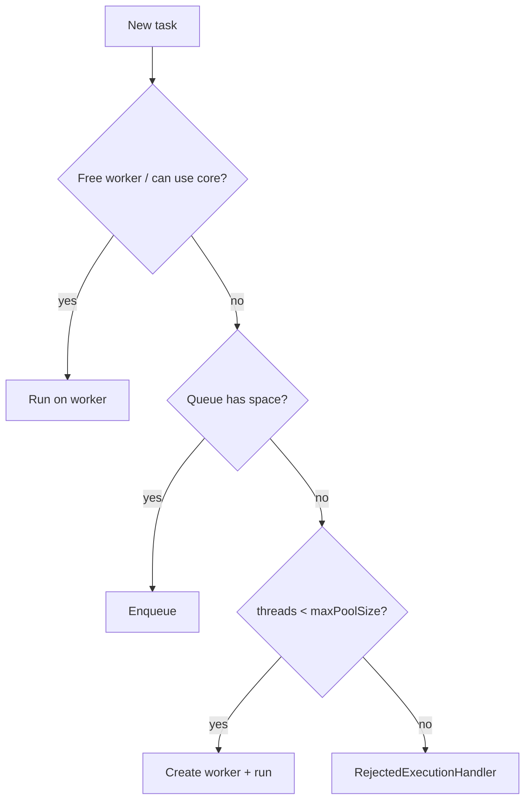

---

### `ThreadPoolExecutor` constructor parameters `[20:08](https://www.youtube.com/watch?v=ZUWs2U71vvk&t=1208s)`

```java
new ThreadPoolExecutor(
    int corePoolSize,
    int maximumPoolSize,
    long keepAliveTime,
    TimeUnit unit,
    BlockingQueue<Runnable> workQueue,
    ThreadFactory threadFactory,
    RejectedExecutionHandler handler
);
```

#### `corePoolSize` `[21:13](https://www.youtube.com/watch?v=ZUWs2U71vvk&t=1273s)`
- Number of threads **kept in the pool even if idle** (baseline workers).
- Example: core = 3 → Thread1–3 stay waiting when idle.

#### `allowCoreThreadTimeOut` (property, not ctor arg) `[21:44](https://www.youtube.com/watch?v=ZUWs2U71vvk&t=1304s)`
- Default **`false`**.
- If **`true`**, idle **core** threads may also die after `keepAliveTime`.
- If left `false`, keepAlive does **not** evict idle core threads even after long idle `[23:16](https://www.youtube.com/watch?v=ZUWs2U71vvk&t=1396s)`.

> **Note:** Excess threads (above core) **do** use `keepAliveTime` to time out even when `allowCoreThreadTimeOut` is false. His wording sometimes sounds like keepAlive only matters with that flag; the flag specifically applies keepAlive to **core** threads. Excess threads always respect keepAlive.

#### `keepAliveTime` + `TimeUnit` `[24:20](https://www.youtube.com/watch?v=ZUWs2U71vvk&t=1460s)`
- How long an idle eligible thread may sit before termination.
- `TimeUnit` interprets the long (seconds, minutes, hours, …).

#### `maximumPoolSize` `[25:22](https://www.youtube.com/watch?v=ZUWs2U71vvk&t=1522s)`
- Hard cap on threads in the pool.
- Extra threads appear **only after** core busy **and** queue full `[26:55](https://www.youtube.com/watch?v=ZUWs2U71vvk&t=1615s)`.

#### Why queue before creating beyond-core threads? `[28:28](https://www.youtube.com/watch?v=ZUWs2U71vvk&t=1708s)`
His design reasoning:
- Core size is meant to cover **average** load.
- If you eagerly create up to max whenever core is busy, those extra threads finish and **sit idle** in the pool — pool stays “fat” forever `[29:31](https://www.youtube.com/watch?v=ZUWs2U71vvk&t=1771s)`.
- Prefer: serve average load with **core + queue**; grow to max only on **peaks** so you don’t reject work `[31:33](https://www.youtube.com/watch?v=ZUWs2U71vvk&t=1893s)`.

#### Work queue (`BlockingQueue`) `[32:34](https://www.youtube.com/watch?v=ZUWs2U71vvk&t=1954s)`

| Type | Example | Capacity |
|------|---------|----------|
| **Bounded** | `ArrayBlockingQueue` | Fixed |
| **Unbounded** | `LinkedBlockingQueue` (default capacity huge) | Effectively unlimited |

- Prefer **bounded** for control; avoid unbounded so the queue cannot grow without limit `[33:04](https://www.youtube.com/watch?v=ZUWs2U71vvk&t=1984s)`.

#### `ThreadFactory` `[33:35](https://www.youtube.com/watch?v=ZUWs2U71vvk&t=2015s)`
- Hook when the pool creates threads: custom **name**, **priority**, **daemon** flag.
- Default factory exists (`Executors.defaultThreadFactory()`); custom for observability.

#### `RejectedExecutionHandler` `[35:07](https://www.youtube.com/watch?v=ZUWs2U71vvk&t=2107s)`
When task cannot be accepted (pool + queue saturated). Built-ins:

| Policy | Behavior |
|--------|----------|
| `AbortPolicy` (default) | Throw `RejectedExecutionException` |
| `DiscardPolicy` | Silently drop the new task |
| `CallerRunsPolicy` | Run the task on the **caller** thread (backpressure) `[36:37](https://www.youtube.com/watch?v=ZUWs2U71vvk&t=2197s)` |
| `DiscardOldestPolicy` | Drop oldest queued task; try to accept the new one `[37:38](https://www.youtube.com/watch?v=ZUWs2U71vvk&t=2258s)` |

You can also implement your own (e.g. log + metrics).

---

### ThreadPoolExecutor lifecycle `[38:08](https://www.youtube.com/watch?v=ZUWs2U71vvk&t=2288s)`

| State | Meaning |
|-------|---------|
| **Running** | Accepts new tasks via `submit` / `execute` |
| **Shutdown** (via `shutdown()`) | No new tasks; **in-flight** tasks finish `[39:11](https://www.youtube.com/watch?v=ZUWs2U71vvk&t=2351s)` |
| **Stop** (via `shutdownNow()`) | No new tasks; **interrupt** running work; attempt to clear pending `[40:11](https://www.youtube.com/watch?v=ZUWs2U71vvk&t=2411s)` |
| **Terminated** | Workers gone; pool done; check with `isTerminated()` `[40:41](https://www.youtube.com/watch?v=ZUWs2U71vvk&t=2441s)` |

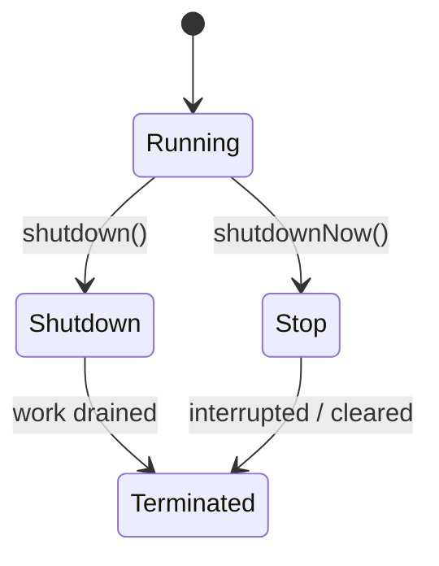

---

### Coding demo `[41:41](https://www.youtube.com/watch?v=ZUWs2U71vvk&t=2501s)`

Example configuration he builds toward:
- core = 2, max = 4, queue = `ArrayBlockingQueue(2)`, keepAlive = 10 minutes
- Custom factory + custom reject handler
- Tasks sleep ~5s so workers stay busy while more tasks arrive

```java
class CustomThreadFactory implements ThreadFactory {
    @Override
    public Thread newThread(Runnable r) {
        Thread t = new Thread(r);
        t.setPriority(Thread.NORM_PRIORITY);
        t.setDaemon(false);
        // t.setName("custom-worker-...");
        return t;
    }
}

class CustomRejectHandler implements RejectedExecutionHandler {
    @Override
    public void rejectedExecution(Runnable r, ThreadPoolExecutor executor) {
        System.out.println("Task rejected: " + r.toString());
    }
}

ThreadPoolExecutor pool = new ThreadPoolExecutor(
    2, 4, 10, TimeUnit.MINUTES,
    new ArrayBlockingQueue<>(2),
    new CustomThreadFactory(),
    new CustomRejectHandler()
);
// pool.allowCoreThreadTimeOut(true); // only if you want core threads to expire

for (int i = 0; i < N; i++) {
    pool.submit(() -> {
        try { Thread.sleep(5000); } catch (InterruptedException e) { /* ... */ }
        System.out.println("processed by " + Thread.currentThread().getName());
    });
}
pool.shutdown();
```

#### Observed behaviours he dry-runs `[52:58](https://www.youtube.com/watch?v=ZUWs2U71vvk&t=3178s)`–`[59:28](https://www.youtube.com/watch?v=ZUWs2U71vvk&t=3568s)`

| Tasks submitted | What happens |
|-----------------|--------------|
| 4 | 2 workers run; 2 queued; **no** extra threads; same 2 finish the queue |
| 5 | After queue full → create **Thread2** (3rd worker) for task 5 |
| 7 | Grow to max 4; queue holds 2; **task 7 rejected** and logged |

He also points at JDK `execute` source comments: (1) assign if possible (2) queue (3) add worker (4) reject `[46:46](https://www.youtube.com/watch?v=ZUWs2U71vvk&t=2806s)`.

---

### Interview: choosing core / max size `[60:31](https://www.youtube.com/watch?v=ZUWs2U71vvk&t=3631s)`

Subjective, but structure your answer around factors `[61:33](https://www.youtube.com/watch?v=ZUWs2U71vvk&t=3693s)`:

| Factor | Why it matters |
|--------|----------------|
| **CPU cores** | Too many threads → context-switch thrash |
| **JVM / heap memory** | Each thread needs stack + related memory |
| **Task nature** | CPU-bound vs IO-bound |
| **Concurrency goals** | High / medium / low |
| **Memory per request** | Heap used while a request is in flight |
| **Throughput** | Requests completed per unit time |

#### CPU vs IO intensive `[64:11](https://www.youtube.com/watch?v=ZUWs2U71vvk&t=3851s)`
- **CPU-intensive** → fewer threads (≈ near core count).
- **IO-intensive** → more threads (workers block on IO; CPU can run others).

#### Starting formula (not complete) `[67:16](https://www.youtube.com/watch?v=ZUWs2U71vvk&t=4036s)`

\[
\text{max threads} \approx N_{\text{cpu}} \times \left(1 + \frac{\text{wait time}}{\text{service time}}\right)
\]

Example: 64 cores, wait 50ms, process 100ms → ≈ `64 * (1 + 0.5) = 96` in general form; he works examples showing **CPU-heavy** cases collapse toward **≈ N_cpu** when wait/service → 0 `[68:46](https://www.youtube.com/watch?v=ZUWs2U71vvk&t=4126s)`.

**Formula ignores memory** — step 2 required `[70:47](https://www.youtube.com/watch?v=ZUWs2U71vvk&t=4247s)`.

#### Memory sanity check (his sketch) `[70:47](https://www.youtube.com/watch?v=ZUWs2U71vvk&t=4247s)`

Worked example he walks on the whiteboard (orders of magnitude for interview talk, not production gospel):

| Bucket | Example size |
|--------|----------------|
| Total JVM | ~2 GB |
| Heap | ~1 GB |
| Code cache | ~128 MB |
| JVM overhead (misc) | ~256 MB |
| Left for thread stacks / related | ~500 MB (his rough remainder) |

- Per thread (stack + registers + bookkeeping): assume ~**5 MB** → stack budget alone allows ~**100** threads `[72:19](https://www.youtube.com/watch?v=ZUWs2U71vvk&t=4339s)`.
- Formula said ~**64** for his CPU/IO mix — still need request heap:
  - One in-flight request holds ~**10 MB** of heap data (DB + service payloads).
  - 100 threads × 10 MB = **1 GB** → entire heap → risky `[73:21](https://www.youtube.com/watch?v=ZUWs2U71vvk&t=4401s)`.
- Cap at ~60–70% of heap for concurrent request data → e.g. **60** threads × 10 MB = 600 MB `[74:23](https://www.youtube.com/watch?v=ZUWs2U71vvk&t=4463s)`.
- Merge constraints: formula ≈ 64, heap-safe ≈ 60 → choose **min ≈ 60, max ≈ 64–70**, then **profile + load-test and refine** `[74:54](https://www.youtube.com/watch?v=ZUWs2U71vvk&t=4494s)`.

```
CPU/IO formula ──► candidate N
JVM stack budget ──► N ≤ stack_limit
Heap per request ──► N ≤ (0.6..0.7 * heap) / mem_per_req
                    └──► pick min/max in the intersection
                         └──► load test → iterate
```

> **Note:** Numbers are illustrative for interview storytelling; production sizing needs measurement (profilers, load tests), not a single formula.

#### End note `[76:25](https://www.youtube.com/watch?v=ZUWs2U71vvk&t=4585s)`
- Long session; rewatch + **code it yourself**. Next videos continue related executor topics.

---

### Interview questions / gotchas he highlights
- Why this `corePoolSize` / `maximumPoolSize`? (multi-factor + iterative tuning) `[0:00](https://www.youtube.com/watch?v=ZUWs2U71vvk&t=0s)`
- Order of admission: **workers → queue → grow → reject** (not grow before queue).
- Why prefer queue before growing past core? (keep average footprint = core) `[28:28](https://www.youtube.com/watch?v=ZUWs2U71vvk&t=1708s)`
- Bounded vs unbounded queue — prefer bounded.
- Four rejection policies + custom logging handler.
- `shutdown` vs `shutdownNow` / stop path.
- CPU-bound vs IO-bound thread counts.
- Formula is a **starting point**; always fold in memory + load testing.

### Quick revision
- Pool = reusable workers + queue + caps.
- Benefits: reuse, lifecycle abstraction, controlled context switching.
- Hierarchy: Executor → ExecutorService → ThreadPoolExecutor / ForkJoin / Scheduled.
- Flow: core → queue → max threads → reject.
- Core stays idle unless `allowCoreThreadTimeOut(true)`.
- Prefer bounded queues; customize factory + rejection.
- Size using cores, task type, JVM/heap, then measure.


---

<a id="lec-36"></a>

## 36. 35. Java8 CompletableFuture | Future and Callable in Java | Multithreading in Java - Part7


[↑ Index](#index) · [Parts](#parts)


> **Video:** [35. Java8 CompletableFuture | Future and Callable in Java | Multithreading in Java - Part7](https://www.youtube.com/watch?v=SFwCiYwr3yQ)

### What this lecture covers
- Why **`Future`** exists: caller needs status / result of an async pool task
- Five `Future` methods: `cancel`, `isCancelled`, `isDone`, `get()`, timed `get`
- How `submit` wraps work in a **`FutureTask`** (state + result)
- Three `submit` overloads: `Runnable`, `Runnable + result`, **`Callable`**
- Runnable vs Callable
- **`CompletableFuture`** (Java 8): advanced Future with chaining
- Core APIs: `supplyAsync`, `thenApply`/`Async`, `thenCompose`/`Async`, `thenAccept`/`Async`, `thenCombine`/`Async`
- Sync vs Async stages (same thread vs new thread / pool)
- Industry reality: often `supplyAsync` + `get`; chaining still interview-heavy

---

### Motivation: knowing async task status `[0:01](https://www.youtube.com/watch?v=SFwCiYwr3yQ&t=1s)`
- Recap: submit a task to `ThreadPoolExecutor` → a pool worker runs it; **main continues**.
- Problem: how does the caller learn if the task finished, failed, or what it returned? `[1:01](https://www.youtube.com/watch?v=SFwCiYwr3yQ&t=61s)`
- Without holding a handle, there is **no** way to ask.
- `submit(...)` returns a **`Future`** — store that reference `[2:07](https://www.youtube.com/watch?v=SFwCiYwr3yQ&t=127s)`.

### What is Future? `[3:09](https://www.youtube.com/watch?v=SFwCiYwr3yQ&t=189s)`
- Interface representing the result of an **async** computation.
- Lets you: check completion, get result, observe / handle exceptions, cancel.

```
Main ──submit──► Pool worker (async task)
  │
  └── holds Future ── later: isDone / get / cancel
```

---

### Future API (5 methods) `[5:12](https://www.youtube.com/watch?v=SFwCiYwr3yQ&t=312s)`

| # | Method | Purpose |
|---|--------|---------|
| 1 | `boolean cancel(boolean mayInterruptIfRunning)` | Attempt to cancel; `false` if already completed `[5:44](https://www.youtube.com/watch?v=SFwCiYwr3yQ&t=344s)` |
| 2 | `boolean isCancelled()` | Was it cancelled before normal completion? |
| 3 | `boolean isDone()` | Finished for **any** reason: success, exception, or cancel `[7:19](https://www.youtube.com/watch?v=SFwCiYwr3yQ&t=439s)` |
| 4 | `V get()` | **Block** caller until done; then return result `[7:52](https://www.youtube.com/watch?v=SFwCiYwr3yQ&t=472s)` |
| 5 | `V get(long timeout, TimeUnit unit)` | Block at most timeout; else `TimeoutException` `[8:54](https://www.youtube.com/watch?v=SFwCiYwr3yQ&t=534s)` |

#### Demo sketch `[9:57](https://www.youtube.com/watch?v=SFwCiYwr3yQ&t=597s)`
- Task sleeps 7s; main checks `isDone()` → false.
- `get(2, SECONDS)` → `TimeoutException`.
- Then unbounded `get()` waits until done → `isDone()` true, `isCancelled()` false.
- Print from the worker appears before the post-`get` prints because main was blocked `[13:35](https://www.youtube.com/watch?v=SFwCiYwr3yQ&t=815s)`.

```java
Future<?> f = pool.submit(() -> {
    Thread.sleep(7000);
    System.out.println("task done");
    return null;
});
System.out.println(f.isDone()); // false while sleeping
try {
    f.get(2, TimeUnit.SECONDS);
} catch (TimeoutException e) {
    System.out.println("timeout");
}
f.get(); // wait rest of the way
System.out.println(f.isDone());      // true
System.out.println(f.isCancelled()); // false
```

---

### Internals: FutureTask `[14:36](https://www.youtube.com/watch?v=SFwCiYwr3yQ&t=876s)`
- `submit` creates a **`FutureTask`** wrapping your `Runnable`/`Callable`.
- `Future` is the interface; `FutureTask` implements `RunnableFuture` → ultimately a Future.
- FutureTask holds: the **task** + a **state** machine (new, running, completed, cancelled, …) that the pool updates `[16:09](https://www.youtube.com/watch?v=SFwCiYwr3yQ&t=969s)`.

---

### Three flavours of `submit` `[17:11](https://www.youtube.com/watch?v=SFwCiYwr3yQ&t=1031s)`

```java
<T> Future<T> submit(Callable<T> task);
Future<?>     submit(Runnable task);
<T> Future<T> submit(Runnable task, T result);
```

### Runnable vs Callable `[18:45](https://www.youtube.com/watch?v=SFwCiYwr3yQ&t=1125s)`

| | **Runnable** | **Callable&lt;V&gt;** |
|--|--------------|---------------------|
| Method | `void run()` | `V call() throws Exception` |
| Return value | None | Yes |
| Functional interface | Yes | Yes |

Both represent “a task to run”; Callable is the clean way to **return** something.

---

### Use case 1: `submit(Runnable)` → `Future<?>` `[20:21](https://www.youtube.com/watch?v=SFwCiYwr3yQ&t=1221s)`
- Lambda that only prints / works → compiler picks **Runnable**.
- Still need a Future for status/cancel — but there is **no** result.
- Type is `Future<?>` (wildcard = unknown); `get()` returns **`null`** (hardcoded result for Runnable wrapping) `[21:24](https://www.youtube.com/watch?v=SFwCiYwr3yQ&t=1284s)`.
- Catch into `Object` (parent of everything):

```java
Future<?> f = pool.submit(() -> System.out.println("work"));
Object o = f.get();
System.out.println(o == null); // true
```

### Use case 2: `submit(Runnable, T result)` — shared object workaround `[24:33](https://www.youtube.com/watch?v=SFwCiYwr3yQ&t=1473s)`
- Pass a common mutable object (e.g. `List<Integer>`) into the Runnable; worker mutates it.
- After completion, `get()` returns **that same** result object you passed in.

```java
List<Integer> output = new ArrayList<>();
Future<List<Integer>> f = pool.submit(() -> {
    // do work...
    output.add(300);
}, output);

List<Integer> fromFuture = f.get(); // same list reference
// output.get(0) and fromFuture.get(0) both 300
```

Useful when you don’t have Callable yet, but it’s a **workaround** `[30:10](https://www.youtube.com/watch?v=SFwCiYwr3yQ&t=1810s)`.

### Use case 3: `submit(Callable)` — cleaner `[31:12](https://www.youtube.com/watch?v=SFwCiYwr3yQ&t=1872s)`

```java
Future<List<Integer>> f = pool.submit(() -> {
    List<Integer> list = new ArrayList<>();
    list.add(300);
    return list; // Callable inferred
});
List<Integer> result = f.get();
```

Prefer this over the Runnable+result pattern.

---

### CompletableFuture overview `[33:16](https://www.youtube.com/watch?v=SFwCiYwr3yQ&t=1996s)`
- Java **8**; for async programming.
- “Big brother” of Future: implements Future + **chaining** and more.
- Five focus APIs in this lecture.

---

### 1. `supplyAsync` `[34:48](https://www.youtube.com/watch?v=SFwCiYwr3yQ&t=2088s)`

```java
static <T> CompletableFuture<T> supplyAsync(Supplier<T> supplier)
static <T> CompletableFuture<T> supplyAsync(Supplier<T> supplier, Executor executor)
```

- Starts an async computation (like submit).
- `Supplier` = no args, returns a value (task body).
- **No executor** → uses shared **`ForkJoinPool.commonPool()`** (size tied to processors; little control) `[35:49](https://www.youtube.com/watch?v=SFwCiYwr3yQ&t=2149s)`.
- Pass your `ThreadPoolExecutor` for full control (core/max/queue).

```java
CompletableFuture<String> cf = CompletableFuture.supplyAsync(() -> {
    // work
    return "task completed";
}, poolExecutor);

System.out.println(cf.get()); // blocks like Future.get
```

---

### 2. `thenApply` / `thenApplyAsync` `[40:25](https://www.youtube.com/watch?v=SFwCiYwr3yQ&t=2425s)`
- Apply a **Function** to the previous stage’s result; return a new `CompletableFuture`.
- Enables **chaining**.

```java
CompletableFuture<String> cf = CompletableFuture
    .supplyAsync(() -> "Concept &&", pool)
    .thenApply(val -> val + " Coding");
```

| Method | Threading |
|--------|-----------|
| `thenApply` | **Synchronous** w.r.t. previous stage — **same** thread that finished the prior async task continues `[43:03](https://www.youtube.com/watch?v=SFwCiYwr3yQ&t=2583s)` |
| `thenApplyAsync` | **New** async execution — different thread; default FJP if no executor `[44:07](https://www.youtube.com/watch?v=SFwCiYwr3yQ&t=2647s)` |

Demo insight `[46:42](https://www.youtube.com/watch?v=SFwCiYwr3yQ&t=2802s)`:
- `thenApply` → same `pool-1-thread-1` for supply and apply.
- `thenApplyAsync` without executor → `ForkJoinPool.commonPool-worker-*`.
- `thenApplyAsync(..., pool)` → your pool (may or may not reuse the same physical thread after return to pool) `[48:46](https://www.youtube.com/watch?v=SFwCiYwr3yQ&t=2926s)`.

> **Gotcha he stresses:** multiple `thenApplyAsync` stages — **ordering not guaranteed** if they are independent concurrent stages; they can run concurrently `[49:16](https://www.youtube.com/watch?v=SFwCiYwr3yQ&t=2956s)`.

---

### 3. `thenCompose` / `thenComposeAsync` `[49:47](https://www.youtube.com/watch?v=SFwCiYwr3yQ&t=2987s)`
- Chain **dependent** async operations (flatMap-style): next stage returns another `CompletionStage`.
- Use when task2 must start **after** task1 and needs task1’s result.
- Maintains **ordering** of dependent stages (internally tracks dependent actions) `[57:00](https://www.youtube.com/watch?v=SFwCiYwr3yQ&t=3420s)`.

```java
CompletableFuture<String> cf = CompletableFuture
    .supplyAsync(() -> "Hello", pool)
    .thenCompose(val ->
        CompletableFuture.supplyAsync(() -> val + " World", pool)
    );
// get() → "Hello World" (ordering guaranteed across dependent compose chain)
```

- Same sync/async thread rule as apply: compose vs composeAsync `[50:49](https://www.youtube.com/watch?v=SFwCiYwr3yQ&t=3049s)`.
- Function signature uses wildcards (`? super T`, `? extends CompletionStage`) — same generics reading skill as earlier lectures `[51:50](https://www.youtube.com/watch?v=SFwCiYwr3yQ&t=3110s)`.

---

### 4. `thenAccept` / `thenAcceptAsync` `[57:30](https://www.youtube.com/watch?v=SFwCiYwr3yQ&t=3450s)`
- **Consumer** of previous result; returns `CompletableFuture<Void>`.
- Typical **end of the chain** — no value to pipe further `[58:01](https://www.youtube.com/watch?v=SFwCiYwr3yQ&t=3481s)`.
- Trying to `thenApply` after accept is awkward because prior stage is `Void` `[60:05](https://www.youtube.com/watch?v=SFwCiYwr3yQ&t=3605s)`.

```java
CompletableFuture<Void> end = CompletableFuture
    .supplyAsync(() -> "hello", pool)
    .thenAccept(val -> System.out.println(val));
```

---

### 5. `thenCombine` / `thenCombineAsync` `[61:06](https://www.youtube.com/watch?v=SFwCiYwr3yQ&t=3666s)`
- Combine results of **two** independent CompletableFutures with a `BiFunction`.

```java
CompletableFuture<Integer> t1 = CompletableFuture.supplyAsync(() -> 10, pool);
CompletableFuture<String>  t2 = CompletableFuture.supplyAsync(() -> "K", pool);

CompletableFuture<String> combined = t1.thenCombine(t2, (a, b) -> a + b);
System.out.println(combined.get()); // "10K"
```

- Again: combine vs combineAsync = same-thread continuation vs new async thread `[61:06](https://www.youtube.com/watch?v=SFwCiYwr3yQ&t=3666s)`.

---

### Chaining cheat-sheet (how the pieces fit)

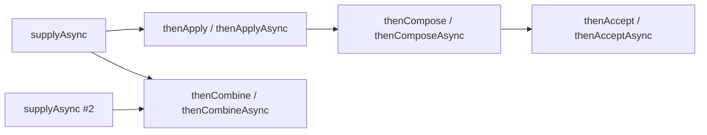

| Need | Prefer |
|------|--------|
| Start async work that returns a value | `supplyAsync` |
| Transform result (same thread) | `thenApply` |
| Transform on another thread | `thenApplyAsync` (+ optional Executor) |
| Next step returns another Future / CF | `thenCompose` |
| Fire-and-forget end of pipeline | `thenAccept` |
| Merge two independent CFs | `thenCombine` |

### Practice & industry note `[65:11](https://www.youtube.com/watch?v=SFwCiYwr3yQ&t=3911s)`
- Topic is confusing without **hands-on** practice and personal notes.
- In MNCs: CompletableFuture is common, but heavy chaining (`thenApply` / `compose` / `combine`) is **rarer**; often `supplyAsync` + `get`.
- Still **very important for interviews** — invent use cases and implement them.
- His tip: make your own notes while coding; watching alone leaves lasting confusion.

---

### Interview questions / gotchas he highlights
- Why Future? Status/result of async work without blocking from the start.
- `isDone` true for success **or** failure **or** cancel.
- `get` blocks; timed `get` throws `TimeoutException`.
- Runnable vs Callable; when `Future<?>`’s `get()` is null.
- Three submit forms — Callable is the clean return path.
- `thenApply` same thread vs `thenApplyAsync` new thread / FJP.
- Multiple independent `thenApplyAsync` → ordering not guaranteed; use `thenCompose` for dependent ordering.
- `thenAccept` = terminal consumer (`Void`).
- Default executor for CF without pool = ForkJoin common pool.

### Quick revision
- Future = handle for async result (cancel / done / get).
- submit wraps FutureTask; three submit overloads.
- Callable returns value; Runnable does not.
- CompletableFuture = Future + chaining (Java 8).
- supplyAsync starts work (pass Executor for control).
- thenApply / thenCompose / thenAccept / thenCombine (+ Async variants).
- Sync stage = same worker; Async = another thread.
- Compose for dependent async; combine for two independent results.


---

<a id="lec-37"></a>

## 37. 36. Java ForkJoinPool || WorkStealingPool || FixedThreadPool || CachedThreadPool || SingleThreadPool


[↑ Index](#index) · [Parts](#parts)


> **Video:** [36. Java ForkJoinPool || WorkStealingPool || FixedThreadPool || CachedThreadPool || SingleThreadPool](https://www.youtube.com/watch?v=VlfVyz-QG60)

### What this lecture covers
- `Executors` utility / factory methods vs hand-built `ThreadPoolExecutor`
- **Fixed**, **Cached**, **Single** thread pools — properties, when to use, downsides
- **Work-stealing pool** ↔ **ForkJoinPool**
- Fork / Join idea: split big work into subtasks, wait, merge
- Submission queue vs per-thread **work-stealing deques**
- Steal priority and steal-from-back / consume-from-front
- `RecursiveTask` vs `RecursiveAction`; `compute`, `fork`, `join`
- Sum-range demo; pool sizing (`availableProcessors` or explicit)

---

### Custom pool vs `Executors` factories `[0:00](https://www.youtube.com/watch?v=VlfVyz-QG60&t=0s)`
- So far: custom `ThreadPoolExecutor` (you set core, max, queue, …).
- `java.util.concurrent.Executors` provides **factory methods** for common pool shapes `[0:31](https://www.youtube.com/watch?v=VlfVyz-QG60&t=31s)`.
- Factories are convenient when they fit; otherwise keep the custom constructor.

---

### Fixed thread pool `[1:01](https://www.youtube.com/watch?v=VlfVyz-QG60&t=61s)`

```java
ExecutorService pool = Executors.newFixedThreadPool(5);
pool.submit(() -> { /* task */ });
```

| Property | Value |
|----------|-------|
| Min / Max | **Same** (e.g. both 5) |
| Queue | **Unbounded** (typically `LinkedBlockingQueue`) |
| Idle threads | Stay alive |
| When to use | You know exact concurrency needed |
| Disadvantage | Heavy load → **limited** concurrency; cannot grow past N `[3:04](https://www.youtube.com/watch?v=VlfVyz-QG60&t=184s)` |

Same thing is achievable with a custom TPE where core == max and an unbounded queue — factory is just handy `[3:36](https://www.youtube.com/watch?v=VlfVyz-QG60&t=216s)`.

---

### Cached thread pool `[4:06](https://www.youtube.com/watch?v=VlfVyz-QG60&t=246s)`

```java
ExecutorService pool = Executors.newCachedThreadPool();
```

| Property | Value |
|----------|-------|
| Min | **0** |
| Max | `Integer.MAX_VALUE` |
| Queue | Effectively **size 0** / SynchronousQueue style — tasks don’t sit; threads are created as needed `[5:06](https://www.youtube.com/watch?v=VlfVyz-QG60&t=306s)` |
| Idle keep-alive | **60 seconds**, then terminate |
| When to use | Bursts of **short-lived** tasks `[6:42](https://www.youtube.com/watch?v=VlfVyz-QG60&t=402s)` |
| Disadvantage | Many long-lived tasks submitted fast → huge thread count → memory pressure `[7:12](https://www.youtube.com/watch?v=VlfVyz-QG60&t=432s)` |

---

### Single thread executor `[7:43](https://www.youtube.com/watch?v=VlfVyz-QG60&t=463s)`

```java
ExecutorService pool = Executors.newSingleThreadExecutor();
```

| Property | Value |
|----------|-------|
| Min / Max | **1 / 1** |
| Queue | Unbounded |
| Idle thread | Kept alive |
| When to use | Tasks must run **sequentially** |
| Disadvantage | **No** concurrency `[8:46](https://www.youtube.com/watch?v=VlfVyz-QG60&t=526s)` |

---

### Work-stealing pool & ForkJoinPool `[9:17](https://www.youtube.com/watch?v=VlfVyz-QG60&t=557s)`
- `Executors.newWorkStealingPool(...)` creates a **ForkJoinPool**.
- Almost the same concept — understand Fork/Join first.

#### Fork / Join idea `[9:49](https://www.youtube.com/watch?v=VlfVyz-QG60&t=589s)`
1. **Fork**: split a big task into smaller subtasks (recursively if needed).
2. Workers run subtasks in parallel.
3. **Join**: wait for subtasks, combine results, return.

Goal: more **parallelism** than one thread chewing a giant task `[11:21](https://www.youtube.com/watch?v=VlfVyz-QG60&t=681s)`.

---

### Classic pool flow vs work-stealing `[12:58](https://www.youtube.com/watch?v=VlfVyz-QG60&t=778s)`

**Classic TPE-style mental model:**
- Shared queue; free worker takes next task from that queue.

**Work-stealing extension** `[13:59](https://www.youtube.com/watch?v=VlfVyz-QG60&t=839s)`:
- Still a shared **submission queue**.
- **Each worker** also has its own **deque** = work-stealing queue.

```
Submission Queue (shared)
Thread1 Deque  ←── work-stealing queue
Thread2 Deque  ←── work-stealing queue
```

---

### Work-stealing flow (detailed) `[16:05](https://www.youtube.com/watch?v=VlfVyz-QG60&t=965s)`

1. Task1 → Thread1; Task2 → Thread2 (normal booking).
2. If threads busy, Task3 → **submission queue**.
3. If Task2 is a **RecursiveTask/Action**, Thread2 **forks** into Subtask1 + Subtask2:
   - Thread2 runs Subtask1.
   - Subtask2 goes on **Thread2’s work-stealing deque** `[18:39](https://www.youtube.com/watch?v=VlfVyz-QG60&t=1119s)`.
4. When Thread1 frees, priority order `[19:40](https://www.youtube.com/watch?v=VlfVyz-QG60&t=1180s)`:
   1. Own work-stealing deque
   2. Submission queue
   3. **Steal** from another busy thread’s deque
5. Steal only from **work-stealing queues**, never by “stealing” the submission queue concept in the same way `[22:47](https://www.youtube.com/watch?v=VlfVyz-QG60&t=1367s)`.

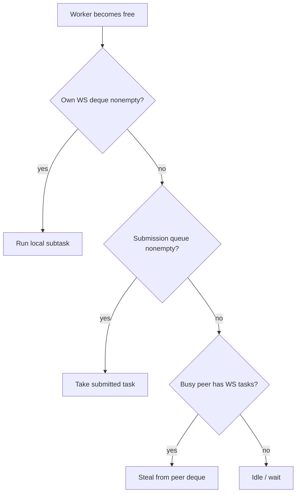

#### Deque front vs back `[38:25](https://www.youtube.com/watch?v=VlfVyz-QG60&t=2305s)`
- Owner consumes from the **front**.
- Thieves steal from the **back** (reduces contention).

---

### How to split tasks: RecursiveTask / RecursiveAction `[24:51](https://www.youtube.com/watch?v=VlfVyz-QG60&t=1491s)`

| Class | `compute()` returns | Use when |
|-------|---------------------|----------|
| `RecursiveTask<V>` | `V` | Subtasks return a value (e.g. sum) |
| `RecursiveAction` | `void` | Fire-and-forget / side-effect work |

You extend one of these and implement `compute()`.

#### Sum range example `[25:52](https://www.youtube.com/watch?v=VlfVyz-QG60&t=1552s)`
- Task: sum integers from `start`..`end`.
- Threshold: if `end - start <= 4`, compute sequentially; else split like binary search mid `[27:59](https://www.youtube.com/watch?v=VlfVyz-QG60&t=1679s)`.

```java
class ComputeSumTask extends RecursiveTask<Integer> {
    final int start, end;

    ComputeSumTask(int start, int end) {
        this.start = start;
        this.end = end;
    }

    @Override
    protected Integer compute() {
        if (end - start <= 4) {
            int sum = 0;
            for (int i = start; i <= end; i++) sum += i;
            return sum;
        }
        int mid = (start + end) / 2;
        ComputeSumTask left = new ComputeSumTask(start, mid);
        ComputeSumTask right = new ComputeSumTask(mid + 1, end);
        left.fork();   // async: may go to WS queue
        right.fork();  // (demo forks both; join both)
        return left.join() + right.join();
    }
}

ForkJoinPool pool = ForkJoinPool.commonPool();
// or: Executors.newWorkStealingPool();
Future<Integer> f = pool.submit(new ComputeSumTask(1, 100));
System.out.println(f.get());
```

> **Note:** A common optimization is `left.fork(); int r = right.compute(); return left.join() + r;` so the current thread does one half inline. His slide/demo forks both then joins both — fine for teaching the API.

#### What `fork` does `[30:03](https://www.youtube.com/watch?v=VlfVyz-QG60&t=1803s)`
- Arranges parallel execution of a subtask.
- One chunk continues on the current worker; the other lands on that worker’s **work-stealing queue** for peers to steal.

#### What `join` does `[32:08](https://www.youtube.com/watch?v=VlfVyz-QG60&t=1928s)`
- Wait for that subtask’s result; then combine and return.

---

### Submitting vs forking — which queue? `[35:47](https://www.youtube.com/watch?v=VlfVyz-QG60&t=2147s)`

| Call | Where work goes |
|------|-----------------|
| `submit` / external submit | **Submission queue** |
| `fork` | Current thread’s **work-stealing deque** |

Ways to get a pool `[35:17](https://www.youtube.com/watch?v=VlfVyz-QG60&t=2117s)`:
- `Executors.newWorkStealingPool()`
- `ForkJoinPool.commonPool()`
- `new ForkJoinPool(...)`

#### Pool size `[36:52](https://www.youtube.com/watch?v=VlfVyz-QG60&t=2212s)`
- No-arg work-stealing pool → `Runtime.getRuntime().availableProcessors()` threads.
- Overload with `parallelism` → that many threads (min=max style retain).
- Examples: 4 CPUs → 4 workers; 8 → 8; 16 → 16 `[37:22](https://www.youtube.com/watch?v=VlfVyz-QG60&t=2242s)`.

### End-to-end mental checklist `[36:20](https://www.youtube.com/watch?v=VlfVyz-QG60&t=2180s)`
1. External `submit` → submission queue (or free worker picks it).
2. Inside `compute`, split with threshold; `fork` siblings → WS deques.
3. Free workers: own deque → submission → steal from peers’ back.
4. `join` waits; combine results; return up the tree.
5. Practice the sum example yourself — API clicks after coding `[38:57](https://www.youtube.com/watch?v=VlfVyz-QG60&t=2337s)`.

---

### Factory pools comparison (revision table)

| Factory | core | max | queue | idle policy | Best for |
|---------|------|-----|-------|-------------|----------|
| `newFixedThreadPool(n)` | n | n | unbounded | keep | Known steady concurrency |
| `newCachedThreadPool()` | 0 | MAX | sync/0 | 60s die | Short bursty tasks |
| `newSingleThreadExecutor()` | 1 | 1 | unbounded | keep | Strict sequencing |
| `newWorkStealingPool()` | ≈CPUs | ≈CPUs | submission + WS deques | FJP managed | Divide-and-conquer / ForkJoin |

---

### Interview questions / gotchas he highlights
- Factory pools vs custom TPE — when each fits.
- Cached pool danger with long-running tasks.
- Single-thread executor = sequential, no concurrency.
- Work-stealing = ForkJoin; two queue kinds.
- Free-worker priority: own deque → submission → steal.
- Steal from **back**, owner from **front**.
- RecursiveTask (returns) vs RecursiveAction (void).
- fork = parallelize / enqueue on WS deque; join = wait + merge.

### Quick revision
- `newFixedThreadPool(n)`: fixed n, unbounded queue, always-alive workers.
- `newCachedThreadPool()`: 0..MAX, 60s idle timeout, short tasks only.
- `newSingleThreadExecutor()`: one worker, sequential.
- Work-stealing / ForkJoin: split with fork, merge with join.
- Per-thread deques + shared submission queue.
- Extend RecursiveTask/Action; implement `compute`.
- Size ≈ CPU count unless you override.


---

<a id="lec-38"></a>

## 38. 37. Java ScheduledThreadPoolExecutor || Shutdown Vs AwaitTermination || Multithreading in Java


[↑ Index](#index) · [Parts](#parts)


> **Video:** [37. Java ScheduledThreadPoolExecutor || Shutdown Vs AwaitTermination || Multithreading in Java](https://www.youtube.com/watch?v=PR1YkZWAH1E)

### What this lecture covers
- Interview trio: **`shutdown`** vs **`awaitTermination`** vs **`shutdownNow`**
- What each does (and what awaitTermination does **not** do)
- **`ScheduledThreadPoolExecutor`**: child of ThreadPoolExecutor + scheduling APIs
- `schedule` (Runnable / Callable) — one-shot delayed run
- `scheduleAtFixedRate` vs `scheduleWithFixedDelay`
- Overlap behaviour when a run overruns its period
- Cancelling repeating tasks via `Future.cancel`
- (Virtual threads & ThreadLocal deferred to next video)

---

### Agenda `[0:00](https://www.youtube.com/watch?v=PR1YkZWAH1E&t=0s)`
- Engineer-requested interview topics: shutdown family + (later) virtual vs platform threads.
- This video focuses on shutdown trio + **ScheduledThreadPoolExecutor**.

---

### `shutdown()` — orderly stop accepting work `[0:31](https://www.youtube.com/watch?v=PR1YkZWAH1E&t=31s)`

After `shutdown()`:
1. Executor **rejects new** submissions.
2. **Already submitted** tasks (running or queued) **continue**.

#### Scenario 1: submit after shutdown `[1:32](https://www.youtube.com/watch?v=PR1YkZWAH1E&t=92s)`

```java
ExecutorService pool = Executors.newFixedThreadPool(5);
pool.submit(() -> System.out.println("ok"));
pool.shutdown();
pool.submit(() -> System.out.println("nope")); // RejectedExecutionException
```

#### Scenario 2: in-flight work not interrupted `[2:32](https://www.youtube.com/watch?v=PR1YkZWAH1E&t=152s)`
- Submit a task that sleeps 5s, then `shutdown()`, main finishes printing.
- Worker still completes after the sleep — **not** interrupted by `shutdown` `[3:35](https://www.youtube.com/watch?v=PR1YkZWAH1E&t=215s)`.

```java
pool.submit(() -> {
    Thread.sleep(5000);
    System.out.println("task completed");
});
pool.shutdown();
System.out.println("main finished"); // prints first; task later
```

---

### `awaitTermination` — optional wait/check `[5:38](https://www.youtube.com/watch?v=PR1YkZWAH1E&t=338s)`

Key points:
- Returns `boolean` — **optional** helper, not a force-stop.
- Useful **after** `shutdown()`; little value before it `[6:10](https://www.youtube.com/watch?v=PR1YkZWAH1E&t=370s)`.
- Blocks the **caller** up to a timeout waiting for the pool to reach terminated state.
- `true` if terminated within timeout; else `false`.

```java
pool.shutdown();
boolean done = pool.awaitTermination(2, TimeUnit.SECONDS);
System.out.println(done); // false if worker still sleeping 5s
```

Dry-run `[7:13](https://www.youtube.com/watch?v=PR1YkZWAH1E&t=433s)`: after shutdown, main waits 2s → pool not yet terminated (5s sleep) → prints `false` → main continues; task finishes later.

**Does not** force shutdown — only observes / waits `[8:43](https://www.youtube.com/watch?v=PR1YkZWAH1E&t=523s)`. Use when you need to run follow-up logic only after (or knowing whether) termination happened.

---

### `shutdownNow()` — best-effort hard stop `[9:14](https://www.youtube.com/watch?v=PR1YkZWAH1E&t=554s)`

Best-effort attempt to:
1. **Interrupt** actively executing tasks.
2. **Halt** processing of waiting / queued work.
3. **Return** `List<Runnable>` of tasks awaiting execution.

```java
pool.submit(() -> {
    Thread.sleep(15000);
    System.out.println("task completed");
});
List<Runnable> leftover = pool.shutdownNow();
// sleep often interrupted; may not print "task completed" cleanly
```

Contrast with `shutdown` on a 15s sleep: orderly path lets it finish; `shutdownNow` interrupts ASAP `[11:16](https://www.youtube.com/watch?v=PR1YkZWAH1E&t=676s)`.

| | `shutdown` | `awaitTermination` | `shutdownNow` |
|--|------------|--------------------|---------------|
| Accept new tasks? | No | N/A (check) | No |
| Running tasks | Continue | Wait/observe | Interrupt (best effort) |
| Queued tasks | Drain/run | — | Returned / not run |
| Return | void | boolean | `List<Runnable>` |

---

### ScheduledThreadPoolExecutor `[12:19](https://www.youtube.com/watch?v=PR1YkZWAH1E&t=739s)`
- Child of `ThreadPoolExecutor` → inherits submit/etc.
- Adds scheduling methods.
- Create via `Executors.newScheduledThreadPool(corePoolSize)`.

Factory sketch `[14:25](https://www.youtube.com/watch?v=PR1YkZWAH1E&t=865s)`:
- Argument = **core** pool size (minimum threads kept).
- Max can grow as needed; keep-alive often `0` for core (core threads stay even if idle — as he describes for this factory).

---

### Method 1: `schedule(Runnable, delay, unit)` `[13:22](https://www.youtube.com/watch?v=PR1YkZWAH1E&t=802s)`
- Run **once** after the delay.

```java
ScheduledExecutorService ses = Executors.newScheduledThreadPool(5);
ses.schedule(() -> System.out.println("hello"), 5, TimeUnit.SECONDS);
```

### Method 2: `schedule(Callable, delay, unit)` `[15:27](https://www.youtube.com/watch?v=PR1YkZWAH1E&t=927s)`
- Same one-shot delay, but Callable **returns** a value → `ScheduledFuture<V>`.

```java
ScheduledFuture<String> f = ses.schedule(() -> "hello", 5, TimeUnit.SECONDS);
System.out.println(f.get()); // blocks until after delay + run
```

---

### Method 3: `scheduleAtFixedRate` `[17:00](https://www.youtube.com/watch?v=PR1YkZWAH1E&t=1020s)`

```java
ScheduledFuture<?> f = ses.scheduleAtFixedRate(
    () -> System.out.println("hello"),
    3,  // initial delay
    5,  // period
    TimeUnit.SECONDS
);
```

- First run after **initialDelay**.
- Then aim for runs every **period** (fixed rate).
- Repeats forever until cancelled — store Future and `cancel(true)` `[18:33](https://www.youtube.com/watch?v=PR1YkZWAH1E&t=1113s)`.

```java
Thread.sleep(10_000);
f.cancel(true);
```

#### Overrun behaviour (important) `[19:35](https://www.youtube.com/watch?v=PR1YkZWAH1E&t=1175s)`
- If previous execution still running when the next period fires, the next run **waits in the queue** until the previous finishes — they do **not** overlap on the same scheduled series in this model.
- Demo: initialDelay 1s, period 3s, task sleeps 6s → next firing “piles up” and starts right when the previous ends (prints look “together”) `[21:07](https://www.youtube.com/watch?v=PR1YkZWAH1E&t=1267s)`.

---

### Method 4: `scheduleWithFixedDelay` `[21:38](https://www.youtube.com/watch?v=PR1YkZWAH1E&t=1298s)`

```java
ses.scheduleWithFixedDelay(runnable, initialDelay, delay, unit);
```

- Delay timer for the **next** run starts **only after** the previous run **completes**.
- Demo contrast: after 6s work, wait another 3s delay → then next print `[22:09](https://www.youtube.com/watch?v=PR1YkZWAH1E&t=1329s)`.

| | `scheduleAtFixedRate` | `scheduleWithFixedDelay` |
|--|----------------------|--------------------------|
| Timing baseline | Ideal start-to-start period | End-to-start delay |
| If task overruns | Next waits; may “catch up” visually | Always wait `delay` **after** finish |

```mermaid
gantt
  title Fixed rate vs fixed delay (conceptual)
  dateFormat X
  axisFormat %s
  section FixedRate
  Run1           :a1, 0, 6
  Period tick    :milestone, 3, 0
  Run2 (queued)  :a2, 6, 12
  section FixedDelay
  Run1           :b1, 0, 6
  Delay 3s       :b2, 6, 9
  Run2           :b3, 9, 15
```

---

### Closing `[22:42](https://www.youtube.com/watch?v=PR1YkZWAH1E&t=1362s)`
- Virtual threads vs normal threads + ThreadLocal → **next** video (keep this one shorter).

---

### Interview questions / gotchas he highlights
- `shutdown` vs `shutdownNow` — orderly vs interrupt + return pending list.
- `awaitTermination` is **not** a shutdown force; optional wait/check after shutdown.
- Fixed rate vs fixed delay timing definitions.
- Overrunning fixed-rate tasks: next execution waits (no overlap).
- Cancel repeating schedules with `Future.cancel`.

### Quick revision
- `shutdown`: no new tasks; in-flight continue.
- `awaitTermination(timeout)`: wait/check terminated → boolean.
- `shutdownNow`: interrupt running; return pending list.
- Scheduled pool = TPE + schedule APIs.
- `schedule`: one-shot after delay (Runnable or Callable).
- `scheduleAtFixedRate`: period from schedule cadence; cancel to stop.
- `scheduleWithFixedDelay`: delay after each completion.


---

<a id="lec-39"></a>

## 39. 38. Java VirtualThreads vs Normal Threads || ThreadLocal in Java


[↑ Index](#index) · [Parts](#parts)


> **Video:** [38. Java VirtualThreads vs Normal Threads || ThreadLocal in Java](https://www.youtube.com/watch?v=pXVEEfYMwws)

### What this lecture covers
- **`ThreadLocal`**: per-thread storage via one shared `ThreadLocal` object
- How `set` / `get` bind to `Thread.currentThread()` automatically
- **Cleanup with `remove()`** when threads are reused (pools)
- **Virtual threads** goal: higher **throughput**, not lower latency
- Platform (normal) threads = JVM wrappers around **OS threads** (1:1)
- Costs: expensive creation (syscalls), OS thread blocked on IO waits
- Virtual threads: many JVM-managed tasks multiplexed onto fewer OS carriers
- Blocking virtual thread → unmount; another virtual thread mounts
- Creation APIs; backward compatible with existing concurrency APIs

---

### ThreadLocal basics `[0:01](https://www.youtube.com/watch?v=pXVEEfYMwws&t=1s)`
- Continuity from previous video’s leftover topics.
- Each thread conceptually has its own **thread-local variable** storage.
- `ThreadLocal<T>` is generic — can hold String, Integer, any object.
- You create **one** `ThreadLocal` instance; each thread sees its **own copy** of the value `[0:32](https://www.youtube.com/watch?v=pXVEEfYMwws&t=32s)`.

```java
ThreadLocal<String> tl = new ThreadLocal<>();

tl.set(Thread.currentThread().getName()); // binds to current thread

Thread t1 = new Thread(() -> {
    tl.set(Thread.currentThread().getName());
    System.out.println(tl.get());
});
t1.start();

System.out.println(tl.get()); // main's value, not t1's
```

#### Internal intuition `[2:38](https://www.youtube.com/watch?v=pXVEEfYMwws&t=158s)`
- `set` / `get` call `Thread.currentThread()`, then store/fetch in that thread’s ThreadLocal map.
- You never pass “which thread” — the runtime uses the caller’s thread.

```
One ThreadLocal object
   ├── Main thread map  → "main"
   └── Thread-1 map     → "pool-1-thread-1"
```

---

### Cleanup when threads are reused `[5:42](https://www.youtube.com/watch?v=pXVEEfYMwws&t=342s)`
- ThreadLocal is bound to the **thread**, not the task.
- In a pool, Thread1 may run Task1 (sets TL), return to pool, then run Task4 — **old TL value still present**.

#### Demo without remove `[7:15](https://www.youtube.com/watch?v=pXVEEfYMwws&t=435s)`
- Pool of 5; one task sets TL; then 15 tasks only `get()`.
- Expect all nulls; instead some prints show leftover names — reused workers still hold values `[8:19](https://www.youtube.com/watch?v=pXVEEfYMwws&t=499s)`.

#### Fix: `remove()` `[8:50](https://www.youtube.com/watch?v=pXVEEfYMwws&t=530s)`

```java
pool.submit(() -> {
    try {
        tl.set(Thread.currentThread().getName());
        // do work...
    } finally {
        tl.remove(); // always clear before thread returns to pool
    }
});
```

After proper cleanup, subsequent `get()`s are null as expected `[9:20](https://www.youtube.com/watch?v=pXVEEfYMwws&t=560s)`.

> **Note:** Prefer `try/finally` (or try-with-resources patterns / scoped values in newer Java) so exceptions don’t skip remove. Java 21+ also introduces **Scoped Values** as a modern alternative for immutable per-request context — worth knowing beyond this lecture.

---

### Virtual threads: the motto `[10:23](https://www.youtube.com/watch?v=pXVEEfYMwws&t=623s)`
- Goal: higher **throughput** (more tasks completed per second), **not** primarily lower latency.
- Example framing: 100 requests/s → 1000 requests/s.

---

### Platform (normal) threads `[11:25](https://www.youtube.com/watch?v=pXVEEfYMwws&t=685s)`
- What you’ve used so far: `new Thread(...).start()`.
- JVM asks the OS to create a **native / OS thread**.
- Platform thread ≈ JVM-managed **wrapper** around an OS thread — **1:1 mapping** `[12:27](https://www.youtube.com/watch?v=pXVEEfYMwws&t=747s)`.
- Stack, PC, etc. are ultimately OS-thread resources; JVM mediates.

```
Your code → Platform Thread (JVM) ──1:1──► OS Thread
10 Java threads ⇒ 10 OS threads
```

#### Disadvantage 1: slow / expensive creation `[14:01](https://www.youtube.com/watch?v=pXVEEfYMwws&t=841s)`
- `start()` → system call to create OS thread (milliseconds-scale cost).
- That’s why **thread pools** pre-create workers — still not free when growing toward max.

#### Disadvantage 2: OS thread stuck on blocking IO `[15:36](https://www.youtube.com/watch?v=pXVEEfYMwws&t=936s)`
- Platform thread blocked on DB for 4s ⇒ underlying OS thread also idle for 4s (1:1).
- OS capacity wasted while waiting.

---

### Virtual threads model `[17:39](https://www.youtube.com/watch?v=pXVEEfYMwws&t=1059s)`

He mentions availability “from JDK 9” in the talk.

> **Note:** Virtual threads were a **preview** in Java 19/20 and became **standard in Java 21** (Project Loom). They are not a Java 9 feature. Keep his throughput story; correct the version in interviews.

Model:
- Few OS **carrier** threads.
- JVM can create **many** virtual threads (lightweight JVM-scheduled tasks/objects).
- Only runnable virtual threads are **mounted** on carriers.
- When a virtual thread **blocks** (e.g. waits on IO), JVM can **unmount** it and mount another ready virtual thread `[19:11](https://www.youtube.com/watch?v=pXVEEfYMwws&t=1151s)`.

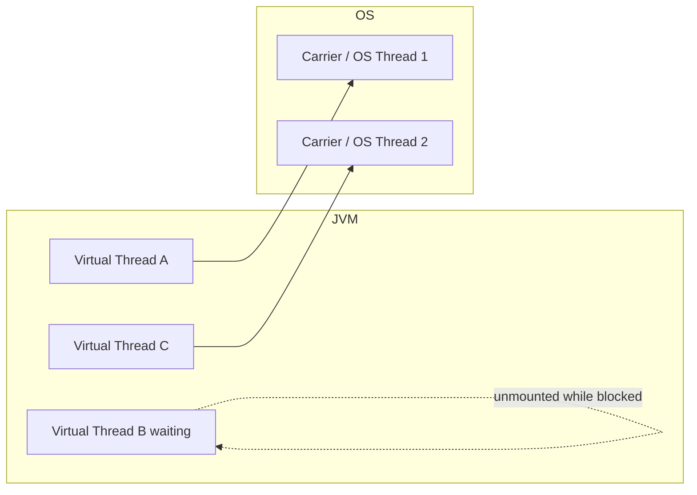

- **No** 1:1 mapping — thousands of virtual threads possible.
- You control virtual-thread count; JVM manages how many OS carriers to use `[20:45](https://www.youtube.com/watch?v=pXVEEfYMwws&t=1245s)`.
- Existing multithreading APIs are largely **backward compatible** — same mental model for locks, executors, etc., with different scheduling underneath `[19:44](https://www.youtube.com/watch?v=pXVEEfYMwws&t=1184s)`.

---

### Creating virtual threads `[21:16](https://www.youtube.com/watch?v=pXVEEfYMwws&t=1276s)`

```java
// 1) Direct
Thread.ofVirtual().start(() -> {
    // task
});

// 2) Executor that starts a new virtual thread per task
try (ExecutorService exec = Executors.newVirtualThreadPerTaskExecutor()) {
    exec.submit(() -> { /* task */ });
}
```

- Same submit patterns as before; workers are virtual instead of platform.

---

### Interview questions / gotchas he highlights
- ThreadLocal: one object, many per-thread values; auto-bound to current thread.
- Always `remove()` when pool threads reuse — otherwise data leaks across tasks.
- Virtual threads → **throughput**; not sold as a latency silver bullet.
- Platform = 1:1 OS wrapper; creation = expensive syscall; blocking wastes OS thread.
- Virtual = many-to-few multiplexing; unmount on block.
- APIs: `Thread.ofVirtual()` and `newVirtualThreadPerTaskExecutor()`.

### Quick revision
- `ThreadLocal.set/get` → current thread’s private slot.
- Pool reuse ⇒ `remove()` in `finally`.
- Platform threads wrap OS threads 1:1.
- Virtual threads (Java 21+) multiplex onto carriers for IO-heavy throughput.
- Blocking virtual work can free the carrier for others.
- Create with `Thread.ofVirtual()` or virtual-per-task executor.


<a id="part-g"></a>

# Part G — Lombok & Modern Java (14–21)

[↑ Index](#index) · [Parts](#parts)

---

<a id="lec-40"></a>

## 40. 39. Project Lombok in Java in depth | Lombok top 10 features


[↑ Index](#index) · [Parts](#parts)


> **Video:** [39. Project Lombok in Java in depth | Lombok top 10 features](https://www.youtube.com/watch?v=fGqb6cmA22A)

### What this lecture covers
- What Lombok is: annotation-driven **boilerplate reduction** at compile time
- Maven dependency + IDE plugin + annotation processing
- Why IDE shows red errors but the app still runs (and how to fix the IDE)
- Top 10 features: `val`/`var`, `@NonNull`, getters/setters, `@ToString`, constructors, `@EqualsAndHashCode`, `@Data`, `@Value`, `@Builder`, `@Cleanup`

---

### Why Lombok / where it sits in the course `[0:00](https://www.youtube.com/watch?v=fGqb6cmA22A&t=0s)`
- Core Java playlist is largely done; next stretch = newer Java features + gaps.
- Starts with Lombok — popular and heavily used in industry.

### What is Project Lombok? `[0:30](https://www.youtube.com/watch?v=fGqb6cmA22A&t=30s)`
- Java library that reduces boilerplate via **annotations**.
- At **compile time**, annotation processing **injects** generated code into classes.
- Common complaint from non-Java folks: “too much unnecessary code” → Lombok targets that.
- Compatible from **Java 6** onward (per his slides) `[1:00](https://www.youtube.com/watch?v=fGqb6cmA22A&t=60s)`.

### Setup `[1:33](https://www.youtube.com/watch?v=fGqb6cmA22A&t=93s)`
1. Add latest Lombok dependency to `pom.xml` (or Gradle).
2. Install **Lombok IDE plugin**.
3. Enable **Annotation Processing** in IDE (Build / Execution / Deployment settings).

#### Red squiggles but runs fine `[1:33](https://www.youtube.com/watch?v=fGqb6cmA22A&t=93s)`
- Example: using Lombok `val` — IntelliJ shows compile errors; `mvn`/`run` works and `.class` has real types.
- Cause: IDE doesn’t know what Lombok will generate unless plugin + annotation processing are on `[2:04](https://www.youtube.com/watch?v=fGqb6cmA22A&t=124s)`.
- After both: IDE stops complaining `[3:41](https://www.youtube.com/watch?v=fGqb6cmA22A&t=221s)`.

> Plugin not strictly mandatory for builds, but needed for a pleasant coding experience.

---

### 1. `val` and `var` `[4:45](https://www.youtube.com/watch?v=fGqb6cmA22A&t=285s)`
- Local-variable type inference from the initializer.
- **Only local variables** — not fields, not parameters `[5:17](https://www.youtube.com/watch?v=fGqb6cmA22A&t=317s)`.

| Keyword | Behaviour |
|---------|-----------|
| `val` | Inferred type + **final** (immutable binding) |
| `var` | Inferred type, **reassignable** |

```java
void demo() {
    val a = 10;
    // a = 20; // compile error: final

    var b = 10;
    b = 20; // ok
}
```

> **Note:** Java language `var` (Java 10+) is separate from Lombok’s `var`/`val`. Prefer language `var` on modern JDKs; Lombok `val` still useful for final locals if the team uses Lombok.

---

### 2. `@NonNull` `[6:55](https://www.youtube.com/watch?v=fGqb6cmA22A&t=415s)`
- Generates a null check; throws **NPE** if null.
- Use on **method / constructor parameters**.

```java
void print(@NonNull String name) {
    System.out.println(name);
}
```

Generated shape:

```java
void print(String name) {
    if (name == null) throw new NullPointerException("name is marked non-null but is null");
    System.out.println(name);
}
```

Later he also shows `@NonNull` on **fields** interacting with generated constructors (null check in ctor params) `[16:46](https://www.youtube.com/watch?v=fGqb6cmA22A&t=1006s)`.

---

### 3. `@Getter` / `@Setter` `[8:27](https://www.youtube.com/watch?v=fGqb6cmA22A&t=507s)`
- Extremely common on POJOs.
- Field-level or **class-level**.
- Defaults: generated methods are **public**.
- Boolean fields → `isX()` style getter (as he shows for `committeeMember`).

```java
@Getter @Setter
private String name;

@Getter(AccessLevel.PRIVATE)
@Setter(AccessLevel.PROTECTED)
private String name;
```

#### Class-level rules `[10:01](https://www.youtube.com/watch?v=fGqb6cmA22A&t=601s)`
- `@Getter` on class → all **non-static** fields.
- `@Setter` on class → all **non-static, non-final** fields (final has no setter — makes sense) `[10:34](https://www.youtube.com/watch?v=fGqb6cmA22A&t=634s)`.

#### Skip generation `[12:09](https://www.youtube.com/watch?v=fGqb6cmA22A&t=729s)`

```java
@Getter @Setter
class Person {
    @Setter(AccessLevel.NONE) // no setter for name
    private String name;
    private boolean committeeMember;
}
```

---

### 4. `@ToString` `[13:10](https://www.youtube.com/watch?v=fGqb6cmA22A&t=790s)`
- Generates `toString()` — mainly for **logging / debugging**.
- Default: `ClassName(field1=value1, field2=value2, ...)`.

Options he covers:
- `@ToString(exclude = "committeeMember")` — omit sensitive/noisy fields `[14:12](https://www.youtube.com/watch?v=fGqb6cmA22A&t=852s)`.
- `@ToString(includeFieldNames = false)` — values only, smaller logs `[14:44](https://www.youtube.com/watch?v=fGqb6cmA22A&t=884s)`.
- `@ToString(onlyExplicitlyIncluded = true)` + `@ToString.Include` on chosen fields `[15:15](https://www.youtube.com/watch?v=fGqb6cmA22A&t=915s)`.

---

### 5. Constructor annotations `[16:15](https://www.youtube.com/watch?v=fGqb6cmA22A&t=975s)`

| Annotation | Generates |
|------------|-----------|
| `@NoArgsConstructor` | No-arg constructor |
| `@AllArgsConstructor` | Constructor with **all** fields |
| `@RequiredArgsConstructor` | Constructor for **final** + `@NonNull` fields only |

- `@NonNull` fields get null-checks inside generated constructors `[17:18](https://www.youtube.com/watch?v=fGqb6cmA22A&t=1038s)`.

```java
@NoArgsConstructor
@AllArgsConstructor
@RequiredArgsConstructor
class Person {
    private String name;
    private boolean committeeMember;
    @NonNull private Integer age;
}
```

---

### 6. `@EqualsAndHashCode` `[18:21](https://www.youtube.com/watch?v=fGqb6cmA22A&t=1101s)`
- Generates `equals` / `hashCode` following the usual contract (tie-back to HashMap lecture).
- Default: all **non-static, non-transient** fields.
- Can exclude fields (same spirit as `@ToString`) `[18:51](https://www.youtube.com/watch?v=fGqb6cmA22A&t=1131s)`.

```java
@EqualsAndHashCode(exclude = "committeeMember")
class Person { /* ... */ }
```

---

### 7. `@Data` `[19:53](https://www.youtube.com/watch?v=fGqb6cmA22A&t=1193s)`
Shortcut combo:
- `@ToString`
- `@EqualsAndHashCode`
- `@Getter` on all fields
- `@Setter` on all **non-final** fields
- `@RequiredArgsConstructor`

```java
@Data
class Person {
    private String name;
    private final int age;
    @NonNull private String address;
}
```

Generates a large `.class` surface from a tiny source file `[20:24](https://www.youtube.com/watch?v=fGqb6cmA22A&t=1224s)`.

---

### 8. `@Value` — immutable `@Data` `[21:57](https://www.youtube.com/watch?v=fGqb6cmA22A&t=1317s)`
- All fields → **private final**.
- Class → **final** (no subclassing).
- **No setters**.
- Still: toString, equals/hashCode, getters.
- Required-args constructor effectively becomes **all-args** because every field is final `[22:28](https://www.youtube.com/watch?v=fGqb6cmA22A&t=1348s)`.

---

### 9. `@Builder` `[24:00](https://www.youtube.com/watch?v=fGqb6cmA22A&t=1440s)`
- Ties to Builder pattern from his LLD playlist: build object **part by part**; encourage **immutability**.
- Annotation generates a nested builder class.

```java
@Builder
class TestPojo {
    private String name;
    private int age;
}

TestPojo obj = TestPojo.builder()
    .age(20)
    .name("A")
    .build();
// no setters on TestPojo → can't mutate after build
```

---

### 10. `@Cleanup` `[26:06](https://www.youtube.com/watch?v=fGqb6cmA22A&t=1566s)`
- Ensures a resource is closed when leaving the scope.
- Expands to try/finally with `close()`.

```java
@Cleanup InputStream in = new FileInputStream("file.txt");
// read...
// generated finally { in.close(); }
```

> **Note:** Prefer Java’s **try-with-resources** (`try (InputStream in = ...)`) on modern Java — language-native and clearer. `@Cleanup` is still seen in Lombok-heavy codebases.

---

### Closing `[27:07](https://www.youtube.com/watch?v=fGqb6cmA22A&t=1627s)`
- Many more Lombok features exist online; these **10** are the ones you’ll see constantly in production code.

---

### Interview questions / gotchas he highlights
- Lombok runs at **compile time** — IDE needs plugin + annotation processing.
- `val`/`var` only for **locals**; `val` is final.
- Class-level `@Setter` skips finals/statics; use `AccessLevel.NONE` to opt out.
- `@Data` vs `@Value` (mutable convenience vs immutable).
- `@RequiredArgsConstructor` = final + `@NonNull` fields.
- Builder supports stepwise construction + immutability.

### Quick revision
- Add dependency + IDE Lombok plugin + enable annotation processing.
- `val` final local; `var` mutable local (Lombok).
- `@NonNull` → NPE guard on params / ctor fields.
- `@Getter`/`@Setter` field or class; control with `AccessLevel`.
- `@ToString` / `@EqualsAndHashCode` with include/exclude options.
- Ctors: NoArgs / AllArgs / RequiredArgs.
- `@Data` = combo; `@Value` = immutable combo.
- `@Builder` generates fluent builder; `@Cleanup` auto-closes resources.


---

<a id="lec-41"></a>

## 41. Java 21 : SequencedCollection, SequencedSet and SequencedMap


[↑ Index](#index) · [Parts](#parts)


> **Video:** [Java 21 : SequencedCollection, SequencedSet and SequencedMap](https://www.youtube.com/watch?v=xYky-RDlnpY)

### What this lecture covers
- Where `SequencedCollection`, `SequencedSet`, and `SequencedMap` sit in the Java 21 collection hierarchy
- Three guiding questions that unlock the whole topic (placement criteria, why needed, why SequencedSet)
- Three conditions that make a collection “sequenced”
- Walk-through of List, Deque, Queue, PriorityQueue, HashSet, LinkedHashSet, SortedSet, HashMap, Hashtable, LinkedHashMap, SortedMap
- The pre-Java-21 gap: no common API for first/last/reverse
- New methods and Java-21+ usage examples (including UnsupportedOperationException on sorted types)

---

### Intro & where the new interfaces fit `[0:00](https://www.youtube.com/watch?v=xYky-RDlnpY&t=0s)`

Java 21 adds three interfaces into the existing collection hierarchy:

| New interface | Extends | Notable children / implementors |
|---------------|---------|----------------------------------|
| **SequencedCollection** | `Collection` | `List`, `Deque`; also parent of SequencedSet |
| **SequencedSet** | `SequencedCollection` **and** `Set` | `LinkedHashSet`, `SortedSet` |
| **SequencedMap** | `Map` | `LinkedHashMap`, `SortedMap` |

Hierarchy changes (yellow = new in Java 21) `[1:02](https://www.youtube.com/watch?v=xYky-RDlnpY&t=62s)`:

```text
Collection
 └── SequencedCollection          ← NEW
      ├── List
      ├── Deque
      └── SequencedSet            ← NEW  (also extends Set)
           ├── LinkedHashSet
           └── SortedSet → NavigableSet → TreeSet

Map
 └── SequencedMap                 ← NEW
      ├── LinkedHashMap
      └── SortedMap → NavigableMap → TreeMap
```

Left out of sequenced hierarchy: `Queue`, `PriorityQueue`, `HashSet`, `HashMap`, `Hashtable` — reasons come next.

---

### Three questions that unlock the topic `[2:35](https://www.youtube.com/watch?v=xYky-RDlnpY&t=155s)`

1. **Placement criteria** — why List/Deque/LinkedHashSet/SortedSet/LinkedHashMap/SortedMap are in, and Queue/PriorityQueue/HashSet/HashMap/Hashtable are out? `[3:05](https://www.youtube.com/watch?v=xYky-RDlnpY&t=185s)`
2. **Why needed at all** — what gap existed before Java 21? `[4:07](https://www.youtube.com/watch?v=xYky-RDlnpY&t=247s)`
3. **Why SequencedSet** — why not put LinkedHashSet directly under SequencedCollection? `[4:39](https://www.youtube.com/watch?v=xYky-RDlnpY&t=279s)`

He stresses: answer Q1 thoroughly and Q2/Q3 fall out of the same reasoning `[5:40](https://www.youtube.com/watch?v=xYky-RDlnpY&t=340s)`.

---

### Criterion 1 — Predictable iteration `[6:10](https://www.youtube.com/watch?v=xYky-RDlnpY&t=370s)`

A collection is a candidate for “sequenced” only if iteration is **consistent and well-defined** every time.

Two acceptable orders `[7:13](https://www.youtube.com/watch?v=xYky-RDlnpY&t=433s)`:

| Order | Meaning | Example |
|-------|---------|---------|
| **Insertion order** | Order of inserts is preserved | List, Deque, LinkedHashSet, LinkedHashMap |
| **Sorted order** | Comparator / natural order | SortedSet, SortedMap |

Important nuance `[8:17](https://www.youtube.com/watch?v=xYky-RDlnpY&t=497s)`: sorted order may *change* the visual sequence vs insertion (e.g. insert `1,2,3` → store as `3,2,1` descending), but it is still **predictable** — same every iteration. Predictable ≠ “never reordered”; it means **stable, defined order**.

---

### Criterion 2 — First & last access / manipulation `[8:49](https://www.youtube.com/watch?v=xYky-RDlnpY&t=529s)`

Must support (at least in principle) operating on the **ends** of the sequence:

- **Access** first / last
- **Add** at first / last
- **Remove** first / last

Example mental model: insert `5 → 10 → 7 → 12` in insertion order; ends are `5` and `12` `[9:20](https://www.youtube.com/watch?v=xYky-RDlnpY&t=560s)`.

---

### Criterion 3 — Reversible view `[10:21](https://www.youtube.com/watch?v=xYky-RDlnpY&t=621s)`

Must be able to obtain a **reverse view** of the same underlying collection (not a brand-new independent copy that you reverse in place as the only option). Changes through the view affect the underlying structure.

If all **three** conditions hold → collection can be termed sequenced `[10:53](https://www.youtube.com/watch?v=xYky-RDlnpY&t=653s)`.

---

### Applying the three conditions — List `[11:26](https://www.youtube.com/watch?v=xYky-RDlnpY&t=686s)`

| Condition | List? | How (pre–Java 21 style) |
|-----------|-------|------------------------|
| Predictable | Yes | Insertion order |
| First/last | Yes | `get(0)` / `get(size-1)`; `add(0,e)` / `add(e)`; `remove(0)` / `remove(size-1)` |
| Reverse view | Yes | e.g. `Collections.reverse(list)` (mutates) / later `reversed()` |

→ **Part of SequencedCollection**.

---

### Deque (`Deque`, pronounced “deck”) `[12:58](https://www.youtube.com/watch?v=xYky-RDlnpY&t=778s)`

| Condition | Deque? |
|-----------|--------|
| Predictable | Yes — insertion order |
| First/last | Yes — `getFirst`/`getLast`, `addFirst`/`addLast`, `removeFirst`/`removeLast` |
| Reverse | Yes — reverse / `reversed()` |

→ **Part of SequencedCollection**.

---

### Queue — why left out `[13:30](https://www.youtube.com/watch?v=xYky-RDlnpY&t=810s)`

| Condition | Queue? |
|-----------|--------|
| Predictable | Yes — insertion / FIFO iteration of remaining elements is defined enough for condition 1 |
| First/last ops | **No** — FIFO only: add at **tail**, remove/peek at **head**. Cannot access last, cannot add at first, cannot remove last |
| Reverse | **Not supported directly** |

→ **Not** sequenced. Even though Deque (which extends Queue conceptually in hierarchy) *is* sequenced, plain `Queue` fails ends + reverse.

---

### PriorityQueue — why left out `[15:04](https://www.youtube.com/watch?v=xYky-RDlnpY&t=904s)`

- Internally a **heap**
- Only guarantees: **head** is min or max per comparator
- Iteration order of the rest is **not** insertion order and **not** a fully sorted consistent sequence

Because order is not preserved, first/last add/remove and reverse “don’t apply” meaningfully `[15:36](https://www.youtube.com/watch?v=xYky-RDlnpY&t=936s)`.

Key insight `[16:07](https://www.youtube.com/watch?v=xYky-RDlnpY&t=967s)`: conditions 2 and 3 only make sense **after** predictable order exists. No order → skip from SequencedCollection.

---

### HashSet — why left out `[16:38](https://www.youtube.com/watch?v=xYky-RDlnpY&t=998s)`

No insertion order, no sorted order → first/last and reverse not applicable → **skipped**.

---

### LinkedHashSet → SequencedSet `[17:09](https://www.youtube.com/watch?v=xYky-RDlnpY&t=1029s)`

- Follows **insertion order** (internally doubly linked list + hash table)
- Pre-Java 21: first/last often needed **manual iteration**; `add` appends to end; **no** `addFirst` API yet, but structure **could** support it (he marks this “yellow” = possible but not exposed)
- Reverse iteration possible via DLL; method not exposed before Java 21

→ Kept under sequenced hierarchy; specifically under **SequencedSet** (next section).

---

### Why SequencedSet exists (Q3) `[19:42](https://www.youtube.com/watch?v=xYky-RDlnpY&t=1182s)`

| Type | Duplicates? |
|------|-------------|
| List, Deque | Allowed |
| Set / LinkedHashSet / SortedSet | **Not** allowed |

`SequencedSet` = all SequencedCollection end/reverse operations **plus** the Set uniqueness contract `[20:43](https://www.youtube.com/watch?v=xYky-RDlnpY&t=1243s)`.

That’s why LinkedHashSet is a child of SequencedSet, not directly of SequencedCollection alone.

---

### SortedSet → SequencedSet `[21:14](https://www.youtube.com/watch?v=xYky-RDlnpY&t=1274s)`

| Condition | SortedSet (e.g. TreeSet)? |
|-----------|---------------------------|
| Predictable | Yes — sorted order |
| First/last | Access: `first()` / `last()`. Add: value goes to position by sort key (smallest → front, largest → end). Remove via remove(first)/remove(last) |
| Reverse | `descendingIterator()` |

`addFirst`/`addLast` as *positional* ops are **not meaningful** under sort — covered again in Java 21 API section.

No duplicates → SequencedSet child.

---

### Map side — HashMap & Hashtable skipped `[23:48](https://www.youtube.com/watch?v=xYky-RDlnpY&t=1428s)`

Neither maintains insertion order nor sorted order → not sequenced.

---

### LinkedHashMap → SequencedMap `[24:19](https://www.youtube.com/watch?v=xYky-RDlnpY&t=1459s)`

Same story as LinkedHashSet: doubly linked list → insertion order; ends/reverse structurally possible; methods incomplete pre-21 → SequencedMap.

---

### SortedMap → SequencedMap `[25:21](https://www.youtube.com/watch?v=xYky-RDlnpY&t=1521s)`

- Sorted by keys
- Access: `firstKey()` / `lastKey()`
- Remove: `pollFirstEntry()` / `pollLastEntry()` (NavigableMap)
- Reverse: `descendingMap()`

→ SequencedMap child.

---

### Why these interfaces exist (Q2) — the gap `[25:52](https://www.youtube.com/watch?v=xYky-RDlnpY&t=1552s)`

All sequenced types needed the **same conceptual ops** (get/add/remove first & last, reverse view), but **each type had different method names** `[26:54](https://www.youtube.com/watch?v=xYky-RDlnpY&t=1614s)`:

| Collection | Old-style ends / reverse (examples) |
|------------|-------------------------------------|
| List | `get(0)`, `add(0,e)`, `Collections.reverse` |
| Deque | `getFirst`, `addFirst`, … |
| LinkedHashSet / LinkedHashMap | Manual iterator / no dedicated reverse API |
| SortedSet | `first`/`last`, `descendingIterator` |
| SortedMap | `firstKey`/`lastKey`, `descendingMap` |

**Gap:** no common interface → hard to remember and hard to write generic code `[27:56](https://www.youtube.com/watch?v=xYky-RDlnpY&t=1676s)`.

---

### New API surface `[29:02](https://www.youtube.com/watch?v=xYky-RDlnpY&t=1742s)`

**SequencedCollection** (also inherited by SequencedSet):

```java
void addFirst(E e);
void addLast(E e);
E getFirst();
E getLast();
E removeFirst();
E removeLast();
SequencedCollection<E> reversed();  // reverse VIEW
```

**SequencedSet**: same contract + uniqueness; `reversed()` returns `SequencedSet`.

**SequencedMap**:

```java
Map.Entry<K,V> firstEntry();
Map.Entry<K,V> lastEntry();
Map.Entry<K,V> pollFirstEntry();
Map.Entry<K,V> pollLastEntry();
V putFirst(K k, V v);
V putLast(K k, V v);
SequencedSet<K> sequencedKeySet();
SequencedCollection<V> sequencedValues();
SequencedSet<Map.Entry<K,V>> sequencedEntrySet();
SequencedMap<K,V> reversed();
```

Same method names across List / Deque / LinkedHashSet / etc. `[29:33](https://www.youtube.com/watch?v=xYky-RDlnpY&t=1773s)`.

> Note: `reversed()` returns a **view**; it does not permanently rewrite the underlying collection’s storage order unless you mutate through that view / replace the reference with a reversed copy depending on how you use it.

---

### Java 21+ demos `[31:07](https://www.youtube.com/watch?v=xYky-RDlnpY&t=1867s)`

#### List (insertion order)

```java
List<String> list = new ArrayList<>(List.of("B", "C", "D"));
list.getFirst();          // B
list.getLast();           // D
list.addFirst("A");       // A B C D
list.addLast("Z");        // A B C D Z
list.removeFirst();       // B C D Z
list.removeLast();        // B C D
list.reversed();          // view: D C B
```

#### Deque — same method names `[31:39](https://www.youtube.com/watch?v=xYky-RDlnpY&t=1899s)`

```java
Deque<String> deque = new ArrayDeque<>(List.of("B", "C", "D"));
// getFirst/getLast, addFirst/addLast, removeFirst/removeLast, reversed()
```

#### LinkedHashSet + duplicate reordering `[32:10](https://www.youtube.com/watch?v=xYky-RDlnpY&t=1930s)`

```java
SequencedSet<String> set = new LinkedHashSet<>(List.of("B", "C", "D"));
set.addFirst("A");  // A B C D
set.addLast("Z");   // A B C D Z
set.addFirst("C");  // C already present → moved to front: C A B D Z
```

Set uniqueness: re-adding an existing element with `addFirst` **relocates** it rather than duplicating `[32:42](https://www.youtube.com/watch?v=xYky-RDlnpY&t=1962s)`.

#### SortedSet — UnsupportedOperationException on addFirst/addLast `[33:42](https://www.youtube.com/watch?v=xYky-RDlnpY&t=2022s)`

```java
SequencedSet<Integer> sorted = new TreeSet<>(Set.of(14, 5, 7));
// stored as 5, 7, 14
sorted.getFirst(); // 5
sorted.getLast();  // 14
sorted.addFirst(2); // UnsupportedOperationException — position is by sort order
sorted.add(2);      // OK → 2, 5, 7, 14
sorted.removeFirst();
sorted.reversed();
```

Positional `addFirst`/`addLast` do not make sense when the structure owns ordering `[34:13](https://www.youtube.com/watch?v=xYky-RDlnpY&t=2053s)`.

#### LinkedHashMap `[34:43](https://www.youtube.com/watch?v=xYky-RDlnpY&t=2083s)`

```java
SequencedMap<Integer, String> map = new LinkedHashMap<>();
map.put(100, "B");
map.put(200, "C");
map.put(300, "D");
map.firstEntry();           // 100=B
map.lastEntry();            // 300=D
map.putFirst(400, "A");
map.putLast(500, "Z");
map.pollFirstEntry();
map.pollLastEntry();
map.reversed();
```

#### SortedMap — same UnsupportedOperationException pattern `[35:45](https://www.youtube.com/watch?v=xYky-RDlnpY&t=2145s)`

```java
SequencedMap<Integer, String> sm = new TreeMap<>();
sm.put(100, "B");
sm.putFirst(50, "A"); // UnsupportedOperationException
sm.put(50, "A");      // OK — key order places 50 first
sm.put(400, "Z");     // goes to end if largest key
```

---

### Closing mental model `[36:47](https://www.youtube.com/watch?v=xYky-RDlnpY&t=2207s)`

Once you know the three conditions:

1. You can rebuild the hierarchy yourself (who’s in / out).
2. You understand the gap (common first/last/reverse API).
3. You understand SequencedSet (uniqueness) vs SequencedCollection (duplicates OK).

Practice by hand; don’t mug up the yellow boxes.

---

### Interview questions / gotchas he highlights
- Why is **Queue** not sequenced but **Deque** is? (FIFO lacks last-end ops + reverse.)
- Why is **PriorityQueue** excluded? (Heap: only head guaranteed; iteration not predictable sorted/insertion.)
- Why **SequencedSet** instead of only SequencedCollection? (No-duplicates contract.)
- What does `reversed()` mean? (**View**, not “create a new reversed ArrayList and forget the original.”)
- Why do **SortedSet/SortedMap** throw on `addFirst`/`putFirst`? (Order owned by comparator, not caller position.)
- LinkedHashSet `addFirst` on an existing element → **moves** to front, does not duplicate.

### Quick revision
- Java 21: SequencedCollection, SequencedSet, SequencedMap unify end/reverse APIs.
- Sequenced iff: predictable order (insert or sorted) + first/last ops + reverse view.
- Out: Queue, PriorityQueue, HashSet, HashMap, Hashtable.
- In: List, Deque, LinkedHashSet, SortedSet, LinkedHashMap, SortedMap.
- SequencedSet = sequenced + unique elements.
- Pre-21 gap: every type had different method names for the same idea.
- Sorted `addFirst`/`putFirst` → UnsupportedOperationException; use `add`/`put`.
- LinkedHashSet re-`addFirst` existing element relocates it.
- `reversed()` is a view over the same underlying data.


---

<a id="lec-42"></a>

## 42. Java 17 : Sealed Classes and Interfaces


[↑ Index](#index) · [Parts](#parts)


> **Video:** [Java 17 : Sealed Classes and Interfaces](https://www.youtube.com/watch?v=BgBDbc8F4A8)

### What this lecture covers
- Problem: no control over who extends/implements a type (open inheritance)
- Why defaults / silent breaks appear in `instanceof` / `switch` hierarchies
- `sealed` + `permits` to whitelist direct subtypes
- Every permitted subtype must be `final`, `sealed`, or `non-sealed`
- Rules: direct child only; types must exist today (no “future placeholder” without implementation)
- Full Shape / Circle / Polygon / AbstractShape walk-through

---

### The problem — lack of control over inheritance `[0:00](https://www.youtube.com/watch?v=BgBDbc8F4A8&t=0s)`

Classic open hierarchy:

```text
Shape (interface)
 ├── Circle
 │    └── ColouredCircle
 │         ├── RedCircle
 │         ├── GreenCircle
 │         └── RotatingCircle   ← maybe never planned!
 ├── Rectangle
 └── Triangle
```

Anyone can `implements Shape` or extend a parent — **zero control** over who joins or where the tree stops `[0:31](https://www.youtube.com/watch?v=BgBDbc8F4A8&t=31s)`.

Consequences when you write handlers `[1:03](https://www.youtube.com/watch?v=BgBDbc8F4A8&t=63s)`:

```java
void area(Shape shape) {
    if (shape instanceof Circle) { /* ... */ }
    else if (shape instanceof Rectangle) { /* ... */ }
    else {
        throw new IllegalArgumentException("unknown shape"); // must guard
    }
}
```

Or with switch on a type flag — you always need **`default`** for unexpected children. Missing a new subtype can **silently break** behaviour if you forget to handle it `[1:37](https://www.youtube.com/watch?v=BgBDbc8F4A8&t=97s)`.

---

### Solution — sealed classes / interfaces (Java 17) `[2:07](https://www.youtube.com/watch?v=BgBDbc8F4A8&t=127s)`

```java
public sealed interface Shape permits Circle, Rectangle {
    // ...
}

public final class Circle implements Shape { }
public final class Rectangle implements Shape { }

// public class Triangle implements Shape { }  // COMPILE ERROR — not in permits
```

Meaning of `sealed` + `permits` `[2:39](https://www.youtube.com/watch?v=BgBDbc8F4A8&t=159s)`:

- Subclassing / implementing **is allowed**, but **only** for types listed in `permits`.
- Anyone outside the list is rejected by the compiler.

> Note: Sealed types were previewed earlier and **finalized in Java 17**. Combined with pattern matching / switch exhaustiveness (later lectures), sealed hierarchies enable compile-time completeness checks.

---

### Every permitted subtype picks one of three modifiers `[3:10](https://www.youtube.com/watch?v=BgBDbc8F4A8&t=190s)`

| Modifier | Effect on that branch |
|----------|------------------------|
| **`final`** | End of the line — **no further** subclasses |
| **`non-sealed`** | Open the branch — **any** number of unknown children allowed again |
| **`sealed` (+ `permits`)** | Restrict again — only listed further children |

Examples he gives `[3:42](https://www.youtube.com/watch?v=BgBDbc8F4A8&t=222s)`:

- Circle → no further kids → **`final`**
- Rectangle → open for many unknown kids → **`non-sealed`**
- Or keep restricting: `sealed class Rectangle permits ColouredRectangle, PlainRectangle`

---

### Rules to remember `[4:43](https://www.youtube.com/watch?v=BgBDbc8F4A8&t=283s)`

1. **`permits` types must be direct subclasses** of the sealed type `[5:14](https://www.youtube.com/watch?v=BgBDbc8F4A8&t=314s)`
   - Wrong: Shape → SomeXyz → Circle, and Circle only listed under Shape (Circle must **directly** implement/extend Shape).
2. **Each permitted type must itself be `final`, `sealed`, or `non-sealed`** `[5:44](https://www.youtube.com/watch?v=BgBDbc8F4A8&t=344s)`.
3. **All permitted types must exist now** — you cannot put a future-only name in `permits` without its implementation present `[6:14](https://www.youtube.com/watch?v=BgBDbc8F4A8&t=374s)`.

---

### Full hierarchy example `[6:44](https://www.youtube.com/watch?v=BgBDbc8F4A8&t=404s)`

Desired design:

```text
<<interface>> Shape   (sealed)
 ├── Circle            (final)           — no further subclass
 ├── Polygon           (non-sealed interface) — open branch (e.g. Hexagon, …)
 └── AbstractShape    (sealed abstract)
      ├── Rectangle   (final)
      └── Triangle    (non-sealed)       — open (e.g. EquilateralTriangle, …)
```

Sketch of the code he builds `[7:14](https://www.youtube.com/watch?v=BgBDbc8F4A8&t=434s)`:

```java
public sealed interface Shape
        permits Circle, Polygon, AbstractShape { }

public final class Circle implements Shape { }

public non-sealed interface Polygon extends Shape { }
// Hexagon, etc. can implement Polygon freely

public sealed abstract class AbstractShape implements Shape
        permits Rectangle, Triangle { }

public final class Rectangle extends AbstractShape { }

public non-sealed class Triangle extends AbstractShape { }
// EquilateralTriangle, etc. can extend Triangle
```

Control points `[8:15](https://www.youtube.com/watch?v=BgBDbc8F4A8&t=495s)`:

- Seal at the root (`Shape`).
- Close a leaf (`final Circle`, `final Rectangle`).
- Open a branch (`non-sealed Polygon`, `non-sealed Triangle`).
- Re-seal mid-tree (`sealed AbstractShape permits …`).
- You can seal further down too (e.g. seal Hexagon’s children) if you want `[8:45](https://www.youtube.com/watch?v=BgBDbc8F4A8&t=525s)`.

---

### Why this is useful `[10:18](https://www.youtube.com/watch?v=BgBDbc8F4A8&t=618s)`

Simple idea, powerful for domain models: **you design who may participate** and where inheritance stops — instead of hoping nobody adds `RotatingCircle` under the radar.

---

### Interview questions / gotchas he highlights
- Biggest problem sealed solves: **lack of control** over inheritance trees.
- Without seals, handlers need **`else` / `default`** for unknown subtypes; silent breaks if missed.
- `permits` list = **only** allowed **direct** subtypes.
- Each permitted type must be **`final` | `sealed` | `non-sealed`**.
- Cannot list a type that does not exist yet / has no implementation.
- `non-sealed` deliberately **reopens** a branch after a seal.

### Quick revision
- Java 17: `sealed` + `permits` whitelist direct subtypes.
- Subtype choices: final (stop), sealed (restrict again), non-sealed (open).
- Permitted types must be direct children and must exist now.
- Use when you own a closed domain hierarchy (shapes, AST nodes, payment kinds, …).
- Pairs well later with exhaustive switch / pattern matching.


---

<a id="lec-43"></a>

## 43. Java 14: Switch Expressions Deep Dive


[↑ Index](#index) · [Parts](#parts)


> **Video:** [Java 14: Switch Expressions Deep Dive](https://www.youtube.com/watch?v=blb1guXuVxA)

### What this lecture covers
- Recap of classic switch (enum days, case stacking, break)
- Five problems of old switch and how Java 14 fixes them
- Arrow labels (`case L ->`) vs colon labels (`case L:`)
- Switch as **expression** + `yield`
- Exhaustiveness only when used as an expression
- Independent scopes per arrow case
- Mixing old colon style with new features (comma labels, yield)

---

### Classic switch recap `[0:00](https://www.youtube.com/watch?v=blb1guXuVxA&t=0s)`

Enum `Monday`…`Sunday`; classic form prints character counts with `break`, and case stacking (fall-through grouping) for same logic `[0:30](https://www.youtube.com/watch?v=blb1guXuVxA&t=30s)`:

```java
switch (day) {
    case MONDAY:
    case FRIDAY:
    case SUNDAY:
        System.out.println(6);
        break;
    case TUESDAY:
        System.out.println(7);
        break;
    // ...
}
```

Java 14 does **not** remove classic switch — it adds enhancements that fix several pain points `[1:00](https://www.youtube.com/watch?v=blb1guXuVxA&t=60s)`.

---

### Problem 1 — Verbose multi-line case stacking `[1:30](https://www.youtube.com/watch?v=blb1guXuVxA&t=90s)`

**Old:** each label needs its own `case` line.

**Java 14:** comma-separated case grouping `[2:01](https://www.youtube.com/watch?v=blb1guXuVxA&t=121s)`:

```java
case MONDAY, FRIDAY, SUNDAY -> System.out.println(6);
```

Cleaner, same grouping idea without stacked lines.

---

### Problem 2 — Fall-through by default `[2:33](https://www.youtube.com/watch?v=blb1guXuVxA&t=153s)`

Miss a `break` → execution falls into the next case (e.g. Friday path prints 6 **and** 7) `[3:03](https://www.youtube.com/watch?v=blb1guXuVxA&t=183s)`.

**Java 14 fix:** arrow form `case L ->` `[3:34](https://www.youtube.com/watch?v=blb1guXuVxA&t=214s)`:

- Only the code on the **right-hand side** of that label runs when matched.
- **No fall-through**; **no `break` needed** `[4:35](https://www.youtube.com/watch?v=blb1guXuVxA&t=275s)`.

```java
switch (day) {
    case MONDAY, FRIDAY, SUNDAY -> System.out.println(6);
    case TUESDAY -> System.out.println(7);
    case THURSDAY, SATURDAY -> System.out.println(8);
    case WEDNESDAY -> System.out.println(9);
}
```

Classic colon style still available if you **want** fall-through; arrow style means you opted into the new “no fall-through” behaviour `[5:05](https://www.youtube.com/watch?v=blb1guXuVxA&t=305s)`.

---

### Problem 3 — Cannot return a value from switch `[5:37](https://www.youtube.com/watch?v=blb1guXuVxA&t=337s)`

**Old pattern:** declare a variable above, assign inside cases, use later:

```java
int count = 0;
switch (day) {
    case MONDAY, FRIDAY, SUNDAY:
        count = 6;
        break;
    // ...
}
System.out.println(count);
```

**Java 14:** switch as an **expression** — computes and yields a value `[6:38](https://www.youtube.com/watch?v=blb1guXuVxA&t=398s)`.

#### Single-statement arms (value after arrow is the result) `[7:09](https://www.youtube.com/watch?v=blb1guXuVxA&t=429s)`

```java
int count = switch (day) {
    case MONDAY, FRIDAY, SUNDAY -> 6;
    case TUESDAY -> 7;
    case THURSDAY, SATURDAY -> 8;
    case WEDNESDAY -> 9;
};  // semicolon ends the assignment expression
```

#### Block arms — use `yield` `[8:42](https://www.youtube.com/watch?v=blb1guXuVxA&t=522s)`

```java
int count = switch (day) {
    case MONDAY, FRIDAY, SUNDAY -> {
        if (day == Days.SUNDAY) {
            throw new IllegalStateException("Sunday is a holiday");
        }
        yield 6;
    }
    case TUESDAY -> 7;
    case THURSDAY, SATURDAY -> 8;
    case WEDNESDAY -> 9;
};
```

Rules when used as an expression `[10:44](https://www.youtube.com/watch?v=blb1guXuVxA&t=644s)`:

- Every matched path must **complete** the expression: either **return a value** (`yield` / arrow value) or **throw**.
- You cannot “leave mid-expression” with no value.

---

### Problem 4 — No exhaustiveness check (classic statement) `[11:46](https://www.youtube.com/watch?v=blb1guXuVxA&t=706s)`

With classic statement switch, covering only `MONDAY` and `TUESDAY` while `day == FRIDAY` is fine — `count` stays `0`; compiler does not force all enum constants `[12:16](https://www.youtube.com/watch?v=blb1guXuVxA&t=736s)`.

**Statement vs expression** `[12:46](https://www.youtube.com/watch?v=blb1guXuVxA&t=766s)`:

| Form | Example shape | Exhaustiveness forced? |
|------|---------------|------------------------|
| **Statement** | `switch (day) { case … -> System.out.println(...); }` | No |
| **Expression** | `String msg = switch (day) { … };` | **Yes** |

Memory trick `[13:18](https://www.youtube.com/watch?v=blb1guXuVxA&t=798s)`: if someone says “switch **expression**”, they mean **a value comes out of it**.

Incomplete expression → compile error like *switch expression does not cover all possible input values* `[14:19](https://www.youtube.com/watch?v=blb1guXuVxA&t=859s)`.

Fix options `[14:49](https://www.youtube.com/watch?v=blb1guXuVxA&t=889s)`:

- Cover every enum constant, **or**
- Add `default` that returns a value **or** throws.

```java
int count = switch (day) {
    case MONDAY -> 6;
    case THURSDAY -> 8;
    case WEDNESDAY -> 9;
    default -> throw new IllegalArgumentException("not allowed");
};
```

---

### Problem 5 — All case blocks share one scope `[15:49](https://www.youtube.com/watch?v=blb1guXuVxA&t=949s)`

Classic colon switch: declaring `String val` in Monday and again in Tuesday → *variable already defined in the scope* `[16:19](https://www.youtube.com/watch?v=blb1guXuVxA&t=979s)`.

Workaround in old style: wrap each case body in its own `{ }` block `[16:50](https://www.youtube.com/watch?v=blb1guXuVxA&t=1010s)`.

**Arrow cases:** each RHS is an **independent scope** `[17:20](https://www.youtube.com/watch?v=blb1guXuVxA&t=1040s)`. Multi-statement arms must use a block:

```java
String message = switch (day) {
    case MONDAY -> {
        String val = "Monday";
        yield val;
    }
    case TUESDAY -> {
        String val = "Tuesday"; // OK — separate scope
        yield val;
    }
    default -> "other";
};
```

You cannot put multiple statements after `->` without braces `[17:50](https://www.youtube.com/watch?v=blb1guXuVxA&t=1070s)`.

---

### Mixing old colon style with new features `[18:23](https://www.youtube.com/watch?v=blb1guXuVxA&t=1103s)`

Two label styles:

| Style | Syntax | Fall-through? |
|-------|--------|---------------|
| New | `case L ->` | **Never** — no break needed |
| Old | `case L:` | **Yes** — need `break` or `yield`/return to stop |

You can combine **comma-separated labels** (new) with **colon** (old nature) `[18:53](https://www.youtube.com/watch?v=blb1guXuVxA&t=1133s)`:

```java
String kind = switch (day.ordinal() + 1) { // illustrative
    case 1, 7:          // comma grouping + colon → fall-through nature
        yield "weekend";
    case 2, 3, 4, 5, 6:
        yield "weekday";
    default:
        yield "unknown";
};
```

Rules of thumb he teaches `[19:25](https://www.youtube.com/watch?v=blb1guXuVxA&t=1165s)` / `[21:30](https://www.youtube.com/watch?v=blb1guXuVxA&t=1290s)`:

1. **Colon** → fall-through possible → stop with `break` (statement switch) or `yield` (expression switch).
2. **Arrow** → never fall-through → no break; for multi-statement value arms use `yield` inside a block.
3. Even with new comma labels, **colon still means fall-through** `[20:28](https://www.youtube.com/watch?v=blb1guXuVxA&t=1228s)`.

---

### Practice nudge `[22:30](https://www.youtube.com/watch?v=blb1guXuVxA&t=1350s)`

Work through each of the five/six enhancements by hand — modern codebases use arrow + expression switch heavily.

---

### Interview questions / gotchas he highlights
- Arrow vs colon: **no fall-through** vs **fall-through**.
- Switch **expression** must be exhaustive (all cases or `default`); statement switch need not be.
- Multi-line expression arms → **`yield`**, not `return` (return exits the enclosing method).
- Assignment to expression switch needs a trailing **`;`**.
- Colon + multi-statement without break/yield still falls through — even with comma labels.
- Arrow cases = independent scopes (no shared `val` clash).

### Quick revision
- Java 14: comma case groups, `case ->`, switch expressions, `yield`.
- Arrow = no fall-through, no break; colon = fall-through.
- Expression switch → must produce value or throw on every path; exhaustiveness checked.
- Statement switch → no exhaustiveness force (classic behaviour).
- Block after `->` for multiple statements; `yield` to produce value.
- Classic switch still legal if you want fall-through.


---

<a id="lec-44"></a>

## 44. Java 16: Pattern Matching for instanceof


[↑ Index](#index) · [Parts](#parts)


> **Video:** [Java 16: Pattern Matching for instanceof](https://www.youtube.com/watch?v=KmX4uHi-KY0)

### What this lecture covers
- Old `instanceof` + manual cast boilerplate
- Java 16 pattern variable: check + cast + bind in one step
- Scope and type safety of the pattern variable
- Combining with `&&` (works) vs `||` (pattern matching does not apply)
- Pattern matching with interfaces / inheritance (polymorphic call after bind)
- Teaser: pattern matching for **switch** is Java 21 (next video)

---

### Old way — check then cast `[0:00](https://www.youtube.com/watch?v=KmX4uHi-KY0&t=0s)`

```java
Object obj = "hello";
if (obj instanceof String) {
    String s = (String) obj;  // extra cast step
    System.out.println(s.length());
}
```

Extra overhead / noise of casting every time — the problem pattern matching removes `[0:33](https://www.youtube.com/watch?v=KmX4uHi-KY0&t=33s)`.

Finalized in **Java 16** (previewed earlier).

---

### New way — pattern matching for `instanceof` `[1:03](https://www.youtube.com/watch?v=KmX4uHi-KY0&t=63s)`

```java
Object obj = "hello";
if (obj instanceof String s) {
    // s already typed as String — cast done internally
    System.out.println(s.length());
}
```

Internal steps when the pattern matches `[1:33](https://www.youtube.com/watch?v=KmX4uHi-KY0&t=93s)`:

1. **Compare** — is `obj` an instance of `String`?
2. If true → **cast** and **bind** to pattern variable `s`.
3. Use `s` directly.

**Scope:** `s` exists inside the true branch (and related flow scopes the compiler can prove); not usable outside the block casually `[1:33](https://www.youtube.com/watch?v=KmX4uHi-KY0&t=93s)`.

---

### Type safety across if / else-if chains `[2:04](https://www.youtube.com/watch?v=KmX4uHi-KY0&t=124s)`

```java
Object obj = /* String | Integer | User */;
if (obj instanceof String s) {
    // s is String
} else if (obj instanceof Integer i) {
    // i is Integer
} else if (obj instanceof User u) {
    // u is User
}
```

Compiler ensures the cast matches the branch that succeeded — you don’t hand-roll the wrong cast `[2:34](https://www.youtube.com/watch?v=KmX4uHi-KY0&t=154s)`.

---

### Combining with `&&` (further conditions) `[3:05](https://www.youtube.com/watch?v=KmX4uHi-KY0&t=185s)`

```java
if (obj instanceof Integer i && i < 10) {
    // comparison true → cast/bind i → then i < 10
}
```

Order matters `[3:36](https://www.youtube.com/watch?v=KmX4uHi-KY0&t=216s)` / `[4:06](https://www.youtube.com/watch?v=KmX4uHi-KY0&t=246s)`:

1. Pattern must succeed first (guarantees type).
2. Then you may use the pattern variable in the rest of the `&&` chain.

**Invalid:** use `i` before the pattern binds it:

```java
// does NOT work
if (i < 10 && obj instanceof Integer i) { }
```

---

### Why `||` does not get pattern matching `[4:37](https://www.youtube.com/watch?v=KmX4uHi-KY0&t=277s)`

```java
// Pattern variables on both sides of || — no guaranteed single type
if (obj instanceof Integer i || obj instanceof String s) {
    // cannot safely use i or s — no guarantee which branch is true
}
```

With `||` there is **no guarantee** the object is Integer **or** String specifically for one binding — so pattern matching effectively doesn’t apply; it behaves like ordinary `instanceof` checks without useful bindings `[5:07](https://www.youtube.com/watch?v=KmX4uHi-KY0&t=307s)`.

Contrast: `&&` **guarantees** the type after the pattern succeeds → binding is safe.

---

### Pattern matching with interfaces / inheritance `[5:37](https://www.youtube.com/watch?v=KmX4uHi-KY0&t=337s)`

```java
interface Vehicle {
    void drive();
}
class TwoWheeler implements Vehicle {
    public void drive() { System.out.println("two-wheeler drive"); }
}
class FourWheeler implements Vehicle {
    public void drive() { System.out.println("four-wheeler drive"); }
}
```

**Old way** `[6:09](https://www.youtube.com/watch?v=KmX4uHi-KY0&t=369s)`:

```java
Object obj = new TwoWheeler();
if (obj instanceof TwoWheeler) {
    ((TwoWheeler) obj).drive();
} else if (obj instanceof FourWheeler) {
    ((FourWheeler) obj).drive();
}
```

**With pattern matching on the parent** `[6:39](https://www.youtube.com/watch?v=KmX4uHi-KY0&t=399s)`:

```java
Object obj = new TwoWheeler();
if (obj instanceof Vehicle v) {
    v.drive(); // dynamic dispatch → TwoWheeler / FourWheeler impl
}
```

Flow `[7:11](https://www.youtube.com/watch?v=KmX4uHi-KY0&t=431s)`:

1. `obj instanceof Vehicle` true for both children.
2. Cast/bind to `Vehicle v`.
3. `v.drive()` runs the **runtime** subtype’s override.

Same if `obj` is `new FourWheeler()` `[7:42](https://www.youtube.com/watch?v=KmX4uHi-KY0&t=462s)`.

---

### Teaser — pattern matching for switch (Java 21) `[8:12](https://www.youtube.com/watch?v=KmX4uHi-KY0&t=492s)`

This lecture is **instanceof** only (Java 16). Pattern matching **for switch** is a separate, later feature (finalized Java 21) — covered in the next video. Internally similar idea, different syntax and version.

Small concept, high day-to-day usefulness `[8:43](https://www.youtube.com/watch?v=KmX4uHi-KY0&t=523s)`.

---

### Interview questions / gotchas he highlights
- Pattern matching = **test + cast + bind** in one expression.
- Pattern variable scope is limited to where the compiler can prove the type.
- Works with **`&&`** after the pattern; **`||`** does not give a usable pattern binding.
- Binding order: pattern first, then use the variable in further conditions.
- Matching an **interface** still binds the interface type; calls are polymorphic on the runtime class.
- Finalized in Java 16; don’t confuse with Java 21 switch patterns.

### Quick revision
- Java 16: `if (obj instanceof String s) { use s; }`
- No manual `(String) obj` in the happy path.
- `&&` OK after pattern; `||` not for pattern vars.
- Works with class and interface types.
- Switch patterns → separate Java 21 topic.


---

<a id="lec-45"></a>

## 45. Java 21: Pattern Matching for switch


[↑ Index](#index) · [Parts](#parts)


> **Video:** [Java 21: Pattern Matching for switch](https://www.youtube.com/watch?v=IwoidRDGEb8)

### What this lecture covers
- Recap: classic switch types + Java 14 switch expressions still apply
- New in Java 21: switch on **objects** (classes, interfaces, abstract types, wrappers) via patterns
- Internally = chain of `instanceof` pattern matches (readability, not a speed win vs if-else)
- Pattern variable scope per case
- Valid / invalid cases under inheritance (duplicate unconditional patterns)
- Enum patterns, null-safety, no grouping of pattern labels
- Guarded patterns with `when` (AND-like extra conditions)

---

### Context — what we already know `[0:00](https://www.youtube.com/watch?v=IwoidRDGEb8&t=0s)`

- Pattern matching for **`instanceof`**: Java 16
- Pattern matching for **switch**: finalized **Java 21** (preview earlier)

Classic switch selector types `[0:30](https://www.youtube.com/watch?v=IwoidRDGEb8&t=30s)`: `int`, `short`, `byte`, `char` (+ wrappers), `enum`, `String`.

Statement form and Java 14 expression form (`->`, `yield`) still work unchanged `[1:01](https://www.youtube.com/watch?v=IwoidRDGEb8&t=61s)` / `[1:32](https://www.youtube.com/watch?v=IwoidRDGEb8&t=92s)`.

---

### What’s new — switch on objects `[2:04](https://www.youtube.com/watch?v=IwoidRDGEb8&t=124s)`

Before: could **not** switch on arbitrary class/interface/abstract types as patterns.

Java 21 pattern switch: cases can be type patterns — same idea as `instanceof` pattern matching `[2:35](https://www.youtube.com/watch?v=IwoidRDGEb8&t=155s)`.

He recommends knowing **instanceof pattern matching first** — switch is built on the same mechanism `[2:35](https://www.youtube.com/watch?v=IwoidRDGEb8&t=155s)`.

---

### Basic pattern switch `[3:05](https://www.youtube.com/watch?v=IwoidRDGEb8&t=185s)`

```java
Object obj = "hello world";

switch (obj) {
    case String s -> System.out.println("len=" + s.length());
    case Integer i -> System.out.println("i=" + i);
    default -> System.out.println("other");
}
```

Internally equivalent to `[3:36](https://www.youtube.com/watch?v=IwoidRDGEb8&t=216s)`:

```java
if (obj instanceof String s) { /* use s */ }
else if (obj instanceof Integer i) { /* use i */ }
else { /* default */ }
```

---

### Performance note vs classic switch `[4:39](https://www.youtube.com/watch?v=IwoidRDGEb8&t=279s)`

| Switch kind | Typical implementation | vs if-else |
|-------------|------------------------|------------|
| Primitives / enum / String (classic) | Jump table / lookup table | Often **faster** than if-else |
| Pattern switch on **objects** | Series of `instanceof` | **No real speed win** — mainly readability |

Don’t claim “switch is always faster” when the selector is an object pattern switch `[5:12](https://www.youtube.com/watch?v=IwoidRDGEb8&t=312s)`.

---

### Scope of pattern variables `[5:42](https://www.youtube.com/watch?v=IwoidRDGEb8&t=342s)`

```java
switch (obj) {
    case String s -> {
        // s visible here only
    }
    case Integer i -> { /* i here */ }
    default -> {
        // s / i NOT visible
    }
}
// s / i not visible after switch
```

Pattern variable is scoped to **its case** — not other cases, not default, not after the switch `[6:13](https://www.youtube.com/watch?v=IwoidRDGEb8&t=373s)`.

---

### Pattern switch + inheritance `[6:46](https://www.youtube.com/watch?v=IwoidRDGEb8&t=406s)`

```text
Vehicle (abstract drive)
 ├── TwoWheeler
 │    ├── Bike
 │    └── Cycle
 └── FourWheeler
```

Method receives `TwoWheeler twObj` `[7:16](https://www.youtube.com/watch?v=IwoidRDGEb8&t=436s)`:

| Case type | Valid when switching on `TwoWheeler`? | Why |
|-----------|----------------------------------------|-----|
| `Bike` | Yes | Possible runtime type |
| `Cycle` | Yes | Possible runtime type |
| `FourWheeler` | **No** | Can never be a TwoWheeler |
| `Vehicle` | Conceptually a catch-all for children | Parent can handle the child |
| `TwoWheeler` | Yes | Could be exactly TwoWheeler |

```java
void validate(TwoWheeler twObj) {
    switch (twObj) {
        case Bike b -> { /* ... */ }
        case Cycle c -> { /* ... */ }
        // case FourWheeler f -> ...  // illegal — impossible
        case Vehicle v -> { /* ... */ }   // catch-all-ish
        // case TwoWheeler t -> ...     // also catch-all-ish
    }
}
```

#### Duplicate unconditional pattern `[9:49](https://www.youtube.com/watch?v=IwoidRDGEb8&t=589s)`

If you write **both** `case Vehicle` and `case TwoWheeler` as catch-alls on a `TwoWheeler` selector, the compiler complains: **duplicate unconditional pattern** — both can handle every remaining possibility (bike, cycle, two-wheeler itself) `[10:19](https://www.youtube.com/watch?v=IwoidRDGEb8&t=619s)`.

Use specific subtypes (`Bike`, `Cycle`) plus **at most one** unconditional catch-all (`Vehicle` **or** `TwoWheeler`, not both) `[10:50](https://www.youtube.com/watch?v=IwoidRDGEb8&t=650s)`.

Same logic mirrored if the selector is `FourWheeler`: you may case FourWheeler + its children + Vehicle; you may **not** case TwoWheeler/Bike/Cycle `[11:20](https://www.youtube.com/watch?v=IwoidRDGEb8&t=680s)`.

---

### Pattern matching with enums `[11:52](https://www.youtube.com/watch?v=IwoidRDGEb8&t=712s)`

Classic enum switch:

```java
switch (obj) {
    case Color.RED -> { /* ... */ }
    case Color.GREEN -> { /* ... */ }
    default -> { /* ... */ }
}
```

Pattern style (type pattern + use enum value) `[12:23](https://www.youtube.com/watch?v=IwoidRDGEb8&t=743s)`:

```java
Object obj = Color.RED;
switch (obj) {
    case Color c -> System.out.println(c.name()); // RED / GREEN / ...
    default -> { }
}
```

Same instanceof + cast story: match type `Color`, bind `c`, use `c.name()` `[12:54](https://www.youtube.com/watch?v=IwoidRDGEb8&t=774s)`.

> Note: You can also use constant cases / guarded patterns for specific enum constants in modern Java; his demo emphasizes the type-pattern view of the enum.

---

### Null handling — null-safe matching `[13:25](https://www.youtube.com/watch?v=IwoidRDGEb8&t=805s)`

If `obj == null`, `instanceof` fails → **no cast** → no NPE from casting null into the pattern type. Control falls through to later cases / `default` `[13:57](https://www.youtube.com/watch?v=IwoidRDGEb8&t=837s)`.

> Note: Java also supports an explicit `case null` in switch; he focuses on “type patterns don’t cast null.”

---

### Grouping patterns — not allowed `[14:27](https://www.youtube.com/watch?v=IwoidRDGEb8&t=867s)`

Same intuition as `||` with instanceof patterns — no guarantee of a single type:

```java
// Error idea: cannot group patterns that declare pattern variables
case Circle c, Square s -> ...   // NOT allowed
case Circle c:
case Square s:                   // also rejected when patterns declare vars
```

Compiler message gist: multiple switch labels in a group only if **none** declare pattern variables `[14:57](https://www.youtube.com/watch?v=IwoidRDGEb8&t=897s)`.

Handle `Circle` and `Square` as **separate** cases `[15:28](https://www.youtube.com/watch?v=IwoidRDGEb8&t=928s)`.

---

### Guarded patterns — `when` `[15:58](https://www.youtube.com/watch?v=IwoidRDGEb8&t=958s)`

Extra conditions after a successful type match (like `&&` on instanceof):

```java
switch (obj) {
    case String s when s.contains("h") || s.contains("H") -> {
        // matched String AND guard true
    }
    case String s -> {
        // other strings
    }
    default -> { }
}
```

Evaluation order `[16:59](https://www.youtube.com/watch?v=IwoidRDGEb8&t=1019s)` / `[17:29](https://www.youtube.com/watch?v=IwoidRDGEb8&t=1049s)`:

1. Type pattern (`instanceof String`) → true
2. Bind / cast to `s`
3. Evaluate `when` guard
4. If guard false → try next case / default

Mental map `[18:02](https://www.youtube.com/watch?v=IwoidRDGEb8&t=1082s)`:

| Construct | Like |
|-----------|------|
| `when` | **AND** extra condition after type match |
| Grouping multiple type patterns | **OR** of types — **not allowed** for pattern vars (same as instanceof) |

---

### Closing `[18:34](https://www.youtube.com/watch?v=IwoidRDGEb8&t=1114s)`

Short but handy: from Java 21, switch can type-test objects; under the hood it’s if/else `instanceof`. Don’t be surprised when you see it in modern codebases.

---

### Interview questions / gotchas he highlights
- Object pattern switch ≈ if-else instanceof — **readability**, not a jump-table speed claim.
- Pattern vars scoped to their **case** only.
- Impossible subtypes rejected; two catch-alls → **duplicate unconditional pattern**.
- Cannot group pattern labels that declare variables (no OR of patterns).
- `when` = guarded pattern (AND after bind).
- Type patterns are null-safe on the match step (no cast of null).
- Classic Java 14 expression features still apply on top.

### Quick revision
- Java 21: `switch (obj) { case String s -> …; case Integer i -> …; default -> …; }`
- Same idea as instanceof pattern matching.
- Inheritance: only possible runtime types; one unconditional catch-all.
- No multi-pattern label groups with pattern variables.
- Use `when` for extra conditions after type match.
- Prefer for clarity; don’t expect classic-switch performance for objects.


---

<a id="lec-46"></a>

## 46. Java 16: Record class


[↑ Index](#index) · [Parts](#parts)


> **Video:** [Java 16: Record class](https://www.youtube.com/watch?v=w7ZyscLnaM4)

### What this lecture covers
- Boilerplate pain of hand-written immutable POJOs
- Lombok comparison — then why records still matter
- Record syntax, generated members, `java.lang.Record` superclass
- Record components, no extra instance fields, static fields OK
- Canonical / compact / additional constructors; access-level rules
- Defensive copying for mutable component types (e.g. `List`)
- Accessors (not `getX`), equals/hashCode/toString overrides
- Nested records (static-only) vs nested classes; why non-static nested records are disallowed
- Local records (block-scoped)
- Records vs Lombok: language feature, stronger immutability guarantees, better language integration

---

### The problem — immutable data carrier boilerplate `[0:00](https://www.youtube.com/watch?v=w7ZyscLnaM4&t=0s)`

Hand-rolled immutable `User`:

- Class `final` (no subclassing)
- Fields `private final`
- All-args constructor
- Getters only (no setters)
- Often `equals` / `hashCode` / `toString` (maps, debugging)

Lots of code for a simple POJO `[1:04](https://www.youtube.com/watch?v=w7ZyscLnaM4&t=64s)`. Create with constructor args; use getters afterward.

---

### Lombok already reduces boilerplate — so why records? `[1:35](https://www.youtube.com/watch?v=w7ZyscLnaM4&t=95s)`

Lombok annotations (`@Getter`, `@EqualsAndHashCode`, `@ToString`, `@AllArgsConstructor`, `@Value`, …) also cut noise `[2:07](https://www.youtube.com/watch?v=w7ZyscLnaM4&t=127s)`.

He parks the comparison until the end — first learn how records work, then contrast `[2:38](https://www.youtube.com/watch?v=w7ZyscLnaM4&t=158s)`.

---

### Record basics — Java 16 `[2:38](https://www.youtube.com/watch?v=w7ZyscLnaM4&t=158s)`

Designed to reduce boilerplate for **immutable data-carrying** classes (simple POJOs).

```java
public record User(String name, int age) { }
```

That one line implies roughly `[3:41](https://www.youtube.com/watch?v=w7ZyscLnaM4&t=221s)`:

- Type is implicitly **final** (record ≈ final class)
- Components → `private final` fields
- Canonical constructor
- Accessors
- `equals` / `hashCode` / `toString`

Compile and inspect `.class` to see generated members `[4:11](https://www.youtube.com/watch?v=w7ZyscLnaM4&t=251s)`. Usage looks normal:

```java
User u = new User("Shrayansh", 30);
System.out.println(u);      // toString
System.out.println(u.name()); // accessor
```

---

### Record ≅ final class; access modifiers `[5:15](https://www.youtube.com/watch?v=w7ZyscLnaM4&t=315s)`

- `record` keyword ⇒ final class semantics
- Access modifiers (`public`, package-private, …) follow **same rules as normal classes** `[5:49](https://www.youtube.com/watch?v=w7ZyscLnaM4&t=349s)`

---

### Implicit superclass: `java.lang.Record` `[6:19](https://www.youtube.com/watch?v=w7ZyscLnaM4&t=379s)`

Every record **implicitly extends** `java.lang.Record`.

Framework/runtime can detect “is this a record?” by walking the superclass chain `[6:50](https://www.youtube.com/watch?v=w7ZyscLnaM4&t=410s)`.

Consequence `[7:20](https://www.youtube.com/watch?v=w7ZyscLnaM4&t=440s)`:

```java
// NOT allowed — already extends Record; Java has single class inheritance
public record User(String name, int age) extends MyService { }
```

**Implements** interfaces — allowed `[8:23](https://www.youtube.com/watch?v=w7ZyscLnaM4&t=503s)`:

```java
public record User(String name, int age) implements Serializable {
    // implement methods as needed
}
```

---

### Record components — transparent data carrier `[8:53](https://www.youtube.com/watch?v=w7ZyscLnaM4&t=533s)`

Fields declared in the header are **record components**. Compiler generates matching `private final` fields.

**Cannot add extra instance fields** in the body `[9:23](https://www.youtube.com/watch?v=w7ZyscLnaM4&t=563s)`:

```java
public record User(String name, int age) {
    // private String nickname;  // NOT allowed
}
```

Why: record is a **transparent data carrier** — looking at the declaration should tell you **exactly** what data it carries `[9:53](https://www.youtube.com/watch?v=w7ZyscLnaM4&t=593s)`. Put every instance field in the header (e.g. add `String lastName`).

**Static fields are allowed** `[10:24](https://www.youtube.com/watch?v=w7ZyscLnaM4&t=624s)`:

```java
public record User(String name, int age) {
    static String TYPE = "USER"; // OK — belongs to the class, not each instance
}
```

Static ≠ instance state → object immutability story unchanged `[10:54](https://www.youtube.com/watch?v=w7ZyscLnaM4&t=654s)`.

---

### Constructors `[11:59](https://www.youtube.com/watch?v=w7ZyscLnaM4&t=719s)`

#### Canonical constructor (all components, declaration order)

Generated automatically. You may override for validation `[12:29](https://www.youtube.com/watch?v=w7ZyscLnaM4&t=749s)`:

```java
public record User(String name, int age) {
    public User(String name, int age) {
        if (age < 0) throw new IllegalArgumentException("age");
        this.name = name;
        this.age = age;
    }
}
```

#### Compact constructor (shorthand) `[13:00](https://www.youtube.com/watch?v=w7ZyscLnaM4&t=780s)`

```java
public record User(String name, int age) {
    public User {
        if (age < 0) throw new IllegalArgumentException("age");
        // no this.name = name; — compiler inserts assignments
    }
}
```

Skip parameter list and field assignments — compiler fills them in for compact form `[14:02](https://www.youtube.com/watch?v=w7ZyscLnaM4&t=842s)`.

#### Additional constructors `[14:33](https://www.youtube.com/watch?v=w7ZyscLnaM4&t=873s)`

Allowed with different parameter lists, but must **delegate to the canonical** constructor so every component is initialized `[15:05](https://www.youtube.com/watch?v=w7ZyscLnaM4&t=905s)`:

```java
public record User(String name, int age) {
    public User(int age) {
        this("unknown", age); // must call canonical
    }
}
```

#### Access level of canonical constructor `[15:37](https://www.youtube.com/watch?v=w7ZyscLnaM4&t=937s)`

| Record visibility | Canonical constructor |
|-------------------|------------------------|
| `public` record | Must be **public** (cannot restrict) `[16:08](https://www.youtube.com/watch?v=w7ZyscLnaM4&t=968s)` |
| Package-private record | Constructor may be package-private **or more open** (e.g. public) — can **increase**, not decrease `[16:39](https://www.youtube.com/watch?v=w7ZyscLnaM4&t=999s)` |

---

### Defensive copying — mutable components `[17:12](https://www.youtube.com/watch?v=w7ZyscLnaM4&t=1032s)`

```java
public record User(String name, List<String> hobbies) { }
```

`hobbies` is `private final` — the **reference** cannot be reassigned, but the **list contents** can still mutate `[17:43](https://www.youtube.com/watch?v=w7ZyscLnaM4&t=1063s)`.

Advice: override constructor / compact constructor and wrap:

```java
public User {
    hobbies = List.copyOf(hobbies); // unmodifiable; mutations → UnsupportedOperationException
}
```

`private final` ≠ deep immutability `[18:47](https://www.youtube.com/watch?v=w7ZyscLnaM4&t=1127s)`.

---

### Accessors (not classic getters) `[19:19](https://www.youtube.com/watch?v=w7ZyscLnaM4&t=1159s)`

Generated method name = **component name** (no `get` prefix):

```java
u.name();  // not getName()
u.age();
```

- No setters generated
- You may override accessors with custom logic `[19:49](https://www.youtube.com/watch?v=w7ZyscLnaM4&t=1189s)`
- May override `equals` / `hashCode` / `toString` `[20:19](https://www.youtube.com/watch?v=w7ZyscLnaM4&t=1219s)`

---

### Nested records `[20:19](https://www.youtube.com/watch?v=w7ZyscLnaM4&t=1219s)`

Similar to nested classes, but: **nested records are always static** `[20:51](https://www.youtube.com/watch?v=w7ZyscLnaM4&t=1251s)`. No non-static nested record.

```java
public record User(String name, int age) {
    // static by default — keyword optional
    public record Address(String city) {
        void display() { /* ... */ }
    }
}

User.Address a = new User.Address("Jaipur");
a.display();
```

Access like a static nested type: `Outer.Nested` `[22:57](https://www.youtube.com/watch?v=w7ZyscLnaM4&t=1377s)`.

Contrast demo with nested classes `[23:27](https://www.youtube.com/watch?v=w7ZyscLnaM4&t=1407s)`:

| Nested member | Static? | Access |
|---------------|---------|--------|
| Nested **record** | Always (default) | `User.NestedRecord` |
| Nested **static class** | Explicit `static` | `User.NestedStatic` |
| Nested **inner class** | Non-static | Need `userObj.new Inner()` |

#### Why only static nested records? `[26:32](https://www.youtube.com/watch?v=w7ZyscLnaM4&t=1592s)`

His reasoning (transparent data carrier):

- Non-static nested type would hold an **implicit reference to the outer instance**
- That hidden field is **not** in the nested record’s component list → violates transparency `[27:37](https://www.youtube.com/watch?v=w7ZyscLnaM4&t=1657s)`
- Static nested record cannot touch outer instance fields → no hidden outer reference `[28:38](https://www.youtube.com/watch?v=w7ZyscLnaM4&t=1718s)`

---

### Local records `[29:08](https://www.youtube.com/watch?v=w7ZyscLnaM4&t=1748s)`

Records declared inside a block (method, if, while, …) — same idea as local classes.

Rules `[29:39](https://www.youtube.com/watch?v=w7ZyscLnaM4&t=1779s)`:

- **No** `public` / `private` / `protected` on the local record — scope is the block only
- Instantiate only **inside** that block
- **No static local record** — static means “belongs to class”; local scope dies with the block `[30:42](https://www.youtube.com/watch?v=w7ZyscLnaM4&t=1842s)`

```java
public record User(String name, int age) {
    void printAddress() {
        record Address(String city) { }
        Address a = new Address("Delhi");
        System.out.println(a.city());
    }
}
```

Outside, call via a `User` instance method that uses the local record internally `[32:13](https://www.youtube.com/watch?v=w7ZyscLnaM4&t=1933s)`.

---

### Records vs Lombok — why records win in modern Java `[33:16](https://www.youtube.com/watch?v=w7ZyscLnaM4&t=1996s)`

| | Lombok | Record |
|-|--------|--------|
| Dependency | External library in `pom.xml` | **Language / JDK** feature `[33:46](https://www.youtube.com/watch?v=w7ZyscLnaM4&t=2026s)` |
| Guarantees | Generates code; you can still hand-write setters | **No setters**; platform-enforced data-carrier shape `[34:17](https://www.youtube.com/watch?v=w7ZyscLnaM4&t=2057s)` |
| Integration | Annotation processor | First-class: sealed types, pattern matching, etc. |

Records are “true Java,” so later language features integrate cleanly `[34:49](https://www.youtube.com/watch?v=w7ZyscLnaM4&t=2089s)`.

Practice nested/local class lectures first if nested/local records feel fuzzy `[35:20](https://www.youtube.com/watch?v=w7ZyscLnaM4&t=2120s)`.

---

### Interview questions / gotchas he highlights
- Record = immutable transparent data carrier; header lists all instance state.
- Implicitly extends `Record` → cannot `extends` another class; can `implements`.
- No extra instance fields; static fields OK.
- Accessors are `name()`, not `getName()`.
- Compact constructor omits params/assignments.
- Extra constructors must `this(...)` to canonical.
- `public` record ⇒ public canonical constructor.
- `List` component: final reference ≠ immutable list — use `List.copyOf`.
- Nested records are **static only** (transparency argument).
- Local records: no access modifiers, no static, block scope only.
- Prefer records over Lombok for simple DTOs when on Java 16+.

### Quick revision
- Java 16: `record User(String name, int age) {}`
- Auto: final type, private final fields, ctor, accessors, equals/hashCode/toString.
- Extends `java.lang.Record`; no class inheritance; interfaces OK.
- Compact ctor for validation; extra ctors must call canonical.
- Nested record = static; local record = block-scoped.
- Records vs Lombok: JDK feature + stronger immutability contract + language integration.


---

<a id="lec-47"></a>

## 47. Java 15: Text Blocks


[↑ Index](#index) · [Parts](#parts)


> **Video:** [Java 15: Text Blocks](https://www.youtube.com/watch?v=z04mr_i2SO8)

### What this lecture covers
- Pain of multi-line strings: SQL and JSON (tests)
- Why concatenation + escapes is hard to read, error-prone, hard to maintain / copy-paste
- Text blocks finalized in Java 15 (`""" … """`)
- Sugar over normal `String` (same `.class` outcome after rules)
- Compilation rules: opening delimiter, indentation (leading WS), trailing WS (`\s`), continuation (`\`)
- All `String` methods apply (`toUpperCase`, `formatted`, …)

---

### Motivation — multi-line strings in real code `[0:00](https://www.youtube.com/watch?v=z04mr_i2SO8&t=0s)`

Two common use cases `[0:30](https://www.youtube.com/watch?v=z04mr_i2SO8&t=30s)`:

1. **SQL** embedded in Java
2. **JSON** expected payloads in unit / functional tests `[1:02](https://www.youtube.com/watch?v=z04mr_i2SO8&t=62s)`

Classic style:

```java
String query = "SELECT e.id, e.name\n"
             + "FROM employees e\n"
             + "WHERE e.salary > 6000\n"
             + "ORDER BY e.name ASC;";

String jsonString = "{\n"
        + "    \"name\": \"Shrayansh Jain\",\n"
        + "    \"country\": \"India\",\n"
        + "    \"profession\": \"Software Engineer\"\n"
        + "}";
```

---

### Disadvantages of classic multi-line strings `[1:33](https://www.youtube.com/watch?v=z04mr_i2SO8&t=93s)`

| Pain | Why |
|------|-----|
| **Hard to read** | `\n`, `\"`, `+` clutter `[2:03](https://www.youtube.com/watch?v=z04mr_i2SO8&t=123s)` |
| **Error-prone** | Easy to miss a comma in JSON among escapes `[2:35](https://www.youtube.com/watch?v=z04mr_i2SO8&t=155s)` |
| **Hard to maintain** | Small edits need careful multi-line surgery `[3:06](https://www.youtube.com/watch?v=z04mr_i2SO8&t=186s)` |
| **Bad for copy-paste** | Cannot paste SQL into a DB tool / JSON into a validator without cleanup `[3:37](https://www.youtube.com/watch?v=z04mr_i2SO8&t=217s)` |

---

### Solution — text blocks (Java 15) `[4:08](https://www.youtube.com/watch?v=z04mr_i2SO8&t=248s)`

- Previewed in 13/14; **finalized in 15** — use the standardized version in production `[4:08](https://www.youtube.com/watch?v=z04mr_i2SO8&t=248s)`
- Multi-line string literal delimited by **three double quotes** `"""`

```java
String text = """
        This is a multiline text block.
        Which is easy to read and write.
        """;
```

Same SQL / JSON — readable, no manual `\n` / `\"` / `+` `[4:39](https://www.youtube.com/watch?v=z04mr_i2SO8&t=279s)` / `[5:10](https://www.youtube.com/watch?v=z04mr_i2SO8&t=310s)`:

```java
String query = """
        SELECT e.id, e.name
        FROM employees e
        WHERE e.salary > 6000
        ORDER BY e.name ASC;
        """;

String jsonString = """
        {
            "name": "SJ",
            "country": "India",
            "profession": "SDE"
        }
        """;
```

---

### Internally still a normal String `[5:42](https://www.youtube.com/watch?v=z04mr_i2SO8&t=342s)`

Text block is **syntactic sugar**. After compilation you get a regular `String` with `\n` and escapes as needed `[6:12](https://www.youtube.com/watch?v=z04mr_i2SO8&t=372s)`. Inspect `.class` — looks like the old concatenated form.

All `String` methods apply `[6:43](https://www.youtube.com/watch?v=z04mr_i2SO8&t=403s)`.

But the compiler applies **rules** while translating text block → string; you can also influence those behaviours `[7:14](https://www.youtube.com/watch?v=z04mr_i2SO8&t=434s)`.

---

### Rule 1 — Opening delimiter: content not on same line `[8:16](https://www.youtube.com/watch?v=z04mr_i2SO8&t=496s)`

**Correct:**

```java
String s = """
        hello
        """;
```

**Wrong** — content right after opening `"""` on the same line `[8:47](https://www.youtube.com/watch?v=z04mr_i2SO8&t=527s)`:

```java
String s = """hello
        """;  // illegal text block start — missing new line after opening quotes
```

#### Why this rule exists `[9:19](https://www.youtube.com/watch?v=z04mr_i2SO8&t=559s)`

Compiler strips **indentation** (leading spaces). Forcing content to start on the **next line** makes it easy to compute how many leading spaces to remove uniformly `[9:49](https://www.youtube.com/watch?v=z04mr_i2SO8&t=589s)`.

Hypothetical without the rule: line1 has 0 spaces before `hello`, line2 has 4 spaces before `world` → ambiguous how many to strip `[10:20](https://www.youtube.com/watch?v=z04mr_i2SO8&t=620s)`. With the rule, every content line participates in the same indentation algorithm `[10:50](https://www.youtube.com/watch?v=z04mr_i2SO8&t=650s)`.

---

### Rule 2 — Indentation (leading whitespace) `[11:21](https://www.youtube.com/watch?v=z04mr_i2SO8&t=681s)`

**All whitespace before the leftmost content is removed.**

Algorithm intuition `[11:51](https://www.youtube.com/watch?v=z04mr_i2SO8&t=711s)`:

1. Find the **leftmost** non-whitespace content among content lines (and often the closing delimiter’s column participates in incidental indentation rules).
2. Strip that many leading spaces from every line.
3. Spaces **after** that leftmost column are **preserved** (relative indentation stays) `[12:55](https://www.youtube.com/watch?v=z04mr_i2SO8&t=775s)`.

Practical tip: align the closing `"""` with the indent you want stripped so nested JSON braces keep relative spacing.

> Note (modern Java): incidental indentation is defined precisely in JLS; closing `"""` position commonly sets the indent floor. His “leftmost content” framing matches the idea of incidental indent removal.

---

### Rule 3 — Trailing whitespace `[13:26](https://www.youtube.com/watch?v=z04mr_i2SO8&t=806s)`

By default **trailing spaces are removed**.

To **keep** trailing spaces, put `\s` at the end of the line `[13:58](https://www.youtube.com/watch?v=z04mr_i2SO8&t=838s)`:

```java
String s = """
        Shrayansh Jain,   \s
        """;
// spaces before \s preserved after compilation
```

Without `\s`, those trailing spaces disappear in the compiled string.

---

### Rule 4 — Continuation character `\` `[14:30](https://www.youtube.com/watch?v=z04mr_i2SO8&t=870s)`

Default: each new line in the text block becomes a `\n` in the string `[14:30](https://www.youtube.com/watch?v=z04mr_i2SO8&t=870s)`.

Sometimes you want visual wrapping **without** a newline — e.g. a long URL `[15:00](https://www.youtube.com/watch?v=z04mr_i2SO8&t=900s)`. End the line with `\`:

```java
String url = """

        path/that/you/want/on/one/line
        """;
// compiles to a single line (no \n between the broken parts)
```

Without `\`, each line break injects `\n` and breaks the URL `[15:30](https://www.youtube.com/watch?v=z04mr_i2SO8&t=930s)` / `[16:00](https://www.youtube.com/watch?v=z04mr_i2SO8&t=960s)`.

---

### String methods still apply `[16:30](https://www.youtube.com/watch?v=z04mr_i2SO8&t=990s)`

```java
String block = """
        hello
        world
        """;
block.toUpperCase();

String filled = """
        name: %s
        country: %s
        """.formatted("Shrayansh", "India");
// name: Shrayansh
// country: India
```

`formatted` fills `%s` placeholders like a normal string `[17:00](https://www.youtube.com/watch?v=z04mr_i2SO8&t=1020s)`.

---

### Closing advice `[17:32](https://www.youtube.com/watch?v=z04mr_i2SO8&t=1052s)`

Rules look intimidating once; practice once and text blocks become natural. Prefer them over escape-heavy concatenation in production — feature is standardized `[18:04](https://www.youtube.com/watch?v=z04mr_i2SO8&t=1084s)`.

---

### Interview questions / gotchas he highlights
- Text block = sugar; runtime type is still `String`.
- Content cannot start on the same line as opening `"""`.
- Leading incidental indent stripped using leftmost content / closing delimiter rules.
- Trailing spaces stripped unless you use `\s`.
- Line continuation `\` suppresses the automatic `\n` for that break.
- Great for SQL/JSON readability and copy-paste into tools.
- Finalized Java 15 (don’t ship on preview-only versions if policy forbids).

### Quick revision
- Java 15: `""" multi-line """` text blocks.
- No manual `\n` / `\"` / `+` for typical SQL/JSON.
- Opening `"""` must be followed by a newline before content.
- Indentation: strip common leading whitespace; keep relative indent.
- Preserve trailing spaces with `\s`; continue lines without `\n` using `\`.
- Use `.formatted(...)`, `.toUpperCase()`, etc. like any String.


<a id="part-h"></a>

# Part H — Optionals, File I/O & NIO

[↑ Index](#index) · [Parts](#parts)

---

<a id="lec-48"></a>

## 48. Master Java Optional from Java 8 to 11 | All Methods with Real Examples


[↑ Index](#index) · [Parts](#parts)


> **Video:** [Master Java Optional from Java 8 to 11 | All Methods with Real Examples](https://www.youtube.com/watch?v=4ZxIOwi4r_g)

### What this lecture covers
- Why `Optional` exists: the null-return / NPE problem and API intent
- Advantages over raw null (compile-time force-handle + utility methods)
- Method categories: creation, presence, retrieve, transform, action, alternative, stream
- Internal structure: single `value` field, shared `EMPTY`, private constructor
- Every major method from Java 8 → 11 with examples
- Stream + Optional interplay (`Optional.stream()` + `flatMap`)
- Where **not** to use Optional (interview-critical)

---

### The problem Optional solves `[0:00](https://www.youtube.com/watch?v=4ZxIOwi4r_g&t=0s)`

Methods often return `null` to mean “not found”. Callers forget null checks → **NullPointerException**.

```java
public User findUserById(int id) {
    // not found
    return null;
}

User user = repo.findUserById(1);
System.out.println(user.getName()); // NPE if null
```

Framing `[1:00](https://www.youtube.com/watch?v=4ZxIOwi4r_g&t=60s)`:
- Method had **no way to tell the client** that the result may be absent.
- Clients are forced into **repetitive null checks** everywhere.

---

### Optional as return-type intent `[2:00](https://www.youtube.com/watch?v=4ZxIOwi4r_g&t=120s)`

Introduced in **Java 8**. Return type `Optional<User>` means: value **may or may not exist**.

```java
public Optional<User> findUserById(int id) { ... }

Optional<User> userOptional = repo.findUserById(1);
if (userOptional.isPresent()) {
    User user = userOptional.get();
    System.out.println(user.getName());
}
```

You cannot call `userOptional.getName()` — it does not compile. Client must handle the Optional first `[3:03](https://www.youtube.com/watch?v=4ZxIOwi4r_g&t=183s)`.

---

### “Still an if — so what’s the difference?” `[4:05](https://www.youtube.com/watch?v=4ZxIOwi4r_g&t=245s)`

Common doubt: earlier `if (user != null)`, now `if (opt.isPresent())` — same shape?

| With null | With Optional |
|-----------|----------------|
| Return type does **not** advertise absence | `Optional<T>` **advertises** absence |
| Easy to call `.getName()` and get NPE at runtime | Cannot call domain methods until you unwrap |
| Null gives **no** helpers | Optional has many utilities (`orElse`, `map`, …) |

Advantages he lists `[5:07](https://www.youtube.com/watch?v=4ZxIOwi4r_g&t=307s)`:
1. Client need not **guess** — Optional means handle absence.
2. Compiler forces handling (no direct `getName` on Optional).
3. Utility methods for common patterns; null has none.

---

### Method categories (mental map) `[6:41](https://www.youtube.com/watch?v=4ZxIOwi4r_g&t=401s)`

| Category | Methods | Notes |
|----------|---------|--------|
| Creation | `of`, `ofNullable`, `empty` | Java 8 |
| Presence | `isPresent`, `isEmpty` | `isEmpty` → **Java 11** |
| Retrieve | `get`, `orElse`, `orElseGet`, `orElseThrow`, `orElseThrow(Supplier)` | `orElseThrow()` → **Java 10** |
| Transform | `map`, `flatMap`, `filter` | like Stream, but 0–1 |
| Action | `ifPresent`, `ifPresentOrElse` | `ifPresentOrElse` → **Java 9** |
| Alternative | `or(Supplier)` | **Java 9** |
| Stream | `stream()` | **Java 9** |

---

### Optional class structure `[10:15](https://www.youtube.com/watch?v=4ZxIOwi4r_g&t=615s)`

```java
public final class Optional<T> {
    private final T value;                         // the only payload
    private static final Optional<?> EMPTY = new Optional<>(null);
    private Optional(T value) { this.value = value; } // private — no `new Optional(...)`
}
```

Key points `[10:46](https://www.youtube.com/watch?v=4ZxIOwi4r_g&t=646s)`:
- **Generic** container of **one** value (or null for empty).
- **Shared EMPTY** — empty Optionals reuse one immutable instance (typed via cast).
- Constructor **private** — create only via factory methods.

---

### Creation methods `[12:17](https://www.youtube.com/watch?v=4ZxIOwi4r_g&t=737s)`

#### `Optional.of(value)` `[12:48](https://www.youtube.com/watch?v=4ZxIOwi4r_g&t=768s)`

- Static; creates **non-empty** Optional.
- **null → NullPointerException**.

```java
Optional<String> o = Optional.of("Shrayansh"); // OK
Optional.of(null); // NPE
```

#### `Optional.ofNullable(value)` `[14:24](https://www.youtube.com/watch?v=4ZxIOwi4r_g&t=864s)`

- null → returns shared **EMPTY**.
- non-null → `new Optional<>(value)`.

```java
Optional.ofNullable(maybeNull); // empty if null, else wrapped
```

#### `Optional.empty()` `[15:26](https://www.youtube.com/watch?v=4ZxIOwi4r_g&t=926s)`

- Returns shared EMPTY, cast to caller’s type.
- `Optional<String>` and `Optional<Integer>` empty both point at the **same** instance.

```java
Optional<String> s = Optional.empty();
Optional<Integer> i = Optional.empty(); // same EMPTY object
```

---

### Presence checking `[17:00](https://www.youtube.com/watch?v=4ZxIOwi4r_g&t=1020s)`

#### `isPresent()` `[17:30](https://www.youtube.com/watch?v=4ZxIOwi4r_g&t=1050s)`

`return value != null;`

```java
if (output.isPresent()) { /* use value */ }
```

#### `isEmpty()` — Java 11 `[18:32](https://www.youtube.com/watch?v=4ZxIOwi4r_g&t=1112s)`

Logical negation of `isPresent`. Before Java 11: `!isPresent()`.

```java
if (output.isEmpty()) { /* absent path */ }
```

---

### Retrieving values `[19:03](https://www.youtube.com/watch?v=4ZxIOwi4r_g&t=1143s)`

#### `get()` `[19:34](https://www.youtube.com/watch?v=4ZxIOwi4r_g&t=1174s)`

- Present → return value.
- Empty → **`NoSuchElementException`**.
- Always guard with `isPresent()` (or prefer other methods).

```java
if (opt.isPresent()) {
    String v = opt.get();
}
Optional.empty().get(); // NoSuchElementException
```

#### `orElse(default)` `[21:08](https://www.youtube.com/watch?v=4ZxIOwi4r_g&t=1268s)`

Present → value; else → provided default. No extra if.

```java
Optional.of("Shrayansh").orElse("defaultUserName"); // Shrayansh
Optional.<String>empty().orElse("defaultUserName"); // defaultUserName
```

#### `orElseGet(Supplier)` `[22:42](https://www.youtube.com/watch?v=4ZxIOwi4r_g&t=1362s)`

Like `orElse`, but default is **computed** via Supplier (lazy). Use when default needs DB hit / service call / heavy logic.

```java
opt.orElseGet(() -> computeDefault()); // supplier runs only if empty
```

> Note: Prefer `orElseGet` when the fallback is expensive; `orElse` always evaluates its argument even if the Optional is present.

#### `orElseThrow()` — Java 10 `[25:17](https://www.youtube.com/watch?v=4ZxIOwi4r_g&t=1517s)`

Present → value; empty → `NoSuchElementException`. Use when absence is a **bug** (value “must” exist).

#### `orElseThrow(Supplier)` `[26:50](https://www.youtube.com/watch?v=4ZxIOwi4r_g&t=1610s)`

Same, but you supply a **custom exception**.

```java
opt.orElseThrow(() -> new IllegalArgumentException("user not found"));
```

---

### Transforming values `[28:22](https://www.youtube.com/watch?v=4ZxIOwi4r_g&t=1702s)`

Conceptually like Stream `map` / `flatMap` / `filter`, with one difference `[29:26](https://www.youtube.com/watch?v=4ZxIOwi4r_g&t=1766s)`:

| Stream | Optional |
|--------|----------|
| 0…N elements | **0 or 1** element (one field) |

#### `map(Function)` `[29:56](https://www.youtube.com/watch?v=4ZxIOwi4r_g&t=1796s)`

- Intermediate-style: `Optional<T>` → `Optional<U>`.
- Empty in → empty out; mapper null → NPE; result wrapped with `ofNullable`.

```java
Optional<String> name = Optional.of("Shrayansh");
Optional<Integer> len = name.map(String::length); // 9
```

#### `flatMap(Function)` `[35:39](https://www.youtube.com/watch?v=4ZxIOwi4r_g&t=2139s)`

**Problem with map:** if mapper already returns `Optional`, you get `Optional<Optional<U>>`.

```java
// BAD with map:
Optional<Optional<Integer>> nested = name.map(v -> Optional.of(v.length()));

// GOOD with flatMap — no re-wrap:
Optional<Integer> flat = name.flatMap(v -> Optional.of(v.length()));
```

Rule: mapper returns Optional → use **`flatMap`**.

#### `filter(Predicate)` `[39:13](https://www.youtube.com/watch?v=4ZxIOwi4r_g&t=2353s)`

Keep value if predicate true; else empty. Empty stays empty.

```java
Optional.of("Shrayansh").filter(v -> v.length() > 10);  // empty
Optional.of("Shrayansh").filter(v -> v.length() <= 9);  // present
```

---

### Action-based methods `[43:19](https://www.youtube.com/watch?v=4ZxIOwi4r_g&t=2599s)`

Side effects; no return value.

#### `ifPresent(Consumer)` `[43:51](https://www.youtube.com/watch?v=4ZxIOwi4r_g&t=2631s)`

Present → run consumer; empty → no-op.

```java
Optional.of("Shrayansh").ifPresent(v -> System.out.println("action: " + v));
Optional.empty().ifPresent(v -> System.out.println("never"));
```

#### `ifPresentOrElse(Consumer, Runnable)` — Java 9 `[45:24](https://www.youtube.com/watch?v=4ZxIOwi4r_g&t=2724s)`

Present → Consumer; empty → Runnable.

```java
opt.ifPresentOrElse(
    name -> System.out.println("User found: " + name),
    () -> System.out.println("User not found")
);
```

---

### Alternative selection: `or(Supplier)` — Java 9 `[47:26](https://www.youtube.com/watch?v=4ZxIOwi4r_g&t=2846s)`

Like `orElseGet`, but returns **`Optional<T>`**, not `T`.

| | `orElseGet` | `or` |
|--|------------|------|
| Fallback returns | `T` | `Optional<T>` |
| Since | Java 8 | Java 9 |

Realistic chain `[49:31](https://www.youtube.com/watch?v=4ZxIOwi4r_g&t=2971s)` — cache → main DB → backup DB; stop at first hit:

```java
Optional<User> user =
    findFromCache()
        .or(() -> findFromMainDatabase())
        .or(() -> findFromBackupDB());
```

---

### Stream integration: `Optional.stream()` — Java 9 `[51:34](https://www.youtube.com/watch?v=4ZxIOwi4r_g&t=3094s)`

- Empty Optional → empty Stream.
- Present → Stream of one element.

**Why?** Stream pipelines often call methods that return `Optional` → you get `Stream<Optional<T>>` and end up with `filter(isPresent).map(get)` `[53:39](https://www.youtube.com/watch?v=4ZxIOwi4r_g&t=3219s)`.

Without `stream()`:

```java
users.stream()
    .map(UserDetails::getEmail)           // Stream<Optional<String>>
    .filter(Optional::isPresent)
    .map(Optional::get)
    .collect(Collectors.toList());
```

With `flatMap` + `Optional.stream()` `[60:30](https://www.youtube.com/watch?v=4ZxIOwi4r_g&t=3630s)`:

```java
users.stream()
    .map(UserDetails::getEmail)
    .flatMap(Optional::stream)            // Stream<String>, empties dropped
    .collect(Collectors.toList());
```

`flatMap` flattens stream-of-streams; empty Optionals become empty streams and drop out.

---

### Where **not** to use Optional (interview) `[64:40](https://www.youtube.com/watch?v=4ZxIOwi4r_g&t=3880s)`

#### 1. Class / field member `[64:40](https://www.youtube.com/watch?v=4ZxIOwi4r_g&t=3880s)`

```java
class User {
    private Optional<String> name; // bad design
}
```

Every access becomes `getName().orElse(...)`. Breaks expectations of Lombok, Jackson, JPA (standard getters returning plain values).

#### 2. Method parameters `[66:14](https://www.youtube.com/watch?v=4ZxIOwi4r_g&t=3974s)`

```java
void createUser(Optional<String> email) // bad
createUser(null); // Optional itself null → NPE before isPresent()
```

Caller can still pass null Optional → you need a null check **on the Optional**, defeating the purpose.

#### 3. Serializable / DTO payloads `[67:14](https://www.youtube.com/watch?v=4ZxIOwi4r_g&t=4034s)`

Jackson expects plain getters. Even if it “works”, payload may inflate:

```json
{ "name": { "present": true, "value": "A" } }
```

instead of `{ "name": "A" }`.

#### 4. DAO / repository return type (not recommended) `[68:46](https://www.youtube.com/watch?v=4ZxIOwi4r_g&t=4126s)`

JDBC already maps SQL NULL → Java `null`. Wrapping as `Optional` at DAO:

```text
SQL NULL → Java null → Optional.empty()
```

DAO sits at the bottom of the call chain → Optional handling spreads through **service + controller** (“pollutes the whole chain”).

**His recommendation:** use Optional at the **service layer**, where you decide what leaves the application for a specific business flow `[72:55](https://www.youtube.com/watch?v=4ZxIOwi4r_g&t=4375s)`.

> Note: Spring Data JPA repositories commonly return `Optional<T>` for single-entity lookups — that’s a framework convention. His point is about *your* DAO wrapping every nullable column and pushing Optional up the stack indiscriminately.

---

### Interview questions / gotchas he highlights
- Why Optional if we still use `if`? → API intent + compile-time force + utilities.
- `of` vs `ofNullable` vs `empty` (shared EMPTY).
- `get()` throws `NoSuchElementException` — guard it.
- `orElse` vs `orElseGet` (eager vs lazy default).
- `map` vs `flatMap` when mapper returns Optional.
- `or` vs `orElseGet` (returns Optional vs value); cache/DB chain.
- Why `Optional.stream()`? Plug Optional into Stream without `filter+get`.
- Never: fields, parameters, serializable DTOs, DAO-wide Optional pollution; prefer service layer.

### Quick revision
- Optional = “value may be absent” as part of the type.
- One field `value`; factories only; shared EMPTY.
- Create: `of` / `ofNullable` / `empty`.
- Check: `isPresent` / `isEmpty` (11).
- Get: `get` / `orElse` / `orElseGet` / `orElseThrow` (10) / custom throw.
- Transform: `map` / `flatMap` / `filter` (0–1 element).
- Act: `ifPresent` / `ifPresentOrElse` (9).
- Fallback Optional: `or` (9); Stream: `stream()` (9).
- Don’t use on fields, params, DTOs, or to pollute DAO→controller.


---

<a id="lec-49"></a>

## 49. Java File Handling Explained | Streams, Buffers, Readers & Writers


[↑ Index](#index) · [Parts](#parts)


> **Video:** [Java File Handling Explained | Streams, Buffers, Readers & Writers](https://www.youtube.com/watch?v=e_S2yJKpTaw)

### What this lecture covers
- Traditional file I/O vs NIO (context; NIO later — Kafka uses NIO)
- `java.io.File` = path helpers, **not** open/read/write
- Streams as the OS bridge (syscalls); unidirectional
- Everything ultimately is **bytes**
- Decorator pattern layering: buffering, Data*, Object*, Reader/Writer
- Encoding (`$`, Hindi text) and why `FileInputStream` alone fails for multi-byte chars
- `BufferedReader` / `BufferedWriter` + `readLine()`

---

### Why study traditional I/O first `[0:00](https://www.youtube.com/watch?v=e_S2yJKpTaw&t=0s)`

Two worlds:
1. **Traditional** (`java.io` streams) — still widely used
2. **NIO** — growing; Kafka uses NIO for log files

NIO fixes traditional pain points. Jumping straight to NIO without this foundation = partial understanding `[0:32](https://www.youtube.com/watch?v=e_S2yJKpTaw&t=32s)`.

**Prep:** revise **Decorator pattern** (LLD) — traditional I/O is a textbook real-world decorator stack `[1:35](https://www.youtube.com/watch?v=e_S2yJKpTaw&t=95s)`.

---

### `File` object — path metadata only `[2:06](https://www.youtube.com/watch?v=e_S2yJKpTaw&t=126s)`

```java
File file = new File("Sample.txt");
```

Does **not**: open, read, or write the file.

It **represents a filesystem path** and offers helpers via the OS:

| Kind | Examples |
|------|----------|
| Path | `getName()`, `getAbsolutePath()` |
| Metadata | `exists()`, `isDirectory()`, `lastModified()` |
| Ops | `createNewFile()`, `delete()`, `mkdir()` |

Not mandatory for every stream use — useful when you need validation (`exists()`) before reading `[3:39](https://www.youtube.com/watch?v=e_S2yJKpTaw&t=219s)`.

> Note: Modern code often prefers `java.nio.file.Path` / `Files`; `File` is the classic API this lecture uses.

---

### Input/Output streams — the OS bridge `[4:09](https://www.youtube.com/watch?v=e_S2yJKpTaw&t=249s)`

Streams make **syscalls** to open / read / write. Uni-directional:

```text
Application --OutputStream--> File
Application <--InputStream--- File
```

Abstract bases: `OutputStream`, `InputStream` `[6:43](https://www.youtube.com/watch?v=e_S2yJKpTaw&t=403s)`.

**Core rule:** at the lowest level, **everything is bytes** — chars (encoded), ints (binary), objects (serialized), images, etc.

Concrete implementations `[8:13](https://www.youtube.com/watch?v=e_S2yJKpTaw&t=493s)`:
- `FileOutputStream` — write bytes
- `FileInputStream` — read bytes

---

### Layer 1: raw byte streams `[8:45](https://www.youtube.com/watch?v=e_S2yJKpTaw&t=525s)`

#### Writing with `FileOutputStream`

```java
FileOutputStream fos = new FileOutputStream("sample.txt");
// OS open(path, O_TRUNC): exists → truncate; missing → create

fos.write(72);   // 'H'
fos.write(105);  // 'i'
fos.write('\n');

byte[] message = "Hello from Shrayansh".getBytes();
fos.write(message); // one write = one syscall for the whole array

fos.close();
```

Append mode `[9:47](https://www.youtube.com/watch?v=e_S2yJKpTaw&t=587s)`:

```java
new FileOutputStream("sample.txt", true); // open(path, O_APPEND)
```

**Every `write()` on `FileOutputStream` = a syscall** `[10:17](https://www.youtube.com/watch?v=e_S2yJKpTaw&t=617s)`.

#### Why `close()` matters `[11:20](https://www.youtube.com/watch?v=e_S2yJKpTaw&t=680s)`

1. OS / kernel buffers must be **flushed** to disk.
2. Closed stream is **unusable** — reuse throws.

#### Reading with `FileInputStream` `[12:21](https://www.youtube.com/watch?v=e_S2yJKpTaw&t=741s)`

```java
File file = new File("sample.txt");
if (!file.exists()) return;

FileInputStream fis = new FileInputStream(file);
int byteValue;
while ((byteValue = fis.read()) != -1) { // 0–255, or -1 EOF
    System.out.print((char) byteValue);
}
fis.close();
```

Default `read()` = **one byte per syscall** `[13:23](https://www.youtube.com/watch?v=e_S2yJKpTaw&t=803s)`.

---

### Layer 2: buffering (Decorator) `[15:26](https://www.youtube.com/watch?v=e_S2yJKpTaw&t=926s)`

#### The problem — syscall storm `[16:26](https://www.youtube.com/watch?v=e_S2yJKpTaw&t=986s)`

Each syscall: Java stops → kernel mode → disk → back. Context switches cost time.

10 lakh bytes × byte-by-byte read ≈ **1,000,000 syscalls** → seconds of overhead.

#### Without vs with buffering `[17:27](https://www.youtube.com/watch?v=e_S2yJKpTaw&t=1047s)`

```text
Without:
  read() → [syscall] → OS → disk → 1 byte   (× N)

With BufferedInputStream (default 8192):
  read() → buffer empty → [syscall] → 8192 bytes into buffer
  read() → buffer hit → 1 byte (memory only)
  ... until empty → another syscall
  ≈ N/8192 syscalls (e.g. ~122 for 1M bytes)
```

`BufferedInputStream` / `BufferedOutputStream` **decorate** the file streams — they do **not** replace them `[18:30](https://www.youtube.com/watch?v=e_S2yJKpTaw&t=1110s)`.

#### Decorator UML intuition `[21:05](https://www.youtube.com/watch?v=e_S2yJKpTaw&t=1265s)`

```text
OutputStream (abstract)
├── FileOutputStream          ← core (syscalls)
└── FilterOutputStream        ← decorator base (IS-A + HAS-A OutputStream)
    └── BufferedOutputStream

InputStream (abstract)
├── FileInputStream
└── FilterInputStream
    └── BufferedInputStream
```

HAS-A = holds the real stream that talks to OS. IS-A = still an `InputStream`/`OutputStream`, so you can wrap further.

#### Buffered write example `[22:37](https://www.youtube.com/watch?v=e_S2yJKpTaw&t=1357s)`

```java
BufferedOutputStream bos = new BufferedOutputStream(
    new FileOutputStream("sample.txt"));

for (int i = 0; i < 1000; i++) {
    bos.write(("Line " + i + "\n").getBytes());
    // accumulates in memory; flush to OS when buffer full
}
bos.close(); // also flushes
```

#### Buffered read + custom size `[26:40](https://www.youtube.com/watch?v=e_S2yJKpTaw&t=1600s)`

```java
BufferedInputStream bis = new BufferedInputStream(
    new FileInputStream("sample.txt"));           // default 8192

BufferedInputStream bis2 = new BufferedInputStream(
    new FileInputStream("sample.txt"), 16384);    // custom
```

Mental model: `FileInputStream.read()` ≈ always a syscall (1 byte or a range via overload). `BufferedInputStream.read()` checks buffer first; fills via underlying stream only when empty `[28:10](https://www.youtube.com/watch?v=e_S2yJKpTaw&t=1690s)`.

#### Speed demo `[32:42](https://www.youtube.com/watch?v=e_S2yJKpTaw&t=1962s)`

~50,000 bytes: unbuffered ~20 ms vs buffered ~3 ms in his run (order-of-magnitude win).

---

### Layer 3: primitives — `DataOutputStream` / `DataInputStream` `[35:12](https://www.youtube.com/watch?v=e_S2yJKpTaw&t=2112s)`

ASCII text worked with 1 byte/char. Problem: **`int` = 4 bytes**, `long`/`double` = 8, etc.

Manual approach for `int 300` `[38:45](https://www.youtube.com/watch?v=e_S2yJKpTaw&t=2325s)`:

```java
fos.write(0); fos.write(0); fos.write(1); fos.write(44);
// then reassemble 4 bytes on read — tedious
```

**Solution:** Data streams know how to split/rebuild primitives (fixed widths, fixed order).

```java
DataOutputStream dos = new DataOutputStream(
    new BufferedOutputStream(new FileOutputStream("player.txt")));

dos.writeInt(9500);           // 4 bytes
dos.writeDouble(87.5);        // 8
dos.writeBoolean(true);       // 1
dos.writeLong(1711234567890L);// 8
dos.writeChar('A');           // 2 (UTF-16)
dos.close();

DataInputStream dis = new DataInputStream(
    new BufferedInputStream(new FileInputStream("player.txt")));

int id = dis.readInt();       // MUST same order as written
double health = dis.readDouble();
boolean alive = dis.readBoolean();
long ts = dis.readLong();
char rank = dis.readChar();
dis.close();
```

**Critical:** read in the **exact same order** as written — wrong type → garbage `[41:51](https://www.youtube.com/watch?v=e_S2yJKpTaw&t=2511s)`.

Stacking is optional flavors on the same core `[40:19](https://www.youtube.com/watch?v=e_S2yJKpTaw&t=2419s)`:

```text
DataOutputStream → BufferedOutputStream → FileOutputStream
```

---

### Layer 4: whole objects — serialization `[44:25](https://www.youtube.com/watch?v=e_S2yJKpTaw&t=2665s)`

Field-by-field with Data* is painful for objects with many fields / many instances.

**Serialization:** object graph → bytes; **deserialization:** bytes → object.

```java
class Player implements Serializable {
    String name;
    int score;
    double health;
    transient String sessionToken; // NOT serialized
    static int totalPlayers = 0;   // NOT serialized (class-level)
}
```

```java
ObjectOutputStream oos = new ObjectOutputStream(
    new BufferedOutputStream(new FileOutputStream("player.txt")));
oos.writeObject(player1);
oos.close();

ObjectInputStream ois = new ObjectInputStream(
    new BufferedInputStream(new FileInputStream("player.txt")));
Player loaded = (Player) ois.readObject();
```

`transient` for secrets/tokens; `static` skipped because it belongs to the class `[45:59](https://www.youtube.com/watch?v=e_S2yJKpTaw&t=2759s)`.

> Note: Prefer JSON/other formats for many modern APIs; Java built-in serialization has versioning/security caveats — lecture teaches the classic I/O mechanism.

---

### Characters & encoding — Readers / Writers `[48:34](https://www.youtube.com/watch?v=e_S2yJKpTaw&t=2914s)`

Byte streams “worked” for English because each char ≈ 1 byte.

**Multi-byte text:** `$` in UTF-8 = **3 bytes**; UTF-16 = **2 bytes**; Hindi chars similarly multi-byte `[50:06](https://www.youtube.com/watch?v=e_S2yJKpTaw&t=3006s)`.

`FileInputStream.read()` returns **one byte** → cast to `char` → **garbage** for multi-byte glyphs.

Buffering alone doesn’t fix this — buffer doesn’t know UTF-8 vs UTF-16 decoding `[51:08](https://www.youtube.com/watch?v=e_S2yJKpTaw&t=3068s)`.

#### `OutputStreamWriter` / `InputStreamReader` `[51:38](https://www.youtube.com/watch?v=e_S2yJKpTaw&t=3098s)`

| Class | Role |
|-------|------|
| `OutputStreamWriter` | chars → encoding → bytes |
| `InputStreamReader` | bytes → decoding → chars |

Analogy to Data*: Data* = primitive widths; Writer/Reader = **charset**-aware char widths.

Important design note `[54:13](https://www.youtube.com/watch?v=e_S2yJKpTaw&t=3253s)`:
- Writer/Reader **wrap** a stream (HAS-A).
- After wrapping, you are in the **Writer/Reader** world — not still an `OutputStream` for further stream decorators. Further wrapping is with **BufferedWriter/Reader**, etc.

```java
OutputStreamWriter writer = new OutputStreamWriter(
    new FileOutputStream("text.txt"),
    StandardCharsets.UTF_8);
writer.write("$");
writer.write("नमस्ते");
writer.close();

InputStreamReader reader = new InputStreamReader(
    new FileInputStream("text.txt"),
    StandardCharsets.UTF_8);
int ch;
while ((ch = reader.read()) != -1) {
    System.out.print((char) ch); // one decoded character
}
reader.close();
```

Always **specify charset** (don’t rely on platform default) `[55:44](https://www.youtube.com/watch?v=e_S2yJKpTaw&t=3344s)`.

---

### BufferedReader / BufferedWriter `[57:14](https://www.youtube.com/watch?v=e_S2yJKpTaw&t=3434s)`

Like Buffered*Stream, but for **decoded characters**.

Full stack example `[58:15](https://www.youtube.com/watch?v=e_S2yJKpTaw&t=3495s)`:

```text
BufferedWriter
  → OutputStreamWriter (charset)
    → BufferedOutputStream (byte buffer)
      → FileOutputStream (syscalls)

BufferedReader
  → InputStreamReader
    → BufferedInputStream
      → FileInputStream
```

What each layer adds `[58:47](https://www.youtube.com/watch?v=e_S2yJKpTaw&t=3527s)`:

| Layer | Job |
|-------|-----|
| File*Stream | bytes ↔ OS |
| Buffered*Stream | cut syscall count (byte chunks, default 8192) |
| *Writer / *Reader | charset encode/decode |
| BufferedReader/Writer | buffer **decoded chars**; `readLine()` |

Without `BufferedReader`: every `read()` may fetch bytes + decode again. With it: decode a chunk into `char[]`, serve from memory `[61:21](https://www.youtube.com/watch?v=e_S2yJKpTaw&t=3681s)`.

```java
BufferedWriter bw = new BufferedWriter(new OutputStreamWriter(
    new BufferedOutputStream(new FileOutputStream("lines.txt")),
    StandardCharsets.UTF_8));
bw.write("hello everyone");
bw.newLine();
bw.write("this is Shrayansh");
bw.close();

BufferedReader br = new BufferedReader(new InputStreamReader(
    new BufferedInputStream(new FileInputStream("lines.txt")),
    StandardCharsets.UTF_8));
String line;
while ((line = br.readLine()) != null) { // null at EOF (not -1)
    System.out.println(line);
}
br.close();
```

---

### Big picture — choose the wrapper for the use case `[64:24](https://www.youtube.com/watch?v=e_S2yJKpTaw&t=3864s)`

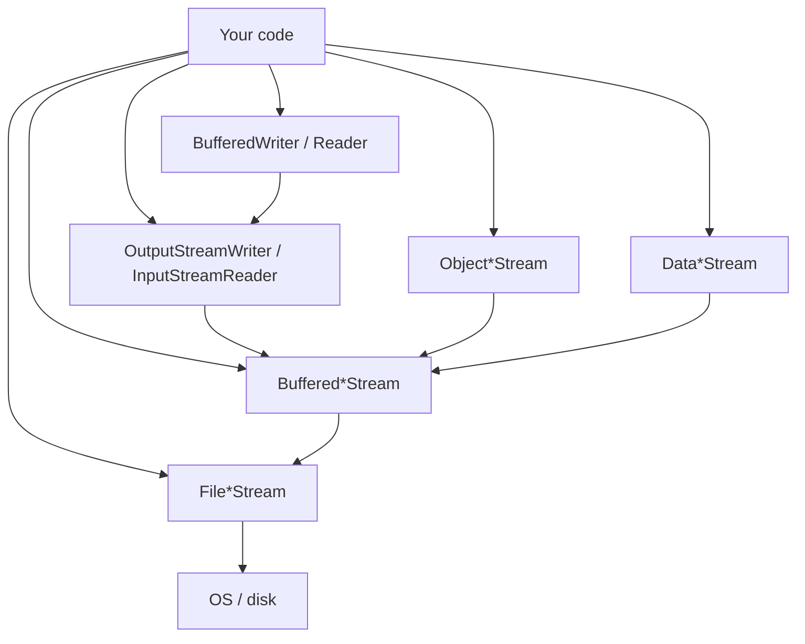

Practice: bytes, buffering, primitives, objects, UTF-8 text — each is “another flavor” on the same core.

---

### Interview questions / gotchas he highlights
- `new File(...)` does **not** open the file.
- Every bare `File*Stream` read/write ≈ syscall; buffering reduces context switches.
- Decorator: Buffered* wraps File*; still an Input/OutputStream until you switch to Reader/Writer.
- Data*: same field order on read/write; wrong order = garbage.
- `transient` / `static` not serialized.
- Multi-byte encodings need Reader/Writer + explicit charset; buffering alone ≠ decoding.
- `read()` on byte streams returns -1 at EOF; `readLine()` returns **null**.
- Prefer buffering for performance; always close (or try-with-resources).

### Quick revision
- Traditional I/O still used; NIO solves its limits (next videos).
- `File` = path helpers; streams = real I/O via OS.
- Lowest layer always bytes; everything else is decoration.
- Buffer (8192 default) → far fewer syscalls.
- Data* for primitives; Object* + `Serializable` for objects.
- Writer/Reader for charset text; BufferedReader for char buffering + `readLine()`.
- Always close streams; flush happens on close.
- Decorator pattern is the mental model for stacking wrappers.


---

<a id="lec-50"></a>

## 50. Java NIO Deep Dive (Part-1): Advantages of NIO over Traditional File I/O


[↑ Index](#index) · [Parts](#parts)


> **Video:** [Java NIO Deep Dive (Part-1): Advantages of NIO over Traditional File I/O](https://www.youtube.com/watch?v=pqEqj58bnxc)

### What this lecture covers
- NIO = New I/O; File I/O focus (Network I/O / multiplexing mentioned but not the focus)
- Traditional I/O is **not** deprecated — choose by use case
- Five advantages over streams: bidirectional, random access, double-copy fix, zero-copy, memory mapping
- Heap vs native memory; why OS won’t write straight into the Java heap
- Direct buffers + Cleaner / GC timing risk
- Kafka’s use of zero-copy (`transferTo`)
- Virtual addresses, page tables, page faults, 4KB pages — how mmap works

---

### Context `[0:00](https://www.youtube.com/watch?v=pqEqj58bnxc&t=0s)`

- Traditional file handling already covered — still common in industry.
- NIO did **not** deprecate streams; recommendation on when to use which comes at the end of the NIO series.
- Hard part of NIO is not syntax — it’s **why** it exists. This lecture is advantages/concepts; Parts 2–3 implement buffers/channels `[1:01](https://www.youtube.com/watch?v=pqEqj58bnxc&t=61s)`.

NIO improves both **File I/O** and **Network I/O**; this series focuses on **File I/O** `[2:05](https://www.youtube.com/watch?v=pqEqj58bnxc&t=125s)`.

---

### Five advantages overview `[2:35](https://www.youtube.com/watch?v=pqEqj58bnxc&t=155s)`

| # | Advantage | Traditional streams | NIO |
|---|-----------|---------------------|-----|
| 1 | Direction | Uni-directional (`FIS` / `FOS`) | Bidirectional `FileChannel` |
| 2 | Position | Sequential only | Random position / jump |
| 3 | Copying | Double copy (OS→native→heap) | Can use **direct** buffer (one copy) |
| 4 | Transfer | Data through JVM | **Zero-copy** (bypass JVM) |
| 5 | Duplicate RAM | Page cache + JVM buffer | **Memory mapping** shares page cache |

---

### 1. Bidirectional channel `[3:06](https://www.youtube.com/watch?v=pqEqj58bnxc&t=186s)`

Streams: separate objects for read vs write.

NIO: one **`FileChannel`** for both read and write.

Minor convenience, but listed as advantage #1.

---

### 2. Random access `[4:07](https://www.youtube.com/watch?v=pqEqj58bnxc&t=247s)`

`FileInputStream.read()` advances forward only — no “jump to byte 10,000”.

NIO channel: set position and start from that byte — no need to scan everything before it `[4:38](https://www.youtube.com/watch?v=pqEqj58bnxc&t=278s)`.

---

### 3. Double-copying problem `[5:09](https://www.youtube.com/watch?v=pqEqj58bnxc&t=309s)`

#### Two memory kinds `[5:40](https://www.youtube.com/watch?v=pqEqj58bnxc&t=340s)`

| Memory | Managed by | Allocation style |
|--------|------------|------------------|
| **Heap** | GC | Java objects |
| **Native (off-heap)** | Not by GC | C-style malloc / free |

#### What buffered streams do internally `[6:10](https://www.youtube.com/watch?v=pqEqj58bnxc&t=370s)`

`BufferedInputStream` buffer lives on the **heap**. Read path:

```text
1. JVM allocates temporary native buffer
2. OS writes file bytes into that native address
3. JVM copies native → heap buffer
4. Discard temporary native memory
```

**Two copies:** OS→native, native→heap `[8:16](https://www.youtube.com/watch?v=pqEqj58bnxc&t=496s)`.

#### Why not OS → heap directly? `[8:47](https://www.youtube.com/watch?v=pqEqj58bnxc&t=527s)`

Heap addresses are **not stable** under GC. Objects move (e.g. between young-gen spaces).

Race he describes:
1. OS starts writing to heap address `0x7F3A2B00`
2. GC moves the buffer to `0x8F3B9C00`
3. OS finishes writing to the **old** address → your buffer is empty / corrupt

Native memory addresses don’t move under GC → safe target for OS DMA/copy `[10:22](https://www.youtube.com/watch?v=pqEqj58bnxc&t=622s)`.

Why normal Java objects don’t “break” when GC moves them: you hold **references**, and GC updates references. OS holds a raw address, not a Java reference `[slides + lecture]`.

#### NIO control `[11:25](https://www.youtube.com/watch?v=pqEqj58bnxc&t=685s)`

You create and manage the buffer:

| API | Where buffer lives | Copies |
|-----|--------------------|--------|
| Heap buffer (`allocate`) | Heap | Still 2 (same as traditional) |
| Direct buffer (`allocateDirect`) | Native | **1** (OS → native); app reads native |

#### Who frees native memory? `[12:57](https://www.youtube.com/watch?v=pqEqj58bnxc&t=777s)`

```java
ByteBuffer directBuf = ByteBuffer.allocateDirect(1024);
```

- Native: `malloc(1024)` → address e.g. `0xC0001000`
- Heap: small `DirectByteBuffer` object holding capacity, address, **Cleaner**
- When the heap object is GC’d → Cleaner runs Deallocator → `free()` native memory `[15:29](https://www.youtube.com/watch?v=pqEqj58bnxc&t=929s)`

#### The risk — GC doesn’t see native pressure `[16:29](https://www.youtube.com/watch?v=pqEqj58bnxc&t=989s)`

Create 100 × 10 MB direct buffers → **1 GB native**, but heap objects are tiny.

Objects become unreachable → eligible for GC — but GC may **not run soon** because heap looks fine. Native memory keeps growing → OOM in native space.

**His recommendation:** when using native buffers, explicitly clean:

```java
// conceptual — he shows Cleaner.clean()
((DirectBuffer) directBuf).cleaner().clean();
```

> Note: `sun.misc.Cleaner` / `jdk.internal.ref.Cleaner` APIs are internal; modern practice uses try-with-resources patterns, arena APIs (newer JDKs), or careful lifecycle — keep his intent: **don’t rely on delayed GC for large direct buffers**.

---

### 4. Zero-copy `[20:40](https://www.youtube.com/watch?v=pqEqj58bnxc&t=1240s)`

**Use case:** read file from disk and send to a destination (e.g. network).

#### Traditional path (copies through JVM) `[21:10](https://www.youtube.com/watch?v=pqEqj58bnxc&t=1270s)`

```text
Disk → OS page cache → JVM buffer (heap/native) → socket buffer → NIC → destination
```

Copies include: disk→page cache, page cache→JVM, JVM→socket buffer.

#### NIO zero-copy `[22:42](https://www.youtube.com/watch?v=pqEqj58bnxc&t=1362s)`

**“Zero-copy” ≠ no copies at all.** It means **JVM is bypassed**.

```text
Disk → OS page cache → socket buffer → destination
         (JVM skipped)
```

API idea: `FileChannel.transferTo(...)` — tell OS to move bytes to destination channel without bringing them into your Java heap `[24:12](https://www.youtube.com/watch?v=pqEqj58bnxc&t=1452s)`.

#### Kafka `[25:12](https://www.youtube.com/watch?v=pqEqj58bnxc&t=1512s)`

Broker holds log files on disk. Consumer asks for data → broker uses zero-copy so log bytes go OS → consumer **without** loading into broker JVM. One reason Kafka is fast. Zero-copy is an **NIO/OS** feature Kafka uses — not a Kafka-only invention.

---

### 5. Memory mapping `[26:45](https://www.youtube.com/watch?v=pqEqj58bnxc&t=1605s)`

#### Traditional duplication `[26:45](https://www.youtube.com/watch?v=pqEqj58bnxc&t=1605s)`

```text
Disk → OS page cache (RAM)
         ↓ copy
       JVM heap or native buffer
```

Same file bytes live in **two** RAM places. Costs RAM + CPU for the copy.

#### Memory-mapping goal `[28:19](https://www.youtube.com/watch?v=pqEqj58bnxc&t=1699s)`

JVM should **not** keep its own copy — work against OS page cache via **virtual addressing**. Saves space and copy cycles.

API foreshadow: `FileChannel.map(...)`.

---

### Virtual memory deep dive `[30:19](https://www.youtube.com/watch?v=pqEqj58bnxc&t=1819s)`

#### Why virtual addresses exist

Processes must not write the same physical RAM blindly (clash). OS gives each process a **virtual address range** and a **page table** mapping virtual → physical.

#### Restaurant analogy `[31:53](https://www.youtube.com/watch?v=pqEqj58bnxc&t=1913s)`

Ask restaurant to reserve 100 tables “for later” → they **acknowledge** but don’t seat 100 people yet. Same as `map`: OS records a **VMA** (virtual memory area) range; **no physical pages reserved yet**.

Process receives virtual base..end and thinks “I have memory”; physically nothing is reserved until first access `[32:57](https://www.youtube.com/watch?v=pqEqj58bnxc&t=1977s)`.

#### First read → page fault path `[35:01](https://www.youtube.com/watch?v=pqEqj58bnxc&t=2101s)`

Suppose mapped file region starts at virtual base `0x7000`, app wants byte offset **256**:

```text
virtual_addr = base + 256
             = 0x7000 + 256 → 0x7100 (28928 decimal)
```

App/CPU asks MMU to resolve virtual → physical.

**OS works in pages (typically 4KB), not individual bytes** `[39:10](https://www.youtube.com/watch?v=pqEqj58bnxc&t=2350s)`.

```text
page number = offset / 4096   → 256/4096 = 0  (page 0)
```

If page table has no entry → **page fault** → OS:

1. Subtract: interested file byte = `virtual_addr - virtual_base` = 256
2. Load **whole page 0** of the file from disk into RAM (page cache)
3. Update page table: virtual page → physical base
4. MMU computes offset within page (`addr % 4096`) and returns data to CPU `[45:19](https://www.youtube.com/watch?v=pqEqj58bnxc&t=2719s)`

**No JVM heap/native file buffer** in this path — only virtual addresses on the Java side.

#### Nearby bytes hit `[47:53](https://www.youtube.com/watch?v=pqEqj58bnxc&t=2873s)`

Reading byte 257 after 256 → same virtual page → page table hit → **OS not involved again**. Traditional stream I/O involves OS more often per read; mapped access only faults on missing pages.

```mermaid
sequenceDiagram
  participant App as JVM / process
  participant CPU
  participant MMU
  participant OS
  participant Disk
  App->>CPU: read virtual addr (base+offset)
  CPU->>MMU: translate
  alt page table miss
    MMU->>OS: page fault
    OS->>Disk: load 4KB page
    OS->>MMU: update page table
  end
  MMU->>CPU: physical addr
  CPU->>App: byte data
```

---

### Mental model summary `[50:28](https://www.youtube.com/watch?v=pqEqj58bnxc&t=3028s)`

| Feature | Saves / gains |
|---------|----------------|
| Direct buffer | One less copy (skip native→heap) |
| Zero-copy | Skip JVM on file→destination transfers |
| Memory map | Skip second RAM copy; fewer OS trips after pages warm |

Implementation (buffers, channels, code) → Parts 2–3.

---

### Interview questions / gotchas he highlights
- Streams not deprecated; NIO when large files / high throughput / Kafka-like paths.
- Why OS can’t write into heap: GC moves objects; address invalid.
- Double copy path for heap buffers; single copy for direct.
- Direct buffer leak: GC sees tiny heap objects, ignores native GB — clean explicitly.
- Zero-copy = bypass JVM, not “literally zero copies”.
- Kafka uses `transferTo`-style zero-copy for consumers.
- mmap: VMA first, physical pages on fault; 4KB pages; MMU + page table.

### Quick revision
- NIO File I/O advantages: bidirectional, random access, fewer/smarter copies, zero-copy, mmap.
- Heap buffers still double-copy; `allocateDirect` = one copy, Cleaner frees native.
- Don’t allocate huge direct buffers without lifecycle discipline.
- Zero-copy: OS page cache → destination; JVM skipped (Kafka).
- Memory map: virtual address window onto file/page cache; page fault loads 4KB.
- Next: Buffer + Channel implementation.


---

<a id="lec-51"></a>

## 51. Java NIO Deep Dive (Part2): ByteBuffer, HeapByteBuffer, DirectByteBuffer, MappedByteBuffer


[↑ Index](#index) · [Parts](#parts)


> **Video:** [Java NIO Deep Dive (Part2): ByteBuffer, HeapByteBuffer, DirectByteBuffer, MappedByteBuffer](https://www.youtube.com/watch?v=wZ3b--utf1s)

### What this lecture covers
- Buffer vs Channel metaphor (highway / vehicle)
- Who creates the buffer: **you** (unlike `BufferedInputStream`)
- Abstract `Buffer` fields: `position`, `limit`, `capacity`
- `ByteBuffer` hierarchy: Heap / Direct / Mapped
- `put` / `get` / `flip` / `clear` lifecycle
- Primitives: view buffers (`asIntBuffer`) vs `putInt`/`getInt` (recommended)
- Why channel + typed views need position sync
- Absolute/index put/get as peek (no position change)
- Tease: NIO.2 abstracts this; learn NIO.1 fundamentals first

---

### Prerequisite `[0:00](https://www.youtube.com/watch?v=wZ3b--utf1s&t=0s)`

Watch Part 1 first (advantages, double copy, zero-copy, mmap). This lecture is **implementation**: Buffer (+ Channel intro).

---

### Buffer and Channel — definitions `[1:04](https://www.youtube.com/watch?v=wZ3b--utf1s&t=64s)`

Analogy: **two-way highway** + **vehicles**.

| Concept | Role |
|---------|------|
| **Channel** | Medium connecting app ↔ OS (replacement for File streams) |
| **Buffer** | Vehicle that **carries** the data |

In NIO File I/O, data **always** flows in buffers — not “byte by byte” as the primary model.

Critical difference from traditional buffering `[2:06](https://www.youtube.com/watch?v=wZ3b--utf1s&t=126s)`:
- `BufferedInputStream`: framework creates/manages the buffer.
- NIO: **you** create and manage the buffer → more control (and more responsibility).

#### Write flow `[3:07](https://www.youtube.com/watch?v=wZ3b--utf1s&t=187s)`

```text
App fills Buffer → Channel drains Buffer → OS → disk
```

#### Read flow `[3:38](https://www.youtube.com/watch?v=wZ3b--utf1s&t=218s)`

```text
App passes empty Buffer → Channel asks OS → OS fills via Channel → App drains Buffer
```

---

### Buffer class hierarchy `[5:44](https://www.youtube.com/watch?v=wZ3b--utf1s&t=344s)`

```text
Buffer (abstract)          ← position, limit, capacity
  └── ByteBuffer (abstract)
        ├── HeapByteBuffer      ← allocate()
        ├── DirectByteBuffer    ← allocateDirect()
        └── MappedByteBuffer    ← FileChannel.map()  (reference to OS page cache)
```

Also exist: `IntBuffer`, `CharBuffer`, `LongBuffer`, … — treated as **views/lenses** over bytes; channels talk **only** to `ByteBuffer` `[23:07](https://www.youtube.com/watch?v=wZ3b--utf1s&t=1387s)`.

| Type | Memory | Notes from Part 1 |
|------|--------|-------------------|
| Heap | JVM heap | Double copy with OS |
| Direct | Native | Single copy; Cleaner risk |
| Mapped | No app buffer copy — window on **page cache** | Via virtual addresses |

```java
ByteBuffer.allocate(64);       // HeapByteBuffer, 64 bytes
ByteBuffer.allocateDirect(64); // DirectByteBuffer in native memory
// Mapped: channel.map(...) — covered in Part 3
```

---

### The three pointers `[9:46](https://www.youtube.com/watch?v=wZ3b--utf1s&t=586s)`

Think of the buffer as a byte array with three markers:

| Field | Meaning |
|-------|---------|
| **capacity** | Total size; fixed after creation |
| **position** | Index of next read **or** write |
| **limit** | Exclusive boundary — cannot read/write at or beyond limit |

Invariant:

```text
0 ≤ position ≤ limit ≤ capacity
```

Example capacity 5, limit set mid-way → only indices `< limit` are valid `[11:18](https://www.youtube.com/watch?v=wZ3b--utf1s&t=678s)`.

---

### Write then read — `put`, `flip`, `get`, `clear` `[12:18](https://www.youtube.com/watch?v=wZ3b--utf1s&t=738s)`

```java
ByteBuffer buff = ByteBuffer.allocate(6);
// pos=0, lim=6, cap=6
```

```text
[ _ _ _ _ _ _ ]
  ^pos        ^lim=cap
```

```java
buff.put((byte) 10);
buff.put((byte) 20);
buff.put((byte) 30);
// pos=3, lim=6, cap=6
```

```text
[ 10 20 30 _ _ _ ]
         ^pos
```

If you `get()` now without flipping → you read from index 3 → **garbage** `[14:50](https://www.youtube.com/watch?v=wZ3b--utf1s&t=890s)`.

#### `flip()` — prepare for reading `[15:21](https://www.youtube.com/watch?v=wZ3b--utf1s&t=921s)`

Switches write mode → read mode:

```text
limit = position   // don’t read past written data
position = 0       // start from beginning
// capacity unchanged
```

```java
buff.flip();
// pos=0, lim=3, cap=6
buff.get(); // 10
buff.get(); // 20
buff.get(); // 30
// pos == lim → no more reads
```

Many people call `flip()` without knowing why — it’s updating these pointers `[17:23](https://www.youtube.com/watch?v=wZ3b--utf1s&t=1043s)`.

#### `clear()` — reuse for writing `[18:30](https://www.youtube.com/watch?v=wZ3b--utf1s&t=1110s)`

```java
buff.clear();
// pos=0, lim=cap, cap=cap
```

Does **not** wipe bytes — next `put`s overwrite. Back to write mode.

> Note: PDF also mentions `rewind()` — resets `position` to 0 only (keeps limit); useful to re-read. `flip()` sets both limit and position.

---

### Primitives in a ByteBuffer `[20:01](https://www.youtube.com/watch?v=wZ3b--utf1s&t=1201s)`

`int` = 4 bytes, `long` = 8, etc. Manually packing/unpacking is the same pain Data*Streams solved in traditional I/O.

Channel only accepts **`ByteBuffer`**, not `IntBuffer` `[23:07](https://www.youtube.com/watch?v=wZ3b--utf1s&t=1387s)`. Typed buffers = **lenses** over the same bytes:

```java
ByteBuffer bb = ByteBuffer.allocate(100);
IntBuffer ib = bb.asIntBuffer();   // same memory, groups of 4
CharBuffer cb = bb.asCharBuffer(); // groups of 2
LongBuffer lb = bb.asLongBuffer(); // groups of 8
// also: asShortBuffer, asFloatBuffer, asDoubleBuffer
```

---

### Approach 1 — typed view (`asIntBuffer`) `[25:09](https://www.youtube.com/watch?v=wZ3b--utf1s&t=1509s)`

```java
ByteBuffer bb = ByteBuffer.allocate(100);
IntBuffer ib = bb.asIntBuffer();
ib.put(65);
ib.flip();
int val = ib.get(); // 65
```

Same underlying bytes; **different** position/limit/capacity objects `[28:46](https://www.youtube.com/watch?v=wZ3b--utf1s&t=1726s)`:

| | ByteBuffer | IntBuffer (view) |
|--|------------|------------------|
| Memory | shared 100 bytes | same |
| capacity/limit | 100 | 25 (100/4) |
| position after `ib.put(65)` | still 0 | advanced (element-wise) |

#### Channel bug if you forget to sync `[31:22](https://www.youtube.com/watch?v=wZ3b--utf1s&t=1882s)`

Channel drains a **ByteBuffer** in **read mode**:

```java
ib.put(65);          // ib.position advanced; bb.position still 0
bb.flip();           // lim = bb.pos = 0 → channel reads NOTHING
```

Correct pattern before handing to channel `[36:59](https://www.youtube.com/watch?v=wZ3b--utf1s&t=2219s)`:

```java
bb.position(ib.position() * Integer.BYTES); // or * 4
bb.flip();
channel.write(bb);
```

This mismatch is easy to miss and causes empty writes — he marks Approach 1 as **less preferred**.

---

### Approach 2 — preferred: `putInt` / `getInt` on ByteBuffer `[39:00](https://www.youtube.com/watch?v=wZ3b--utf1s&t=2340s)`

No separate view object. ByteBuffer encodes/decodes itself; **one** position updates.

```java
ByteBuffer bb = ByteBuffer.allocate(100);
bb.putInt(65);
bb.putShort((short) 100);
bb.putLong(100L);
bb.putChar('A');
bb.putFloat(10.5f);
bb.putDouble(10.5);

bb.flip();
int v = bb.getInt();
```

Industry-friendly: flip works directly on `bb` before `channel.write(bb)`.

---

### Random access at buffer level `[41:02](https://www.youtube.com/watch?v=wZ3b--utf1s&t=2462s)`

Two levels of “random”:
1. **Buffer-level** (this lecture): absolute index in the buffer
2. **Channel-level** (Part 3): position in the **file**

Absolute API **bypasses** position/limit updates `[42:04](https://www.youtube.com/watch?v=wZ3b--utf1s&t=2524s)`:

```java
ByteBuffer bb = ByteBuffer.allocate(16);
bb.putInt(0, 100);
bb.putInt(4, 200);
bb.putInt(8, 300);

int a = bb.getInt(0); // 100
int b = bb.getInt(4); // 200
// no flip needed — position untouched
```

#### Real-world use: peek `[43:39](https://www.youtube.com/watch?v=wZ3b--utf1s&t=2619s)`

| Call | Effect |
|------|--------|
| `bb.getInt()` | return value **and** advance position |
| `bb.getInt(index)` | return value; **position unchanged** → peek |

Peek → validate → then relative `get` to consume. Rare in his experience, but useful.

---

### Closing thoughts `[45:42](https://www.youtube.com/watch?v=wZ3b--utf1s&t=2742s)`

Managing buffers is more work than stream wrappers — that’s the power of NIO.1. **NIO.2** adds cleaner abstractions but sits on the same fundamentals; don’t skip this layer.

Next (Part 3): **FileChannel** + full code (write/read/random/both, zero-copy, mmap, charset).

---

### Interview questions / gotchas he highlights
- You manage the buffer; channel moves data to/from OS.
- Explain `flip`: `limit=position; position=0` before reading.
- `clear` does not erase data — resets pointers for rewrite.
- Channel accepts **only** `ByteBuffer` in the mode it needs (drain = read mode for writes to disk).
- `asIntBuffer` shares memory but **not** markers — sync `bb.position` before `bb.flip()` / channel.
- Prefer `putInt`/`getInt` on ByteBuffer.
- Absolute get = peek; relative get = consume.
- Heap vs Direct vs Mapped (from Part 1).

### Quick revision
- Channel = pipe; Buffer = cargo; always buffer-based in NIO file I/O.
- Markers: position / limit / capacity; `position ≤ limit ≤ capacity`.
- Write with `put` → `flip` → `get` (or hand to channel) → `clear` to reuse.
- Typed views = lenses; sync ByteBuffer position before channel.
- Prefer ByteBuffer’s `putX`/`getX` for primitives.
- Index put/get bypass position (peek/validate).
- Part 3: FileChannel end-to-end.


---

<a id="lec-52"></a>

## 52. Java NIO Deep Dive (Part3): FileChannel and Complete Code Examples


[↑ Index](#index) · [Parts](#parts)


> **Video:** [Java NIO Deep Dive (Part3): FileChannel and Complete Code Examples](https://www.youtube.com/watch?v=vocQoMkHJ78)

### What this lecture covers
- One class for file I/O: **`FileChannel`** (vs many stream classes)
- Basics: write-only, read-only, random read (channel + buffer), read+write with primitives
- Advanced: `transferTo` (zero-copy), `map` (memory mapping), manual charset encode/decode
- `compact()` vs `clear()` when decoding multi-byte chars across reads
- When to prefer traditional streams vs NIO
- NIO.2 as abstraction over these fundamentals

---

### Channel after Buffer `[0:00](https://www.youtube.com/watch?v=vocQoMkHJ78&t=0s)`

Parts 1–2 done → channel is straightforward. Traditional I/O has many classes (`FileInputStream`, `Buffered*`, `FileReader`, …). NIO file I/O centers on **one**: `FileChannel` — read and write `[0:31](https://www.youtube.com/watch?v=vocQoMkHJ78&t=31s)`.

**Basics demos:** write-only, read-only, random read, read+write + primitives.
**Advanced:** zero-copy (`transferTo`), memory mapping, character encoding.
Kafka uses zero-copy — NIO feature, not Kafka magic `[1:01](https://www.youtube.com/watch?v=vocQoMkHJ78&t=61s)`.

---

### Use case 1 — write-only channel `[1:31](https://www.youtube.com/watch?v=vocQoMkHJ78&t=91s)`

```java
Path filePath = Path.of("nio_demo_usecase1.txt");
FileChannel writeChannel = FileChannel.open(
    filePath,
    StandardOpenOption.WRITE,
    StandardOpenOption.CREATE,
    StandardOpenOption.TRUNCATE_EXISTING);

String text = "Hello All, how are you!";
ByteBuffer writeBuf = ByteBuffer.allocate(text.length());
writeBuf.put(text.getBytes());
writeBuf.flip();                 // channel must READ the buffer
writeChannel.write(writeBuf);
writeChannel.close();
```

Open options meaning `[2:02](https://www.youtube.com/watch?v=vocQoMkHJ78&t=122s)`:
- `WRITE` — write permission
- `CREATE` — create if missing
- `TRUNCATE_EXISTING` — empty if exists

Flow: app fills buffer → `flip` → channel drains → OS → disk `[3:07](https://www.youtube.com/watch?v=vocQoMkHJ78&t=187s)`.

---

### Use case 2 — read-only channel `[5:41](https://www.youtube.com/watch?v=vocQoMkHJ78&t=341s)`

```java
FileChannel readChannel = FileChannel.open(filePath, StandardOpenOption.READ);
ByteBuffer readBuf = ByteBuffer.allocate(100);

while (readChannel.read(readBuf) != -1) {
    readBuf.flip();                      // app drains buffer
    while (readBuf.hasRemaining()) {
        System.out.print((char) readBuf.get());
    }
    readBuf.clear();                     // prepare for next fill
}
readChannel.close();
```

Why the loop `[7:44](https://www.youtube.com/watch?v=vocQoMkHJ78&t=464s)`: file may be larger than buffer (e.g. 500 bytes, buffer 100). Channel keeps a **file position** automatically — next `read` continues where left off. EOF → `-1`.

Per iteration:
1. Pass empty buffer → channel fills from OS
2. `flip` → app reads
3. `clear` → ready to fill again

---

### Use case 3 — random read (channel + buffer) `[11:18](https://www.youtube.com/watch?v=vocQoMkHJ78&t=678s)`

Part 2 covered **buffer-level** absolute get. Here: **channel-level** position = cursor in the **file**.

```java
FileChannel randomReadChannel = FileChannel.open(filePath, StandardOpenOption.READ);
randomReadChannel.position(16);          // jump to byte 16 in the file

ByteBuffer randomReadBuf = ByteBuffer.allocate(11);
randomReadChannel.read(randomReadBuf);   // fills from file offset 16
randomReadBuf.flip();

System.out.println((char) randomReadBuf.get(0));  // buffer-level absolute
System.out.println((char) randomReadBuf.get(9));
```

Demo story `[14:21](https://www.youtube.com/watch?v=vocQoMkHJ78&t=861s)`: text starting at index 16 → `"RE YOU!..."`-style slice; `get(0)` and `get(9)` pick characters inside that window without moving buffer position.

Two layers of randomness:
| Level | What you set |
|-------|----------------|
| Channel | Where in the **file** to start |
| Buffer | Which index inside the **filled buffer** to peek |

---

### Use case 4 — same channel for read and write + primitives `[15:23](https://www.youtube.com/watch?v=vocQoMkHJ78&t=923s)`

```java
FileChannel both = FileChannel.open(
    filePath,
    StandardOpenOption.READ,
    StandardOpenOption.WRITE,
    StandardOpenOption.CREATE,
    StandardOpenOption.TRUNCATE_EXISTING);

ByteBuffer buffWrite = ByteBuffer.allocate(32);
buffWrite.putInt(100);      // 4 bytes — ByteBuffer encodes
buffWrite.putChar('A');     // 2 bytes
buffWrite.put("1".getBytes());
buffWrite.flip();
both.write(buffWrite);

// CRITICAL: reset channel cursor before reading from start
both.position(0);

ByteBuffer buffRead = ByteBuffer.allocate(32);
both.read(buffRead);
buffRead.flip();
System.out.println(buffRead.getInt());   // 100
System.out.println(buffRead.getChar());  // A
System.out.println((char) buffRead.get());
both.close();
```

After writing, channel position has advanced. Before reading from the beginning, **always** `channel.position(0)` (or set the offset you want) `[17:28](https://www.youtube.com/watch?v=vocQoMkHJ78&t=1048s)`.

Uses Approach 2 from Part 2 (`putInt` / `getInt`) — preferred over typed views.

---

### Advanced 1 — `transferTo` (zero-copy) `[20:03](https://www.youtube.com/watch?v=vocQoMkHJ78&t=1203s)`

Recall Part 1: without zero-copy, app reads source into JVM buffer then writes destination — extra copies through the JVM.

#### Without zero-copy `[22:34](https://www.youtube.com/watch?v=vocQoMkHJ78&t=1354s)`

```java
FileChannel src = FileChannel.open(sourcePath, StandardOpenOption.READ);
FileChannel dst = FileChannel.open(destPath,
    StandardOpenOption.WRITE, StandardOpenOption.CREATE, StandardOpenOption.TRUNCATE_EXISTING);

ByteBuffer buf = ByteBuffer.allocate(8192);
while (src.read(buf) != -1) {
    buf.flip();
    while (buf.hasRemaining()) {
        dst.write(buf);
    }
    buf.clear();
}
```

Data path: disk → OS → JVM buffer → OS → destination.

#### With zero-copy `[24:37](https://www.youtube.com/watch?v=vocQoMkHJ78&t=1477s)`

```java
long size = srcChannel.size();
long transferred = srcChannel.transferTo(0, size, dstChannel);
// from position 0, this many bytes, to destination channel
// JVM bypassed — OS moves data
```

No flip/loop/buffer management for the transfer itself — you issue a command to the OS. Kafka broker → consumer uses this idea `[22:34](https://www.youtube.com/watch?v=vocQoMkHJ78&t=1354s)`.

---

### Advanced 2 — memory mapping `[26:13](https://www.youtube.com/watch?v=vocQoMkHJ78&t=1573s)`

App perspective of Part 1’s mmap story.

```java
Path mapFile = Path.of("mmap_demo.txt");
FileChannel ch = FileChannel.open(mapFile,
    StandardOpenOption.READ, StandardOpenOption.WRITE);

// Request mapping: file bytes [0, size) → virtual address range
// OS: VMA entry only — no physical pages yet
MappedByteBuffer mmap = ch.map(FileChannel.MapMode.READ_WRITE, 0, ch.size());
// Can map a window only: e.g. map(mode, 51, 20) for bytes 51..70
```

#### Read like an array `[33:21](https://www.youtube.com/watch?v=vocQoMkHJ78&t=2001s)`

```java
for (int i = 0; i < mmap.limit(); i++) {
    System.out.print((char) mmap.get(i));
}
```

First `get(0)` may **page-fault** → OS loads page into RAM, updates page table (Part 1). After that, nearby accesses often hit. Channel used mainly for the **map** command; subsequent access is via the `MappedByteBuffer` `[34:22](https://www.youtube.com/watch?v=vocQoMkHJ78&t=2062s)`.

#### Write + force `[36:27](https://www.youtube.com/watch?v=vocQoMkHJ78&t=2187s)`

Writes update **OS page cache**, not disk immediately. Disk may lag until OS flushes dirty pages.

```java
mmap.put(0, (byte) 'a');
mmap.put(1, (byte) 'b');
mmap.put(2, (byte) 'c');
mmap.force(); // flush page cache → disk now
```

Always `force()` when durability matters after mmap writes.

---

### Advanced 3 — character encoding / decoding `[38:32](https://www.youtube.com/watch?v=vocQoMkHJ78&t=2312s)`

Traditional I/O: `BufferedReader`/`Writer` hide charset. NIO.1: **manual** encode/decode — more control (e.g. channel position), more boilerplate. NIO.2 abstracts much of this `[39:03](https://www.youtube.com/watch?v=vocQoMkHJ78&t=2343s)`.

UTF-8: `$` can be **3 bytes**; UTF-16: **2 bytes** — decoder must know the charset `[41:08](https://www.youtube.com/watch?v=vocQoMkHJ78&t=2468s)`.

#### Write with encode `[40:36](https://www.youtube.com/watch?v=vocQoMkHJ78&t=2436s)`

```java
FileChannel ch = FileChannel.open(file,
    StandardOpenOption.READ, StandardOpenOption.WRITE,
    StandardOpenOption.CREATE, StandardOpenOption.TRUNCATE_EXISTING);

ByteBuffer bb = StandardCharsets.UTF_8.encode("Price: 100$");
// encode() produces a ByteBuffer ready for reading (position at start)
ch.write(bb);
```

If you built the buffer yourself with `put`, you’d still `flip` before `write` `[43:47](https://www.youtube.com/watch?v=vocQoMkHJ78&t=2627s)`.

#### Read with decode + `compact` `[44:17](https://www.youtube.com/watch?v=vocQoMkHJ78&t=2657s)`

```java
ch.position(0);
CharsetDecoder decoder = StandardCharsets.UTF_8.newDecoder();
ByteBuffer byteBuf = ByteBuffer.allocate(3);
CharBuffer charBuf = CharBuffer.allocate(6);

while (ch.read(byteBuf) != -1) {
    byteBuf.flip();
    decoder.decode(byteBuf, charBuf, false);
    charBuf.flip();
    System.out.print(charBuf);
    charBuf.clear();
    byteBuf.compact(); // NOT clear — keep unprocessed bytes
}
```

#### Why `compact()` not `clear()` `[46:20](https://www.youtube.com/watch?v=vocQoMkHJ78&t=2780s)`

Multi-byte characters may **span** read boundaries. Example: buffer size 4, UTF-8 char needs 3 bytes — after decoding one char, **1 leftover byte** is incomplete.

- `clear()` → resets position to 0, limit to capacity → **loses** that leftover.
- `compact()` → moves unread bytes to the front, sets position after them, limit = capacity → next `read` appends after leftovers so the next decode can complete the character.

```text
Before compact (after partial decode):
[ byteA byteB leftover _ _ ]
                ^pos

After compact:
[ leftover _ _ _ _ ]
          ^pos      ^lim=cap
```

This is a major NIO.1 encoding gotcha; NIO.2 reduces how often you touch this `[48:54](https://www.youtube.com/watch?v=vocQoMkHJ78&t=2934s)`.

---

### When traditional vs NIO `[49:24](https://www.youtube.com/watch?v=vocQoMkHJ78&t=2964s)`

| Prefer traditional streams | Prefer NIO |
|----------------------------|------------|
| Small files | Large files, Kafka-like pipelines |
| Occasional file use | High-frequency / file-intensive I/O |
| Simple text with Readers | Need speed, zero-copy, mmap, random access |

NIO.2 is mostly **abstraction** over NIO.1; solid Part 1–3 understanding makes NIO.2 easy `[50:26](https://www.youtube.com/watch?v=vocQoMkHJ78&t=3026s)`.

---

### End-to-end write/read diagram

```mermaid
flowchart LR
  subgraph write
    A[App put into ByteBuffer] --> B[flip]
    B --> C[FileChannel.write]
    C --> D[OS / disk]
  end
  subgraph read
    E[Empty ByteBuffer] --> F[FileChannel.read]
    F --> G[OS fills buffer]
    G --> H[flip]
    H --> I[App get / decode]
    I --> J[clear or compact]
  end
```

---

### Interview questions / gotchas he highlights
- One `FileChannel` replaces many stream classes for file bytes.
- Always `flip` before channel drains a buffer you filled; `clear` before refill.
- Channel maintains file position; reset to 0 when reusing same channel for read-after-write.
- `transferTo` = zero-copy path Kafka uses.
- mmap writes hit page cache — call `force()` for durability.
- Charset encode/decode is manual in NIO.1; use `compact` when leftovers span reads.
- Small/simple files → traditional; big/hot paths → NIO.

### Quick revision
- Open with `FileChannel.open(path, options...)`.
- Write: allocate → put → flip → `channel.write`.
- Read loop: `read` until -1 → flip → drain → clear.
- Random: `channel.position(n)` + optional absolute buffer get.
- Same channel R/W: set `position(0)` before read-from-start.
- Zero-copy: `src.transferTo(0, size, dst)`.
- Map: `channel.map(mode, pos, size)` → array-like access; `force()` after writes.
- Encoding: `Charset.encode` / `CharsetDecoder`; prefer `compact` over `clear` mid-decode.
- NIO.2 later = cleaner API on same ideas.


